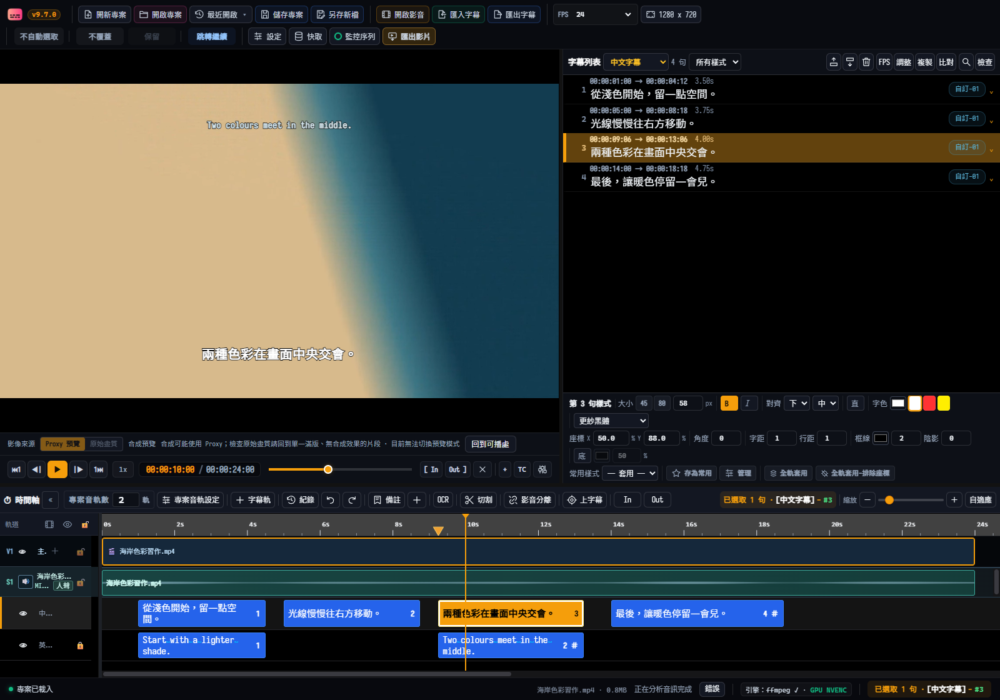

# SUB Tool

在同一條時間軸排列字幕、影片、圖片與音訊，逐格打點、校稿、混音，最後交付字幕檔或燒錄字幕的影片。

**[下載 Windows 安裝版](https://github.com/evanwayc-star/SUB_Tool/releases/latest)** · [使用說明](docs/使用說明.md) · [版本紀錄](docs/版本變更紀錄.md)



## 開始使用

1. 在 Windows 10／11 x64 安裝最新 Release 的 Setup。開啟 SUB Tool，按「開啟影音」選素材，再按 `Ctrl+S` 儲存 `.subtool` 專案。備份時請一併保留母素材。
2. 選字幕軌，移到句首。在沒有選取字幕時按 `I` 新增一句，播放到句尾再按 `O`。雙擊列表輸入文字，按 `Enter` 完成。用 `←`／`→` 逐格檢查。[打點步驟](docs/使用說明.md#3-五分鐘完成第一條字幕)
3. 按「匯出字幕」交付字幕檔。要輸出影片或音訊，在桌面版使用「匯出影片」，逐份設定格式、聲道與字幕。[交付設定](docs/使用說明.md#影片與音訊交付)

已有逐行校對稿時，用「文本匹配」為每行對齊時間。要從錄音建立初稿，選「語音辨識」。對白、譯文與畫面字卡可分軌校對。[語音辨識與文本匹配](docs/使用說明.md#8-語音辨識與文本匹配)

## 平台與開發

| 平台 | 如何執行 |
|---|---|
| Windows 桌面版 | Setup 內含 ffmpeg、ffprobe 與 mpv，支援長片、多聲道及正式影音交付。 |
| 網頁版 | 適用於瀏覽器可解碼的素材，可編輯時間軸與匯出字幕。開發環境執行 `npm run dev`。 |
| Apple Silicon | arm64 DMG／ZIP 供本機 unsigned 測試。[Mac 建置與驗收](docs/開發與驗證.md#apple-silicon-本機測試版) |

從原始碼啟動桌面版，在專案根目錄執行：

```bash
npm ci
npm run electron
```

桌面熱更新需先啟動 `npm run dev`，再於另一個終端執行 `npm run electron:dev`。[環境與指令](docs/開發與驗證.md#1-指令)

## 文件導覽

| 工作 | 從這裡讀 |
|---|---|
| 操作與交付 | [使用說明](docs/使用說明.md) · [快捷鍵](docs/使用說明.md#11-常用快捷鍵) · [波形與 Proxy](docs/使用說明.md#proxy取消與換專案) |
| 擷取影片畫面文字 | [辨識畫面文字及首次設定](docs/使用說明.md#辨識畫面文字) |
| Agent 接手專案 | [AGENTS.md](AGENTS.md) · [Issue 工作流程](docs/agents/issue-tracker.md) · [分流標籤](docs/agents/triage-labels.md) · [領域文件設定](docs/agents/domain.md) |
| 查指令、驗收、打包、發版 | [開發與驗證](docs/開發與驗證.md) |
| 修改 renderer、主行程或跨行程規則 | [架構與鐵律](docs/技術架構說明.md) · [Electron 維護](docs/Electron_維護手冊.md) · [shared 加入條件](shared/README.md) |
| 修改 FPS、seek、逐格、倒帶或時碼 | [FPS／時碼一致性](docs/FPS_時碼一致性.md) |
| 查用語、設計理由、版本證據 | [領域詞彙](CONTEXT.md) · [架構決策](docs/adr/) · [版本紀錄](docs/版本變更紀錄.md) |
| 查技術評估與來源 | [語音辨識引擎](docs/research/語音辨識引擎改善評估.md) · [人聲波形模型](docs/research/人聲波形模型研究.md) |

授權：ISC。
