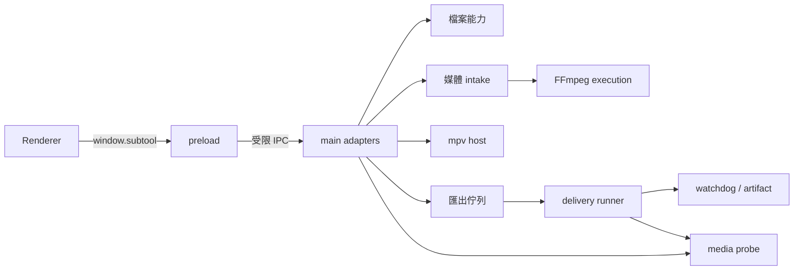

# SUB Tool Electron 維護手冊

本文件說明桌面邊界、可呼叫 IPC、原生程序及故障排查。開發與發布步驟見[開發與驗證](開發與驗證.md)；renderer 資料流見[技術架構說明](技術架構說明.md)，時間契約見 [FPS／時碼一致性](FPS_時碼一致性.md)。

## 1. 系統總覽

先找到持有資料及生命週期的 owner，再修改 adapter。`main.js` 負責組裝，不重寫已由其他模組擁有的規則。

| Owner | 責任 |
|---|---|
| `main.js` | 視窗、IPC 註冊、平台設定及 owner 組裝 |
| `preload.js` | 主頁面 contextBridge 及部分型別／大小檢查 |
| `queue-preload.js`、`compare-preload.js` | 各獨立視窗的最小 bridge |
| `local-resource.js` | 不透明本機資源 URL 與應用頁導航限制 |
| `file-authority.js`、`ipc-guards.js` | 精確檔案能力及主程序准入 |
| `project-file-authority-engine.js` | 可信專案讀寫、媒體能力、最近清單及重連 |
| `settings-file.js` | 設定與快捷鍵的原子讀改寫 |
| `directory-output.js`、`style-directory-import.js` | 所選目錄的安全輸出／樣式讀取 |
| `screenshot-output.js` | 截圖路徑 reservation、寫入、發布及退出收尾 |
| `media-probe.js` | metadata、音訊及 bitrate 探測、並行與 close 屏障 |
| `mother-source-evidence.js` | 本機 stat／內容取樣證據與跨電腦完整內容證據 |
| `media-intake-runtime.js` | Proxy／音訊／波形快取、串流及 intake coordinator |
| `media-source-clock.js` | FFmpeg seek 捨入及音訊 PTS filter；純原點映射使用 shared |
| `clip-frame-cache.js`、`clip-audio-cache.js` | 固定畫面 PNG、反向片段 WAV 的私有 staging 及完整性 |
| `ffmpeg-execution-engine.js` | 工具解析、encoder、stderr 解析及程序執行 |
| `audio-normalization-runtime.js` | 聲量量測、平衡階段及原生取消 |
| `vocal-waveform-runtime.js` | 人聲分析的受限 PCM 讀取與逐 sender 取消 |
| `vocal-waveform-fingerprint.js` | 人聲波形來源指紋的 namespace adapter |
| `speech-audio-compressor.js` | 辨識 WAV 的受限壓縮及取消 |
| `mpv-host.js` | Windows mpv、named pipe、視窗及呈現證據 |
| `compare-window.js` | 比較視窗身分、快照及 revision |
| `export-queue.js`、`queue-store.js` | 排程、狀態、journal、歷史及復原 |
| `delivery-runner.js`、`export-plan.js` | 交付准入／probe 與純交付計畫 |
| `export-watchdog.js`、`export-lease.js` | 原生 owner、停止、跨程序輸出 lease 及最終裁定 |
| `export-artifact.js` | 成品準備、封裝、驗證、發布及私有素材清理 |
| `airline-*`、`mod-fhd-transport.js`、`disc-*` | 各交付格式的規格、封裝或結構驗證 |

## 2. 安全與檔案能力

主視窗使用 `contextIsolation:true`、`nodeIntegration:false`、`webSecurity:true`。Preload 只暴露指定能力，不暴露 `ipcRenderer` 或任意 Node 呼叫。部分入口在 preload 檢查型別，主程序仍須自行驗證輸入與能力；不能假設每個 bridge 都已做完整驗證。

### 拖放

Preload 以 `webUtils.getPathForFile()` 從真正的 File 取得路徑。一般媒體送 `fs:authorizeDroppedFile` 授予精確來源能力；`.subtool`／`.json` 走可信專案開啟入口，不使用一般拖放授權。Renderer 提供的 path 或 base64 不能擴張能力。

樣式資料夾匯入只讀所選根目錄內的 JSON，不追 junction／symlink，回傳內容而不授予整目錄讀取權。單檔字幕／XLSX 與目錄批次輸出共用 `directory-output.js`：同時檢查相對名稱與實體父目錄，在所選根內以 `wx` 建私有暫存檔；完成 write／sync／close 後重核身分，再 rename 替換。合法空檔仍可發布，寫入失敗則保留原檔。遇既有 hardlink 只替換該檔名，不能截斷其他位置共用的檔案。批次若有項目被略過，回報實際寫入及略過數，已成功的檔案保留，不能宣稱整批完成。

### 專案

可信 bytes 先由 main 讀取，再衍生專案宣告媒體的能力。原生選檔、最近清單、啟動參數與 OS 開檔共用 `projectWorkspace.open()` 的較新請求優先規則；過期讀取不得再授權、寫最近清單或交給 renderer。

Save As 的媒體路徑必須已有讀權。`createAtomicProjectWriter()` 同時持有目錄準備、私有暫存及發布；main 不先以遞迴 mkdir 準備 renderer 傳入的路徑。所選根目錄可以是掛載／連結位置，`.subtool_AutoSave` 及其子目錄則逐層核對實體目錄與 dev／ino，不沿連結寫到其他位置。暫存放在所選實體根，完成 write／sync／close 後重核目錄、目標與暫存身分，才 rename；失敗只清本次仍持有的暫存，保留原檔及替換進來的資料。

路徑准入依呼叫順序非同步定位，再以實體父目錄與檔名排同目標 FIFO；別名與原路徑不能讓較舊內容晚到覆蓋。不同已准入目標仍可並行寫入。最後少量 metadata 核對、rename 及清理沒有 JavaScript await 缺口，內容寫入仍非同步；這是多次檔案系統呼叫的身分核對，不是 OS 級目錄 handle 的原子沙箱。成功才更新目前專案、重連與近期清單。最近項目以穩定 token 開啟，清單重排不改變原點選目標；清除後 token 失效。重連只接受同名一般檔案，不把目錄當媒體。

### 本機資源 URL

一般媒體與字型使用 `subtool-local:` capability URL。隨機 token 對應精確檔案；每次讀取仍核對 token、目前 `canExposeFileURL()`、方法、一般檔案及 Range。token 不是整目錄或永久授權，不以關閉 `webSecurity` 解決載入問題。

需要 Web Audio 或 canvas 讀取的元素，須在指派 `src` 前設定匿名 CORS，程式載入共用 `setMediaElementSource()`；圖片疊層 markup 同樣帶 `crossorigin="anonymous"`。這包含固定畫面、截圖另外載入的圖片及 WebCodecs 圖片合成。協定已有允許來源標頭仍不足以補救已用無 CORS 模式載入的元素；驗收須讀實際像素及截圖內容。

主頁面、佇列及比較視窗由 `protectApplicationWindow()` 限制在自己的 HTML；明確 `--dev` 才允許主頁面的指定開發 origin／pathname。其他導航、重新導向及子視窗受阻擋，允許的外部 HTTP(S) 連結交給系統瀏覽器。

### 設定檔持久化

`settings-file.js` 分別持有 settings.json 與 key.json。更新先寫相鄰暫存檔，再 rename；解析失敗須先保存 `.corrupt-*` 原始 bytes，無法備份就拒絕覆寫。失敗須傳回 caller，不能把 false 視為保存成功。設定位置與驗收隔離方式見[CDP 流程](開發與驗證.md#3-真機驗證cdp)。

## 3. Preload／IPC 介面

以下逐條對應目前三份 preload。一般呼叫是 `invoke`／Promise；標為「事件」者是 main→renderer 訂閱，標為 `send` 者沒有 invoke 回覆。新增通道須同步更新 main 的准入、preload、契約／安全測試及本表。

### 主頁面：檔案、專案與應用

API 前綴皆為 `window.subtool`。`isDesktop` 是值；`getFilePath(file)` 只呼叫 `webUtils`，不走 IPC。

| API | 通道 | 輸入或用途 |
|---|---|---|
| `status()` | `app:status` | 平台、架構、工具偵測與實際 encoder |
| `authorizeDroppedFile(file)` | `fs:authorizeDroppedFile` | preload 自真實 File 取得路徑 |
| `openDroppedProject(file)` | `project:openDroppedFile` | 真實專案 File 的可信開啟 |
| `fileURL(path)` | `fs:fileURL` | 取得受控資源 URL |
| `stat(path)` | `fs:stat` | 已授權路徑資訊 |
| `listDir(path)` | `fs:listDir` | 受控目錄列舉 |
| `findRelinkTarget(projectPath, oldMediaPath)` | `fs:findRelinkTarget` | 原專案的重連搜尋 |
| `showSourceInFolder(path)` | `app:showSourceInFolder` | 定位已授權來源 |
| `fontsList()` | `fonts:list` | 字型清單與內容 |
| `openMedia()` | `dialog:openMedia` | 原生媒體選檔 |
| `openAudio()` | `dialog:openAudio` | 原生音訊選檔 |
| `openProject()` | `dialog:openProject` | 原生專案開啟 |
| `recentProjects()` | `project:recentList` | 最近項目 token 清單 |
| `openRecentProject(token)` | `project:openRecent` | 解析可信 token |
| `clearRecentProjects()` | `project:clearRecent` | 清除最近清單 |
| `saveProject(name, b64)` | `dialog:saveProject` | Save As 對話框及寫入 |
| `importSub(kind)` | `dialog:importSub` | 字幕／文字匯入 |
| `exportSub(name, b64, ext)` | `dialog:exportSub` | 字幕／文字輸出 |
| `exportDirectory(files)` | `dialog:exportDirectory` | 所選目錄安全批次輸出 |
| `importDirectory()` | `dialog:importDirectory` | 樣式目錄 JSON 讀取 |
| `importFont()` | `dialog:importFont` | 自備字型匯入 |
| `readB64(path)` | `fs:readB64` | 已授權單檔內容 |
| `writeProject(path, b64)` | `fs:writeProject` | 已准入專案寫入 |
| `reserveScreenshotPath(directory, suffix)` | `fs:reserveScreenshotPath` | 原子保留下一個 Shot 檔名 |
| `releaseScreenshotPath(path)` | `fs:releaseScreenshotPath` | 釋放未消耗 reservation |
| `writeScreenshot(path, b64)` | `fs:writeScreenshot` | 消耗 reservation 並發布 JPEG |
| `openPath(path)` | `app:openPath` | 開啟允許的路徑 |
| `openExternal(url)` | `app:openExternal` | 允許的外部 URL |
| `cacheInfo()` | `cache:info` | 管理快取資訊 |
| `cacheCleanOrphans()` | `cache:cleanOrphans` | 保守清除孤兒 |
| `cacheClearAll(src)` | `cache:clearAll` | 清中央快取及指定母素材的 sidecar，保留使用中的 writer／reader |
| `configLoad()` | `config:load` | 讀設定 |
| `configSave(data)` | `config:save` | 設定交易 |
| `keysLoad()` | `keys:load` | 讀快捷鍵 |
| `keysSave(data)` | `keys:save` | 快捷鍵交易 |
| `getStartupFile()` | `app:getStartupFile` | 取得啟動時已接受的專案 |
| `minimizeApp()` | `app:minimize` | 最小化主視窗 |
| `closeApp()` | `app:close` | 請求主視窗關閉流程 |
| `openCompareWindow(payload)` | `open-compare-window` | `send`，開比較視窗 |
| `syncCompareWindow(payload)` | `sync-compare-window` | `send`，更新比較快照 |
| `onCompareCommand(cb)` | `compare:command` | 事件，帶原 revision 的命令 |
| `onCompareClosed(cb)` | `compare:closed` | 事件，比較視窗關閉 |
| `onAppRequestClose(cb)` | `app:request-close` | 事件，renderer 執行關閉確認 |
| `onOpenFile(cb)` | `app:open-file` | 事件，OS 接受的開檔 |

### 主頁面：媒體、音訊與交付

| API | 通道 | 輸入或用途 |
|---|---|---|
| `probe(path)` | `ffprobe` | 已授權來源 metadata |
| `ingest(opts)` | `ffmpeg:ingest` | path／duration／needsProxy／audio／queue／sessionId／requestId |
| `streamIngest(opts)` | `ffmpeg:streamIngest` | path／duration／audio／sessionId／requestId |
| `cancelMediaIntake(scope)` | `ffmpeg:cancelIntake` | sessionId，及可選 requestId；sender 由 main 綁定 |
| `releaseStream(streamLeaseId)` | `ffmpeg:releaseStream` | 只釋放同 sender 的串流 reader |
| `makeProxy(path, duration)` | `ffmpeg:proxy` | 獨立預覽 Proxy |
| `extractAudio(path, idx, duration, codec)` | `ffmpeg:extractAudio` | 來源音軌 stream 抽取及 copy／AAC fallback |
| `waveAudio(path, duration)` | `ffmpeg:waveAudio` | 首條音軌波形 |
| `clipFrame(request)` | `ffmpeg:clipFrame` | 已授權母素材 path、來源 time、fps |
| `reverseAudio(request)` | `audio:reverse-clip` | path、遞增 in／out、sourceStream |
| `vocalWaveFingerprint(path)` | `audio:vocal-wave-fingerprint` | 人聲波形來源指紋 |
| `vocalWaveChunk(request)` | `audio:vocal-wave-chunk` | path、來源 start／duration、requestId、sourceStream／sourceChannel |
| `cancelVocalWaveChunk(requestId)` | `audio:vocal-wave-cancel` | 同 sender 的 PCM 讀取取消 |
| `normalizeAudio(path, options, duration, requestId)` | `audio:normalize` | 音量平衡工作 |
| `cancelAudioNormalization(requestId)` | `audio:normalize-cancel` | 平衡工作取消 |
| `analyzeAudioLoudness(path, duration)` | `audio:analyzeLoudness` | 有效聲量量測 |
| `onAudioNormalizeProgress(cb)` | `audio:normalize-progress` | 事件；回傳該訂閱的解除函式 |
| `cleanupAudio(path)` | `ffmpeg:cleanup` | 清理由主程序管理的產物 |
| `compressSpeechAudio(bytes, requestId)` | `speech:compressAudio` | 44–20,000,000 bytes WAV／typed array |
| `cancelSpeechAudioCompression(requestId)` | `speech:cancelCompression` | 同工作辨識壓縮取消 |
| `exportVideo(opts)` | `ffmpeg:exportVideo` | 凍結交付快照的逐份准入 |
| `stopExport(jobId)` | `ffmpeg:stopExport` | 停止指定交付，與 intake 取消分開 |
| `openQueueMonitor()` | `queue:openMonitor` | 顯示佇列視窗 |
| `queueResume()` | `queue:resume` | 恢復排程 |
| `onQueueStatus(cb)` | `queue-status`、`queue:getStatus` | 訂閱事件並 invoke 取得初始狀態 |
| `onProgress(cb)` | `task-progress` | 事件；須依工作歸屬及明確 outcome 處理 |

### 主頁面：mpv

API 前綴為 `window.subtool.mpv`，定位參數一律為影片來源秒數。時間軸映射留在 renderer 序列層。

| API | 通道 | 輸入或用途 |
|---|---|---|
| `detect()` | `mpv:detect` | 支援狀態、工具位置與目前 instance 的 logPath |
| `launch(opts)` | `mpv:launch` | 已授權來源與啟動選項 |
| `seek(time, options)` | `mpv:seek` | 來源秒數、exact |
| `present(time, options)` | `mpv:present` | exact、waitForFrame、tolerance、frameTarget／frameStart／frameDuration |
| `cancelPresent()` | `mpv:cancelPresent` | 撤銷待完成呈現 |
| `loadfile(path)` | `mpv:loadfile` | 已授權來源切換 |
| `screenshot(path)` | `mpv:screenshot` | main 再驗輸出路徑，等待實際擷取 |
| `play()` | `mpv:play` | 播放 |
| `pause()` | `mpv:pause` | 暫停 |
| `direction(value)` | `mpv:direction` | 播放方向 |
| `mute(value)` | `mpv:mute` | 等待靜音命令成功 ACK；失敗／斷線不能宣稱聲音已交接 |
| `rate(value)` | `mpv:rate` | 速度 |
| `brightness(value)` | `mpv:brightness` | 亮度 |
| `setBounds(bounds)` | `mpv:setBounds` | 視窗幾何 |
| `show(value)` | `mpv:show` | 可見性 |
| `setGuide(guide)` | `mpv:setGuide` | 字幕 guide |
| `setImageGuide(data)` | `mpv:setImageGuide` | 圖片 guide |
| `setTimecodeWatermark(data)` | `mpv:setTimecodeWatermark` | 受限 text／rect payload |
| `clearTimecodeWatermark()` | `mpv:clearTimecodeWatermark` | 清監看 TC |
| `subSet(ass)` | `mpv:subSet` | live ASS |
| `subVisible(value)` | `mpv:subVisible` | 字幕可見性 |
| `quit()` | `mpv:quit` | 關閉 mpv |
| `onEvent(cb)` | `mpv:event` | 事件，替換原 mpv listener |

### 獨立視窗

佇列只使用 `window.queueAPI`，不重用主頁面 preload。`exactFrameRate()` 是同步純值查詢；sandbox preload 只 require Electron，由 main 呼叫 shared 規則，最多快取 64 筆。main 只接受存活佇列 sender 的數字或字串，每條路徑只設定一次 `event.returnValue`；拒絕立即回 null，不能先寫預設值再覆寫。

| queueAPI | 通道 | 用途 |
|---|---|---|
| `exactFrameRate(value)` | `queue:exactFrameRate` | `sendSync`，精確格率純值 |
| `getAll()` | `queue:getAll` | 工作及排程快照 |
| `setPause(value)` | `queue:pause` | 排程暫停 |
| `setConcurrency(value)` | `queue:setConcurrency` | 並行度 |
| `stopJob(id)` | `queue:stopJob` | 停止 |
| `retryJob(id)` | `queue:retryJob` | 重試 |
| `clearJob(id)` | `queue:clearJob` | 移除可清工作 |
| `clearCompleted()` | `queue:clearCompleted` | 清完成紀錄 |
| `reorderJob(id, newIndex)` | `queue:reorderJob` | 排隊順序 |
| `updateDelivery(id, patch)` | `queue:updateDelivery` | format／targetH／kbps，路徑與尺寸由 main 推導 |
| `showMainWindow()` | `app:showMainWindow` | 回主視窗 |
| `openPath(path)` | `app:openPath` | 開允許的成品 |
| `showItemInFolder(path)` | `app:showItemInFolder` | 定位允許的成品 |
| `onUpdate(cb)` | `queue:update` | 事件，替換原更新 listener |

比較視窗的 `window.subtool` 只有兩項：

| API | 通道 | 用途 |
|---|---|---|
| `onUpdateData(cb)` | `compare:update-data` | 事件，接收最新快照 |
| `sendCommand(command)` | `compare:command` | `send`，保留建立時 revision |

Callback 包裝不把 Electron event 交給頁面。部分 API 替換舊 listener，部分只追加；不能假定每項訂閱都回傳解除函式。`compare-window.js` 在載入期間只保留最新快照；舊選單命令不得改綁新 revision。

## 4. ffmpeg／ffprobe 整合

### Native tool 解析

`ffmpeg-execution-engine.js` 依平台與架構尋找工具。開發可使用環境／專案 fallback，正式包不得依賴使用者 PATH。

| 目標 | 封裝位置 |
|---|---|
| Windows x64 | `electron/ffmpeg/ffmpeg.exe`、`ffprobe.exe` |
| macOS arm64 | `electron/ffmpeg/darwin-arm64/ffmpeg`、`ffprobe` |

`verify-native-binaries.js` 核對必要檔案、大小、執行權限及清單指定雜湊，不等於已執行工具驗架構或 codec。Mac 準備 helper 另實際驗 arm64、ASS filter、encoder 及 MXF demuxer。

`media-probe.js` 最多同時執行兩個 ffprobe。相同指令且母素材證據一致的無取消請求共用進行中工作，結束後再核對來源並移除共用項目；同路徑換檔不能加入舊結果。帶 AbortSignal 的請求各自持有生命週期。排隊不計入預設 60 秒執行期限。取樣從第一個等待起納入取消及退出屏障；取消或逾時仍等待真正 `close`，無法確認終止的行程會擋住後續准入，不能只因 caller Promise 已結束便釋放。來源讀不到或已變更會明確拒絕，不能當成音訊探測的一般保守回退。

### 媒體 intake

Runtime 接受 probe 結果，建立 720p 預覽 Proxy、逐聲道音訊與波形。Proxy 與其他管理快取只供預覽，交付准入必須拒絕它們；不能只依 basename 封鎖，快取外同名母素材仍是合法來源。

來源證據包含完整路徑、size／mtime／ctime／dev／ino 及前／中／尾段取樣。讀取前後核對檔案身分，來源途中替換或截斷即拒絕。這不是整檔 checksum，也不授權路徑。各 owner 仍持有自己的 namespace、規格與 capability／realpath 檢查；`source-v3` 隔離未依影片時鐘對齊的舊 intake。

跨電腦重用保留上述本機 key 與原快取目錄，完成紀錄保存可攜來源證據 `sourceContent`（`source-v3-sha256`、size、完整內容 SHA-256）及已驗證的 `sourceKeys`。`portableSourceFingerprint()` 以固定 1 MiB buffer 非同步讀完整母素材，讀前後核對 handle 與路徑身分，逐段檢查取消；不能把原本的取樣 key 改成只看檔名或部分內容。

每個 writer 在自己的 `generation-<隨機識別>/cache-meta.json` 原子發布完成紀錄，這才是真正提交點；根目錄 `meta.json` 只供相容索引使用，寫入失敗不撤銷已完成產物。補記跨機身分另寫 `source-<本機 key>.json` receipt，不回寫整份產物索引。讀取由同一 owner 合併相同母素材及相容聲道配置的完成元件，避免較晚的 writer 或身分補記抹掉另一行程剛補齊的音訊；不以遠端 PID 或逾時搶鎖判定跨電腦所有權。只有既有 `meta.json` 的舊快取仍可讀取。

Runtime 只在既有 sidecar／中央快取根目錄內搜尋可攜 metadata；相符內容才沿用原 generation，磁碟代號、檔案時間或裝置差異不影響內容相等。已確認的本機 key 可免重讀全文；唯讀快取無法補記 key 時仍可讀，下次再驗證。舊 metadata 只在原本機 key 仍命中時補上內容證據；無證據的外來舊快取不能猜認。處理期間仍核對凍結的本機 key，且沿用原本的色彩版本、聲道完整性與路徑圍堵檢查。

可攜映射同時保存目錄及已驗證的 `sourceContent`；候選路徑本身不是沿用資格。實際讀取、補建及清理都須重核目前內容，不能在檢查後換入另一母素材時仍回報 cached。新格式的本機 key 目錄若未綁定目前來源，也須先完成內容驗證；舊無內容證據的本機快取仍保留相容規則。失配會撤銷舊映射，暫時 I/O 失敗則只拒絕本次准入，不當成可以刪除的無效資料。

補建同時綁定准入時的目錄 dev／ino 與母素材內容證據；可寫性探測後、建立 generation、發布 metadata 的暫存及 rename 均重新核對。唯讀退路在來源開檔前、取得 handle 後與完成複製後重核原資格，不能以「複製到的檔案自身沒有變動」替另一母素材作證。失敗清理先取得自己建立的實體 generation，重核後才刪除；同名路徑被替換時保留外來內容。

清除目前素材的 sidecar 時，先略過仍有 lease 的目錄，再在相同 sidecar 根內原子移至不可預測的私有隔離名稱，取得將被刪除的那個目錄物件。目錄身分及來源重核通過才刪除；若內容已換入或讀取不確定則復原。原路徑已被另一 writer 重建時，保留隔離內容，不能用舊目錄覆蓋新工作；不對先前檢查過的路徑直接遞迴刪除。

Proxy 色彩探測前後核對同一來源 key，描述隨其證據一起進入快取准入，再和目標快取目錄核對；不能把探測等待前的尺寸或色彩用來認證同路徑的新影片。已完成且驗證有效的 warm Proxy 仍直接使用，不重做色彩探測。

音訊計畫在 split／pan／mix 前保留實際 PTS，轉成影片來源時鐘，再補前置靜音或裁負時間。不能先將每個 stream STARTPTS 歸零後補猜測延遲，否則 AAC priming 可能重裁。Proxy 影片歸零；波形、固定畫面、人聲 PCM、反向音訊與交付也必須沿用來源時鐘。FFmpeg seek 與剩餘偏移交給 `media-source-clock.js`，不要複製換算。

快取完整性須符合本次聲道數、stream／channel 座標及非空產物。新完成紀錄另保存各元件的 `artifactSizes`；同一路徑共用已知完成長度，缺乏長度的相容索引不能繞過檢查。搬移中被截短的 Proxy、聲道或波形只重建受損元件；重用、唯讀複製與提交也核對相同證據，不能把非空截短檔重新認證。長度檢查不是產物全文 checksum，無法據此宣稱已偵測同長度的外部破壞。

Proxy-only 不能滿足有音訊的請求，部分 sidecar 不能遮住完整中央快取。只補缺件，寫本次私有 generation；來源與重用檔案重核、完成紀錄提交成功後才發布成功。失敗、取消或 runtime 關閉後晚到的工作不能發布，清除本次未提交 generation，保留既有完成紀錄及檔案。沒有按天過期規則；孤兒清理也讀取 generation 完成紀錄，不能因缺少相容索引便刪除有效快取，遇權限或暫時 I/O 錯誤同樣保留。

`ingest` 與 `streamIngest` 共用 coordinator，直到完整背景 completion 才允許下一個 writer。新 caller 必須提供每次工作區取代或整個 session 取消後唯一的 sessionId，以及每份工作唯一的 requestId；兩者都是非空且不超過 128 字元的字串。main 從 event 綁定 sender，不採信 payload 的 sender。同專案首次加影片、保留既有外音的 reset 沿用目前 session，避免取消合法的外音準備。

| 操作 | 生命週期契約 |
|---|---|
| `ingest({…, queue:true})` | 排隊；不與仍在寫入的 stream 併行 |
| `ingest({…, queue:false})`／`streamIngest()` | 取代同 sender 的 active／queued，不終止另一視窗工作 |
| `cancelMediaIntake({sessionId, requestId})` | 撤銷指定原工作及遲到准入，其他 request 保留 |
| `cancelMediaIntake({sessionId})` | 撤銷該 sender 的整個原 session，包括 queued 與已交付串流 reader |
| 取消後重試 | request 使用新 id；整 session 取消後改用新 sessionId |
| 換專案 | renderer 同步撤銷舊歸屬、切新 session，再取消舊 session |

取消會移除匹配 queued、標記 active lease、終止其 process 並收回 HTTP reader；Promise 要等 native `close` 與 cache 收尾。新工作可先入列，但不能越過此屏障。晚到舊 cancel 不能取消新 session／request，也不呼叫全域 FFmpeg 或 export 停止。拒絕錯誤為 `INGEST_SUPERSEDED`，訊息「媒體轉檔已被較新的載入取代」；Electron invoke 可能不保留自訂 code，renderer 也須以本地撤銷狀態判斷。

串流先交付 response／URL，writer 可繼續執行；可播不代表快取已提交。60 秒尚未可播則 `STREAM_READINESS_TIMEOUT`，停止 writer 並等 close，不接受晚到 code 0 或 process callback 補成成功。交付前失敗由 runtime 釋放 URL；交付後 caller 持有 streamLeaseId，明確 release 或 session 取消收尾。

Writer 與每個串流 reader 分別保護快取目錄；writer 完成不能讓仍在播放的快取被刪。每個 HTTP request 自有 reader／timer，斷線先結束該 request；release／cancel／runtime close 結束相關全部 request。清快取只計實際刪除 bytes，保留被引用目錄。診斷應呼叫 `inspectCache()` 共用完整性與圍堵規則，不自行取 basename 重組路徑。

### 執行進度與終態

stderr 以增量 UTF-8、CR／LF record 解析，保留跨 chunk 文字，結束時處理最後 record；carry 有界，原始 log 保留 bytes。執行 module 同時持有記錄檔收尾：等待串流 `close` 確認檔案已釋放，成功時再等刪除回呼，才完成工作及發布終態。寫入 `finish` 或等待期限不能代替 `close`；記錄寫入或刪除失敗仍保留原生執行結果。

`done:true` 只表示結束，成功須有 `outcome:'success'`，失敗為 `failed`。有標記的 intake 由 runtime 統一附上 sessionId／requestId，包括 native 中間進度、cache hit、提交與 stream 終態；renderer 只接目前仍持有的工作。stream 的 ready Promise 不可提前清掉仍在執行的工作狀態。其他直接作業如 extractAudio 的 `a0` 進度有自己的 caller，不能被 intake 的 session 篩選誤吞。

Execution 的編碼完成不等於交付完成；封裝、內容驗證、成品發布及 lease 清理仍由 artifact／watchdog 裁定。取消不發布假成功。

### 聲量量測

`audio-normalization-runtime.js` 的聲量分析等 FFmpeg 成功，再解析必要量測值。空報告、缺欄位或程序失敗均失敗；`-inf` 必須來自實際量測，不能補造，也不能單憑它認定靜音。Renderer 可保留快速預覽，但不得把量測失敗顯示成成功。

平衡以整份母素材量測及處理；輸出無容器 PTS 的 WAV 前才對齊來源零點、補靜音及裁長。Peak、True Peak 第二遍與無聲保護共用此步驟，已對齊結果不重套偏移。取消同時傳給 probe 與後續原生階段，遲到 probe 不得啟動新程序。

True Peak 第一遍失敗時，即使 stderr 已含報告，也不能以它判定無聲或保存為交付用量測；改用單遍濾鏡，並讓預覽與交付共用相同退路。

已保存的量測欄位只接受有內容的數字或數字字串，缺值及錯型不可轉成零冒充量測；非靜音報告也須符合 FFmpeg 的 `measured_*`／`offset` 範圍，否則改用單遍。FFmpeg 的完全靜音報告可能有 `target_offset: "inf"`；只在其餘量測可確認靜音時保留此報告，讓交付與預覽同樣維持無聲保護。

短於整體響度量測窗的可聽音訊可能回報 `input_i: "-inf"`，須參考實際峰值：峰值不超過 −70 dB 時保留原音，避免放大低音量底噪；峰值高於此值而雙遍量測不可用時改用單遍。分析面板以實測 RMS 補足此類平均值，明確標示 RMS。`input_thresh` 是相對量測門檻，不可直接當成 −70 LKFS 的絕對響度門檻。

### 人聲波形 PCM

`vocal-waveform-runtime.js` 只讀已授權母素材的來源 start／duration，每段最多 36 秒，可指定 stream 與單聲道。stdout 回傳 44.1 kHz 交錯 Stereo Float32 PCM，最大片段約 12.7 MB，不寫交付或音訊快取。成功的短片段／零 sample 可代表 EOF；renderer 依原時間補靜音，不能平移已有 sample 或把分析結果接到播放。

PCM 取樣前按影片來源原點對齊，resampler 與指定聲道的 pan 在同一鏈中；seek 只補剩餘前置靜音。來源指紋沿用 `vocal-waveform-fingerprint.js` namespace 與共同取樣規則。

工作由 WebContents＋request id 持有，其他 sender 同 id 不可取消。取消、視窗銷毀或 120 秒期限會停止程序，必要時強制終止，確認 close 才移除。退出停止新准入並等待全部片段；十秒仍未確認終止則拒絕退出並保留追蹤。

### 交付

`delivery-runner.js` 接凍結快照、核對能力、probe 母素材，再交 `export-plan.js` 產生 argv、實際片長、聲道及規格。純計畫自行決定 codec／mux、音訊尾端及光碟容量，runner 不另配一份設定。所有 execution 明確指定 `direct` 或 `queued-delivery`；交付缺少 queue dir／job id／outPath 直接拒絕，不得退回 direct 繞 watchdog。

`ffmpeg-execution-engine.js` 的交付能力 owner 從同一純計畫取得實際 encoder，在送出及重跑準備前以短編碼核對可執行性，光碟另執行所需工具的版本探針。探針不讀母素材、不建成品；視訊看實際 frame 與完成標記，不能因短 GPU 編碼的 mux 時間為零而誤判失敗。成功不跨工作快取，避免相同執行檔的 DLL、系統 runtime 或 GPU 狀態變更後沿用舊結果。取消及退出等待原探針 close，失敗退出後才恢復准入。這只驗證能力，成品內容仍由原交付驗收負責。

交付保持 In／Out、offset 與速度精度。影片保留所需 GOP 的 PTS，再按絕對交付格網合成；不能逐段轉 FPS 後 concat，也不能以顯示用毫秒回寫來源。反向 VFR 按交付格網重建 cadence，保留首格前缺口及半開尾端；固定畫面按實際來源 PTS 取格，不由平均 FPS 補造。隔行在場格網合成，補末場再交織 TFF。驗證須逐格比像素、區間、CFR／VFR、速度與疊層；完整時間規則見 [FPS 文件](FPS_時碼一致性.md)。

來源影片使用共用 `sourceVideoClockSeek()` 保留容器相對 PTS。音訊依來源時鐘及實際 seek 補剩餘靜音；已對齊或反向 adapter 不重複套偏移。各 bus 獨立混音，join 前補至交付片長，較長聲道尾音不可被短聲道截掉。重用 input 時核對其讀取範圍，較早音訊須用自己的來源 input。

從 probe 開始就登記同一 active owner，停止也會取消準備中探測。成品提交及 lease 釋放後，補充 audio bitrate 探測失敗只回 `audioActualBitrates:null`，不能倒改已完成交付；編碼、封裝與收尾失敗仍屬失敗。

Watchdog 取得輸出 lease，artifact 在同目錄的本工作私有路徑準備／編碼／封裝／驗證，全部成功才 rename 正式成品。取消、失敗及崩潰只刪本 owner 登記的私有檔，不刪既有同名成品；舊 lease 按原規則復原。ISO 開始寫入前持久化 owner，每個新原生程序更新 PID；清理失敗保留 lease。

Windows 的 `spawnExportWatchdog()` 使用 `detached`，讓 watchdog 在主程序遭強制終止後仍可接收 IPC disconnect，停止 FFmpeg 並完成 stage／lease 清理。保留隱藏視窗、stderr pipe、IPC 與 ChildProcess 追蹤，正常退出仍等待 completion；依據見 [Node.js 的 detached 說明](https://nodejs.org/api/child_process.html#optionsdetached)。回歸測試真正終止父程序，確認未呼叫 recover 也會自行完成清理，避免把下次啟動的補救當成本次 owner 已完成。

復原時，連線建立到回覆之間的 EPIPE、ECONNRESET 或提前關閉，會以原 pipe／token 有限重試。Peer 消失後仍須確認兩個已登記 PID 均不存在，才能沿原規則清理；逾時、無效回覆及 token 拒絕維持保留 stage／lease。

有 PID 後的 `error` 可能是終止失敗，須持續等 close；`exit` 或重複 error 不得提早清檔／釋放 lease。只有未取得 PID 的啟動失敗可立即收尾。Controller `ready` 失敗與 `completion` 分開：程序已啟動時，即使 owner 寫入讓 ready 拒絕，completion 仍等 standalone 收尾或程序結束，runner 保留 active 與 ASS／TC 輸入。

停止先持久化完整 stopped journal，記憶體維持 stopping 到 runner 結束。寫停止意圖失敗要回 running，不能先停 native。測試 adapter 只由可信 Node 注入，不得由 renderer 或持久化工作指定可載入模組。

真正退出依序封閉准入，等 direct FFmpeg、probe、intake、PCM、辨識壓縮、cache owner 及 queue 屏障，再清暫存。若屏障失敗，恢復可恢復 owner；queue 等原交易收尾後 `cancelShutdown()`，不安全中止過的工作維持暫停。截圖清理須先於不可逆的 intake close，避免退出失敗後已有 HTTP Proxy、截圖或轉檔入口永久失效。

每個主程序以 `mkdtempSync` 建立獨有的 `subtool_cache-*` 暫存根，退出只回收自己持有的目錄；不同 profile 或尚未取得單例鎖的程序，不能共用可被遞迴刪除的工作目錄。這是中間檔的生命週期，不改變母素材旁 Proxy 快取的位置。診斷工具從當前 instance 的 `mpv:detect.logPath` 取得記錄位置，不以共同暫存路徑或最新檔案推測。

辨識壓縮的取消資格涵蓋原生程序結束後的 MP3 讀取及私有檔案清理，晚到結果不能回報成功。`cancelAllAndWait()` 先封閉新工作准入；取消退出時，`resume()` 等既有工作全部收尾後才重新接受壓縮。

Windows filtergraph 路徑由既有兩層跳脫處理，包含逗號、單引號與括號。ASS Fontname 使用字型內部 family；兩項都不能只以 exit 0 驗證。

### Encoder

一般 H.264 可用硬體 encoder，狀態須回報實際採用者；不能以命令成功推定使用 GPU。固定交付採自己的規格。

| MOD-FHD 項目 | 對應規格 |
|---|---|
| 視訊 | CPU libx264、1920×1080、30000/1001、TFF／MBAFF、High@4.1、7280 kbps CBR |
| 編碼 | GOP 上限 32、2 B、4 refs、CABAC、單 slice、AUD／HRD、一秒 VBV |
| 合成 | 60000/1001 場時刻；隔行來源 bwdif，TC 交織後計數 |
| TS | 7980 kbps、188 bytes、Video/PCR 4131、Audio 4130、PMT 1280、program／TS id 1 |
| 時序 | PAT／PMT 100 ms、PCR 40 ms |
| 音訊 | 單一 AAC-LC Stereo、48 kHz、256 kbps、ADTS／eng；關 PNS，結構核對後設 MPEG-2 ADTS ID |

未設定專案平衡時，最終 Stereo 套 −12 dBTP 上限與非靜音約 −18 LUFS；已有設定不重做，純靜音繞過無效正規化。Carbon 的自動 VBV、搜尋／量化及 sequence-end-code 不全有等價 x264 參數，不能宣稱位元流完全相同。`verify-mod-fhd.js` 以正式計畫／watchdog 核對場像素、解碼、codec、FPS、片長、ADTS、PID、PCR 及 PAT。

### 航空 MPG 自動合成

三格式輸出 `.mpg`，實際以 `-f mpegts` 建立 188-byte TS；同一 FFmpeg 編碼合成，不從缺 PTS／DTS 的 raw H.264 重建 B 幀時鐘。舊 `.h264`／`.m1v` 工作須重新由交付清單送出。

| 格式 | 視訊與音訊要點 |
|---|---|
| exW | Main@3.0、640×360、正方形像素／16:9、30000/1001p、VBR 500／max 2000 kbps、125000-byte VBV、GOP 15、3 B／2 refs；AAC Stereo 48 kHz／64 kbps |
| DMPES 1.5M | Main@3.0、720×480、SAR 32:27／16:9、30000/1001p、1500 kbps CBR、GOP ≤15、3 B／2 refs；AAC Stereo 48 kHz／128 kbps |
| DMPES 4M | 同上，視訊 4000 kbps CBR |

DMPES 16:9／SAR 32:27 是已確認取捨，優先於 CPF 6:5 與參考成品 40:33。兩類關 deblocking、weighted prediction、B pyramid；exW 關 HRD、加逐格 pic timing 與 AUD 後 AFD active_format 10；DMPES 用 NAL HRD CBR。1.5M VBV 傳入 1041616 bits，x264 取整後排程使用 130124 bytes，4M 使用 347124 bytes。最後 video PES 加 EOS／EOST。

Transport 採 program 1、PMT 0x3f、Video/PCR 0x30、Audio 0x31、TransportPriority。DMPES 1.5M 為 1855594 bps CBR，4M 為 4600000；exW VBR 不填空閒 null，排程上限 2.5 Mbps。依原 PTS／DTS、priming 及緩衝限制排 PES；影片 TB 目標 ≤400 bytes／上限 512，音訊提前 DMPES 約 0.1s、exW 約 0.35s，PCR 約 50ms、PAT／PMT 約 90ms。不能靠增 mux delay 掩蓋 TSA 溢位。

曾實測 exW 提早場景切換 IDR 讓 TSA6 判 reorder depth 4、逐格報 4-16e，TSA7 卻不報；因此停提前 IDR、保留 GOP 15 與 pic timing，並以黑場轉動態測試守住。112 秒二次編碼診斷檔曾在 TSA6／7 零錯誤警告，但它不是正式交付驗收；實際每片仍須 TSA 檢測。Carbon 搜尋／量化不保證等價，也不宣稱已通過航空設備。

Artifact 先驗 TS，再以單 PES 與固定 buffer 重排到 lease 暫存 TS、產生 PCR／PSI，不建立全片索引；取消或清理失敗保留復原資訊。`airlineEncoding`、`airlineTransport`、`airlineBuffers` 測試核對 header、CRC、內容、格序、期限與獨立抵達模型；原生取消／復原仍由 watchdog／queue 測試驗證。

### DVD／BD ISO 自動製作

`disc-encoding.js` 依實際片長計算碼率，扣 AC-3 多串流、64 MiB 導覽與 8% 封裝預留；`disc-authoring.js` 負責工具及結構驗證。

| 成品 | 編碼與封裝 |
|---|---|
| DVD | MPEG-2 720×480 TFF／29.97，dvdauthor VIDEO_TS、mkisofs UDF 1.02，標籤 DVD |
| BD | AVC High@4.1，23.976／24 為 1080p、25／29.97 為 1080i；tsMuxeR UDF 2.50，標籤 BD |

BD 選不低於來源且最高 29.97 的可用格率；字幕先依顯示比例燒錄再縮儲存尺寸。兩種均無選單、首播 title 1。驗 UDF anchor／logical volume、tag checksum、descriptor CRC、標籤及容量後才完成；影音解碼與聲道仍須內容驗收。取消先等 native close，開始寫入前的失敗保留原 ISO。

工具與 DLL／授權文字由 `disc-tools.json` 固定來源及 SHA-256，正式包只收 manifest 所列檔案。`discAuthoring.test.js` 核對真工具 ISO／多音軌，`discWatchdog.test.js` 核對取消、復原及既有 ISO。

## 5. mpv 嵌入整合（Windows）

mpv 是 OS 子視窗，不是 DOM。Host 持有 launch／named pipe、bounds／可見性、來源、播放狀態、ASS、透明 guide 與監看 TC。每次 launch 使用獨有 pipe、ASS 暫存及 log；舊 close／error 不得處置新程序資源，log 失敗只停止寫 log，仍排空 stderr。

首次啟動先以 idle／pause 建立程序並接好 pipe，再送來源 loadfile。來源路徑確認、初始 playback-restart 與有限 time-pos 都到齊才宣告就緒；全程維持暫停，不透過短暫播放催出首格。首格有期限，失敗或被新啟動取代時清理原工作，不留下假就緒宿主。首載保留多音軌混音圖，之後換來源才依換檔契約清理。

### 精準呈現

`mpv:present` 接來源秒數。播放完成需目標 time-pos 與同請求 playback-restart 配對；暫停定位則成功 command ack 加命中 time-pos。錯誤回覆、逾時或 null 時鐘均不是呈現證據。逐格使用 time-pos setter，不連發 absolute seek 排隊。只保留最新 pending，loadfile 前撤銷舊呈現；來源完成事件須符合相同 client、世代及路徑。

Launch／loadfile 透過 probe 取得容器相對來源原點，seek、回報與 duration 都轉成影片第零秒。例：影片比容器晚半秒，公開來源 2.8s 對應容器相對 3.3s；Proxy 已歸零不能再套偏移。慢速來源索引可提供 frameTarget／frameStart／frameDuration 作區間證據，平均 FPS 不能冒充。詳細區間及容差以 [FPS 文件](FPS_時碼一致性.md#i4-靜止讀數同源於-mediadisplaytime) 為準，驗證同時比真像素與片長。

### 截圖輸出

Renderer 凍結時間、FPS 及圖片計畫，透過既有 `withPresentedFrame()` 暫停並確認同格，持有至 screenshot-to-file 回覆及像素讀入，再依最新意圖恢復。新 seek／reset／換來源使舊請求失效，但已送 native 讀取仍須等待結束，才能共用暫存圖。錯誤、逾時、斷線與寫入失敗都拒絕，不以固定 delay 判定。擷取、讀圖、疊 TC 與保存整段序列化。

`screenshot-output.js` 以 wx 保留下一個 Shot 編號，含超過 999；write 須同時具能力及 reservation。JPEG 先寫私有暫存檔並 sync／close，再核對原空檔身分，以 exclusive hardlink 發布；不支援 hardlink 才以 wx 複製，不能覆寫晚到外部檔。失敗只清本次仍持有的 reservation／私有檔及身分、前綴相符的部分複製。退出封閉准入，等 reserve／write 後清理；失敗可重試 close。未保存的 renderer 必須 release reservation。

刪除前重查當前檔案身分、長度與修改時間，staging 發布及複製完成也核對寫入 handle 的完成快照，拒絕把等待期間被替換的內容視為成功截圖。最後的 metadata 與 link／unlink 同步執行，避免已重現的 JavaScript await 交錯；這仍不是作業系統層級的原子 compare-and-delete，不能推論可防禦任意跨程序同時改檔。

### Guide 與互動

透明 guide 永久 ignoreMouseEvents／forward，滑鼠互動由主 renderer DOM layer 處理。圖片節點依身分重用，更新裁切及 DOM 順序，幾何變動不重建節點或丟 hover。需要 HTML 操作時沿用 `_syncMpvPanel()` 讓位／WebCodecs 接管，不新增第二套 guide pointer 命令。

### macOS

目前 Apple Silicon 測試包不含 mpv，detect 明確回報不支援，使用 ffmpeg intake、HTML／WebCodecs 路徑；不宣稱已完成 Windows mpv 的同等驗收。

## 6. 匯出佇列

狀態真相在 `export-queue.js` 的 JOB_STATUS／TRANSITIONS。常見路徑為 queued→running→done／failed，停止先到 stopping，再依實際結果裁定 stopped／done／failed；missing-source 需重連才可回 queued。`paused` 是排程旗標，不是個別工作狀態。

每份交付使用凍結快照、自己的 FFmpeg 程序；同輸出路徑只有一個 live job，跨程序由 `output-leases/*.lock/owner.json` 保護。決策與代價見 [ADR-0001](adr/0001-每份交付各自一個-ffmpeg-程序.md)。重啟先確認舊程序停止、復原 journal／lease、清本工作私有半成品，再恢復佇列。

`queue-store.js` 分別持有 live state 與 history.json；不能把 history 當待跑工作。完成歷史只恢復精確成品定位能力，不授予讀寫或整目錄能力。只有 ENOENT 是未建立；讀取失敗不能當空歷史覆寫。毀損 JSON／schema 更新前先保存完整 `.corrupt-<uuid>` bytes，備份失敗保留原檔及 outcome journal，待可提交再結清。

工作快照、ASS、終態 journal 與歷史共用私有暫存檔寫入及 rename；寫入中途失敗也清除該次暫存檔，保留已發布內容及原始錯誤，讓下一次持久化可重試。

停止或執行前准入失敗的終態若尚未落盤，恢復後由佇列判斷是否仍有 runner 持有收尾；未啟動 runner 的工作直接完成收尾，不能永久擋住重試。持久刪除成功時一併撤銷該工作的待提交終態及恢復標記，並喚醒既有排程，避免已刪除工作堵住後續交付或關閉；刪除 journal 失敗則保留原意圖。取消安全關閉而恢復原運行狀態時，也須重新排程已存在的 queued 工作；暫停、被中止工作及仍在收尾的 runner 仍由排程入口保護。

有執行中工作時關閉主視窗，由監控接手；真正退出須走前述 owner 屏障，不能因主頁面關閉就中止工作。

## 7. 打包與發布

完整命令、順序及正式安裝驗收以[開發與驗證 §2](開發與驗證.md#2-建置與發版流程) 為唯一來源，本節只列 native 封裝檢查點。

- 主程序及兩平台均包含 shared 規則；standalone watchdog、artifact、lease 與其格式依賴符合 `asarUnpack`。
- Windows 包含 ffmpeg／ffprobe、mpv、`d3dcompiler_43.dll` 及 manifest 光碟工具；font 是 extraResources。
- NSIS 為 perMachine，建立桌面／開始捷徑及 `.subtool` 關聯。正式驗收正常 Setup 到 Program Files，不能使用 `/D`，不能指向 repo。
- 安裝後另核對實際 EXE／App 版本、metadata、捷徑、ASAR 及內容；repo 路徑安全腳本不能代替全部驗收。
- ASAR 解檔先切獨立 temp，禁止在 repo cwd 執行 `asar extract-file`。
- Mac unsigned DMG／ZIP 只供本機測試，簽署／notarization 與真 Mac 驗收前不得當正式 Release。

## 8. 排查

先保留問題時間、source／job／session／request id、main log、renderer console、metadata 與可重現案例，再按 owner 查證。

| 現象 | 核對位置與證據 |
|---|---|
| App 無法啟動 | native 檔案、shared 封裝、main 啟動錯誤 |
| 工具找不到 | status、mpv.detect、平台路徑及實際打包內容 |
| 素材反覆重轉 | 指紋、前／中／尾取樣、cache 完整性與暫時 I/O 錯誤 |
| 換專案仍等舊 Proxy | renderer 新 session／取消 IPC、coordinator owner、native close 及晚到准入 |
| Proxy 取消誤報失敗 | 本地撤銷資格、INGEST_SUPERSEDED、progress session/request |
| 串流黑畫面 | readiness、HTTP Range／lease、writer／reader、實際 presenter |
| 逐格不動或回舊格 | tolerance、來源區間、pending、client／世代及 time-pos setter |
| 字幕三路不同 | effStyle、PlayResY 高度縮放、ASS alignment／family／跳脫 |
| 圖框可見不能拖 | guide 是否錯接滑鼠、renderer imageLayer 與讓位 |
| 音訊或尾音不符 | 母素材、來源時鐘、source→bus→stream、成品 PCM |
| 成品路徑無法重試 | live job、stopping journal、native PID、output lease |
| 關閉後有半成品 | watchdog／artifact log、owner.json、close 及復原狀態 |
| 本機資源被阻擋 | capability／token／Range，不關 webSecurity |
| 按鈕無反應 | 原生對話框與 renderer handler，是否誤用 window.prompt |

診斷工具的量測範圍與回報限制見[開發與驗證 §5](開發與驗證.md#5-問題回報)，不要由未量到的機制推論原因。
