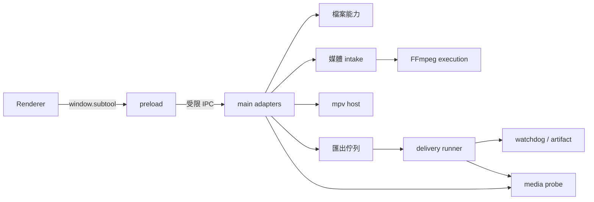

# SUB Tool Electron 維護手冊

本文件說明桌面邊界、可呼叫 IPC、原生程序及故障排查。開發與發布步驟見[開發與驗證](開發與驗證.md)；renderer 資料流見[技術架構說明](技術架構說明.md)，時間契約見 [FPS／時碼一致性](FPS_時碼一致性.md)。

## 1. 系統總覽

先找到持有資料及生命週期的 owner，再修改 adapter。`main.js` 負責組裝，不重寫已由其他模組擁有的規則。

| Owner | 責任 |
|---|---|
| `main.js` | 視窗、IPC 註冊、平台設定及 owner 組裝 |
| `preload.js` | 主頁面 contextBridge 及部分型別／大小檢查 |
| `queue-preload.js`、`compare-preload.js` | 各獨立視窗的最小 bridge |
| `local-resource.js` | 不透明本機資源 URL 與應用頁導航限制 |
| `file-authority.js`、`ipc-guards.js` | 精確檔案能力及主程序准入 |
| `project-file-authority-engine.js` | 可信專案讀寫、媒體能力、最近清單及重連 |
| `settings-file.js` | 設定與快捷鍵的原子讀改寫 |
| `directory-output.js`、`style-directory-import.js` | 所選目錄的安全輸出／樣式讀取 |
| `file-content-evidence.js` | 檔案身分與有界分塊內容雜湊，供專案與文字輸出核對 |
| `file-commit-coordinator.js` | 程式內按實體目的檔排序專案、字幕、樣式及截圖提交 |
| `screenshot-output.js` | 截圖路徑 reservation、寫入、發布及退出收尾 |
| `media-probe.js` | metadata、音訊及 bitrate 探測、並行與 close 屏障 |
| `mother-source-evidence.js` | 本機取樣、同一共享檔案身分及跨複製檔的完整內容證據，三者不混用 |
| `media-intake-runtime.js` | Proxy／音訊／波形快取、串流及 intake coordinator |
| `source-waveform-worker.js`、`source-waveform-task.js` | main 持有 native 程序，worker 執行波形 I/O；PCM 背壓、取消與退出屏障 |
| `continuous-source-waveform.js` | 單次 PCM 解碼、續算接點核對、已持久峰值及完整波形交接 |
| `continuous-waveform-cache.js` | 單檔 PCM 前綴、checkpoint、獨立 writer 世代及正式 WAV 發布 |
| `source-waveform-cache.js` | 舊分段 `.swc` 快取、內容證據與私有 WAV 副本 |
| `media-source-clock.js` | FFmpeg seek 捨入及音訊 PTS filter；純原點映射使用 shared |
| `clip-frame-cache.js`、`clip-audio-cache.js` | 固定畫面 PNG、反向片段 WAV 的格式完整性及母素材證據 |
| `clip-cache-artifact.js` | 片段快取的目錄世代、輸出 handle、發布及失敗清理 |
| `ffmpeg-execution-engine.js` | 工具解析、encoder、stderr 解析及程序執行 |
| `delivery-consent.js` | main 持有的交付目的檔預檢與單次收據 |
| `diagnostic-log.js` | 每次執行記錄的身分、保留、讀取及回收 |
| `audio-normalization-runtime.js` | 聲量量測、平衡階段及原生取消 |
| `native-audio-meter.js` | 播放快取前的逐 stream／channel PCM 電平取樣與程序生命週期 |
| `vocal-waveform-runtime.js` | 人聲分析的受限 PCM 讀取與逐 sender 取消 |
| `vocal-waveform-fingerprint.js` | 人聲波形來源指紋的 namespace adapter |
| `speech-audio-compressor.js` | 辨識 WAV 的受限壓縮及取消 |
| `mpv-host.js` | Windows mpv、named pipe、視窗及呈現證據 |
| `mpv-window-region.js` | 原生畫面範圍驗證、CSS 到 DIP 轉換及浮動視窗遮擋區域 |
| `compare-window.js` | 比較視窗身分、快照及 revision |
| `export-queue.js`、`queue-store.js` | 排程、狀態、journal、歷史及復原 |
| `delivery-runner.js`、`export-plan.js` | 交付准入／probe 與純交付計畫 |
| `export-watchdog.js`、`export-lease.js` | 原生 owner、停止、跨程序輸出 lease 及最終裁定 |
| `export-artifact.js` | 成品準備、封裝、驗證、發布及私有素材清理 |
| `owned-output-handle.js` | 開檔前後的路徑與實際 handle 身分核對，供封裝後處理共用 |
| `airline-*`、`mod-fhd-transport.js`、`disc-*` | 各交付格式的規格、封裝或結構驗證 |

## 2. 安全與檔案能力

主視窗使用 `contextIsolation:true`、`nodeIntegration:false`、`webSecurity:true`。Preload 只暴露指定能力，不暴露 `ipcRenderer` 或任意 Node 呼叫。部分入口在 preload 檢查型別，主程序仍須自行驗證輸入與能力；不能假設每個 bridge 都已做完整驗證。

### 拖放

Preload 以 `webUtils.getPathForFile()` 從真正的 File 取得路徑。一般媒體送 `fs:authorizeDroppedFile` 授予精確來源能力；`.subtool`／`.json` 走可信專案開啟入口，不使用一般拖放授權。Renderer 提供的 path 或 base64 不能擴張能力。

樣式資料夾匯入只讀所選根目錄內的 JSON，不追 junction／symlink，回傳內容而不授予整目錄讀取權。單檔字幕／XLSX 與目錄批次輸出共用 `directory-output.js`：同時檢查相對名稱與實體父目錄，在所選根內以 `wx+` 建私有暫存檔；寫入及同步後透過同一 handle 分塊比對預期 bytes。NAS／SMB 可能直到關閉寫入 handle 才更新時間戳，因此關檔後須先確認仍是同一檔案、mode 與大小不變，並以完整內容 SHA-256 及讀取前後快照核對預期 bytes，才採用關檔後的時間戳。不能只因 inode 與大小相同就放行；完成此核對後才檢查目的檔衝突，使正常時間更新不會導致匯出失敗或遺留已驗證的暫存。發布前重核根目錄及目的檔身分、狀態與完整內容 SHA-256，再次核對暫存檔內容後才 rename 替換；可偵測同 inode、同長度且時間戳相同的內容改寫。暫存檔被修改時保留該檔與原目的檔；目的檔在寫入期間變更時保留對方內容並提示重新確認。內容核對與 rename 仍是分離的系統呼叫，並非跨程序原子操作。合法空檔仍可發布，寫入失敗則保留原檔；尚無完整寫入快照時，只清理身分與狀態仍符預留證據的空暫存檔，保留無法區分來源的部分資料。遇既有 hardlink 只替換該檔名，不能截斷其他位置共用的檔案。批次若有項目被略過，回報實際寫入及略過數；衝突項另提示原因，已成功的檔案保留，不能宣稱整批完成。根目錄身分失效時不按舊路徑清理暫存，避免觸及替換目錄內的檔案。

同步失敗後清理已寫入的目錄輸出暫存檔時，須同時確認完整長度及完整內容；只吻合預期前綴不足以刪除他人追加的尾端。若錯誤收尾才關閉 handle，亦須在這次關閉後核對身分、mode、長度及完整內容，才能採用 NAS 最後更新的時間戳；清理不得發布失敗的輸出或掩蓋原始同步錯誤。沒有關檔邊界時仍嚴格比對原快照，不因時間戳變更而重新授權。檢查與刪除仍不是跨程序原子操作。

字幕及樣式輸出在准入時先向 `file-commit-coordinator.js` 預留整批合法目的檔，再由 worker thread 執行寫入與內容核對，避免大檔雜湊卡住主程序。專案存檔、截圖候選保留與截圖寫入共用同一協調器；同一實體目錄項依准入順序交易，不同目的檔可並行。無效或連結項目不取得寫入資格，合法項仍可完成；worker 等待後重核選定根目錄。協調器辨識 Windows 短名稱及不存在的巢狀目錄，不把不同 hardlink 名稱當作同一目錄項。這是程式內排序，不能約束外部程序；退出時停止新准入並等待已接受的 worker、專案寫入及截圖收尾。

### 專案

可信 bytes 先由 main 讀取，再衍生專案宣告媒體的能力。原生選檔、最近清單、啟動參數與 OS 開檔共用 `projectWorkspace.open()` 的較新請求優先規則；過期讀取不得再授權、寫最近清單或交給 renderer。較新的開檔會撤銷舊讀取，分塊計算初始雜湊時讓出事件迴圈並檢查取消。讀取前捕獲所選父目錄身分，再以同一個 file handle 取得 bytes；讀取前後核對 dev／ino、長度與時間，關閉 handle 後、授權前以完整內容雜湊核對路徑仍指向同一內容與原目錄，即使時間戳未變也不接受舊 bytes。避免在關閉 handle 前重複做一次無法替授權作證的同步全文核對；最後核對仍同步執行，以避免同程序在核對與授權間交錯，極大的專案仍可能暫時占用主程序。舊 bytes 不能在讀取等待期間被替換的目錄取得新的重連或寫入能力。

Save As 的媒體路徑必須已有讀權。`createAtomicProjectWriter()` 同時持有目錄準備、私有暫存及發布；main 不先以遞迴 mkdir 準備 renderer 傳入的路徑。所選根目錄可以是掛載／連結位置，`.subtool_AutoSave` 及其子目錄則逐層核對實體目錄與 dev／ino，不沿連結寫到其他位置。每筆工作等同目標前一筆完成後，透過實際開啟的 handle 分塊讀取目的檔，核對讀前後身分及路徑，記錄完整內容雜湊。暫存放在所選實體根，完成 write／sync／close 後重核目錄、目的檔與暫存的身分及內容，才 rename；寫入期間目的檔新增、移除、替換或內容改變時拒絕發布，保留既有目的檔。未完成寫入時只清理仍符預留證據的空暫存，無法區分來源的部分資料予以保留。檢查與 rename 仍是分離的系統呼叫。

SMB 儲存可能在 writer 關閉時才更新 mtime／ctime。關檔後先確認暫存仍是原 dev／ino、mode 與長度，再透過唯讀 handle 核對完整預期 SHA 及讀前後快照；全部吻合後，以這份關閉後快照作為發布及清理的依據。此核對也涵蓋完整寫入後 sync 失敗、直到 finally 才關檔的情況；只清理本次可驗證的完整暫存，保留原專案及原始錯誤。後續仍嚴格比對時間戳與完整內容，因此正常關檔不會被誤判成外部改寫，同 inode 的內容變更仍會拒絕發布並保留暫存。自動備份收到失敗或未知回覆時，只有仍屬原工作區及儲存路徑才在狀態列提示失敗，不將晚到結果回報到新專案。

原專案儲存與自動備份沿用可信開檔／另存當時的父目錄身分，不能在下一次寫入時把同名替代目錄重新認成原根。備份根重疊時先選最具體的資格再核對，子根失效不能退回祖先資格。原生另存取得新的明確選擇後才建立新資格；writer 在準備、等待後與發布前都重核該資格，不能只依路徑字串或 `canWriteProject()` 的一次布林結果。

路徑准入依呼叫順序非同步定位，再以實體父目錄與檔名排同目標 FIFO；既有目標的 Windows 8.3 短檔名也先解析為同一個實際目錄項，連結與身分不一致時拒絕，避免別名與原路徑讓較舊內容晚到覆蓋。準入及最後發布依同一順序交易，避免本程序的 rename 在別名解析中途換掉檔案；不同已准入目標仍可並行寫入。最後內容與身分核對、rename 及清理沒有 JavaScript await 缺口，雜湊以有界分塊讀取，但非常大的目的檔會同步占用主程序；這是多次檔案系統呼叫的身分核對，不是 OS 級目錄 handle 的原子沙箱。成功才更新目前專案、重連與近期清單。最近項目以穩定 token 開啟，清單重排不改變原點選目標；清除後 token 失效。重連只接受同名一般檔案，不把目錄當媒體。

最近項目的開啟失敗不自動刪除紀錄：外部程序或暫時離線的儲存裝置可能在非同步查詢後恢復，查詢與清單寫入無法原子核對。清單標示找不到的項目，使用者可在恢復後重試或明確清除清單；逾時及其他 I/O 錯誤也不授權移除。

自動重連只能使用目前已成功開啟的專案及其可信 bytes 宣告的來源。可信讀取時記錄專案搜尋根的實體身分，遞迴列舉每層目錄前保存快照，等待後及授權找到的檔案前重新核對；junction、同名換目錄或專案宣告世代變更都不授權晚到結果。另一專案成功開啟會撤銷舊搜尋資格；開啟失敗或使用者取消選檔不撤銷目前專案。這些仍是多個 filesystem syscall，不提供 OS 級原子圍堵。

Windows 的同步與非同步實體路徑核對都使用 native realpath，將 8.3 短檔名展開為相同表示，再比較目錄與檔案身分。短名與長名指向同一目錄時不能誤拒保存；也不能只為名稱相同就省略 dev／ino 或連結檢查。

### 本機資源 URL

一般媒體與字型使用 `subtool-local:` capability URL。隨機 token 對應精確檔案；每次讀取仍核對 token、目前 `canExposeFileURL()`、方法、一般檔案及 Range。token 不是整目錄或永久授權，不以關閉 `webSecurity` 解決載入問題。

需要 Web Audio 或 canvas 讀取的元素，須在指派 `src` 前設定匿名 CORS，程式載入共用 `setMediaElementSource()`；圖片疊層 markup 同樣帶 `crossorigin="anonymous"`。這包含固定畫面、截圖另外載入的圖片及 WebCodecs 圖片合成。協定已有允許來源標頭仍不足以補救已用無 CORS 模式載入的元素；驗收須讀實際像素及截圖內容。

主頁面、佇列及比較視窗由 `protectApplicationWindow()` 限制在自己的 HTML；明確 `--dev` 才允許主頁面的指定開發 origin／pathname。其他導航、重新導向及子視窗受阻擋，允許的外部 HTTP(S) 連結交給系統瀏覽器。

### 設定檔持久化

`settings-file.js` 分別持有 settings.json 與 key.json。更新先寫相鄰暫存檔，發布前重核暫存與目的檔的身分及實際內容；設定期間目的檔變更即拒絕覆寫。正常及失敗收尾的關檔邊界，都以同一 owner、mode、長度及實際 bytes 驗證後採用關檔時間戳；之後恢復嚴格快照核對。失敗只清理仍屬本次且內容符合已寫入前綴的暫存檔，發布後不再按舊名稱刪檔；無法確認歸屬的內容保留。這些核對與 rename、unlink 仍是分離的系統呼叫，不能排除其他程序在最後檢查後改動。解析失敗須先保存 `.corrupt-*` 原始 bytes，無法備份就拒絕覆寫。失敗須傳回 caller，不能把 false 視為保存成功。設定位置與驗收隔離方式見[CDP 流程](開發與驗證.md#3-真機驗證cdp)。

最近專案讀取失敗只允許暫時顯示空清單，不取得新增或移除項目的合併資格；之後讀取成功才更新，避免以空值覆寫已保存清單。對話框目錄讀錯不快取空物件，記住新目錄時從交易內的 `current.lastDirs` 合併，成功後才更新顯示快取，保留其他種類的開檔目錄。

## 3. Preload／IPC 介面

以下逐條對應目前三份 preload。一般呼叫是 `invoke`／Promise；標為「事件」者是 main→renderer 訂閱，標為 `send` 者沒有 invoke 回覆。新增通道須同步更新 main 的准入、preload、契約／安全測試及本表。

### 主頁面：檔案、專案與應用

API 前綴皆為 `window.subtool`。`isDesktop` 是值；`getFilePath(file)` 只呼叫 `webUtils`，不走 IPC。

| API | 通道 | 輸入或用途 |
|---|---|---|
| `status()` | `app:status` | 平台、架構、工具偵測與實際 encoder |
| `authorizeDroppedFile(file)` | `fs:authorizeDroppedFile` | preload 自真實 File 取得路徑 |
| `openDroppedProject(file)` | `project:openDroppedFile` | 真實專案 File 的可信開啟 |
| `fileURL(path)` | `fs:fileURL` | 取得受控資源 URL |
| `stat(path)` | `fs:stat` | 已授權路徑資訊 |
| `listDir(path)` | `fs:listDir` | 受控目錄列舉；失權或讀取失敗會拒絕，只有成功的空目錄才回空陣列 |
| `findRelinkTarget(projectPath, oldMediaPath)` | `fs:findRelinkTarget` | 原專案的重連搜尋 |
| `showSourceInFolder(path)` | `app:showSourceInFolder` | 定位已授權來源 |
| `fontsList()` | `fonts:list` | 字型清單與內容 |
| `openMedia()` | `dialog:openMedia` | 原生媒體選檔 |
| `openAudio()` | `dialog:openAudio` | 原生音訊選檔 |
| `openProject()` | `dialog:openProject` | 原生專案開啟 |
| `recentProjects()` | `project:recentList` | 最近項目 token 清單 |
| `openRecentProject(token)` | `project:openRecent` | 解析可信 token |
| `clearRecentProjects()` | `project:clearRecent` | 清除最近清單 |
| `saveProject(name, b64)` | `dialog:saveProject` | Save As 對話框及寫入 |
| `importSub(kind)` | `dialog:importSub` | 字幕／文字匯入 |
| `exportSub(name, b64, ext)` | `dialog:exportSub` | 字幕／文字輸出 |
| `exportDirectory(files)` | `dialog:exportDirectory` | 所選目錄安全批次輸出 |
| `importDirectory()` | `dialog:importDirectory` | 樣式目錄 JSON 讀取 |
| `importFont()` | `dialog:importFont` | 自備字型匯入 |
| `readB64(path)` | `fs:readB64` | 已授權單檔內容 |
| `writeProject(path, b64)` | `fs:writeProject` | 已准入專案寫入 |
| `reserveScreenshotPath(directory, suffix)` | `fs:reserveScreenshotPath` | 原子保留下一個 Shot 檔名 |
| `releaseScreenshotPath(path, token)` | `fs:releaseScreenshotPath` | 以原 reservation 憑證釋放未消耗預留 |
| `writeScreenshot(path, b64, token)` | `fs:writeScreenshot` | 消耗同一 reservation 憑證並發布 JPEG |
| `openPath(path)` | `app:openPath` | 開啟允許的路徑 |
| `openExternal(url)` | `app:openExternal` | 允許的外部 URL |
| `cacheInfo(src?)` | `cache:info` | 只查已授權目前來源的 sidecar 保存紀錄；無來源直接回空結果，不掃描中央快取 |
| `cacheClearAll(src)` | `cache:clearAll` | 名稱保留相容，實際委派 `clearSource`，只清指定母素材的 sidecar；必須通過來源讀取權限，保留使用中的 writer／reader |
| `configLoad()` | `config:load` | 讀設定 |
| `configSave(data)` | `config:save` | 設定交易 |
| `keysLoad()` | `keys:load` | 讀快捷鍵 |
| `keysSave(data)` | `keys:save` | 快捷鍵交易 |
| `getStartupFile()` | `app:getStartupFile` | 取得啟動時已接受的專案 |
| `minimizeApp()` | `app:minimize` | 最小化主視窗 |
| `closeApp()` | `app:close` | 請求主視窗關閉流程 |
| `openCompareWindow(payload)` | `open-compare-window` | `send`，開比較視窗 |
| `syncCompareWindow(payload)` | `sync-compare-window` | `send`，更新比較快照 |
| `onCompareCommand(cb)` | `compare:command` | 事件，帶原 revision 的命令 |
| `onCompareClosed(cb)` | `compare:closed` | 事件，比較視窗關閉 |
| `onAppRequestClose(cb)` | `app:request-close` | 事件，renderer 執行關閉確認 |
| `onOpenFile(cb)` | `app:open-file` | 事件，OS 接受的開檔 |

### 主頁面：媒體、音訊與交付

`sourceWaveformContinuous` 是能力布林值，不是 IPC；只有明確為 `true` 才使用單次連續波形請求，舊 bridge 沿用分段請求。

| API | 通道 | 輸入或用途 |
|---|---|---|
| `probe(path)` | `ffprobe` | 已授權來源 metadata |
| `ingest(opts)` | `ffmpeg:ingest` | path／duration／needsProxy／audio／queue／sessionId／requestId |
| `streamIngest(opts)` | `ffmpeg:streamIngest` | path／duration／audio／sessionId／requestId |
| `mediaSourceKey(path)` | `ffmpeg:sourceKey` | 已授權母素材的本機 `source-v3` 取樣證據 |
| `prepareSourceWaveform(opts)` | `ffmpeg:prepareSourceWaveform` | path／duration／audio／continuous／ignoreCached／sessionId／requestId；舊分段模式另收 start／length |
| `cancelMediaIntake(scope)` | `ffmpeg:cancelIntake` | sessionId，及可選 requestId；sender 由 main 綁定 |
| `releaseStream(streamLeaseId)` | `ffmpeg:releaseStream` | 只釋放同 sender 的串流 reader |
| `makeProxy(path, duration)` | `ffmpeg:proxy` | 獨立預覽 Proxy |
| `extractAudio(path, idx, duration, codec)` | `ffmpeg:extractAudio` | 來源音軌 stream 抽取及 copy／AAC fallback |
| `waveAudio(path, duration)` | `ffmpeg:waveAudio` | 首條音軌波形 |
| `clipFrame(request)` | `ffmpeg:clipFrame` | 已授權母素材 path、來源 time、fps |
| `reverseAudio(request)` | `audio:reverse-clip` | path、遞增 in／out、sourceStream |
| `readAudioMeter(request)` | `audio:meterRead` | 已授權母素材 path、來源 time、rate，及可選 mixes（busId、來源聲道座標與 gain）；回傳聲道及混音 bus 峰值 |
| `stopAudioMeter()` | `audio:meterStop` | 撤銷取樣並等待自己的解碼程序結束 |
| `vocalWaveFingerprint(path)` | `audio:vocal-wave-fingerprint` | 人聲波形來源指紋 |
| `audioSourceFingerprint(path)` | `audio:vocal-wave-fingerprint` | 同一來源指紋介面，供音訊效果核對 |
| `vocalWaveChunk(request)` | `audio:vocal-wave-chunk` | path、來源 start／duration、requestId、sourceStream／sourceChannel |
| `cancelVocalWaveChunk(requestId)` | `audio:vocal-wave-cancel` | 同 sender 的 PCM 讀取取消 |
| `normalizeAudio(path, options, duration, requestId)` | `audio:normalize` | 音量平衡工作 |
| `cancelAudioNormalization(requestId)` | `audio:normalize-cancel` | 平衡工作取消 |
| `analyzeAudioLoudness(path, duration)` | `audio:analyzeLoudness` | 有效聲量量測 |
| `onAudioNormalizeProgress(cb)` | `audio:normalize-progress` | 事件；回傳該訂閱的解除函式 |
| `cleanupAudio(path)` | `ffmpeg:cleanup` | 清理由主程序管理的產物 |
| `compressSpeechAudio(bytes, requestId)` | `speech:compressAudio` | 44–20,000,000 bytes WAV／typed array |
| `cancelSpeechAudioCompression(requestId)` | `speech:cancelCompression` | 同工作辨識壓縮取消 |
| `exportVideo(opts)` | `ffmpeg:exportVideo` | 凍結交付快照的逐份准入 |
| `beginDeliveryTargetRequest(requestId)` | `delivery:beginTargetRequest` | 為同 sender 的準備請求取得單次 ticket |
| `prepareDeliveryTargets(paths, requestId, ticket)` | `delivery:prepareTargets` | 以原請求與 ticket 建立批次目的檔預檢收據 |
| `cancelDeliveryTargetRequest(requestId, ticket)` | `delivery:cancelTargetRequest` | 撤銷該次準備，等待中的舊結果不得取得新資格 |
| `finishDeliveryTargetRequest(requestId, ticket)` | `delivery:finishTargetRequest` | 結束原準備請求及其剩餘收據 |
| `releaseDeliveryTargets(id)` | `delivery:releaseTargets` | 釋放同視窗持有的批次預檢收據 |
| `stopExport(jobId)` | `ffmpeg:stopExport` | 停止指定交付，與 intake 取消分開 |
| `openQueueMonitor()` | `queue:openMonitor` | 顯示佇列視窗 |
| `queueResume()` | `queue:resume` | 恢復排程 |
| `onQueueStatus(cb)` | `queue-status`、`queue:getStatus` | 訂閱事件並 invoke 取得初始狀態 |
| `onProgress(cb)` | `task-progress` | 事件；須依工作歸屬及明確 outcome 處理 |

### 主頁面：mpv

API 前綴為 `window.subtool.mpv`，定位參數一律為影片來源秒數。時間軸映射留在 renderer 序列層。

| API | 通道 | 輸入或用途 |
|---|---|---|
| `detect()` | `mpv:detect` | 支援狀態、工具位置與目前 instance 的 logPath |
| `launch(opts)` | `mpv:launch` | 已授權來源與啟動選項 |
| `seek(time, options)` | `mpv:seek` | 來源秒數、exact |
| `present(time, options)` | `mpv:present` | exact、waitForFrame、tolerance、frameTarget／frameStart／frameDuration |
| `cancelPresent()` | `mpv:cancelPresent` | 撤銷待完成呈現 |
| `loadfile(path)` | `mpv:loadfile` | 已授權來源切換；以命令回覆的 playlist entry ID 配對載入事件及路徑，舊來源事件不能完成新切換；回覆不代表首幀已呈現 |
| `screenshot(path)` | `mpv:screenshot` | main 驗證請求的截圖目錄，在私有暫存擷取並回傳 base64 畫格。自訂畫布補邊時附上同一畫格的畫布與內容矩形 |
| `play(options)` | `mpv:play` | 預設等待播放命令 ACK；`waitForReady: true` 另核對同來源、定位與播放意圖的即時狀態，回覆 `{ ready: true, sourceTime }`。ACK 不能代替可播放證據；命令錯誤、取消、片尾、逾時或斷線會拒絕 |
| `pause()` | `mpv:pause` | 暫停 |
| `direction(value)` | `mpv:direction` | 播放方向 |
| `mute(value)` | `mpv:mute` | 等待靜音命令成功 ACK；失敗／斷線不能宣稱聲音已交接 |
| `audioMix(request)` | `mpv:audioMix` | 主 renderer 傳目前 sourceSessionId、逐聲道座標與 gain；host 核對來源後套用混音，不接受濾鏡字串 |
| `rate(value)` | `mpv:rate` | 速度 |
| `brightness(value)` | `mpv:brightness` | 亮度 |
| `setBounds(bounds)` | `mpv:setBounds` | 視窗幾何 |
| `setViewport(viewport)` | `mpv:setViewport` | 僅主 renderer 可傳影片 bounds、visible 與 occluders；同次更新位置、可見性及局部遮擋 |
| `setProjectCanvas(size)` | `mpv:setProjectCanvas` | 主視窗傳 `{ width, height }` 或 `null`（自動）。不同比例等比例縮放後補黑邊。等同來源及設定的實際輸出畫格就緒才完成 |
| `show(value)` | `mpv:show` | 可見性 |
| `setGuide(guide)` | `mpv:setGuide` | 字幕 guide |
| `setImageGuide(data)` | `mpv:setImageGuide` | 圖片 guide |
| `setTimecodeWatermark(data)` | `mpv:setTimecodeWatermark` | 受限 text／rect payload |
| `clearTimecodeWatermark()` | `mpv:clearTimecodeWatermark` | 清監看 TC |
| `subSet(ass)` | `mpv:subSet` | live ASS |
| `subVisible(value)` | `mpv:subVisible` | 字幕可見性 |
| `quit()` | `mpv:quit` | 關閉 mpv |
| `onEvent(cb)` | `mpv:event` | 事件，替換原 mpv listener |

### 獨立視窗

佇列只使用 `window.queueAPI`，不重用主頁面 preload。`exactFrameRate()` 是同步純值查詢；sandbox preload 只 require Electron，由 main 呼叫 shared 規則，最多快取 64 筆。main 只接受存活佇列 sender 的數字或字串，每條路徑只設定一次 `event.returnValue`；拒絕立即回 null，不能先寫預設值再覆寫。

| queueAPI | 通道 | 用途 |
|---|---|---|
| `exactFrameRate(value)` | `queue:exactFrameRate` | `sendSync`，精確格率純值 |
| `getAll()` | `queue:getAll` | 工作及排程快照 |
| `setPause(value)` | `queue:pause` | 排程暫停 |
| `setConcurrency(value)` | `queue:setConcurrency` | 並行度 |
| `stopJob(id)` | `queue:stopJob` | 停止 |
| `retryJob(id)` | `queue:retryJob` | 重試 |
| `retryWithOutputDirectory(id)` | `queue:retryWithOutputDirectory` | 系統選取原輸出資料夾、重新授權並重試；回 `retried`／`cancelled`／`failed` 與訊息 |
| `retryWithOutputConfirmation(id)` | `queue:retryWithOutputConfirmation` | 舊交付重新選定輸出檔，核對內容、覆寫同意及既有 lease 後重試 |
| `clearJob(id)` | `queue:clearJob` | 移除可清工作 |
| `clearCompleted()` | `queue:clearCompleted` | 清完成紀錄 |
| `reorderJob(id, newIndex)` | `queue:reorderJob` | 排隊順序 |
| `updateDelivery(id, patch)` | `queue:updateDelivery` | format／targetH／kbps，路徑與尺寸由 main 推導 |
| `showMainWindow()` | `app:showMainWindow` | 回主視窗 |
| `openPath(path)` | `app:openPath` | 開允許的成品 |
| `showItemInFolder(path)` | `app:showItemInFolder` | 定位允許的成品 |
| `onUpdate(cb)` | `queue:update` | 事件，替換原更新 listener |

比較視窗的 `window.subtool` 只有兩項：

| API | 通道 | 用途 |
|---|---|---|
| `onUpdateData(cb)` | `compare:update-data` | 事件，接收最新快照 |
| `sendCommand(command)` | `compare:command` | `send`，保留建立時 revision |

Callback 包裝不把 Electron event 交給頁面。部分 API 替換舊 listener，部分只追加；不能假定每項訂閱都回傳解除函式。`compare-window.js` 在載入期間只保留最新快照；舊選單命令不得改綁新 revision。

## 4. ffmpeg／ffprobe 整合

### Native tool 解析

`ffmpeg-execution-engine.js` 依平台與架構尋找工具。開發可使用環境／專案 fallback，正式包不得依賴使用者 PATH。

| 目標 | 封裝位置 |
|---|---|
| Windows x64 | `electron/ffmpeg/ffmpeg.exe`、`ffprobe.exe` |
| macOS arm64 | `electron/ffmpeg/darwin-arm64/ffmpeg`、`ffprobe` |

`verify-native-binaries.js` 核對必要檔案、大小、執行權限及清單指定雜湊，不等於已執行工具驗架構或 codec。Mac 準備 helper 另實際驗 arm64、ASS filter、encoder 及 MXF demuxer。

`media-probe.js` 最多同時執行兩個 ffprobe。相同指令且母素材證據一致的無取消請求共用進行中工作，結束後再核對來源並移除共用項目；同路徑換檔不能加入舊結果。帶 AbortSignal 的請求各自持有生命週期。排隊不計入預設 60 秒執行期限。取樣從第一個等待起納入取消及退出屏障；取消或逾時仍等待真正 `close`，無法確認終止的行程會擋住後續准入，不能只因 caller Promise 已結束便釋放。來源讀不到或已變更會明確拒絕，不能當成音訊探測的一般保守回退。

### 媒體 intake

Runtime 接受 probe 結果，在母素材旁建立 480p、1000 kb/s 的預覽 Proxy、逐聲道音訊與波形。Proxy 與其他管理快取只供預覽，交付准入必須拒絕它們；不能只依 basename 封鎖，快取外同名母素材仍是合法來源。固定畫面 PNG 與反向 PCM 也分別寫入同一素材旁 `.subtool_Cache/clip-frames`、`.subtool_Cache/clip-audio`；隔離驗收明確指定的測試 profile 除外。

單聲道 stream 仍可能帶 `DL`、`DR`、`FL`、`LFE` 等喇叭位置標記。`buildAudioIngestPlan()` 在來源時鐘對齊後以 `pan=mono|c0=c0` 一對一取原聲道，明確給預覽 AAC 標準 Mono layout；不做喇叭混音或音量衰減，來源 stream／channel 座標保持不變。不能依賴同時輸出的 Mono 波形替 filtergraph 協商 layout，因為重用完整波形時不會輸出該 WAV，原標記便可能直接進 AAC 而失敗。`mediaIntakeSourceTiming.test.js` 以八種真實 MOV 單聲道標記、已完成波形重用及獨立頻率驗證各軌與 MIX 內容。

Renderer 的 `MediaIntakeJobs` 分別持有在途請求與可重試的失敗／停止紀錄。停止立即撤銷原 session 的結果資格，保留可核對的保存紀錄；重試建立新請求，先比對原母素材證據及工作區／片段來源資格。載入後的來源指紋在註冊當下凍結，不能在重試時把已原地換檔的片段當成原來源。串流 IPC 先回可播網址、之後轉檔失敗時仍保留重試入口；網址、metadata、初始定位或音訊載入失敗也須回報終態，不能留下永久 `working` 的恢復紀錄。公開入口與競態回歸見[產品驗收](開發與驗證.md#46-產品驗收與證據)。

`ffmpeg:prepareSourceWaveform` 優先供應來源波形，使用獨立 coordinator 與相同 session／request 取消契約，退出時也等待程序 close。桌面 bridge 以 `sourceWaveformContinuous` 宣告連續處理能力，renderer 傳 `continuous:true`、整份來源時長及音訊配置，不能同時傳分段範圍。有效完整波形可直接沿用；沒有時由一次 FFmpeg 連續解碼成 4000 Hz Mono、16-bit PCM，經有背壓的 stdout 交給 worker。混音、來源時鐘與尾端整數 sample 補零／裁切沿用既有規則。低優先序、單 decoder／filter thread 及隱藏 console 不改變音訊內容或取消關閉屏障。

`continuous-waveform-cache.js` 在 `.subtool_Cache/<key>/continuous-waveforms/<規格與工作識別>/` 保存一個 `partial.wav` 與原子更新的 `checkpoint.json`。每五秒來源 PCM 寫入並同步保存後，才把該範圍的峰值交給 renderer；未提交的尾端不算已完成。partial 的 WAV header 預告最終總樣本數，讀取只能採信 checkpoint 確認的前綴，不能當成完整 WAV。完成時關閉 writer，重核同一檔案及完整 PCM SHA-256，原子改名為 `wave.wav` 並發布完成紀錄。

一般 `ingest` 與 `streamIngest` 的共同計畫都必須帶 `duration`；沿用波形時核對 `round(duration * 4000)`、音訊配置、原共享來源證據及 wave 檔案快照。worker 完成結果將原證據交回 main，不以之後新取得的來源指紋替舊 wave 認證。同目錄直接引用正式 wave，必要時在持有來源資格下複製；完成 metadata 保存相對路徑，下一個 runtime 可沿用。完整波形已命中時不再輸出第二份混音 WAV；這不省略仍缺少的 Proxy 或逐聲道音訊。

素材旁快取不可寫時明確回報，不退到本機中央快取；子目錄的權限或容量錯誤也不能轉移儲存位置。開始保存後的寫入失敗保留既有 checkpoint，不假報完成。`ignoreCached:true` 建立新的 writer 世代，不沿用舊前綴或完成檔，也不刪除舊成果。`allowSidecarCache:false` 僅供隔離驗收，避免測試寫入使用者 NAS，並非正式版的自動退路。

保存規格綁定共享來源證據、混音／時鐘版本、音訊配置及總 sample 數。完整命中驗證 PCM SHA-256 後唯讀交接，不另建 writer；partial 命中則核對已保存前綴，再複製到自己的 writer 世代，不接管或覆寫另一台電腦的 writer。續算以整數 sample 決定完成點前三秒的整秒解碼起點，逐樣本比對已保存的最後一秒；若 decoder／resampler 歷史造成不一致，最多回來源起點一次，核對全部既有前綴後再追加，不能拼接錯位 PCM。不同格式的續算成本因此可能不同。

取消、正常退出或程序中斷均保留已提交進度，啟動孤兒清理也保留；使用者明確清除全部快取時仍依既有語意清除，並等待在途 writer 收尾。波形準備期間的完整內容驗證與有界 PCM 讀寫在 worker；主程序仍負責准入、交接及快取清理，不能把 worker 架構解讀為主程序完全沒有同步檔案核對。波形證據不替 Proxy 或逐聲道快取作整份母素材認證。

舊 bridge 的分段 interface 與 `source-waveform-cache.js` 保留相容：首段 5 秒、第二段補到 60 秒，後續每段最多 60 秒，以 `.swc` 保存完成片段及其 SHA-256。新連續工作不再按分鐘建立 `.swc`；既有完整 ingest 波形仍可直接重用。清理私有交接檔不能刪除持久的分段或連續波形。

來源 MIX 波形的每個原始聲道等權，跨 stream 合併時依全部聲道總數平均；較短 stream 的尾端視為靜音，不隨剩餘 stream 數量重新正規化。正式快取以 `waveMixVersion` 標示此規格；缺少標記的多 stream 舊波形不再沿用，但保留原檔、Proxy 與逐聲道，優先波形可先從母素材產生，正式 intake 只補建缺少的波形成品。已知聲道配置完整的單 stream 舊波形可繼續使用；聲道識別缺失、重複或不連續時，即使帶版本標記也不能把波形當作已證明的新規格。各 publication 依自己的配置獨立核對。

mpv／原生直讀可在主素材註冊後啟動背景波形；需要先做 intake 的 HTML 路徑則先顯示獨立唯讀來源波形，不提早提交正式片段。這包含非原生串流退路、單 stream 多聲道與沒有 `streamIngest` 的一般退路，均先完成同來源波形再做 Proxy／聲道 intake；同來源切片共用準備工作。`MediaIntakeJobs` 只把增量峰值交給仍持有同一 session／request 的 consumer，不把大批峰值留在狀態列快照。`source-waveform-progress.js` 核對連續 sample、100 Hz 桶界線、總長度及來源 key，換檔或失敗只撤回本輪結果。已顯示全片峰值仍須等 WAV 正式保存成功，不能提前啟動 Proxy；保存失敗時回報並保留可續算前綴。

`task-progress.waveform` 帶 `sourceKey`、`startSample`、`sampleRate:4000`、`resolution:100`、min/max 成對的 `peaks`、`completedSamples` 及 `totalSamples`。每桶 40 個 sample；除最後尾段外，起訖都對齊桶界線。恢復先從 sample 0 重送已確認前綴，再追加新峰值；完整快取可不發增量，renderer 由正式 WAV 有界分段計算峰值。`completedSamples === totalSamples` 是資料進度，不是成功終態；最後仍需完成結果與同一 request 的資格。

來源波形私有檔交接後，主程序保留原檔與父目錄身分，跨 IPC 清理前重核；失權或已刪除的路徑保留撤銷紀錄，同一 runtime 不重用該名稱。退出前另核對啟動時的暫存根；根或波形所有權無法確認、writer 尚未關閉時，保留整個暫存根，不遞迴清理。正常情況仍回收私有暫存；身分檢查與刪除不是作業系統的原子操作。

串流回覆帶同 namespace 的本機來源 key；交接暫時波形前再經 `ffmpeg:sourceKey` 核對可讀來源與相同 key。這是本機有界取樣證據，不能代替跨機快取的完整 SHA-256，也不因暫時波形而認證或沿用未驗證的外來快取。暫時波形與正式素材的呈現、取消和交接責任見[技術架構：Proxy、聲道與取消](技術架構說明.md#proxy聲道與取消)。

舊式 `ffmpeg:proxy`、`ffmpeg:extractAudio`、`ffmpeg:waveAudio` 的未交接輸出由 `produceTemporaryFile()` 持有：在私有暫存根以 `wx` 保留檔案，記錄 dev／ino，讓 FFmpeg 透過持有的描述元寫入並等待 writer 結束。整項工作失敗時只清除仍屬本次的檔案；extract 的 copy→AAC 退路屬同一交易，不在中間失敗時清檔。成功才交出路徑並保留所有權紀錄供 renderer 清理；退出時只回收仍能確認歸屬的檔案，未知或已替換的內容及非空暫存根會保留。舊式 Proxy 在完整轉檔後才交接，這條描述元寫入路徑不啟用 `faststart`；新式串流路徑不受此變更影響。

音訊平衡、舊式私有來源波形及辨識壓縮共用 `withTemporaryDescriptor()`，由 `temporary-output-ownership.js` 開啟與關閉輸出 handle，核對父目錄、路徑及 handle 的同一檔案身分；連續波形的持久 writer 則由 `continuous-waveform-cache.js` 管理。多遍處理可在每一遍前後重核，不能只核對整項工作的起訖；工作結束後撤銷該核對資格，close 失敗不得回報完成。來源證據、取消、聲道、來源時鐘、PCM 長度及交接仍由各領域 caller 持有，輸入 stdin 與讀取 position 不併入輸出 handle 的規則。

來源證據包含完整路徑、size／mtime／ctime／dev／ino 及前／中／尾段取樣。讀取前後核對檔案身分，來源途中替換或截斷即拒絕。這不是整檔 checksum，也不授權路徑。各 owner 仍持有自己的 namespace、規格與 capability／realpath 檢查；`source-v3` 隔離未依影片時鐘對齊的舊 intake。

快取保留本機 key 與原目錄，完成紀錄的 `sourceContent` 以 `format` 區分兩種證據：`source-v4-shared-file` 保存 size 與 `sharedSourceKey`，只確認同一份檔案；既有 `source-v3-sha256` 保存 size 與完整內容 SHA-256，可確認不同複製檔的完整內容相等。兩種格式不得混合或用共享指紋填入 sha256。紀錄另保存已驗證的 `sourceKeys`。必須比較跨檔案內容時，`portableSourceFingerprint()` 以固定 1 MiB buffer 非同步讀完整母素材，讀前後核對 handle 與路徑身分，逐段檢查取消，並回報實際已讀 bytes／總 bytes；完成身分核對後才回報驗證 100%。

每個 writer 在自己的 `generation-<隨機識別>/cache-meta.json` 原子發布完成紀錄，這才是真正提交點；根目錄 `meta.json` 只供相容索引使用，寫入失敗不撤銷已完成產物。來源證據一完成就獨立保存 `source-<本機 key>.json` receipt，不等轉檔，也不回寫整份產物索引。只有 receipt 代表該格式的來源核對完成，不能假報 Proxy、聲道或完整波形已完成；之後轉檔失敗或取消，重開仍可沿用來源證據。讀取由同一 owner 合併同格式、相同來源證據及相容聲道配置的完成元件，避免較晚的 writer 或身分補記抹掉另一行程剛補齊的音訊；不以遠端 PID 或逾時搶鎖判定跨電腦所有權。只有既有 `meta.json` 的舊快取仍可讀取。

同一 NAS 檔案以 `sharedSourceFingerprintSync()` 識別：canonical UNC 的 server／share、檔名、size、inode、mtime／ctime／birthtime 的完整奈秒值及前／中／尾取樣共同雜湊，排除 client 的 dev 與掛載路徑；讀取起訖仍核對本次 handle、路徑與完整本機身分。波形片段可直接共用；Proxy 首次在可寫的相鄰 sidecar 建立時，若沒有待驗證的其他來源候選，便使用共享檔案證據，不先全文讀取母素材。不同電腦／掛載路徑只可在相鄰 sidecar 以同一共享證據沿用產物；隔離驗收的中央根另須符合本機 strict key，正式流程沒有中央補建退路。讀取、補建、重試、metadata 發布與交接都重核共享身分，不能只以本機 key 代替奈秒時間戳；來源或目錄失效不能被最佳努力的 receipt 寫入吞掉。複製檔、其他 share 或缺少可靠檔案 ID／時間戳時回退完整驗證；只有 SHA 型舊完成紀錄能依完整內容相等沿用，單有 shared-file 紀錄則重建。無法解析成 UNC 的掛載路徑只在同主機／裝置範圍共享，不猜測跨平台別名。共享證據不是全文 checksum，不能宣稱偵測到保留全部檔案身分與時間戳、只改未取樣區域的外部修改。

正式 Runtime 只在素材旁 sidecar 搜尋可攜 metadata；隔離驗收才使用自己的中央根。相符內容才沿用原 generation，磁碟代號、檔案時間或裝置差異不影響內容相等。已確認的本機 key 可免重讀全文；已綁定來源但缺少元件時沿用既有內容證據，只補缺件。唯讀快取無法補記 key 時仍可讀，下次再驗證；需要補建卻不可寫時回報錯誤。Proxy 另以 `proxyProfileVersion` 核對 480p／1000k／最快 preset；舊 720p 只重建 Proxy，已驗證的聲道與波形不因此失效。無證據的外來舊快取不能猜認，處理期間仍核對來源 key、色彩、聲道完整性與路徑圍堵。

NAS 已完成的 Proxy、聲道與波形直接使用同資料夾資產，不再暴露 `prepareLocalPreview` 複製入口。既有本機副本不在快取視窗顯示，也不在開檔時自動搬移或刪除。讀取、進度與完成回覆仍受 session／request 所有權約束，不能把已被新專案取代的工作重新發布。

可攜映射同時保存目錄及已驗證的 `sourceContent`；候選路徑本身不是沿用資格。實際讀取、補建及清理都須重核目前內容，不能在檢查後換入另一母素材時仍回報 cached。新格式的本機 key 目錄若未綁定目前來源，也須先完成內容驗證；舊無內容證據的本機快取仍保留相容規則。失配會撤銷舊映射，暫時 I/O 失敗則只拒絕本次准入，不當成可以刪除的無效資料。

補建同時綁定准入時的目錄 dev／ino 與母素材內容證據；可寫性探測後、建立 generation、發布 metadata 的暫存及 rename 均重新核對。唯讀 sidecar 只重用已完成且通過來源與路徑核對的元件，缺件時回報無法寫入；不能以快取檔自身沒有變動替另一母素材作證。失敗清理先取得自己建立的實體 generation，重核後才刪除；同名路徑被替換時保留外來內容。

清除目前素材的 sidecar 時，先略過仍有 lease 的目錄，再在相同 sidecar 根內原子移至不可預測的私有隔離名稱，取得將被刪除的那個目錄物件。目錄身分及來源重核通過才刪除；若內容已換入或讀取不確定則復原。原路徑已被另一 writer 重建時，保留隔離內容，不能用舊目錄覆蓋新工作；不對先前檢查過的路徑直接遞迴刪除。

舊中央快取根存在時於可信啟動記錄實體目錄身分，正式版不為此建立新目錄；側車根於首次准入或建立後核對來源父目錄並保存身分。根被替換、側車根為 junction／symlink，或已登記祖先失權時，不以後來的同名目錄重新授權。舊式逐檔清理也核對原根與父層；來源波形另核工作檔身分與撤銷紀錄，不能以 8.3 別名繞過。

`cache:info` 有來源時先經讀取權限守衛，再以 `sourceOnly:true` 交給 waveform worker 的唯讀 `cache-info` 工作；無素材直接回空結果，不建立查詢 worker 或掃描舊中央快取。sidecar 描述只核對來源、目錄、checkpoint 與檔案大小，回報 `verified:false`，不為開資訊視窗掃描完整 PCM。它不取代續算時的內容驗證，也不授權刪除；查詢失敗與沒有紀錄分開顯示。唯讀查詢獨立登記於 `cacheInfoTasks`，只參與關閉／取消收尾，不讓清除等候先前的慢查詢。

桌面清除只進入 `clearSource(src)`，來源必須有讀取資格；檔案掃描、隔離、內容核對及刪除交給 `cache-clear-source` worker，避免 NAS 同步 I/O 阻塞主程序。worker 取得主程序已凍結的目錄權威、可攜來源映射與活躍來源／目錄；遇到相同來源或別名的活躍 writer／reader 時立即回 `{bytes:0,incomplete:true,reason:'busy'}`，不等待整部影片處理。既有無關 writer 不阻擋清理。清理期間的新 writer 准入則暫等本次刪除結束，因為不同檔名的相同內容仍可能在稍後解析可攜映射時共用該快取；`cleanupTasks` 持有此屏障，無關的唯讀查詢不在其中。renderer 關閉快取視窗不取消已送出的工作，重開相同來源沿用同一 Promise，結果只更新仍持有資格的視窗。

實際刪除後，worker 另送 `cacheRemoved` 事實通知，包含既有實體路徑及 dev／ino。主程序只核銷本次凍結、仍為同一物件且身分相符的目錄登記；短路徑與完整路徑指向同一實體時，也能正確核銷各自的登記。此通知不依賴 UI 成功回覆，避免關閉取消發生於刪除與回覆之間時，留下舊權威阻擋下次重建。

清理仍在原 sidecar 根內隔離候選，以有界並行的非同步分塊讀取核對完整內容；整棵候選准入後逐檔再核內容、身分與資格並刪除，不等待其他大檔讀完才處理已核對的小檔。舊式中央清理規則保留供相容與隔離驗收，正式 renderer 不再提供中央查詢或孤兒清理入口。來源尚無 sidecar 時也保護該來源，不能讓晚到掃描刪除新建波形。匯入與清理均跨 await 重核來源、根及 writer 資格。

清理快照最多 20,000 項、2,048 個目錄、48 層；超限、讀取不確定、身分變更或活躍項目予以保留並回報部分完成，釋放位元組數只計實際刪除的內容。隔離項還原前核對原實體與目標位置，無法安全還原時保留隔離資料；讀取 handle 關閉失敗由 runtime 持續追蹤並可重試。關閉中及關閉後拒絕新清理；resume 須先等待或重試 handle 收尾，較新的 close 撤銷等待中的舊 resume。核對、隔離與刪除仍是分開的檔案系統操作，不能保證消除外部程序在最後核對與 unlink 間寫入的競態。快取資訊無法核對時回報不可用，不假報零容量。

Proxy 色彩探測前後核對同一來源 key，描述隨其證據一起進入快取准入，再和目標快取目錄核對；不能把探測等待前的尺寸或色彩用來認證同路徑的新影片。已完成且驗證有效的 warm Proxy 仍直接使用，不重做色彩探測。

音訊計畫在 split／pan／mix 前保留實際 PTS，轉成影片來源時鐘，再補前置靜音或裁負時間。不能先將每個 stream STARTPTS 歸零後補猜測延遲，否則 AAC priming 可能重裁。Proxy 影片歸零；波形、固定畫面、人聲 PCM、反向音訊與交付也必須沿用來源時鐘。FFmpeg seek 與剩餘偏移交給 `media-source-clock.js`，不要複製換算。

快取完整性須符合本次聲道數、stream／channel 座標及非空產物。新完成紀錄另保存各元件的 `artifactSizes`；同一路徑共用已知完成長度，缺乏長度的相容索引不能繞過檢查。搬移中被截短的 Proxy、聲道或波形只重建受損元件；重用、唯讀複製與提交也核對相同證據，不能把非空截短檔重新認證。長度檢查不是產物全文 checksum，無法據此宣稱已偵測同長度的外部破壞。

Proxy-only 不能滿足有音訊的請求；缺件必須在素材旁補建，不能改讀舊中央副本。只補缺件，寫本次私有 generation；來源與重用檔案重核、完成紀錄提交成功後才發布成功。Renderer 另須先提交聲道，再允許無聲 Proxy 接手，不等待波形載入；完成通知遇到定位或播放時保留至可交接邊界。失敗、取消或 runtime 關閉後晚到的工作不能發布，清除本次未提交 generation，保留既有完成紀錄及檔案。沒有按天過期規則；孤兒清理也讀取 generation 完成紀錄，不能因缺少相容索引便刪除有效快取，遇權限或暫時 I/O 錯誤同樣保留。

串流 lease 綁定首次准入的快取根、generation 及 Proxy 檔案 dev／ino；可播檢查及每次 HTTP 開檔前後都重核，不能因同名路徑出現新檔便供應替代內容。新 Proxy 先以 `wx` 預留，FFmpeg 在同一檔案上寫入；這個身分不以母素材仍存在或目前相容索引仍指向舊 generation 為條件，已完成的有效串流可繼續讀取。

`ingest` 與 `streamIngest` 共用 coordinator，直到完整背景 completion 才允許下一個 writer。新 caller 必須提供每次工作區取代或整個 session 取消後唯一的 sessionId，以及每份工作唯一的 requestId；兩者都是非空且不超過 128 字元的字串。main 從 event 綁定 sender，不採信 payload 的 sender。同專案首次加影片、保留既有外音的 reset 沿用目前 session，避免取消合法的外音準備。

| 操作 | 生命週期契約 |
|---|---|
| `ingest({…, queue:true})` | 排隊；不與仍在寫入的 stream 併行 |
| `ingest({…, queue:false})`／`streamIngest()` | 取代同 sender 的 active／queued，不終止另一視窗工作 |
| `cancelMediaIntake({sessionId, requestId})` | 撤銷指定原工作及遲到准入，其他 request 保留 |
| `cancelMediaIntake({sessionId})` | 撤銷該 sender 的整個原 session，包括 queued 與已交付串流 reader |
| 取消後重試 | request 使用新 id；整 session 取消後改用新 sessionId |
| 換專案 | renderer 同步撤銷舊歸屬、切新 session，再取消舊 session |

取消會移除匹配 queued、標記 active lease、終止其 process 並收回 HTTP reader；Promise 要等 native `close` 與 cache 收尾。新工作可先入列，但不能越過此屏障。晚到舊 cancel 不能取消新 session／request，也不呼叫全域 FFmpeg 或 export 停止。拒絕錯誤為 `INGEST_SUPERSEDED`，訊息「媒體轉檔已被較新的載入取代」；Electron invoke 可能不保留自訂 code，renderer 也須以本地撤銷狀態判斷。

串流先交付 response／URL，writer 可繼續執行；可播不代表快取已提交。60 秒尚未可播則 `STREAM_READINESS_TIMEOUT`，停止 writer 並等 close，不接受晚到 code 0 或 process callback 補成成功。交付前失敗由 runtime 釋放 URL；交付後 caller 持有 streamLeaseId，明確 release 或 session 取消收尾。

Writer 與每個串流 reader 分別保護快取目錄；writer 完成不能讓仍在播放的快取被刪。每個 HTTP request 自有 reader／timer，斷線先結束該 request；release／cancel／runtime close 結束相關全部 request。清快取只計實際刪除 bytes，保留被引用目錄。診斷應呼叫 `inspectCache()` 共用完整性與圍堵規則，不自行取 basename 重組路徑。

### 固定畫面與反向音訊快取

兩種片段快取共用 `clip-cache-artifact.js` 的檔案生命週期；PNG／WAV 格式驗證與母素材指紋仍由各自模組持有。每個 key 只搜尋自己的完成世代及舊版平面檔案。有效舊快取可沿用；損毀的既有產物保留，另建新世代，不依賴 hardlink 發布。

PNG 逐區塊核對長度、順序與 CRC，串流解壓 IDAT，依尺寸、色彩型別、位深與 Adam7 分段核對實際列長及濾鏡；完整標頭或 IEND 不能替損毀的影像資料作證。檔案與解壓資料各受 1 GiB 工作預算限制，超限不發布；不一次配置整張解壓影像。格式依 [PNG 規格](https://www.w3.org/TR/png-3/)；此檢查是私有固定畫面快取的准入條件，不是通用圖片編輯器。

新世代以 `wx+` 建立檔案並持有 handle，FFmpeg 經 `fd:` 寫入同一個實體檔案；此協定對一般檔案可 seek，WAV 長度欄位可正常回填，詳見 [FFmpeg fd protocol](https://ffmpeg.org/ffmpeg-protocols.html#fd)。`ffmpeg-execution-engine.js` 的 `outputDescriptor` 只允許 direct 執行且輸出為 `fd:`，不接管 caller 的關檔責任。

原生程序結束後，先核對檔案及目錄身分、格式內容與母素材指紋，再建立 `ready` 標記供後續讀取。失敗或取消會等 handle 關閉，僅清理仍持有的未完成檔案與空目錄；同名路徑被替換時保留現場。這是多次檔案系統核對，不提供 OS 級原子沙箱。

### 執行進度與終態

stderr 以增量 UTF-8、CR／LF record 解析，保留跨 chunk 文字，結束時處理最後 record；carry 有界，原始 log 保留 bytes。執行 module 同時持有記錄檔收尾：等待串流 `close` 確認檔案已釋放，成功時完成身分核對與同步刪除，才完成工作及發布終態。寫入 `finish` 或等待期限不能代替 `close`；記錄寫入或刪除失敗仍保留原生執行結果。

Direct 與交付佇列的每次執行都以獨立隨機名稱及 `wx` 建立記錄。診斷 owner 將檔案與父目錄的 dev／ino／建立時間寫入獨立 receipt；關檔後再次核對才能讀取、保留或發布路徑。交付重試保留各次失敗記錄，不覆寫舊記錄；清除工作及重啟恢復時，依 job 身分只回收仍與 receipt 相符的記錄。舊版固定名沒有可信身分，保守保留。系統開啟時再次核 receipt，Direct 仍僅授予單份記錄的開啟資格，不授予同目錄或一般讀寫能力。這些是多個 filesystem syscall，並非 OS 級原子圍堵；失權時保留無法確認的資料。

佇列清理遇到鎖檔或權限等 I/O 失敗會保留待刪 journal，之後重啟再嘗試；不能把 rename／身分讀取失敗當成已清除。身分不符與檔案已不存在分開處理，不為完成清理而刪除替代內容。

記錄檔若未成功開啟，例如 `wx` 遇到同名外來檔，執行器不得讀取、刪除、授權或以 `LOG_PATH` 發布該路徑；診斷僅使用本次 stderr 與開檔錯誤。記錄失敗不改變原生工作的成功／失敗判定。

`done:true` 只表示結束，成功須有 `outcome:'success'`，失敗為 `failed`。有標記的 intake 由 runtime 統一附上 sessionId／requestId，包括 native 中間進度、cache hit、提交與 stream 終態；renderer 只接目前仍持有的工作。stream 的 ready Promise 不可提前清掉仍在執行的工作狀態。其他直接作業如 extractAudio 的 `a0` 進度有自己的 caller，不能被 intake 的 session 篩選誤吞。

終態事件可能先於 IPC 回覆：狀態列可以結束顯示，但尚未交接的回覆仍須留在 session 的取消集合。開始、進度、終態與交接通知可能同步觸發換專案；發送通知後再核對工作資格，失權時不得啟動或交出舊工作，也不能派發舊完成事件。狀態列接通知時讀取目前工作快照，避免巢狀通知倒退顯示。

Intake 進度以 `stage` 區分快取檢查、母素材內容驗證與轉檔；未知分母使用 `pct:null`，不補造百分比，切換階段時重設剩餘時間估算。Renderer 的 `MediaIntakeJobs` 也持有本機波形準備工作，其取消與晚到結果同樣受 session／request 歸屬限制；實際先後由各載入 owner 決定，連續來源波形必須在同來源 intake 前完成。狀態列保留仍持有的背景進度，一般訊息及播放操作不能覆蓋；錯誤仍可提示，匯出的進度鎖優先，解鎖後恢復目前背景工作。

同來源先完成優先波形，再顯示 Proxy 驗證或轉檔進度；若不同來源的背景工作同時存在，狀態列仍能並排顯示各自階段及百分比。完整標籤、容量及各自估計時間保留在 tooltip 與無障礙狀態文字，狹窄空間保留取消按鈕。

優先波形的 NAS 路徑、來源與 PCM 驗證由 `source-waveform-worker.js`／`source-waveform-task.js` 移到 worker thread，仍使用同一 intake runtime 的檢查。主程序持有排程、probe 與 FFmpeg writer，逐批 PCM 等 worker 保存及回覆後才繼續讀取；取消須等 native close、worker 退出及交接收尾。工作在第一次 await 前登記；清快取依開始順序等待，不與 worker 的讀寫交錯。來源的完整取樣指紋在開始與交接邊界核對，逐批寫入只查來源 stat 與 writer 身分，避免每批重讀 NAS 來源。完成通知及其 microtask 後再核對來源、目錄、檔案身分與內容時間戳，失權不刪除外來替代檔。

波形 FFmpeg 限制輸入 decoder 與 complex filter 的平行度，並對有效子程序 PID 設定低於一般的排程優先序；不降低 Electron 本身或交付作業的優先序。這些設定讓出背景運算資源，並非 CPU／磁碟使用量的硬上限。所有子程序仍隱藏 console，失敗或取消維持原生關閉屏障。

Execution 的編碼完成不等於交付完成；封裝、內容驗證、成品發布及 lease 清理仍由 artifact／watchdog 裁定。取消不發布假成功。

### 聲量量測

`audio-normalization-runtime.js` 的聲量分析等 FFmpeg 成功，再解析必要量測值。空報告、缺欄位或程序失敗均失敗；`-inf` 必須來自實際量測，不能補造，也不能單憑它認定靜音。Renderer 可保留快速預覽，但不得把量測失敗顯示成成功。

面板量測使用 `buildAudioIngestPlan(..., { waveOnly: true })`，與來源 MIX 波形共用全部原始聲道等權、來源時鐘與短 stream 尾端補零規則，不讓 FFmpeg 自選單一 stream。此混合報告只供面板顯示；效果仍逐實體 stream 量測及保存，不能把可能因反相抵消而靜音的 MIX 報告當成各 stream 的處理證據。

量測和轉檔使用 `mother-source-evidence.js` 的本機來源指紋，核對處理前後及各階段的檔案身分和內容；來源消失、無法讀取或證據變動時不交出報告或 WAV。指紋採 stat 與前／中／尾有界取樣，並非整檔雜湊，不能保證偵測所有未取樣區段的變更。對話框也只接受仍屬目前工作及來源的結果。

Renderer 的效果快取及多 stream 整批使用 `audioSourceFingerprint`，沿用已授權的 `vocal-waveform-fingerprint.js` namespace；它與原生轉檔各自核對來源，不跨 namespace 比較 digest。舊 bridge 缺少此介面時，單 stream 可處理但不重用效果快取，多 stream 因無法核對整批來源而拒絕啟動。

效果工作先 probe 母素材取得實際 stream／channel，再分別送原生處理；舊配線不作為實體聲道數的證據。配線保留、缺失提示與配置變更的處理見[技術架構：來源、效果與配線](技術架構說明.md#來源效果與配線)。

平衡 WAV 使用 `produceTemporaryFile()` 預留私有檔並核對身分，FFmpeg 透過可 seek 的 `fd:` 寫入持有的 handle；Peak、True Peak 第二遍和無聲保護均適用。程序結束後再核對路徑與 handle、關閉 handle，成功交接後才顯示完成；失敗或取消只清理仍屬該工作的檔案，保留同名替代檔。這些是多次身分檢查，並非 OS 級原子沙箱。

平衡以整份母素材量測及處理；輸出無容器 PTS 的 WAV 前才對齊來源零點、補靜音及裁長。Peak、True Peak 第二遍與無聲保護共用此步驟，已對齊結果不重套偏移。取消同時傳給 probe 與後續原生階段，遲到 probe 不得啟動新程序。

Peak 與 True Peak 都先量測母素材的指定 stream，確認無聲時維持 0 dB，成功報告隨效果保存供重開及交付共用；正常 Peak 仍使用 `alimiter`。第一遍失敗時，即使 stderr 已含報告，也不能以它判定無聲或保存為交付用量測；改用單遍濾鏡，並讓預覽與交付共用相同退路。

已保存的量測欄位只接受有內容的數字或數字字串，缺值及錯型不可轉成零冒充量測；非靜音報告也須符合 FFmpeg 的 `measured_*`／`offset` 範圍，否則改用單遍。FFmpeg 的完全靜音報告可能有 `target_offset: "inf"`；只在其餘量測可確認靜音時保留此報告，讓交付與預覽同樣維持無聲保護。

短於整體響度量測窗的可聽音訊可能回報 `input_i: "-inf"`，須參考實際峰值：峰值不超過 −70 dB 時保留原音，避免放大低音量底噪；峰值高於此值而雙遍量測不可用時改用單遍。分析面板以實測 RMS 補足此類平均值，明確標示 RMS。`input_thresh` 是相對量測門檻，不可直接當成 −70 LKFS 的絕對響度門檻。

### 原音電平取樣

mpv 可在完整聲道快取之前出聲，這時沒有 WebAudio analyser。`native-audio-meter.js` 按音量表輪詢啟動一個只讀 FFmpeg 程序，保留每個 stream 的原聲道，以 48 kHz Float32 PCM 計算 50 ms 峰值；不播放音訊、不寫暫存音檔，也不等待完整波形。來源位置與各 stream 原點沿用 `media-source-clock.js`，取樣不能另當播放時鐘。

Renderer 每 100 ms 至多送出一個讀取請求。取樣保存有界時間窗，只交出同一來源時間且仍新鮮的各聲道峰值；換源、定位或速度改變時先停止舊程序，再建立新工作。停止、播放快取接管及關閉音量表撤銷舊回覆；一秒沒有輪詢也會自動停止。退出等待程序 close，取樣結果只供電平顯示，不加入交付或專案資料。

所有專案 bus 靜音、音量歸零或停用配線而沒有有效原生輸入時，也停止額外取樣。單一輸入的 bus 直接使用同窗已計算峰值乘增益；多輸入仍逐 sample 計算 signed PCM 合成峰值，重用 session 暫存陣列並先歸零，不用峰值相加近似。重新開啟配線後沿原新鮮度與來源資格恢復取樣。

同一 bus 接收多個來源聲道時，不能把各聲道峰值取最大或直接相加。取樣器保存有界 signed PCM，從所有 stream 同一個 50 ms 區間套用 bus 配線增益、逐 sample 相加，再取混音峰值；同相疊加與反相抵銷都必須反映。聲道總數最多 128，每來源最多保存 32 個區間，PCM 歷史上限約 39.3 MB，另有當前區間與 pipe buffer；停止立即釋放。推子或配線改變只撤銷舊讀值，沿用同一解碼器重新計算，不重啟母素材讀取。

`tests/nativeAudioMeterPlayback.test.js` 阻擋背景快取，以真實 mpv 與兩個不同音量的 stream 驗證首播、音量變化、暫停及定位重播；`tests/mixerMeterNative.test.js` 比對 PCM、讀數與實際 CSS 刻度位置。

`tests/nativeMixerPlayback.test.js` 對隔離 app 的 mpv 輸出寫出私有 PCM，並觀測快取播放的實際 master 節點；不擷取系統或其他程式的聲音。以不同頻率分辨獨奏、靜音、推子、全靜音、重設與接管後的殘留聲道，再以同一 mpv 切換單一 Stereo stream 與八種 Mono layout。安裝版可指定 `SUBTOOL_ACCEPTANCE_EXE`／`SUBTOOL_ACCEPTANCE_VERSION`，重跑相同內容驗收並核對封裝來源。

### 人聲波形 PCM

`vocal-waveform-runtime.js` 只讀已授權母素材的來源 start／duration，每段最多 36 秒，可指定 stream 與單聲道。stdout 回傳 44.1 kHz 交錯 Stereo Float32 PCM，最大片段約 12.7 MB，不寫交付或音訊快取。成功的短片段／零 sample 可代表 EOF；renderer 依原時間補靜音，不能平移已有 sample 或把分析結果接到播放。

PCM 取樣前按影片來源原點對齊，resampler 與指定聲道的 pan 在同一鏈中；seek 只補剩餘前置靜音。來源指紋沿用 `vocal-waveform-fingerprint.js` namespace 與共同取樣規則。

工作由 WebContents＋request id 持有，其他 sender 同 id 不可取消。取消、視窗銷毀或 120 秒期限會停止程序，必要時強制終止，確認 close 才移除。退出停止新准入並等待全部片段；十秒仍未確認終止則拒絕退出並保留追蹤。

### 交付

`delivery-runner.js` 接凍結快照、核對能力、probe 母素材，再交 `export-plan.js` 產生 argv、實際片長、聲道及規格。純計畫自行決定 codec／mux、音訊尾端及光碟容量，runner 不另配一份設定。所有 execution 明確指定 `direct` 或 `queued-delivery`；交付缺少 queue dir／job id／outPath 直接拒絕，不得退回 direct 繞 watchdog。

`ffmpeg-execution-engine.js` 的交付能力 owner 從同一純計畫取得實際 encoder，在送出及重跑準備前以短編碼核對可執行性，光碟另執行所需工具的版本探針。探針不讀母素材、不建成品；視訊看實際 frame 與完成標記，不能因短 GPU 編碼的 mux 時間為零而誤判失敗。成功不跨工作快取，避免相同執行檔的 DLL、系統 runtime 或 GPU 狀態變更後沿用舊結果。取消及退出等待原探針 close，失敗退出後才恢復准入。這只驗證能力，成品內容仍由原交付驗收負責。

交付保持 In／Out、offset 與速度精度。影片保留所需 GOP 的 PTS，再按絕對交付格網合成；不能逐段轉 FPS 後 concat，也不能以顯示用毫秒回寫來源。反向 VFR 按交付格網重建 cadence，保留首格前缺口及半開尾端；固定畫面按實際來源 PTS 取格，不由平均 FPS 補造。隔行在場格網合成，補末場再交織 TFF。驗證須逐格比像素、區間、CFR／VFR、速度與疊層；完整時間規則見 [FPS 文件](FPS_時碼一致性.md)。

來源影片使用共用 `sourceVideoClockSeek()` 保留容器相對 PTS。音訊依來源時鐘及實際 seek 補剩餘靜音；已對齊或反向 adapter 不重複套偏移。各 bus 獨立混音，join 前補至交付片長，較長聲道尾音不可被短聲道截掉。重用 input 時核對其讀取範圍，較早音訊須用自己的來源 input。

從 probe 開始就登記同一 active owner，停止也會取消準備中探測。成品提交及 lease 釋放後，補充 audio bitrate 探測失敗只回 `audioActualBitrates:null`，不能倒改已完成交付；編碼、封裝與收尾失敗仍屬失敗。

輸出授權綁定使用者在系統選擇器確認的實體目錄。`FileAuthority` 經 `export-lease.js` 保存所選根的原路徑、`realpathSync.native()` 解析的 canonical 路徑，以及 `dev`／`ino` 字串；根本身可為使用者明確選取的 junction，根以下到輸出父目錄則逐層拒絕連結並記錄目錄身分。改向或同名換目錄後，舊授權失效。main 不接受 renderer 偽造的 `outputAuthority`；可信捕捉結果存在 job 頂層，隨工作快照及 failed／stopped journal 持久化，重啟只恢復仍有效的證據。

批次送出前由 main 核發一次性 ticket，將準備、取消、收據及入列綁定同一 sender、請求與 ticket；識別碼重用也不能讓晚到的舊訊息接手新工作。視窗關閉、工作區失權或 sender 導覽會撤銷準備，尚未結束的讀取真正收尾後才釋放並行名額。主程序限制同時讀取及排隊數量；既有目的檔以可取消的非同步分塊 SHA-256 取得完整內容證據，再由交付清單要求使用者確認。每列入列前重核並持久化同一證據，不能接受 renderer 提供的身分或把等待期間出現的新檔當成已確認的目標。部分成功後保留未接受的列；取消或完成會釋放剩餘收據。單筆原生另存選定後捕捉證據，舊式指定路徑未帶收據只允許不存在的目標，既有檔案立即拒絕，不先讀取整個大檔。

一般重試和重啟沿用目的檔紀錄，不把後來的檔案視為入列時的狀態。Runner 在 probe 前及交給 execution 前非同步核對完整內容；watchdog 再驗證並固定本次 canonical outPath，準備後及發布前再次核對。舊版佇列缺少目的檔紀錄，或既有檔只有舊版 metadata 證據時不執行覆寫；使用者須透過原生視窗重新選檔，已有檔案另行確認，核對同一工作、attempt、來源、目的及目錄後，交易式保存新證據。收據與目的檔紀錄保護正常 UI 的確認流程，不能證明已遭控制的 renderer 確實顯示過確認對話框。

對已存在的目的檔，入列、probe 後及 watchdog 發布前會核對母素材與目的的實際路徑，以辨識 Windows 8.3 等別名；不同硬連結名稱不依 inode 合併。probe 可排除圖片，但發布保護使用與入列相同的完整來源集合，包含圖片及舊佇列記錄的來源。無法核對時拒絕；發布前才發現衝突時保留已完成的 stage 與 lease。路徑核對與 rename 仍是不同的系統操作。

佇列修改格式或時碼設定時，若衍生的不同檔名已存在或無法核對，拒絕修改並保留原工作；同一路徑沿用原目的檔證據。介面不提供重新命名，若推導結果僅與原路徑的大小寫不同，保留原路徑，不據此合併不同目錄項目或授權硬連結。

lease 位於該 queueDir 的 `output-leases/<輸出路徑雜湊>.lock/owner.json`，記錄 jobId、token、PID、pipe 與輸出證據。後續更新及釋放沿取得時的 lease key 核對 outPath／token，不因所選別名改向而重新計算另一把鎖。stage 名稱由 canonical outPath 與 token 派生，不接受 caller 指定刪除路徑。

同一作業系統使用者、同一 appData 實體視圖的新版本另以可信共用目錄鎖住實體目錄項，避免不同 profile 或 Windows 長短名稱同時寫入；原佇列鎖與 stage key 不改變。Windows 套件虛擬化改變路徑文字時，仍須核對原目錄與實體目錄的身分，不能因此接受未准入的子目錄 junction。建立子目錄使用根目錄已准入的 `requestedPath` 拼接，範圍與實體目錄各依自己的證據核對；不能將實體長路徑拿去計算相對於 8.3 短路徑的範圍。根目錄別名每次使用仍須重新解析，指向不同實體目錄即拒絕。共用鎖不主動復原其他 profile 的工作，原鎖仍在或無法核對時保留；writer 啟動後、PID 尚未持久化便中斷時也保留鎖與 stage，須先確認程序狀態並檢查成品。不同使用者、跨機、不同 appData 實體視圖及未實作此協定的舊版不受共用鎖保障；不同封裝或程序安全環境是否共用同一視圖，不能由單一環境測試推定。

| 成品階段 | 實際所有權檢查 |
|---|---|
| 開始寫入 | 以 `wx` 保留空 stage，從已取得的 handle 讀取 `dev`／`ino`、大小及時間，並將身分寫入 lease；真正啟動 writer 前及尚未啟動時取消都重核空預留，遭填入或變更則保留內容與 lease。ISO 也在真正 writer 起動前完成此步驟，每個新原生程序更新 PID；未取得檔案不能清除同名內容 |
| 封裝 | artifact 傳遞同步 `assertOutput`；MOD／航空以開檔前、handle、開檔後的 bigint `dev`／`ino` 比對 stage，每次有限大小的修正或發布寫入前重核目錄與 stage。航空發布使用 `r+`、truncate 前再核對；私有 mux 以 `wx` 建立，記錄檔案與父目錄身分，讀取及清理前重核 |
| Commit | 取得 lease 後重核最終檔內容與身分；等編碼、封裝與驗證成功，再核目錄、stage 身分、非空一般檔案、取消狀態及最終檔完整內容證據，以同目錄 rename 發布正式成品。最終檔在工作期間新增、移除、取代、修改或無法核對時不覆蓋，保留 stage 與 lease 供復原 |
| Cleanup | 等 writer close 後，在每次刪除前重核目錄與 stage 身分；失權或清理失敗保留相關資料／lease，不沿被替換的路徑刪檔。handle 關閉失敗時保留 stage；lease 中只有已記錄並通過身分核對的光碟工作目錄可清理，其他未登記項目使釋放失敗。移除私有內容及 owner 記錄前核 token；最後鎖目錄刪除失敗時嘗試恢復 owner 記錄 |
| Recovery | 先核 lock key、owner outPath、由 token 派生的 stage 路徑，再交原 pipe／token 收尾。無存活 owner 時，須確認登記的兩個 PID 均已消失，且原目錄／stage 身分有效，才可清理。遇到 stage 不存在時再核對原目錄，不能把檢查期間整個輸出目錄消失誤判成 stage 已移走並釋放鎖。目的檔變更或無法核對而保留的已完成 stage，由持有 token 的 owner 在 lease 記錄受限原因與 stage 身分；重啟時再次核對目錄及 stage 後保留並提示檔名。使用者已將原 stage 移走後，可由後續 recovery 釋放舊鎖；旁置標記檔不授予保留資格。若保留紀錄本身寫入失敗，立即提示重啟前備份，不能保證重啟後保留 |

舊 lease 若缺少 stage 路徑或檔案身分，且不能證明尚未開始輸出，即使原目錄身分仍有效，也不能把目前的目的檔當作半成品刪除；保留目的檔、暫存資料與鎖並提示檢查。能證明未開始寫入的單純預留仍可安全釋放。

非同步核對最終檔前後會比較 stage 的身分、大小及時間等 metadata；等待中取消也重核。可觀測到 stage 改變時保留暫存與 lease，重啟後仍保留並提示。清理階段若無法核對已授權 stage，或 unlink 失敗，不再重試：即使 inode 與時間未變，也無法證明失敗期間內容未被其他程序改寫。watchdog 在持有的 lease 中保存受限紀錄，後續 recovery 保留並提示；紀錄寫入失敗時需在重啟前備份。若已確認檔案並移往安全位置，後續 recovery 可檢查原目錄並釋放舊鎖。空預留遭填入非空資料時大小必然不同；但啟動前核對與原生 writer 開檔是不同操作，其他程序仍可能在其間改寫。成品檢查不重讀大型檔案，不能偵測 metadata 相同的原位改寫，也無法排除最後核對至 rename 或 unlink 間的跨程序改動。

這些檢查覆蓋 app 的准入、等待、交接與重啟恢復，不是作業系統的原子檔案能力。批次從 main 預檢後開始核對，單筆及舊版工作重新確認從原生選擇與明確覆寫確認開始建立證據。相同大小及時間的外部破壞也不一定可偵測。Node 的 `lstat`／`realpath` 檢查與後續 open、write、rename、unlink 仍是不同 syscall；同步檢查縮短事件迴圈間隙，也不能封鎖另一個程序在其間替換目錄或檔案，原生 encoder 本身也仍以路徑開檔。沒有取得可跨這些操作持續約束目錄身分的 OS handle，因此不能宣稱消除了任意外部程序競爭下的所有 TOCTOU 窗口。

Windows 原生子程序一律以 `windowsHide: true` 啟動，包含波形、Proxy／ingest、工具版本及 GPU 編碼器偵測、mpv。隱藏的是背景 console，進度、stderr、檔案描述元及取消仍走原有 owner；不為隱藏視窗改走 shell 或切斷程序追蹤。

Windows 的 `spawnExportWatchdog()` 使用 `detached`，讓 watchdog 在主程序遭強制終止後仍可接收 IPC disconnect，停止 FFmpeg 並完成 stage／lease 清理。保留隱藏視窗、stderr pipe、IPC 與 ChildProcess 追蹤，正常退出仍等待 completion；依據見 [Node.js 的 detached 說明](https://nodejs.org/api/child_process.html#optionsdetached)。回歸測試真正終止父程序，確認未呼叫 recover 也會自行完成清理，避免把下次啟動的補救當成本次 owner 已完成。

復原時，連線建立到回覆之間的 EPIPE、ECONNRESET 或提前關閉，會以原 pipe／token 有限重試。Peer 消失後仍須確認兩個已登記 PID 均不存在，才能沿原規則清理；逾時、無效回覆及 token 拒絕維持保留 stage／lease。

有 PID 後的 `error` 可能是終止失敗，須持續等 close；`exit` 或重複 error 不得提早清檔／釋放 lease。只有未取得 PID 的啟動失敗可立即收尾。Controller `ready` 失敗與 `completion` 分開：程序已啟動時，即使 owner 寫入讓 ready 拒絕，completion 仍等 standalone 收尾或程序結束，runner 保留 active 與 ASS／TC 輸入。

停止先持久化完整 stopped journal，記憶體維持 stopping 到 runner 結束。寫停止意圖失敗要回 running，不能先停 native。測試 adapter 只由可信 Node 注入，不得由 renderer 或持久化工作指定可載入模組。

停止或關機不掩蓋未完成的檔案收尾：stage 清理或成品提交後 lease 釋放失敗，佇列都持久化 failed 與錯誤，不能把仍持鎖的工作報成 stopped 或關機後重新排入 queued。即使正式成品已存在，也只有提交及釋鎖均完成後才依成功結果裁定 done。啟動時取得 lease 後、writer 尚未啟動前若出錯，watchdog 先嘗試釋鎖，再經 IPC 傳遞原始啟動錯誤及收尾結果；釋鎖失敗時保留 lease，並在失敗訊息保留原始原因與釋鎖原因。沒有保留 lease 的正常停止與關機仍依既有停止／排程規則處理。

真正退出依序封閉准入，等 direct FFmpeg、probe、intake、PCM、辨識壓縮、cache owner 及 queue 屏障，再清暫存。若屏障失敗，恢復可恢復 owner；queue 等原交易收尾後 `cancelShutdown()`，不安全中止過的工作維持暫停。截圖清理須先於不可逆的 intake close，避免退出失敗後已有 HTTP Proxy、截圖或轉檔入口永久失效。

每個主程序以 `mkdtempSync` 建立獨有的 `subtool_cache-*` 暫存根，退出只回收自己持有的目錄；不同 profile 或尚未取得單例鎖的程序，不能共用可被遞迴刪除的工作目錄。這是中間檔的生命週期，不改變母素材旁 Proxy 快取的位置。診斷工具從當前 instance 的 `mpv:detect.logPath` 取得記錄位置，不以共同暫存路徑或最新檔案推測。

辨識壓縮將凍結的 WAV bytes 透過受控 stdin 管線送至 FFmpeg，MP3 使用持有的暫存檔描述元；取消資格涵蓋原生程序結束後的 MP3 讀取及私有檔案清理，晚到結果不能回報成功。`cancelAllAndWait()` 先封閉新工作准入；取消退出時，`resume()` 等既有工作全部收尾後才重新接受壓縮。

Windows filtergraph 路徑由既有兩層跳脫處理，包含逗號、單引號與括號。ASS Fontname 使用字型內部 family；兩項都不能只以 exit 0 驗證。

### Encoder

一般 H.264 可用硬體 encoder，狀態須回報實際採用者；不能以命令成功推定使用 GPU。固定交付採自己的規格。

#### Proxy 的 GPU 路徑

背景 `ingest` 與 `streamIngest` 依實際選中的 encoder 及同一來源的 probe 描述選路徑。NVENC 可用時，將相容 SDR YUV 的縮放交給 CUDA；仍缺少的逐聲道 AAC 與 Proxy 在同一次 FFmpeg 中完成。已由優先工作保存的來源波形直接沿用，只有未命中相容波形才加入 WAV 輸出，不另開一輪影片轉檔。

| 來源／條件 | 優先路徑 |
|---|---|
| H.264／HEVC、8-bit 4:2:0、無旋轉／交錯的 SDR | CUDA 解碼 → CUDA 縮放 → NVENC，畫格不先下載回 CPU |
| 其他受支援的 SDR YUV，例如 ProRes | CPU 解碼及轉成 4:2:0 → 上傳 CUDA → CUDA 縮放 → NVENC |
| RGB、full-range、HDR、顯示矩陣／旋轉、交錯或描述不足 | 沿用相容色彩／幾何處理，再使用已選中的硬體 encoder |
| QSV、AMF、VideoToolbox 或純 CPU | 保留相容路徑；本次 CUDA 縮放不適用 |

`previewPipelineCandidates()` 擁有准入規則，`buildIngestArgs()` 產生實際參數。Proxy 統一 480p、1000 kb/s 目標碼率、各 encoder 的最快 preset，保留來源畫格時間、無 B 幀及短 GOP。未知色彩先依原尺寸固定解讀，再縮放；不能用縮放後高度猜母素材色彩。CPU 與 CUDA 縮放結果並非逐像素相同，驗證須比較完整畫格與色彩，不能只比輸出標籤。正式交付仍走自己的編碼規格。

只有同次 FFmpeg 的明確硬體／濾鏡相容性錯誤才能重試：依序降至 CPU 解碼加 GPU 縮放、CPU 解碼縮放加硬體編碼，最後 libx264；實際候選依上表省略不適用路徑。磁碟、權限、來源毀損、取消及來源身分變更不屬這個退路。每次都等待原 writer `close`、重核來源與本次 generation、清除自己的未完成檔案，再建立新 generation。已交出串流 URL 後不換輸出或重新編碼，避免同一 URL 前後屬於不同影片。進度標籤回報目前嘗試的「GPU 解碼／縮放／編碼」、「GPU 縮放／編碼」、「GPU 編碼」或「CPU 轉檔」。

背景 ingest 保留起始一秒的排程讓步，讓原生播放器先讀取母素材，避免首次播放無聲；重試不重複這段等待。串流 intake 沒有此等待。已完成的相容快取直接重用，不因 GPU 路徑改進強制重建；舊式獨立 `ffmpeg:proxy` 暫存 API 保留原相容參數。

濾鏡與硬體傳輸介面參考 [FFmpeg scale_cuda](https://ffmpeg.org/ffmpeg-filters.html#scale_005fcuda) 及 [NVIDIA FFmpeg 指南](https://docs.nvidia.com/video-technologies/video-codec-sdk/13.1/ffmpeg-with-nvidia-gpu/index.html)。效能驗收使用實際 runtime、獨立空快取及相同母素材片段，同時核對 PTS、畫格數、GOP、色彩和所有聲道／波形的解碼內容；需分開記錄首次 GPU 初始化與後續運行，不能把 warm cache 命中當成加速。

[proxyGpuNative.test.js](../tests/proxyGpuNative.test.js) 在 Windows 以真 NVENC 探針確認硬體，再驗 H.264／ProRes 的實際 GPU 輸出。沒有 NVENC 的機器明確略過；探針成功後的管線錯誤不得略過。色彩比較固定相同 encoder，避免把 x264 與 NVENC 的量化差異歸因於縮放器。

#### MOD-FHD 交付規格

| MOD-FHD 項目 | 對應規格 |
|---|---|
| 視訊 | CPU libx264、1920×1080、30000/1001、TFF／MBAFF、High@4.1、7280 kbps CBR |
| 編碼 | GOP 上限 32、2 B、4 refs、CABAC、單 slice、AUD／HRD、一秒 VBV |
| 合成 | 60000/1001 場時刻；隔行來源 bwdif，TC 交織後計數 |
| TS | 7980 kbps、188 bytes、Video/PCR 4131、Audio 4130、PMT 1280、program／TS id 1 |
| 時序 | PAT／PMT 100 ms、PCR 40 ms |
| 音訊 | 單一 AAC-LC Stereo、48 kHz、256 kbps、ADTS／eng；關 PNS，結構核對後設 MPEG-2 ADTS ID |

未設定專案平衡時，最終 Stereo 套 −12 dBTP 上限與非靜音約 −18 LUFS；已有設定不重做，純靜音繞過無效正規化。Carbon 的自動 VBV、搜尋／量化及 sequence-end-code 不全有等價 x264 參數，不能宣稱位元流完全相同。`verify-mod-fhd.js` 以正式計畫／watchdog 核對場像素、解碼、codec、FPS、片長、ADTS、PID、PCR 及 PAT。

### 航空 MPG 自動合成

三格式輸出 `.mpg`，實際以 `-f mpegts` 建立 188-byte TS；同一 FFmpeg 編碼合成，不從缺 PTS／DTS 的 raw H.264 重建 B 幀時鐘。舊 `.h264`／`.m1v` 工作須重新由交付清單送出。

| 格式 | 視訊與音訊要點 |
|---|---|
| exW | Main@3.0、640×360、正方形像素／16:9、30000/1001p、VBR 500／max 2000 kbps、125000-byte VBV、GOP 15、3 B／2 refs；AAC Stereo 48 kHz／64 kbps |
| DMPES 1.5M | Main@3.0、720×480、SAR 32:27／16:9、30000/1001p、1500 kbps CBR、GOP ≤15、3 B／2 refs；AAC Stereo 48 kHz／128 kbps |
| DMPES 4M | 同上，視訊 4000 kbps CBR |

DMPES 16:9／SAR 32:27 是已確認取捨，優先於 CPF 6:5 與參考成品 40:33。兩類關 deblocking、weighted prediction、B pyramid；exW 關 HRD、加逐格 pic timing 與 AUD 後 AFD active_format 10；DMPES 用 NAL HRD CBR。1.5M VBV 傳入 1041616 bits，x264 取整後排程使用 130124 bytes，4M 使用 347124 bytes。最後 video PES 加 EOS／EOST。

Transport 採 program 1、PMT 0x3f、Video/PCR 0x30、Audio 0x31、TransportPriority。DMPES 1.5M 為 1855594 bps CBR，4M 為 4600000；exW VBR 不填空閒 null，排程上限 2.5 Mbps。依原 PTS／DTS、priming 及緩衝限制排 PES；影片 TB 目標 ≤400 bytes／上限 512，音訊提前 DMPES 約 0.1s、exW 約 0.35s，PCR 約 50ms、PAT／PMT 約 90ms。不能靠增 mux delay 掩蓋 TSA 溢位。

`tests/airlineAudioClock.test.js` 以 132 秒素材跑專案配線及舊音軌兩條正式交付路徑。以 ADTS 樣本數獨立核對 PID 0x31 的 PTS。修正前 AAC 封包索引 3003／6006／6127 各少兩個 90 kHz tick，與實際 TSA6 報告相符。整數 sample 時鐘修正後，每個 1024-sample AAC 封包相隔 1920 tick，封裝前後的 AAC 與解碼 PCM 皆吻合參考。這項驗收使用實際 TS 內容，TSA6 交付掃描另行執行。

曾實測 exW 提早場景切換 IDR 讓 TSA6 判 reorder depth 4、逐格報 4-16e，TSA7 卻不報；因此停提前 IDR、保留 GOP 15 與 pic timing，並以黑場轉動態測試守住。112 秒二次編碼診斷檔曾在 TSA6／7 零錯誤警告，但它不是正式交付驗收；實際每片仍須 TSA 檢測。Carbon 搜尋／量化不保證等價，也不宣稱已通過航空設備。

Artifact 先驗 TS，再以單 PES 與固定 buffer 重排到 lease 暫存 TS、產生 PCR／PSI，不建立全片索引；取消或清理失敗保留復原資訊。`airlineEncoding`、`airlineTransport`、`airlineBuffers` 測試核對 header、CRC、內容、格序、期限與獨立抵達模型；原生取消／復原仍由 watchdog／queue 測試驗證。

### DVD／BD ISO 自動製作

`disc-encoding.js` 依實際片長計算碼率，扣 AC-3 多串流、64 MiB 導覽與 8% 封裝預留；`disc-authoring.js` 負責工具及結構驗證。

| 成品 | 編碼與封裝 |
|---|---|
| DVD | MPEG-2 720×480 TFF／29.97，dvdauthor VIDEO_TS、mkisofs UDF 1.02，標籤 DVD |
| BD | AVC High@4.1，23.976／24 為 1080p、25／29.97 為 1080i；tsMuxeR UDF 2.50，標籤 BD |

BD 選不低於來源且最高 29.97 的可用格率；字幕先依顯示比例燒錄再縮儲存尺寸。兩種均無選單、首播 title 1。驗 UDF anchor／logical volume、tag checksum、descriptor CRC、標籤及容量後才完成；影音解碼與聲道仍須內容驗收。取消先等 native close，開始寫入前的失敗保留原 ISO。

光碟的編碼資料仍留在 lease 專屬工作目錄；Windows 的原生工具以每工作獨立 junction 取得較短的工作路徑。建立前依序檢查系統暫存目錄（`os.tmpdir()`）、`LOCALAPPDATA/Temp`、`USERPROFILE/AppData/Local/Temp`，計入 DVD 內部檔案及 BD stage 完整檔名後選擇足夠短的既有目錄，並以實際建立動作確認寫入權；同名碰撞不取得所有權。沒有可寫且足夠短的個人暫存目錄時明確報錯，應調整環境後重試，不假報完成。極長 queue 的 lease 及光碟工作目錄以 Windows namespace 路徑建立，持久化資料仍使用原路徑表示。

BD 的 tsMuxeR 另經工作目錄內的短 junction 存取原輸出父目錄。它寫入的仍是使用者授權目錄中已預留的同一 stage inode，並非另存後複製；建立與啟動前重核輸出授權、stage、junction 及其目標身分，設定檔則用 `wx` 建立。工作目錄父層、工作目錄、短入口及 BD 輸出 junction 的身分隨 lease 保存，清理與重啟復原依證據驗證。仍存活的 owner 可用已取得的記憶體身分清理；重啟復原缺少已持久化身分，或身分已被替換時則保留工作／連結。復原時若 `TEMP` 等環境改變，無法確認原入口就保留 lease，恢復原環境後才可重新驗證。清理工作目錄只移除受驗證的 junction，不沿 junction 遞迴刪除輸出目錄。這些仍受前述 Node／OS syscall 非原子限制。

光碟原生程序的 stdout／stderr 發生讀取錯誤時，保留最先發生的錯誤並停止 writer，等待 child `close` 後才清理工作與 lease；管線報錯本身不是程序已退出的證據。

工具與 DLL／授權文字由 `disc-tools.json` 固定來源及 SHA-256，正式包只收 manifest 所列檔案。`discAuthoring.test.js` 核對真工具 ISO／多音軌，`discWatchdog.test.js` 核對取消、復原及既有 ISO。

## 5. mpv 嵌入整合（Windows）

mpv 是 OS 子視窗，不是 DOM。Host 持有 launch／named pipe、bounds／可見性、來源、播放狀態、ASS、透明 guide 與監看 TC。每次 launch 使用獨有 pipe、ASS 暫存及 log；舊 close／error 不得處置新程序資源，log 失敗只停止寫 log，仍排空 stderr。

浮動面板、一般／快捷鍵對話框、搜尋框與選單不再因局部重疊而隱藏整個播放器。`video-renderer.js` 依 computed style 及實際矩形收集遮擋，經 preview runtime 的 `setNativeViewport()` 將影片 bounds、可見性與遮擋一起送往主程序；開關、拖曳及 ResizeObserver 都重算，新來源啟動亦重算已開面板。Host 驗證資料後，同時裁切 mpv host 與透明 guide，只保留未被遮住的區域，不切換 presenter、定位或播放時鐘。序列間隙及 WebCodecs 接管仍完整隱藏原生視窗。

`BrowserWindow.setShape()` 接視窗內部 DIP，host 將主 renderer 的 CSS 座標按 page zoom 換算，不能再乘螢幕的 devicePixelRatio。空清單代表恢復矩形；整個影片被覆蓋時須另外 hide。位置／大小及父視窗恢復時重套裁切，避免留下舊形狀。[Electron 的 API 契約](https://github.com/electron/electron/blob/v44.9.1/docs/api/base-window.md#winsetshaperects-windows-linux-experimental)沒有原生成功回傳，單元測試只證明幾何及接線；畫面與滑鼠穿透須用實際 OS 合成像素與輸入驗證，見[原生疊層驗收](開發與驗證.md#3-真機驗證cdp)。

首次啟動先以 idle／pause 建立程序並接好 pipe，再送來源 loadfile。來源路徑確認、初始 playback-restart 與有限 time-pos 都到齊才宣告就緒；全程維持暫停，不透過短暫播放催出首格。首格有期限，失敗或被新啟動取代時清理原工作，不留下假就緒宿主。首載保留多音軌混音圖，之後換來源才依換檔契約清理。

### 精準呈現

`mpv:present` 接來源秒數。播放完成需目標 time-pos 與同請求 playback-restart 配對；暫停定位則成功 command ack 加命中 time-pos。錯誤回覆、逾時或 null 時鐘均不是呈現證據。逐格使用 time-pos setter，不連發 absolute seek 排隊。只保留最新 pending，loadfile 前撤銷舊呈現；來源完成事件須符合相同 client、世代及路徑。

Launch／loadfile 透過 probe 取得容器相對來源原點，seek、回報與 duration 都轉成影片第零秒。例：影片比容器晚半秒，公開來源 2.8s 對應容器相對 3.3s；Proxy 已歸零不能再套偏移。慢速來源索引可提供 frameTarget／frameStart／frameDuration 作區間證據，平均 FPS 不能冒充。詳細區間及容差以 [FPS 文件](FPS_時碼一致性.md#i4-靜止讀數同源於-mediadisplaytime) 為準，驗證同時比真像素與片長。

每次 launch／loadfile 均有不同來源 session，即使路徑相同也不能沿用。mpv 的 duration 通知沒有來源身分，main 只把它當作重新查詢的提示，並在回覆後核對已配對的 playlist entry、client 與 session；切換或失連後遲到的結果不再交出。初始查詢期間的通知會觸發載入後補查，重複通知會合併。初始 mpv 讀數無效時，只採用同次 probe 已取得的來源長度，不能對已歸零的長度再次套偏移。

Renderer 在啟動前訂閱 native 事件，將先於載入回覆抵達的長度與失連依 session 暫存；只有回覆確認的 session 可交接長度，已失連的 session 不能因遲到的成功回覆恢復資格。舊來源失連不轉送至目前播放器，當前失連回呼的處理資格只在同步回呼內有效。

`time-pos` 與 `pause` 在來源 entry 確認後各自註冊新的 mpv observer ID；舊 ID 的事件不能驅動播放頭或完成呈現，載入取消時撤銷該次訂閱。時間事件仍直接逐幀轉送，不增加逐幀查詢。暫停通知則只作重新查詢目前 pause 狀態的提示，回覆須符合相同來源與播放命令意圖；renderer 也核對意圖，防止已排隊的舊暫停在新播放後停止聲音。

`core-idle`、`paused-for-cache` 與 `seeking` 同樣沿來源生命週期持續觀察，不能在首次起播完成後就撤銷。事件帶 `sourceSessionId`，adapter 拒絕未知／舊來源及非 boolean 值，再更新 `nativePlaybackState()` 快照並通知 Media。快照未知欄位為 null，切換來源、退出或失連即清空；初次載入回覆前的事件只有被正式接受的來源能交接。它們提供再次緩衝的停止線索，恢復仍需獨立起播證據，見[播放聲音的唯一 owner](技術架構說明.md#播放聲音的唯一-owner)。

來源切換完成前的初始時間讀數不能覆寫新定位目標；新的定位命令須先獲 mpv 確認，暫停呈現再以確認後的讀回或後續時間事件核對。擷取畫格仍等待確認後的 `playback-restart`。mpv 的 restart 事件沒有來源 entry 或請求 ID，命令確認前的舊事件會被排除；確認之後才產生的事件，僅憑其內容無法完全證明屬於該請求。驗收真實畫格仍須比對實際像素，不能把這個事件當成完整的來源身分證明。

### 截圖輸出

Renderer 凍結時間、FPS 及圖片計畫，透過既有 `withPresentedFrame()` 暫停並確認同格，持有至原生擷取回覆及像素讀入，再依最新意圖恢復。新 seek／reset／換來源使舊請求失效，已送 native 的擷取仍須等待結束。錯誤、逾時、斷線與寫入失敗都拒絕，不以固定 delay 判定。擷取、讀圖、疊 TC 與保存整段序列化。

mpv 的 `screenshot-to-file` 會覆寫既有同名檔；main 不把 renderer 提供的固定路徑交給 mpv。每次擷取在主程序獨占 TMP 下建立新的私有目錄，以 `wx` 預留影像檔，等待 mpv 回覆後核對檔案與目錄身分，再透過同一 IPC 回傳畫格 bytes 並清理。若目錄／檔案身分改變或證據不足，保留資料並回報失敗；退出等待已准入擷取及清理。實體截圖目錄在可信授權時綁定身分，reservation、寫入與清理跨等待重新核對，避免目錄改向後寫入或刪除替代位置。

`screenshot-output.js` 以 wx 保留下一個 Shot 編號，含超過 999；每次預留取得獨立隨機憑證，renderer 的 write／release IPC 須同時提供路徑與該次憑證。舊請求不能取得同名新 reservation；寫入失敗清理也只持有原本的預留物件。JPEG 先寫私有暫存檔並 sync／close，再核對原空檔身分，以 exclusive hardlink 發布；不支援 hardlink 才以 wx 複製，不能覆寫晚到外部檔。失敗只清本次仍持有的 reservation／私有檔及身分、前綴相符的部分複製；部分複製也綁定同次預留，舊工作不能清除同名新工作的未完成輸出。reservation 清理等待檔案資訊後須重核物件身分及寫入狀態，不可撤銷同名新 reservation 或刪除已開始寫入的空檔。退出封閉准入，等 reserve／write 後清理；失敗可重試 close。未保存的 renderer 必須 release reservation。

刪除前以 bigint 檢查檔案身分、長度與奈秒時間，並核對內容是否為本次寫入資料的前綴；staging 發布及複製完成也核對實際 bytes 和完成快照。Windows 同 inode、同大小的改寫可能有相同時間戳，不能只靠 metadata 認定內容未變；inode 亦不可先轉成可能失去精度的 Number。最後的檢查與 link／unlink 同步執行，避免已重現的 JavaScript await 交錯；這仍不是作業系統層級的原子 compare-and-delete，不能推論可防禦任意跨程序同時改檔。

### Guide 與互動

透明 guide 永久 ignoreMouseEvents／forward，滑鼠互動由主 renderer DOM layer 處理。圖片節點依身分重用，更新裁切及 DOM 順序，幾何變動不重建節點或丟 hover。需要 HTML 操作時沿用 `_syncMpvPanel()` 讓位／WebCodecs 接管，不新增第二套 guide pointer 命令。

### macOS

目前 Apple Silicon 測試包不含 mpv，detect 明確回報不支援，使用 ffmpeg intake、HTML／WebCodecs 路徑；不宣稱已完成 Windows mpv 的同等驗收。

## 6. 匯出佇列

狀態真相在 `export-queue.js` 的 JOB_STATUS／TRANSITIONS。常見路徑為 queued→running→done／failed，停止先到 stopping，再依實際結果裁定 stopped／done／failed；missing-source 需重連才可回 queued。`paused` 是排程旗標，不是個別工作狀態。

監控視窗編輯某一等待工作的格式時，保留該 editor 的 DOM、焦點與草稿，其他工作的進度、完成狀態及摘要仍持續刷新。原工作被移除或不再等待時撤銷 editor，不能以舊草稿提交格式；局部編輯不應凍結整份監控清單。

每份交付使用凍結快照、自己的 FFmpeg 程序；同輸出路徑只有一個 live job，跨程序由 `output-leases/*.lock/owner.json` 保護。決策與代價見 [ADR-0001](adr/0001-每份交付各自一個-ffmpeg-程序.md)。重啟先確認舊程序停止、復原 journal／lease、清本工作私有半成品，再恢復佇列。

佇列的音訊摘要由該工作凍結的 `audioPlan` 與已驗證的 `projectBusOrder` 產生，跨 prepare、持久化、恢復及完成歷史保留提交時的 A 軌編號；不讀目前專案的配線補造摘要。舊紀錄缺少此資料時明示未記錄。畫面上的「暫停後續工作」只停止派發新 runner，已執行工作繼續至自己的終態。

沒有 `outputAuthority` 的舊工作仍保留凍結 payload／ASS，但不憑原路徑自動授予目前同名目錄的寫入權。`retryWithOutputDirectory` 只收 job id，由 main 取得原父目錄；選擇後核同一 job 物件、attempt、status、payload／outPath 與退出狀態，再比較所選目錄和原父目錄的 canonical 路徑及 `dev`／`ino`。因此 8.3 短名／junction 與同一實體長路徑可相容，但不能藉此搬移工作。成功重試才將新證據隨新 attempt 持久化；取消保留原工作。queue renderer 跨重繪保留 pending 互斥，失權的晚到結果不覆寫新 attempt，普通 retry false 也須顯示失敗。

一般重試必須先核對工作原有的完整目錄身分；上層資料夾授權不能自動接納同名替換的子目錄。缺少或失去原證據時，需透過原資料夾選擇器明確重授權；重選資料夾不等於同意覆寫其中較新的目的檔，仍保留原目的檔證據。

舊工作重新授權不等於舊 lease 取得清檔資格。缺少原 `outputAuthority`，或已開始寫 stage 卻缺少 `stageIdentity` 的 stale lease，保留半成品與鎖；只有可證明尚未寫檔的 reservation 才能不刪檔釋放。目錄／stage 身分失效、PID／pipe 狀態不明，或 lease 內存在未登記項目（例如殘留 mux 或 owner 暫存檔）時也維持保留，不以現在路徑重新捕捉證據來猜測舊檔所有權。使用者可改檔名建立新交付，操作見[使用說明：匯出序列](使用說明.md#匯出序列)；原路徑清理須先保留並查證 owner／log。

`queue-store.js` 分別持有 live state 與 history.json；不能把 history 當待跑工作。完成歷史只恢復精確成品定位能力，不授予讀寫或整目錄能力。只有 ENOENT 是未建立；讀取失敗不能當空歷史覆寫。毀損 JSON／schema 更新前先保存完整 `.corrupt-<uuid>` bytes，備份失敗保留原檔及 outcome journal，待可提交再結清。

工作快照、ASS、終態 journal 與歷史共用私有暫存檔寫入及 rename；寫入中途失敗也清除該次暫存檔，保留已發布內容及原始錯誤，讓下一次持久化可重試。

停止或執行前准入失敗的終態若尚未落盤，恢復後由佇列判斷是否仍有 runner 持有收尾；未啟動 runner 的工作直接完成收尾，不能永久擋住重試。持久刪除成功時一併撤銷該工作的待提交終態及恢復標記，並喚醒既有排程，避免已刪除工作堵住後續交付或關閉；刪除 journal 失敗則保留原意圖。取消安全關閉而恢復原運行狀態時，也須重新排程已存在的 queued 工作；暫停、被中止工作及仍在收尾的 runner 仍由排程入口保護。

有執行中工作時關閉主視窗，由監控接手；真正退出須走前述 owner 屏障，不能因主頁面關閉就中止工作。

## 7. 打包與發布

完整命令、順序及正式安裝驗收以[開發與驗證 §2](開發與驗證.md#2-建置與發版流程) 為唯一來源，本節只列 native 封裝檢查點。

- 主程序及兩平台均包含 shared 規則；standalone watchdog、artifact、lease 與其格式依賴符合 `asarUnpack`。
- Windows 包含 ffmpeg／ffprobe、mpv、`d3dcompiler_43.dll` 及 manifest 光碟工具；font 是 extraResources。
- NSIS 為 perMachine，建立桌面／開始捷徑及 `.subtool` 關聯。正式驗收正常 Setup 到 Program Files，不能使用 `/D`，不能指向 repo。
- 安裝後另核對實際 EXE／App 版本、metadata、捷徑、ASAR 及內容；repo 路徑安全腳本不能代替全部驗收。
- ASAR 解檔先切獨立 temp，禁止在 repo cwd 執行 `asar extract-file`。
- Mac unsigned DMG／ZIP 只供本機測試，簽署／notarization 與真 Mac 驗收前不得當正式 Release。

## 8. 排查

先保留問題時間、source／job／session／request id、main log、renderer console、metadata 與可重現案例，再按 owner 查證。

| 現象 | 核對位置與證據 |
|---|---|
| App 無法啟動 | native 檔案、shared 封裝、main 啟動錯誤 |
| 工具找不到 | status、mpv.detect、平台路徑及實際打包內容 |
| 素材反覆重轉 | 指紋、前／中／尾取樣、cache 完整性與暫時 I/O 錯誤 |
| 波形中斷後重算 | `checkpoint.json` 的來源規格與已確認 sample／SHA、續算 overlap 是否失配；安全回起點與快取遺失須分開判讀 |
| 波形完成後又產生 WAV | wave 交接原來源證據、一般／串流 request 的 duration、音訊配置，以及實際 FFmpeg argv 是否仍映射 wave 輸出 |
| 波形或驗證讓畫面卡頓 | worker／main 責任、source 指紋讀取次數、stdout 背壓及 renderer 分段計算；區分 native 解碼與診斷工具自身負載 |
| NAS 驗證很久 | `sourceContent.format`、shared-file 與完整 SHA 分支、receipt 及實際 processedBytes；完整波形 SHA 不等於重讀整份母素材 |
| 換專案仍等舊 Proxy | renderer 新 session／取消 IPC、coordinator owner、native close 及晚到准入 |
| Proxy 取消誤報失敗 | 本地撤銷資格、INGEST_SUPERSEDED、progress session/request |
| 串流黑畫面 | readiness、HTTP Range／lease、writer／reader、實際 presenter |
| 逐格不動或回舊格 | tolerance、來源區間、pending、client／世代及 time-pos setter |
| 字幕三路不同 | effStyle、PlayResY 高度縮放、ASS alignment／family／跳脫 |
| 圖框可見不能拖 | guide 是否錯接滑鼠、renderer imageLayer 與讓位 |
| 音訊或尾音不符 | 母素材、來源時鐘、source→bus→stream、成品 PCM |
| 跳轉後短暫疊音 | native mute ACK、共同 readiness／commit，以及起播後 core-idle／paused-for-cache 時的 follower 停止；對照實際時鐘與音訊重啟，見 [FPS 排查](FPS_時碼一致性.md#proxy-跳轉後短暫回音原地暫停再播恢復) |
| 自動備份留下 `.tmp` | 原目錄資格、write／sync／close 後身分與完整 SHA；SMB 正常關檔時間更新及外部修改須分別判定，保留失敗證據 |
| 成品路徑無法重試 | 原輸出資料夾授權與 dev／ino、live job、stopping journal、native PID、output lease；舊 lease 缺身分時保留並依使用說明改檔名重送 |
| 關閉後有半成品 | watchdog／artifact log、owner.json、close 及復原狀態 |
| 本機資源被阻擋 | capability／token／Range，不關 webSecurity |
| 按鈕無反應 | 原生對話框與 renderer handler，是否誤用 window.prompt |

診斷工具的量測範圍與回報限制見[開發與驗證 §5](開發與驗證.md#5-問題回報)，不要由未量到的機制推論原因。
