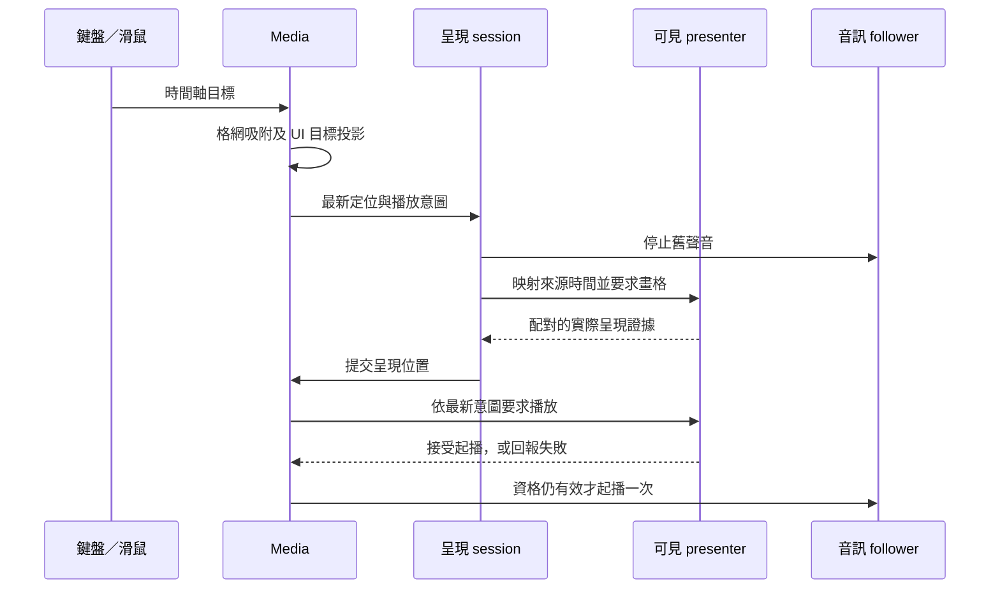

# FPS／時碼一致性

本文件是 FPS、時碼、播放點、seek、逐格及倒帶的時間契約。相關程式以 `FPS-SYNC` 標記，可搜尋目前實作位置；領域定義見[詞彙表](../CONTEXT.md)，一般模組責任見[技術架構說明](技術架構說明.md)。

## 1. 名詞

| 座標或讀數 | 用途與判讀 |
|---|---|
| 牆鐘秒數 | 真實經過時間，用於倍率及 cadence 量測 |
| 時碼 | `HH:MM:SS:FF`，DF 使用分號；它是影格標籤 |
| 影格格網 | 第 N 格位於 `N / exactFps` |
| 時間軸時間 | 字幕、播放點、片段、備註與交付共用的專案座標 |
| 來源時間 | 單一母素材的影片第零秒起算座標 |
| 播放器時間 | 容器／元素原始時間；可能帶有不同起點偏移 |
| 播放目標 | 尚待解碼或呈現完成的定位意圖 |
| 呈現位置 | 已由目前可見 presenter 證明的畫格位置 |

29.97 NDF 連續計格，與牆鐘每小時約差 3.6 秒。29.97 DF 透過跳過標籤接近牆鐘，不會刪除影片畫格，也不改變秒數。

## 2. 八條不變量

### I1. FPS 來自實測，不依檔名

桌面版使用 ffprobe 的 `info.video.fps`；網頁版使用實際畫格 timestamp 偵測。專案可選格率由 `state.js` 的 `FPS_SET` 與 `snapFps()` 統一處理，目前包含 23.976、24、25、29.97、30。交付格率選項另由 `shared/delivery-frame-rate.cjs` 管理。

偵測值不能先 `Math.round()`，否則會把 23.976 當作 24、29.97 當作 30。真實素材 `V_拼桌_FTR_24FPS_51FM+20FM_30P.mxf` 的檔名同時含兩種格率，不能作為時間證據。

來源 FPS 與專案格網各自保存。新專案可由首支素材初始化；專案重開及重新連結只更新來源 metadata，保留已保存的 FPS／DF。網頁延後偵測與桌面 probe 都須核對格網 revision；使用者明確選取同值 FPS 也會撤銷背景初始化資格。

NTSC 計算使用精確有理數：23.976 對應 `24000/1001`、29.97 對應 `30000/1001`、59.94 對應 `60000/1001`。`getExactFps()` 的比對容差目前為 0.01，必須小於 0.024；過去放寬到 0.05 曾把 24 誤判成 `24000/1001`。

### I2. 時間軸位置轉時碼只有 encoreParts()

播放器、字幕列表、時間軸刻度及監看 TC 由 `encoreParts()`／`secToEncore()` 產生標籤。其他模組不能自行拆時、分、秒與格。

佇列片長是明確例外的顯示 adapter：`queue.html` 取得凍結工作 duration／fps 與 preload 提供的共用精確格率，將整數格分解成 NDF 片長。它與 `secToEncore(duration, fps)` 有逐項契約測試，包含六小時 NTSC；不參與時間軸位置、監看或燒入 TC 的運算。

### I3. 影格格網只有 snapTimeToFrame()

seek、pause、拖曳、逐格、字幕時間及手勢交易共用 `snapTimeToFrame()`。DF 是標籤規則，不改變秒數格網。

字幕端點由 `subtitle-model.js` 的 `snapCueToFrames()` 集中合法化：正片長字幕吸附後至少保留一格；`addCue()` 在建立 History 前完成處理。專案讀取及 FPS 變更也先正規化，再建立 History／儲存基準，不能等重繪才修時間。無時間碼字幕不補造時間，辨識結果仍遵守原有提交准入。

批次時長調整先以精確 FPS 建立至少一格的下限，再將下限向上、鄰句邊界向下轉成合法格網，最後限制新終點。非整格鄰句若容不下一格，保留原句；不能把已吸附結果再夾回非格網位置。

字幕 FPS 轉換的預覽與確認共用 `getExactFps(from) / getExactFps(to)`，然後吸附目的格網。直接用選單的顯示小數比例，數小時後會累積一格誤差。

ASS 標準時間只有百分秒。`secToASS()` 直接將原秒數表達為百分秒，不先減半格；自產 ASS 的精確影格中繼資料負責往返。舊版自產檔的相容判斷見 [ADR-0002](adr/0002-自產-ass-無損往返.md)。

### I4. 靜止讀數同源於 Media.displayTime()

#### UI 權威與實際呈現

播放器時碼、seek bar、時間軸播放點、備註及監看 TC 統一讀 `Media.displayTime()`。暫停時讀 transport 保存並吸附的權威位置；持續播放時才讀已換回時間軸域的播放器時鐘。不能各自使用 `video.currentTime`、mpv `time-pos` 或 event data。

`Media.seek()` 可以先將播放目標投影到 UI，讓操作立即回應。這不代表畫格已抵達：`presentedTime()` 與呈現請求結果才提供完成證據，pending 期間的 UI 讀數不能用來宣告擷取、定位或起播成功。

播放中的 `tcCur` 與 `seekBar` 由同一個 `requestAnimationFrame` 迴圈同步，避免低頻 `timeupdate` 造成持續落後。In／Out 在按鍵事件發生時捕獲 `displayTime()`，不能等彈窗或非同步工作結束才讀。

#### 各 presenter 的完成證據

| Presenter | 必要證據 |
|---|---|
| HTML video | `requestVideoFrameCallback()` 的 `mediaTime` |
| mpv 播放定位 | 目標 `time-pos` 與同一請求的 `playback-restart` |
| mpv 暫停定位 | command ack 加命中目標的 `time-pos`；同格無新事件時主動查詢 |
| WebCodecs | 所有可見影片及圖片完成繪製；影片須提供實際來源 timestamp |

等待期間如果 mpv／WebCodecs 接管關係改變，請求要改用目前可見 presenter 的證據。mpv ack 不能替尚未完成的 Canvas 作證，隱藏 Canvas 也不能阻塞已切回 mpv 的請求。圖片須完成載入及繪製，但不參與影片來源 timestamp 比對。

#### 來源畫格區間與慢速播放

呈現容差先以時間軸秒數定義，再由同一片段映射為來源秒數。慢速播放可能讓數個專案影格共用一張來源畫格，只有實際來源區間涵蓋目標時才能提交；放大容差不能取代區間證據。

WebCodecs 使用實際 timestamp 與呈現索引時長；HTML／mpv 透過 `decode/source-frame-index.js` 查詢目前可見來源。三路共用 `demux.js` 的 `presentationSamples()`：先套 MP4 edit list，依相鄰呈現 PTS 計算區間。解碼順序的 sample duration、平均 FPS、非空歷史 frame 或預解碼的未來首格都不是顯示區間證據。沒有索引時只接受實際 PTS 容差。

來源區間左閉右開，反轉映射後為時間軸左開右閉；裁切尾端的第一格另保留片段起點。`fadeAlphaAtTimeline()` 僅吸收相鄰 offset 相減的一個 ULP 等級誤差，將微小負本地時間當成零；真正間隙、半開邊界及原始淡化時鐘不變。

#### 容器起點與來源原點

影片可以晚於容器開始。Probe 的 `timestampOffset` 用於已扣除容器起點的 FFmpeg／mpv，`presentationTimestampOffset` 用於保留絕對 PTS 的 HTML／WebCodecs。`shared/media-source-clock.cjs` 是原點映射的共用規則。

HTML adapter 按來源 URL 保存時鐘，seek、讀數、畫格 callback 及 metadata duration 都轉成同一影片來源座標；追加素材、重連及重疊音訊 voice 各用自己的來源。歸零 Proxy／對齊音訊的偏移為零；未歸零轉檔結果須登記實際 metadata。

真實驗證情境：容器從 5 秒開始、影片從 5.5 秒開始，來源 2.8 秒對應 HTML 原始 8.3 秒；mpv 的容器相對位置是 3.3 秒，對外仍回報來源 2.8 秒。只修 seek、未修畫格回報會留下漂移。驗證須比較容器從 0／5 秒開始的 MKV／MOV 真實像素及片長；原生細節見 [Electron 維護手冊](Electron_維護手冊.md)。

原始 File 的片長及原點共用有界 metadata／索引快取。MP4／MOV 依 MP4Box 提供的下一個 box 位置跳過媒體及填充內容，包含檔尾 moov，並保留原 sample 位址。WebM 由有界 EBML metadata 及首批 block 取得原點。無有限片長或不支援 edit list 時走既有退路，不以整檔讀取或猜測補造證據。

#### PCM 的獨立解碼原點

PCM 音訊另有自己的解碼起點。`AudioEngine.decodeSourceAudioData()`／`normalizeSourceAudioBuffer()` 按各 stream 原點換算整數 sample，裁去影片前的音訊或補上前置空白，再供波形、反向音訊、人聲分離及辨識使用。

AAC active edit 已丟棄的編碼樣本、Opus 已消耗的 pre-skip 不能再次位移；Opus 解碼原點與 HTML block／CodecDelay 時鐘分開。已對齊 buffer 及其 Mono 副本保留原點標記，避免重複換算。驗證比較解碼樣本與原生 PCM，不能只看長度或是否有聲音。

#### MOV 延後片長與定位所有權

MOV 的 HTML duration 可能讀到後段 PTS 後才延長。HTML adapter 保留初期被截斷的 seek 目標，在可達範圍真正擴大時重送；尚未完全到達也須讓解碼器繼續讀 metadata。同值事件不重複定位，最終仍由實際畫格 callback 確認；換來源、transport 或取消後撤銷重試，逾時不能回報成功。

原音元素、重疊 voice 及逐格 scrub 共用定位入口，位置就緒前不能起播；scrub 時長由定位與播放就緒後起算。網頁固定幀的獨立影片載體也以 `presentElement()` 確認後才擷取。尚未加入專案的素材仍持有匯入工作資格，reset 後不得晚到起播。

#### 微秒精度與裁切末格

CTS 及 edit offset 保留實際精度，相加後只轉一次整數微秒，避免各自捨入造成一 tick 偏移。精確 PTS 屬於由該 PTS 開始的畫格，反轉亦同；只有半開 Out 不能取到尾點畫格。

HTML／WebCodecs 共用 `sourceFrameTargetUs()` 處理 In／Out，只吸收浮點 ULP。預取與繪製使用同一微秒目標，末格目標為嚴格小於 Out 的最大整數微秒。來源 30 FPS、專案 25 FPS 裁到 1.04 秒，末格應為 1.033333 秒；固定減 `1/120` 會跳過它。

### I5. 逐格以 displayTime() 為基準

`stepFrame()`／`nudge()` 將 `displayTime()` 轉成整數格，再增減格數並交給 `Media.seek()`：

```text
targetFrame = round(displayTime * exactFps) + direction
targetTime  = targetFrame / exactFps
```

禁止從沉降中的來源浮點時間連續相加。快速輸入時 UI 權威目標可先推進，舊畫格回應不能把它拉回。

單格定位的完成容差必須小於半格，目前為 0.45 格；一般 seek 的 1.5 格容差會把上一格誤認為成功。mpv 逐格以 `time-pos` setter 送出，避免連續 `seek absolute` 形成舊定位佇列。長按方向鍵維持逐格及既有節流，不改為 JKL；單次按鍵保留短促 scrub，長按不堆疊切片聲音。

時碼欄位上下鍵也由 `time.js` 計格。29.97 DF 的 `00:00:59;29` 下一格為 `00:01:00;02`，59.94 DF 為 `;04`；第十個整分鐘從 `;00` 開始。時／分／秒分量保留文字進位意圖，遇不存在的 DF 標籤向前到該秒第一個有效格，不另抄跳號公式。

### I6. 原始播放器時間不可覆寫暫停權威值

mpv 暫停仍可能持續回報非格網 `time-pos`。`TimelineTransport.observeSourceTime()` 將差小於 4 格的變動視為沉降抖動，保留權威值；明顯跳轉才吸附後提交。

載入初始零秒、來源切換、間隙及純音訊時間軸使用自己的資格或虛擬時鐘，不能被舊 mpv 回報覆寫。

來源已載妥後，若較新的定位已由當前呈現 session 證明完成，它可以接手來源切換，不必繼續等待可能被 mpv 合併的中間 `time-pos`。舊 session 的畫格、載入中的初始零秒及未完成的定位都沒有此資格；逾時不是畫格完成證據。

### I7. 片段邊界永遠是時間軸時間

片段 offset、鍵盤邊界跳轉、切割、字幕、備註及交付都屬於時間軸域。解除影音保留原片段的來源範圍、offset、速度及反轉，獨立音訊擁有自己的時間軸長度。

影片與外音共用 `sequence-time.js` 的純映射，公式見[技術架構說明 §0.5](技術架構說明.md#05-時間域外部是時間軸時間播放器是來源時間)。辨識來源秒數先轉回時間軸；反轉後仍以升冪起訖建立字幕。辨識工作的凍結格網及提交政策由既有 session／commit 介面持有，不因視窗重開改變。

固定畫面的預設來源格先由 `Seq.toSource()` 映射目前時間軸位置，再限制來源的半開 Out 與 EOF；不能先在時間軸尾端扣掉一個來源格，否則變速及反轉會選錯首末格。

字幕導航在無選取時依目前時間軸位置尋找下一句；後方沒有字幕便保持原位，不循環跳回首句。提前五格的入口也須先找到目標，再依精確專案格網退回五格。

### I8. 監看 TC 與燒入 TC 分工

| 類型 | 時間及格率來源 |
|---|---|
| 播放器監看 TC | `Media.displayTime()` 與專案 FPS／DF |
| 交付燒入 TC | 凍結工作的 `timelineStart` 與該列輸出 FPS |
| WAV | 沒有畫面，不提供燒入 TC |

交付格率預設依專案，也可逐列設定。起點由同一時間軸秒數按該列 FPS 換算；DF 只在 29.97／59.94 生效，其他格率用 NDF。影格率轉換不改片段、字幕或音訊的秒數，監看與燒入也不是同一個開關。

## 3. 呈現生命週期



同時最多一個 in-flight，只保留最新 pending。使用者可在等待期間改為 play／pause；reset、換素材或專案會取消舊請求。presenter 接管時改用目前可見畫面的證據。

音訊只能在實際畫格完成後起播或校正；有播放器的路徑還須確認起播被接受，兩者是不同證據。`Media.startElementSources()`／`startBufferSources()` 會拒絕播放轉換等待中的背景重啟，避免聲道接管、來源切換先播放一次，畫格抵達後又從相同位置起播。起播與晚到回覆的責任見[技術架構](技術架構說明.md#播放聲音的唯一-owner)，呈現節流的取捨保留在 [ADR-0003](adr/0003-倒帶以實際呈現畫格節流.md)。

## 4. 關鍵 owner

| 模組 | 唯一責任或介面 |
|---|---|
| `time.js` | 精確 FPS、DF／NDF、標籤及 frame snap |
| `shared/delivery-frame-rate.cjs` | 精確 NTSC 有理數與交付格率對照 |
| `state.js` | 專案 FPS／DF 及明確格網變更的 revision |
| `sequence-time.js`、`sequence.js` | 影片及外音的速度／反轉時間映射與片段查詢 |
| `clip-model.js` | 片段編輯交易及固定畫面預設來源格的 Out／EOF 限制 |
| `subtitle-model.js` | 字幕端點的格網與至少一格准入 |
| `tcparse.js` | 時碼輸入、分量上下鍵及組字按鍵保護 |
| `subio.js` | FPS 轉換與批次時長，使用模型的合法上下限 |
| `media-presentation-core.js` | 請求、取消、pending、播放意圖及畫格 hold |
| `media.js` | `displayTime()`、presenter 選擇、來源切換與音訊生命週期 |
| `media-player-adapter.js` | HTML／mpv 操作、來源時鐘及延後定位 |
| `transport-controller.js` | 逐格、JKL、倒帶 session、字幕導航及按鍵當下的 In／Out |
| `timeline-interaction-engine.js` | jump／drag 意圖；不私建播放器時鐘 |
| `media-loader.js` | 載入與 mpv listener 的工作資格 |
| `media.js` 的 `observeMpvEvent()` | mpv 來源讀數、暫停抖動與播放狀態裁定 |
| `decode/demux.js`、`source-frame-index.js` | 實際 CTS 呈現區間及有界索引 |
| `decode/player.js` | 各可見層畫格證據及完整 Canvas 發布 |
| `timeline-renderer.js` | 時間軸刻度與播放點的同源顯示 |
| `delivery-list.js`、`delivery-job.js` | 凍結起點、逐列格率及交付範圍 |
| `electron/main.js`、`queue-preload.js`、`queue.html` | 佇列片長的精確格率純值 adapter |
| `electron/export-plan.js` | 輸出有理數格率與轉碼；H264-MP4 不猜測來源 copy 資格 |

## 5. 常見失敗

### 時間軸刻度與播放器差幾秒

檢查是否有人以牆鐘秒數自行拼時碼，或先將 23.976／29.97 四捨五入。標籤回到 `encoreParts()`，格率回到共用有理數。

### 右鍵跳兩格、左鍵不動

檢查逐格基準是否來自原始播放器浮點時間，或舊 request 是否回寫了較新的目標。應從 `displayTime()` 的整數格推進。

### 按左右鍵但時間點沒有變

依序核對單格容差、mpv `time-pos` setter、最新 pending 的提交資格、重複輸入的目標累積，以及 presenter 是否只有 IPC ack 而缺畫格證據。

### seek 後立刻播放看到舊畫面或音訊先跑

檢查 session 的最新播放意圖、`playback-restart` 配對及背景音訊起播資格。等待期間的 pause ack 不得清掉較新的 play，背景來源也不得提前起播。

### 純字幕專案播放點變了，預覽沒變

沒有影片時仍須發布統一 seeked／playhead invalidation；消費端依 `displayTime()` 重繪，不能依是否存在 HTML video／mpv 決定要不要更新。

## 6. 驗證

時間變更先鎖定相關契約測試，再依[開發與驗證](開發與驗證.md)執行真機播放驗收；本文件不另維護啟動及 CDP 指令。

| 要證明的內容 | 主要測試 |
|---|---|
| 有理數、DF、格網及長片時碼 | `time.test.js` |
| 最新呈現、取消與播放意圖 | `mediaPresentationCore.test.js`、`mediaPresentationRuntime.test.js` |
| 時間域、逐格與 JKL | `timelineTransport.test.js`、`transportController.test.js` |
| HTML／mpv 來源原點與真實像素 | `webSourceClock.test.js`、`desktopAudioSourceClock.test.js` |
| PCM 原點及實際聲音位置 | `decodedSourceAudioClock.test.js`、`decodedSourceAudioClockNative.test.js` |
| seek／背景起播及聲音數量 | `mediaPlacementAudio.test.js`、`audioScrubOwnership.test.js` |

保留三支真實素材矩陣：`V_MAMAMOO_FTR_24fps_51FM.mov`、`V_拼桌_FTR_24FPS_51FM+20FM_30P.mxf`、`V_心機特務_FTR.mp4`。核對中尾段長距離 seek、單格及快速交替、長按、seek 後立即 play／pause、JKL 多倍率、倒帶回母素材，以及畫面、播放點與監看 TC 的持續漂移。

驗收須量測實際畫格與 PCM／voice，不能只看 Promise、檔案存在或 TC 字串相同。新增時間邊界時同步補 `FPS-SYNC`、介面測試及本文件責任表。
