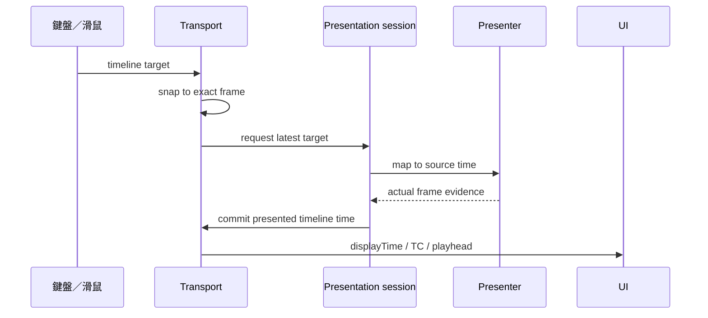

# FPS／時碼一致性

改 FPS、時碼、seek、播放點、逐格、倒帶或 presenter 前必讀。程式中的相關邊界以 `FPS-SYNC` 標記；用全域搜尋找目前位置，不手動維護數量。

## 1. 名詞

| 名詞 | 意義 |
|---|---|
| 牆鐘秒數 | 真實經過的浮點秒數 |
| 時碼 | `HH:MM:SS:FF`；29.97 DF 使用分號 |
| 影格格網 | 第 N 格位於 `N / exactFps` |
| 播放目標 | 使用者要求前往的位置，畫面尚未必抵達 |
| 呈現位置 | 播放器實際交出的可見畫格 |
| 時間軸時間 | UI、字幕、片段與交付共同座標 |
| 來源時間 | HTML video、mpv、WebCodecs 內部座標 |

29.97 NDF 是數影格，不是讓時碼貼近牆鐘；每小時會慢約 3.6 秒。要時碼接近牆鐘才用 29.97 DF。

## 2. 八條不變量

### I1. FPS 來自實測，不依檔名

- 桌面版：ffprobe `info.video.fps`。
- 網頁版：`requestVideoFrameCallback` 的實際 timestamp。
- 最後經 `snapFps()` 對齊 23.976、24、25、29.97、30。

不可先 `Math.round()`；否則 23.976 變 24、29.97 變 30。實際素材檔名可能同時寫 24FPS 與 30P，因此檔名只能當線索。

素材 FPS 與專案格網各自保存：新專案第一次匯入可用實測 FPS 初始化格網；重開或重新連結專案只更新片段來源 FPS，保留專案保存的 FPS／DF。網頁版延後完成的偵測必須仍持有格網修改資格，不能覆寫使用者已選擇的 FPS，即使新選擇和原值相同。

`getExactFps()` 的比對容差必須小於 0.024；目前 0.01。放寬到 0.05 會把 24 誤判為 24000/1001。

### I2. 時間軸位置轉時碼只有 encoreParts()

播放器、字幕列表、時間軸刻度、匯出與監看 TC 都由 `encoreParts()`／`secToEncore()` 產生。禁止在其他地方自行 `Math.floor` 拼字串。

佇列的輸出片長標籤由凍結工作的 duration／fps 產生，固定使用 NDF。`queue.html` 的顯示 adapter 透過 preload 取得共用精確 FPS，將整數格分解成片長標籤；契約測試逐項比對 `secToEncore(duration, fps)`，尤其包含六小時的 NTSC 格率。該 adapter 不參與播放點、監看或燒入 TC 的位置計算。

### I3. 影格格網只有 snapTimeToFrame()

seek、pause、滑鼠拖曳、逐格、字幕時間與手勢交易都用 `snapTimeToFrame()`。

`subio.js` 的批次字幕時長調整以 `getExactFps()` 計算至少一格的下限，再把下限向上、下一句邊界向下轉成合法格網，最後才限制新結束時間。相鄰字幕的非整格邊界若容不下一格，保留原句，避免限制步驟把已吸附的結果拉回非格網。

字幕 FPS 轉換的預覽與確認共用 `getExactFps(from) / getExactFps(to)`，再吸附到專案格網；下拉選單的 23.976／29.97 等顯示值不能直接作為換算比例。顯示小數在數小時字幕中會累積一格誤差，來源與目標皆須使用精確格率。

新建定時字幕、正片長字幕匯入或變更專案 FPS 時，以 `subtitle-model.js` 的 `snapCueToFrames()` 保持至少一格，避免兩端各自吸附後變成零長度。`addCue()` 在建立 History 前處理端點，右鍵游標位置等 caller 不得留下非格網快照。無時間碼字幕不補造時間；辨識結果的嚴格時間有效性仍由原有提交規則裁定。

ASS 只有百分秒；`secToASS()` 直接表達原秒數，不預先減半格。SUB Tool 自產 ASS 的精確 frame metadata 負責往返還原。

### I4. 靜止讀數同源於 Media.displayTime()

`Media.displayTime()` 是 UI 權威位置：

- 暫停：已提交且吸附格網的呈現位置。
- 播放：播放器持續回報的時間軸位置。

播放器時碼、seek bar、時間軸播放點、備註與監看 TC 都讀它。不可直接讀 `video.currentTime`、mpv `time-pos` 或 event data。

播放期間動畫迴圈以 `requestAnimationFrame` 同步 `tcCur` 與 `seekBar`，不依賴較低頻的瀏覽器 `timeupdate`；打點 In／Out 於按鍵事件觸發時捕獲 `Media.displayTime()`，避免非同步作業或彈窗延遲造成時碼漂移。預覽 Proxy 的短 GOP 可減少解碼等待，但不改變本節的時間權威：只有實際呈現的畫格能提交呈現位置。

播放目標不能冒充呈現位置。`requestPresentation()` 送出目標後，必須等待實際畫格證據：

- HTML video：`requestVideoFrameCallback().mediaTime`
- mpv 播放：目標 `time-pos` 與同一請求的 `playback-restart`
- mpv 暫停：command ack 加命中目標的 `time-pos`
- WebCodecs：所有可見層完成繪製後的來源 timestamp

請求等待期間切換 mpv／WebCodecs 時，要重新判定目前可見 presenter 的完成證據；不能沿用送出當下的 takeover 布林值。mpv ack 不能代替尚未完成的可見 Canvas，已切回 mpv 時也不能繼續等待隱藏 Canvas。圖片須完成載入才繪製整個合成畫面，但不參與影片來源 timestamp 的格網比對。

呈現容差使用時間軸秒數，交給來源 presenter 前由同一片段映射成來源容差。慢速播放可能有多個專案影格共用同一來源畫格：只有實際畫格的來源區間涵蓋目標時，才能提交該時間軸位置；不能把容差放大來接受未抵達的下一格。WebCodecs 使用實際 timestamp 與呈現索引的區間時長；HTML／mpv 由 `decode/source-frame-index.js` 取得目前可見來源的實際 CTS 區間，不能用平均 FPS 補造格長或定位。三路共用 `demux.js` 的 `presentationSamples()`，將 MP4 edit list 換算成播放器時間，並依相鄰呈現 PTS 計算區間；解碼順序的 sample duration 不代表 VFR／B 畫格的顯示時長。來源前置空白也不能以預解碼的未來首格提早確認。沒有可取得的索引時只接受實際 PTS 容差。來源區間左閉右開，反轉後時間軸區間左開右閉；裁切尾端的第一格另保留片段起點。

相鄰片段的 offset 與格網秒數可能因浮點相減差一個 ULP。合成入口 `fadeAlphaAtTimeline()` 只將這種微小負本地時間視為起點零秒，避免已被序列接受的首格變成透明；真正的前置間隙、片段半開邊界與淡化原時鐘不變。

母素材的影片起點可能晚於容器起點。Probe 的 `timestampOffset` 供已扣除容器起點的 FFmpeg／mpv 使用；`presentationTimestampOffset` 供保留絕對呈現 PTS 的 HTML／WebCodecs 使用。HTML transport 按目前來源 URL 保存對應時鐘，seek、讀數、畫格 callback 與 metadata duration 都經 `shared/media-source-clock.cjs` 換算為影片來源秒數；追加素材、重連與重疊音訊 voice 使用各自來源。已歸零的 Proxy／對齊音訊偏移為零，未歸零的轉檔結果仍須依其 metadata 登記來源時鐘。WebCodecs 與來源索引也將實際 CTS 換到同一來源原點，不能只修 seek 卻留下原始容器畫格回報。容器從 5 秒開始、影片從 5.5 秒開始時，來源 2.8 秒對應 HTML 原始 8.3 秒；不能套用容器相對的 3.3 秒。驗證同時核對容器從 0／5 秒開始的 MKV／MOV 真實像素與片長。mpv 的 native 換算見 [Electron 精準呈現](Electron_維護手冊.md#精準呈現)。

網頁原始 File 的片長與來源原點共用 `decode/source-frame-index.js` 的 metadata／畫格索引快取。MP4／MOV 由 MP4Box 決定下一個容器 box 位置，跳過媒體與填充內容，讀取有界的 moov；檔尾索引也保留原 sample 位址，不得以整檔讀取換取定位。WebM adapter 由有界的 EBML metadata 與首批 block 取得來源原點；無有限片長或不支援的 edit list 保留既有退路，不補造來源證據。

解碼後的 PCM 另有自己的起點。`AudioEngine.decodeSourceAudioData()`／`normalizeSourceAudioBuffer()` 依每條音軌的實際解碼原點換算整數 sample，裁去影片之前的音訊或補上真正的前置空白，再供波形、反向音訊、人聲分離與語音辨識使用。AAC active edit 已捨棄的前置編碼樣本、Opus 已消耗的 pre-skip 都不能再次移動；後者的解碼原點與 HTML 的 block／CodecDelay 時鐘分開保存。已對齊 PCM 與其 mono 副本保留原點標記，避免同一 buffer 重複換算。驗證以原始解碼樣本和原生 PCM 內容比較，不能只看 buffer 長度或是否有聲音。

MOV 的 HTML metadata duration 可能在讀到實際 PTS 後延長。HTML adapter 保留被初期片尾截斷的 seek 目標；每當可達範圍真正擴大便重送，即使尚未到達原始目標，也讓解碼器繼續讀取後段 metadata。同值的連發事件不重複定位，仍以實際畫格 callback 確認呈現；換來源、換 transport 或取消請求即撤銷重試，逾時不得回報成功。原始音訊元素、重疊片段的獨立載體與逐格音訊預聽共用這個定位入口；延後定位完成前不能起播，預聽時長從定位與播放就緒後計算。網頁凍結畫面的獨立影片載體也經同一 adapter 的 `presentElement()` 確認實際來源畫格，再擷取像素。尚未加入專案的素材也須保留匯入工作的所有權，reset 後不得晚到起播。

來源 CTS 與 MP4 edit offset 必須保留實際精度，再一次換算成整數微秒；分別捨入再相加會將畫格起點移動一 tick。裁切內的精確來源 PTS 屬於該 PTS 開始的畫格，反向播放也相同；只有半開的 Out 不得取到尾點畫格。HTML／WebCodecs 共用 `sourceFrameTargetUs()` 處理 In／Out，僅吸收浮點表示的 ULP 誤差，不能將每一個反向畫格邊界都退到前一格。

WebCodecs 預取與繪製共用來源微秒目標，裁切尾端使用嚴格小於 `out` 的最大整數微秒，不能固定減 `1/120`，也不能讓捨入把 epsilon 消掉。來源 30 FPS、專案 25 FPS 裁到 1.04 秒時，末格是 1.033333 秒；固定尾端補償會跳過它。

### I5. 逐格以 displayTime() 為基準

`stepFrame()`／`nudge()` 從目前呈現格加減整數格，再交給 `Media.seek()`。

```text
targetFrame = presentedFrame + direction
targetTime  = targetFrame / exactFps
```

不能從帶浮點沉降的來源時間继续相加；那會造成右鍵跳兩格、左鍵不動。

逐格完成 tolerance 必須小於半格。一般 seek 的 1.5 格容差不能套到只差一格的操作，否則舊畫格也會被誤判為成功。

mpv 逐格使用 `time-pos` setter，不使用連續 `seek absolute`。快速連按時只保留最新 pending；舊畫格即使晚到，也不可覆寫權威位置。

時碼輸入欄位的上下鍵也共用 `time.js`：格分量先轉成整數影格，加減一格後再由 `encoreParts()` 產生標籤。29.97 DF 的 `00:00:59;29` 下一格為 `00:01:00;02`，59.94 DF 則跳至 `;04`；第十個整分鐘仍從 `;00` 起算。時／分／秒分量保留文字分量的進位意圖，遇到不存在的 DF 標籤時前進至該秒第一個有效格，不能自行複製跳號公式。

### I6. 原始播放器時間不可覆寫暫停權威值

mpv 暫停時可能持續回報偏離格網的 `time-pos`：

- 與權威值差小於 4 格：視為沉降抖動，不覆寫。
- 明顯大幅變動：視為 mpv 內直接跳轉，吸附後提交。

### I7. 片段邊界永遠是時間軸時間

解除影音後，外部音訊保留原片段的 offset／in／out、速度與反轉方向，擁有自己的時間軸長度。鍵盤跳轉、切割、字幕、備註與匯出仍在時間軸域工作；只有播放器及辨識來源片段的結果才轉換時間域。

影片與外音共同使用序列層 `sequence-time.js` 的純映射；公式以 [技術架構說明 §0.5](技術架構說明.md#05-時間域外部是時間軸時間播放器是來源時間) 為準。ASR 的來源秒數先映射回時間軸，反轉後仍以升冪起訖建立字幕。

### I8. 監看 TC 與燒入 TC 分工

- 播放器 `TC`：讀 `Media.displayTime()`，只供監看。
- 交付「壓入時間碼」：從凍結工作的 `timelineStart` 起算。
- WAV 沒有畫面，不提供燒入 TC。

監看使用專案 FPS；交付可逐列指定輸出 FPS（預設依專案），燒入 TC 的起點由同一時間軸秒數按該列 FPS 換算。DF 偏好只在 29.97／59.94 生效，其他格率使用 NDF。影格率轉換不改片段、字幕或音訊的秒數；兩者不是同一個開關。

## 3. 呈現生命週期



同一 session：

- 同時最多一個 in-flight。
- 只保存最新 pending。
- newer intent 可在畫格到達前改成 play 或 pause。
- reset、換素材與換專案會取消舊請求；presenter 接管或交回時，未完成請求改用目前可見 presenter 的證據。
- 音訊 follower 只能在實際畫格提交後啟動或校正。

## 4. 關鍵 owner

| 模組 | 責任 |
|---|---|
| `time.js` | 使用共用精確 FPS，擁有 DF／NDF、時碼與 frame snap |
| `sequence-time.js`、`sequence.js` | 影片與外音共用的速度／反轉時間映射及序列片段查詢 |
| `subtitle-model.js` 的 `snapCueToFrames()` | 正片長字幕吸附後至少保留一格 |
| `tcparse.js` | 時碼輸入解析與分量上下鍵；DF 標籤仍交由 `time.js` 決定 |
| `subio.js` 的批次時長調整 | 共用精確格率與 frame snap，先換算合法上下限再限制結束時間 |
| `media-presentation-core.js` | in-flight／pending／取消／commit |
| `media.js` | presenter 選擇、`displayTime()`、時間域轉換、seek 與 audio lifecycle |
| `media-player-adapter.js` | HTML／mpv 共同操作 |
| `transport-controller.js` | 左右逐格、JKL、播放意圖 |
| `timeline-interaction-engine.js`、`transport-controller.js` | 滑鼠 jump／drag 與跳轉後播放政策 |
| `media.js` 的反向播放流程 | 反向穿梭目標、cadence 與逐次 await 的素材歸屬 |
| `media-loader.js` | 媒體載入、mpv 事件註冊及 intake ownership 檢查 |
| `media.js` 的 `observeMpvEvent()` | mpv 來源時間回報、播放狀態與呈現位置裁定 |
| `decode/player.js` | WebCodecs 多層繪製與 timestamp |
| `timeline-renderer.js` | 播放點與刻度 |
| `subio.js`、`delivery-list.js` | 凍結輸出起點、逐列交付 FPS 與燒入 TC |
| `shared/delivery-frame-rate.cjs` | renderer、佇列顯示及輸出共用精確 NTSC 有理數對照 |
| `electron/main.js`、`electron/queue-preload.js`、`electron/queue.html` | main 提供共用精確 FPS 的純值 adapter，preload 取得結果，畫面將片長轉成整數格的 NDF 標籤；IPC 細節見 [Electron 維護手冊](Electron_維護手冊.md) |
| `electron/export-plan.js` | 精確輸出格率與轉碼；H264-MP4 從交付快照重編，避免來源 codec 未證實或片尾超出交付範圍 |

## 5. 常見失敗

### 時間軸刻度與播放器差幾秒

原因通常是其中一邊用牆鐘秒數手拼時碼。兩邊都改回 `encoreParts()`。

### 右鍵跳兩格、左鍵不動

原因通常是從原始 `currentTime` 或舊 request 計算下一格。以 `displayTime()` 為基準，並阻止舊呈現回寫。

### 按左右鍵但時間點沒有變

依序檢查：

1. tolerance 是否錯用一般 seek 的 1.5 格。
2. mpv 是否仍用 `seek absolute`。
3. 先前 in-flight 是否在較新目標後 commit。
4. 重複 keydown 是否從實際呈現格而非 pending 目標重算。
5. presenter 是否只回 IPC ack，卻沒有實際畫格證據。

### seek 後立刻播放看到舊畫面或音訊先跑

播放意圖可更新，但 presenter clock 與音訊不得在目標畫格到達前啟動。檢查 `playback-restart` 配對與 presentation session。

### 純字幕專案播放點變了，預覽沒變

無 HTML video／mpv 時仍要送統一 seeked／playhead invalidation，所有 consumer 再讀 `displayTime()`。

## 6. 驗證

純規則：

```bash
npm test -- tests/time.test.js
npm test -- tests/mediaPresentationCore.test.js
npm test -- tests/timelineTransport.test.js
npm test -- tests/transportController.test.js
```

真機：

```bash
npm run build
node scripts/acceptance/verify-transport-smoothness.js
node scripts/acceptance/verify-reverse-shuttle.js
```

實際素材：

- `V_MAMAMOO_FTR_24fps_51FM.mov`
- `V_拼桌_FTR_24FPS_51FM+20FM_30P.mxf`
- `V_心機特務_FTR.mp4`

至少測：

- 中段與尾段長距離 seek
- 暫停後單次左右格
- 快速交替左右格
- 按住方向鍵
- seek 後立刻播放／暫停
- J／K／L 與多倍率
- 停止倒帶後回母素材同一格
- 播放點、播放器 TC、實際畫面零持續漂移

新增時碼相關邊界時，補 `FPS-SYNC` 標記、測試與本文件 owner 表。
