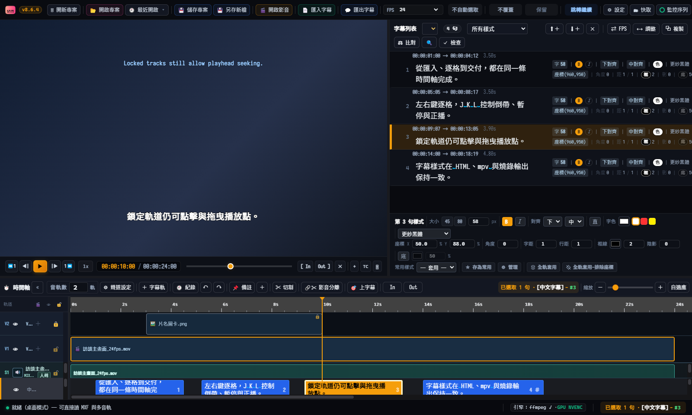
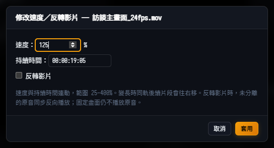
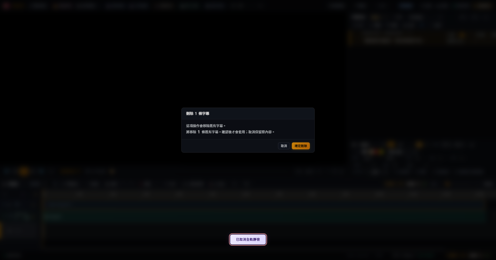
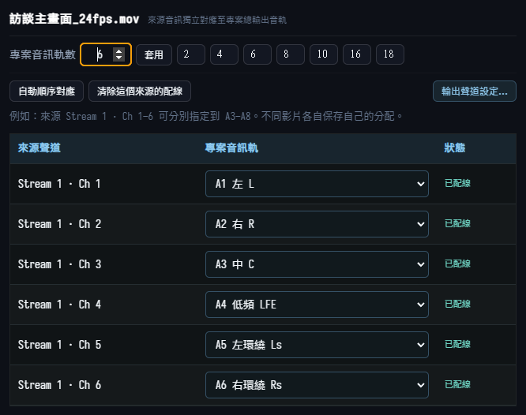
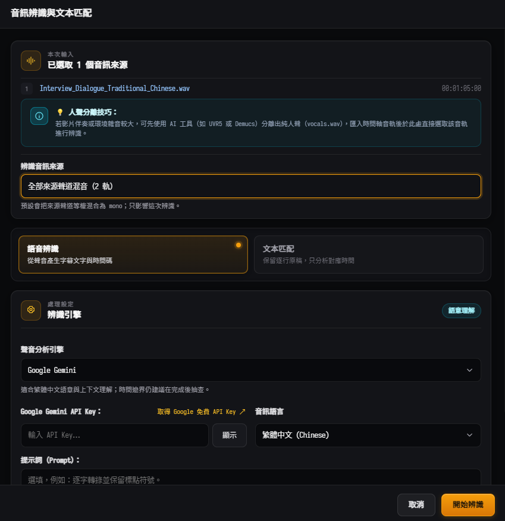
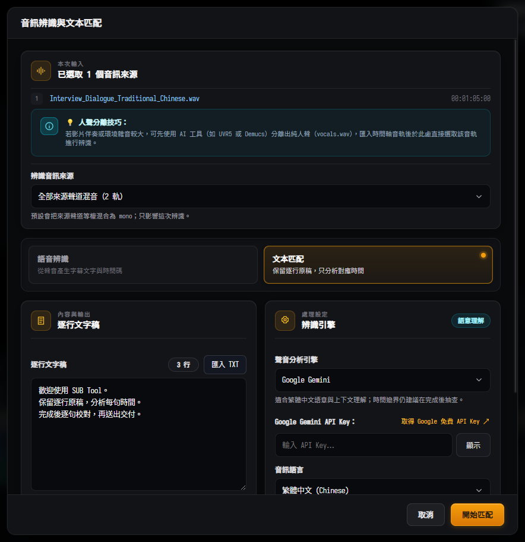
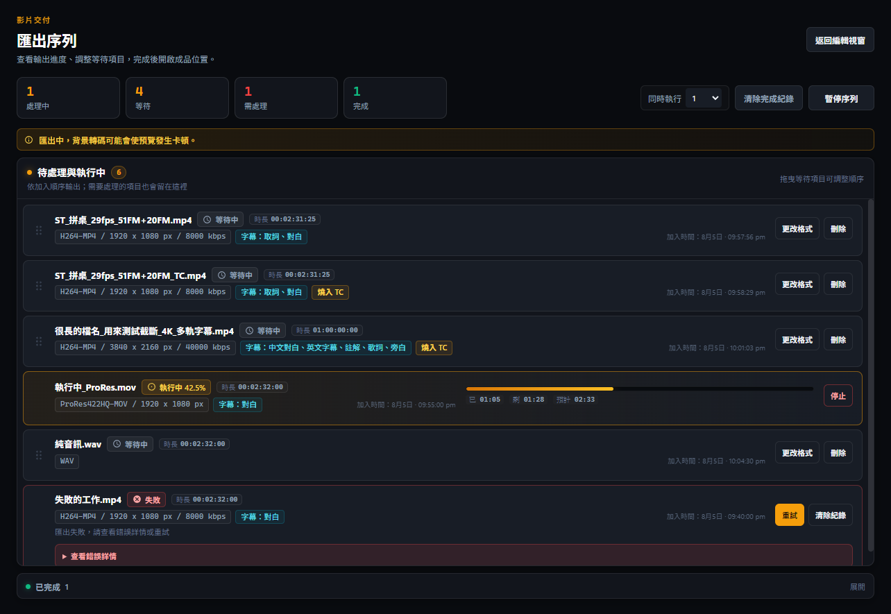
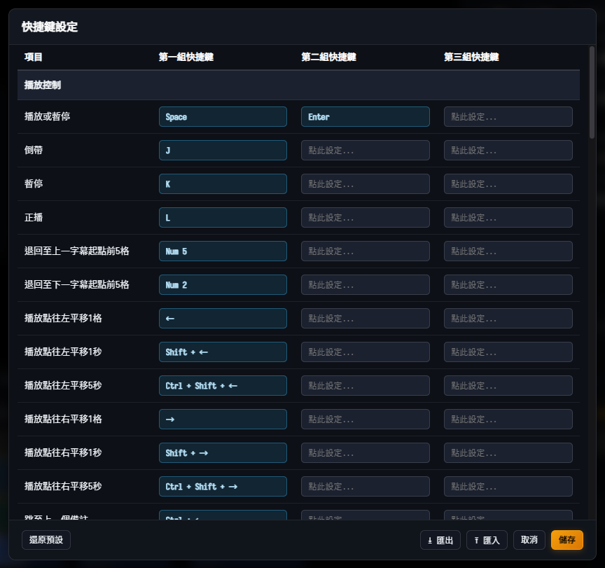
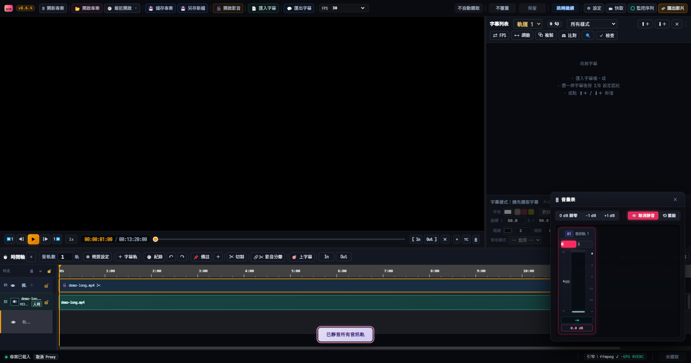

# SUB Tool 使用說明

這份手冊從載入素材、製作字幕一路說明到交付成品。第一次使用可先做完[第一條字幕](#3-五分鐘完成第一條字幕)，再依工作需要查閱各節。安裝來源與文件導覽見 [README](../README.md)；建置、測試、打包及維護細節見[開發與驗證](開發與驗證.md)。

## 1. 安裝與開啟

### Windows 桌面版

1. 從 [GitHub Releases](https://github.com/evanwayc-star/SUB_Tool/releases/latest) 下載 Setup 安裝檔。
2. 安裝並開啟 SUB Tool。左上角會顯示目前版本。
3. 按「開啟影音」選擇母素材，或把檔案拖進工作區。
4. 若是繼續舊工作，改用「開啟專案」、最近開啟清單，或雙擊 `.subtool` 專案檔。

桌面版附有影音處理與播放工具，適合 MXF、MOV、多聲道、長片及正式影片交付。先保留原始母素材，再進行字幕與剪輯；專案檔不會把影片包進去。

### 桌面版與網頁版的差別

| 工作 | 桌面版 | 網頁版 |
|---|---|---|
| 編輯字幕、時間軸與專案 | 支援 | 支援 |
| 播放素材 | 可使用原生播放器與轉檔快取 | 受瀏覽器支援的容器、編碼及記憶體限制 |
| 多音軌、大型 MXF／MOV 等素材 | 適合 | 建議改用桌面版 |
| 匯入與匯出字幕檔 | 支援 | 支援，透過瀏覽器下載 |
| 專案儲存 | 寫入選定的 `.subtool` | 下載專案檔；重開時可能要重選媒體 |
| 九種影片／音訊交付與匯出序列 | 支援 | 使用桌面版 |
| 字幕軌道比對視窗、自訂字型檔匯入 | 支援 | 使用桌面版 |

網頁版能否播放一份 MP4／MOV，取決於裡面的實際編碼。副檔名相同不代表一定能解碼。大型素材讀取或多聲道受限時，請使用桌面版。

### 從原始碼啟動

已有原始碼與開發環境時，可使用根目錄的 `啟動桌面版.bat`、`啟動網頁版.bat` 或 `啟動網頁開發版.bat`。環境準備與各腳本用途統一放在[開發與驗證](開發與驗證.md)，操作方式仍依本手冊。

## 2. 介面

| 區域 | 用途 |
|---|---|
| 最上方工具列 | 開新／開啟／儲存專案、開啟影音、字幕匯入匯出、FPS、設定與交付 |
| 左上播放器 | 看畫面、聽聲音、逐格、JKL、輸出範圍、安全框與監看時碼 |
| 右側字幕列表 | 選字幕軌、編輯文字與時間、樣式篩選、搜尋、比對與檢查 |
| 字幕樣式面板 | 修改選取字幕的字型、外觀、位置與常用樣式 |
| 下方時間軸 | 視訊／圖片、素材音訊、字幕軌、波形、播放點與備註 |
| 音量表／混音器 | A1、A2… 專案音訊軌的 M、S、音量與電平 |
| 最下方狀態列 | 處理進度、素材資訊、目前選取；背景處理時提供取消按鈕 |

拖曳播放器與字幕列表中間的分隔線可調整寬度，拖曳時間軸上緣可調整高度。版面會記住上次調整。需要看音量表時，按播放器旁的混音器按鈕或 `U`。

右側字幕軌選單決定「目前編輯哪一軌」，眼睛圖示決定「這一軌是否顯示」。切換、隱藏與鎖定軌道是不同操作。

## 3. 五分鐘完成第一條字幕

1. 按「開啟影音」載入一支影片，確認畫面與聲音正常。
2. 按 `Ctrl+S`，先存成 `.subtool`。首次編輯也會出現儲存建議；可立即儲存或選「稍後再說」。
3. 在字幕列表上方選目的字幕軌。空白專案已有字幕軌，需要其他語言或角色時再新增。
4. 定位到第一句開始，按 `I`（或 `Q`）。沒有選取字幕時會新增一條；已有選取時會修改該句起點。
5. 播放到句尾，按 `O`（或 `W`）設定終點。終點必須晚於起點。
6. 雙擊右側該列文字，輸入內容，按 `Enter` 完成；`Shift+Enter` 換行。
7. 用 `←`／`→` 逐格檢查起訖，再調整字級、位置與外觀。
8. 按 `Ctrl+S` 保存。要交字幕檔，按「匯出字幕」；要把字幕燒在影片上，使用桌面版「匯出影片」。

製作下一句時，先取消上一句的選取再按 `I`，或使用[上字幕模式](#上字幕模式與未定時稿)。若出現將移除既有字幕的提示，先核對句數，再決定確認或取消。

## 4. 播放與定位

### 逐格與 JKL

| 操作 | 結果 |
|---|---|
| `Space` 或非文字編輯狀態的 `Enter` | 播放／暫停 |
| `←`／`→` | 前後一格；按住可連續逐格 |
| `Shift+←`／`Shift+→` | 前後一秒 |
| `Ctrl+Shift+←`／`Ctrl+Shift+→` | 前後五秒 |
| `J`／`K`／`L` | 倒播／暫停／正播；連按 J 或 L 逐級加速，最高 5× |
| `Home`／`End` | 時間軸開頭／結尾 |
| `↑`／`↓` | 依目前軌道類型移到上一／下一個邊界 |
| `A`／`S` | 選取字幕的起點／終點 |

逐格以已呈現畫格為基準。快速連按與長按會追上最新目標，定位時可能聽到短促聲音。JKL 倒播期間靜音；評估對白、音量或聲道時，回到正常正播再聽。

右鍵點速度數字可選 0.1×–4× 監看速度。這只改播放速度；要改片段本身的長度與交付速度，使用時間軸片段的「修改速度」。

### 用滑鼠移動播放點

時間尺、時間軸空白、波形、素材區塊與播放器下方進度條，都可用左鍵點擊定位。時間尺、空白與波形也可按住拖曳連續定位；素材區塊本身同時提供剪輯手勢，留意指標與邊緣控制點。

「跳轉繼續／跳轉暫停」控制播放中用滑鼠定位後的行為。原本暫停時只會移動播放點；選「跳轉暫停」可在檢查字幕時避免定位後又繼續播放。

### 鎖定軌的定位規則

鎖定保護內容，仍可定位播放點：

- 點擊時間軸鎖定軌內的區塊，不會改選該區塊，也保留原本選取的影片、音訊或字幕。
- 左鍵點擊仍可改變播放點；按住拖曳仍可連續定位。
- 個別片段鎖定也遵守相同規則。鎖定外音的右鍵選單與喇叭按鈕保留原選取。
- 移動或換軌若需要推動鎖定鄰片，整筆編輯會拒絕；含個別鎖定影片片段的視訊軌不能直接刪除。

字幕列表與搜尋可以選中鎖定字幕並定位，方便閱讀校對；文字、時間、樣式、取代與刪除仍受鎖定保護。「能選到」不代表「可以編輯」。

### 時碼、FPS 與輸出範圍

雙擊目前時碼可輸入 `HH:MM:SS:FF` 定位，右鍵可複製。29.97 DF 使用分號，例如 `01:05:28;16`；NDF 使用冒號。播放器總長度下方會在需要時另顯示實際經過時間。

29.97 NDF 的時碼是影格編號，長片可能與時鐘秒數有差異。看到實際片長比 NDF 時碼長，不代表檔案少了尾段。工作採用 DF 時，請在上方 FPS 選「29.97 (DF)」。進一步說明見 [FPS／時碼一致性](FPS_時碼一致性.md)。

按 `[ In`／`Out ]` 或 `[`／`]` 設定交付起訖；按旁邊的清除按鈕，或同時按 `[` 與 `]`，回到全長。這組是輸出範圍，與字幕 `I`／`O` 不同。匯出前請核對交付視窗顯示的時長。

「TC」只在播放器顯示監看時碼，安全框也只供構圖參考。要把時碼寫進成品，需另勾交付列的「畫面燒入時間碼」。雙擊影片可切換播放器全螢幕，`Esc` 可離開。

## 5. 時間軸與軌道

### 視訊與圖片

第一份影音載入後，時間軸會建立對應片段。已有素材時再開檔，依畫面提供的加入方式選目的位置。先核對播放點與作用中的軌道，再確定加入。

| 手勢／入口 | 用途 |
|---|---|
| 拖曳區塊中間 | 移動時間位置 |
| 拖曳左／右邊緣 | 修剪入點與出點 |
| 上下拖曳影片 | 移到其他視訊軌 |
| `Ctrl+K` 或右鍵「切割」 | 在播放點切割可編輯的媒體片段 |
| 片段右鍵 | 修改長度、速度／反轉、大小位置、淡入淡出、交叉淡化、解除影音或移除 |

同視訊軌片段不可重疊；不同視訊軌可疊層。上層透明、縮小或淡化時會露出下層。操作快捷鍵前，先看目前選取的是影片、音訊還是字幕。

圖片是有持續時間的片段，預設 10 秒。可修剪、移動、改長度，也可在播放器拖曳與縮放；會依時間軸範圍出現在交付影片中。

### 速度、反轉與固定畫面

右鍵影片選「修改速度／反轉影片」。速度可設 25%–400%，片段持續時間跟著改變。變長若碰到同軌後段，後段會往右移並保留原有間距；受鎖定限制時拒絕套用。時間軸速度與反轉圖示可用滑鼠停留查看。

反轉時，未分離原音同步反向播放與匯出。反向畫面預覽需要桌面版原生播放器。這與按 `J` 暫時倒播不同：片段反轉會保存並影響交付。

要停在一格畫面，右鍵選「固定畫面」：

1. 先定位到要保持的畫面。
2. 核對預設的來源影格，或輸入其他影格。
3. 確認後整段保持該畫面，長度、位置、大小及淡化保留。
4. 固定片段原音靜音；已分離音訊依自己的時間軸播放。
5. 「解除固定畫面」或 Undo 可回復。固定設定會隨專案保存並用於匯出。

「解除影音」建立可獨立移動、切割的音訊，保留解除當下的速度、方向與裁切範圍。之後修改影片，不會自動帶著已分離音訊一起改。

### 淡入淡出與交叉淡化

在片段右鍵設定淡入淡出，輸入時間再套用。切割或修剪會延續原淡化進度，不會把每個切段重新當成一次完整淡化。

交叉淡化使用前一段與目前片段安排重疊，必要時把目前片段放到上方視訊軌。長度受兩段實際片長限制，短片段也不能設定比自身更長的溶接。目的軌或相關片段被鎖定時，先解鎖再操作。

### 字幕選取與編輯

- 單擊選一條，`Ctrl`＋單擊增減多選，`Shift`＋單擊選範圍。
- 列表 `Ctrl+A`、範圍選取及右鍵「將以上／以下字幕選取」只含目前顯示列；樣式篩選隱藏的句子不會連帶選中。
- 時間軸 `Shift` 範圍限同一字幕軌，`Alt`＋拖曳可複製字幕。
- 雙擊列表文字進入編輯；`Enter` 完成、`Shift+Enter` 換行、`Esc` 取消本次修改。輸入法選字的 Enter 先交給輸入法。
- 編輯中 `Ctrl+Enter` 依游標位置切成前後兩句，時間以播放點切分。先把播放點放在該句內並核對文字游標。
- 雙擊起點／終點欄輸入時碼；非法或不完整時間不會當成有效修改。
- 雙擊時間軸字幕可開單句文字與樣式視窗。
- 右鍵可複製、貼上、清除時間、交換文字、合併或刪除。合併會先確認移除原字幕。

播放器中的字幕可直接拖曳。移到字幕上會出現虛線框與旋轉點，拖動旋轉點可旋轉，按 `Shift` 以 15° 吸附。取消拖曳只復原本次位置／角度，期間另行修改的其他樣式保留。

### 上字幕模式與未定時稿

已有逐行原稿時，先匯入 TXT，再按 `Y` 進入上字幕模式。依序播放、按 `I` 設起點、按 `O` 設終點，模式會協助前進到下一句。未定時句保留文字，等待你補時間。

模式保留原稿順序，暫時關閉播放自動選取與覆蓋，離開後回復原狀。按 `Y` 切換或 `Esc` 離開，適合依原稿順序逐句定時。

一般模式「自動選取」（`Z`）會跟隨播放點選中字幕。「可覆蓋／不覆蓋」（`X`）決定重疊處理；「保留／刪除」（`C`）決定完整覆蓋其他字幕時是否保留原句。使用刪除模式前先核對狀態。

### 所有既有字幕的移除確認

會移除字幕物件的操作，都先顯示受影響句數，確認前不提交變更：

| 操作 | 確認內容 |
|---|---|
| 單句／多句 Delete、列表或右鍵刪除 | 實際選取的既有字幕數 |
| 刪除有字幕的軌道 | 該軌將移除的字幕數 |
| 合併相鄰字幕 | 合併後會移除的原字幕數 |
| 覆蓋模式下改 In／Out、列表時間或拖曳，完整吞掉其他句 | 將被完整移除的既有字幕數 |
| 匯入既有軌且未勾「附加」 | 目的軌原稿將被取代的字幕數 |
| 開新專案 | 工作區將清空的字幕數 |

按取消、關閉或換掉確認視窗，都保留原資料且不新增 Undo。覆蓋拖曳先撤回暫時預覽再詢問，取消後原時間與原句仍在。開啟其他專案的未儲存確認見[專案](#專案)。

確認只對當時的專案與字幕有效。目標在等待期間被編輯、替換、鎖定，或工作區已更換時，舊確認不會刪新內容，請重新操作。單純新增不相關字幕，不會擴大 Delete 範圍。

一般文字修改、文字編輯內剪下及 Undo／Redo，維持原編輯行為，不另外當成移除字幕物件再詢問。清除時間保留句子與文字；附加或新增軌匯入也不刪原稿。

### 軌道鎖定

| 類型 | 鎖定後的內容保護 |
|---|---|
| 視訊軌／個別片段 | 禁止移動、修剪、切割、刪除與需要改動該軌的移入 |
| 音訊素材軌 | 禁止該素材的編輯 |
| 字幕軌 | 禁止文字、時間、樣式、移動、刪除及新增字幕 |

遇到鎖定提示先核對目的軌。鎖定後仍可閱讀、搜尋與定位，見[鎖定軌的定位規則](#鎖定軌的定位規則)。

## 6. 字幕樣式

### 修改一句或一組字幕

先選字幕，再操作樣式面板。一般情況下只改目前選取字幕，未選取時停用。可調字型、字級、粗斜體、字色、直書、對齊、X／Y、角度、字距、行距、外框、陰影、底色與不透明度。

X／Y 是畫面百分比位置。字級以固定字幕畫布為基準，預覽依實際畫面高度縮放；換交付解析度時保持相對比例。不要把 X／Y 數字當成影片像素。

雙擊時間軸字幕，開「修改樣式（此句）」可改文字及樣式。「確認」保存，「取消」放棄草稿；未修改欄位保留原值，重開可看到已保存設定。數值欄可用滾輪，按 `Shift` 為十倍步進。

在此視窗用 `Ctrl+Enter` 切句時，已修改的樣式會連同文字一起保存到兩句；切分位置或樣式無效時，保留草稿供修正。

### 常用樣式與整軌套用

「存為常用」保存為跨專案樣式。注意樣式群組，不同群組中的同名樣式仍是不同項目。

開啟專案時，若它帶入的樣式與現有同群組、同名樣式不同，會另存為「名稱 (專案)」、「名稱 (專案 2)」等，不覆寫原有常用樣式；再次開啟相同內容會重用已有項目。

「全軌套用」把位置、角度及外觀一起套用；「全軌套用－排除座標」適合保留各句位置、只統一外觀。編輯常用樣式時會出現專用提示，完成會更新套用者；操作前核對名稱。

`Ctrl+Shift+C`／`Ctrl+Shift+V` 複製／貼上樣式，與 `Ctrl+C`／`Ctrl+V` 複製整句不同。

### 字幕列表的樣式篩選

樣式選單只篩選列表，不刪字幕。「所有樣式」顯示該軌全部；「自訂樣式（非預設）」依最終外觀判定，可能來自軌道繼承、逐句修改或常用樣式。

有名稱可依名稱篩選，未命名外觀顯示如「自訂-01」。`✱` 表示保存了逐句覆蓋，不保證外觀一定不同於預設；沒有 `✱` 也可能因軌道樣式而屬於自訂。

篩選後全選只包含可見列。搜尋跳到隱藏字幕時會切回「所有樣式」，讓結果可見。

### 自備字型

桌面版字型選單可選「匯入自訂字型...」，再選字型檔；專案缺字型時也可依提示匯入。網頁版不提供這個原生匯入流程。

支援 `.ttf`、`.otf`、`.ttc`、`.woff`、`.woff2`。從原始碼管理時可放 `font/<顯示名稱>/`，每資料夾建議一個 Regular、非斜體字型。跨電腦交接要另備有權使用的字型檔，專案不嵌字型。

獨立 ASS 在其他播放器也需正確字型，才能呈現相同外觀。需要固定外觀時，另交燒錄影片供核對。

## 7. 音訊

### 先分清素材、專案音軌與輸出聲道

| 層次 | 介面例子 | 作用 |
|---|---|---|
| 來源聲道 | 母素材 Stream／Ch、素材波形列 | 檔案內實際聲音 |
| 專案音軌（bus） | 混音器 A1、A2… | 接收來源、套 M／S／音量，供交付使用 |
| 輸出 stream | Mono、Stereo、Lt/Rt、5.1 | 把 A 軌編為成品音訊組 |

例如用母素材 Ch 7／8 做 Stereo，先接到 A7／A8，再把 A7、A8 指定為輸出左右。只選輸出 A7／A8，無法補上缺少的來源配線。

### 來源配線與輸出配線

1. 在音訊素材或相關選單開「聲道設定」。
2. 核對母素材，把需要的來源聲道指定到 A 軌；多個來源可接到同一 bus。
3. 需要增減 A 軌時，調整「專案音訊軌數」。0 表示刻意不建立專案音軌。
4. 進「輸出聲道設定…」（標題為 Audio Channel Configuration），安排 Mono／Stereo／Lt/Rt／5.1。
5. 子視窗保存只更新這次來源配線草稿，最後按「儲存配線」才整次保存；取消或關閉主視窗撤回草稿。

配線可即時監聽，整次保存後可一次 Undo。套用 2.0／5.1 等輸出配置保留 A 軌與來源配線；明確減少專案音軌數才會移除超出範圍配線。之後增加 A 軌，需重新接回來源。

交付清單每列的「設定音軌」只改該列編組，適合一次交 Stereo 與多聲道版本。WAV 也可選 A 軌子集與順序，不反過來改來源配線。

### 靜音、獨奏與音量

素材列與片段的喇叭按鈕切換該素材聲音。Proxy 或逐聲道快取仍在建立時，也可關閉或開啟原音，不必等完成。已切成多段但仍共用素材的原音遵守來源開關，已分離外音依自己的開關。

按 `U` 開混音器：

- `M` 靜音該 A 軌，`S` 獨奏；檢查完記得解除獨奏。
- 推子調音量，雙擊推子回到 0 dB；點擊音量讀數可輸入 dB。
- 「0 dB 歸零」回原增益；「全靜音／取消靜音」切換所有 A 軌；「重設」也取消獨奏。

素材喇叭與 A 軌 M／S 是兩層控制。無聲時兩層都查；靜音影響專案播放與交付，並非只關你目前的監聽喇叭。

### 音訊平衡

右鍵音訊素材片段或列頭，選「音訊平衡」。提供自訂及提高限制到 −1／−6／−12 dB；最大聲音與目標聲音可調 −50 至 −1 dB。手動改數值會切回自訂。

「套用」後背景分析，時間軸顯示進度。無聲保護讓無聲素材維持 0 dB 增益。效果保存到專案、支援 Undo／Redo，重開重建預覽，匯出也套用。「還原原音」移除效果；同來源連續設定以最後一次為準。

完成後正常播放頭、中、尾與峰值處。音量平衡不會修復原檔削波、失真或收音不良。

### 人聲波形

列頭按「人聲」，或右鍵選「人聲（分離配樂）」，在本機分離人聲、建立對齊波形，方便找字幕起訖。這**只改波形顯示**，播放與匯出仍依原專案音訊。

- 列頭按鈕及列頭／空白列選單，處理同列所有片段，包括切開的外音。
- 個別片段右鍵只選該來源波形。
- 同列選擇不同時顯示「混合（依各片段）」，可按「人聲」統一或「原音」回 MIX。
- 首次需下載模型；分析中保留原波形，全部完成才切換。
- 按取消或改選 MIX／來源聲道可停止；失敗或取消保留原選擇，可重試。

結果與最後選擇保存在本機快取。素材、來源音軌、模型版本改變或清快取後，可能重新分析；快取不隨專案搬到別台電腦。

長片用桌面版，分析會分段處理。網頁版支援 5 分鐘內素材，需要整檔解碼時上限 100 MB，多音軌需先取得全部原始音軌。分離仍可能留下歌聲或背景聲，邊界要搭配播放確認。

## 8. 語音辨識與文本匹配

在影音或音訊素材右鍵選「語音辨識／文本匹配」。先核對來源與聲道，再選工作類型；這次聲道選擇不修改專案 A 軌配線。

### 語音辨識

1. 選全部來源聲道混音，或指定對白清楚的來源聲道。配樂與不同語言分居不同聲道時，可選對白一路。
2. 選供應商；雲端填對應 API Key，Azure 另填資源 Region。
3. 設語言或自動偵測，依供應商支援填提示詞、專名等。
4. 本機模型首次需下載，完成才推論；雲端需可用帳戶、額度及網路。
5. 開始後可背景執行；完成檢查新增的「語音辨識」軌，再逐句校對。

| 供應商 | 目前提供的設定 |
|---|---|
| 內建本機 AI | Tiny、Base、Small、Large v3 Turbo 量化版、Large v3；先嘗試 WebGPU，必要時 CPU，下載後在本機推論 |
| Groq | `whisper-large-v3`；Key、語言、提示詞、溫度 |
| OpenAI | `whisper-1`；Key、語言、提示詞、溫度 |
| Azure Speech | Key 與資源 Region 必須相符；Phrase List、不雅詞處理 |
| Google Gemini | Key 與提示；查詢帳戶可用模型後選擇支援者，無任意模型名稱輸入欄 |
| ElevenLabs | `scribe_v2`；依介面設定 Keyterms、說話者數、聲音事件 |

表格描述程式選項，不代表供應商當下最新、免費或品質排名。能否呼叫由帳戶決定；外部現況研究見 [research](research/)，注意研究日期。

本機溫度 0 為確定性解碼，0.2／0.5 改用相應隨機取樣；提高不保證更準。辨識前處理只影響這次分析，不等同人聲波形分離，也不改交付音訊。

同一視窗內切換供應商會保留各自尚未送出的 Key 與導引文字；取消或關閉會放棄這次草稿。開始辨識時才在本機記住目前供應商設定。Key 是憑證，勿分享含金鑰畫面；本機保存不等於加密憑證保管庫。

### 文本匹配

已有校對稿時切到文本匹配，貼上或匯入 TXT：

1. 核對聲道與語言。
2. 每句各放一行；每非空白行對應一條字幕，空白行不建字幕，頭尾空白會整理。
3. 開始分析，結果保留原文字與順序，主要工作是找時間。
4. 檢查新增的「文本匹配」軌。可靠行寫入時間；無法安全匹配可能保留未定時，部分估算復原結果會提示人工校對。
5. 依診斷行號搭配播放與波形補 I／O，再做字幕檢查。

全部有時間不代表每句都準。台詞缺漏、重複句、唱詞、噪音與稿件順序不同都需人工確認。診斷 JSON 可能含完整稿件與辨識內容，分享前檢查。

### 背景執行與取消

頂部「辨識中」可重開進度。關閉或收起進度視窗不等於停止，要按工作內「取消」。切換專案時，舊分析不會把晚到結果寫入新工作區。

失敗保留原字幕，依錯誤分別查 Key／Region、模型權限、額度、網路與來源聲音。先修原因再重試，避免重複送同一工作。

## 9. 檢查、比較與搜尋

### 搜尋與取代

按 `Ctrl+F` 或放大鏡搜尋目前軌全部字幕，用上／下一筆或 `Enter`／`Shift+Enter` 跳轉。搜尋全選也會讓被樣式篩選藏起的結果顯示。

取代前確認目前軌、搜尋字與命中數。鎖定字幕可搜尋定位但不能取代。文字取代保留字幕物件，依一般文字編輯與 Undo 處理。

### 字幕檢查

按「檢查」或 `Num 9`，看重疊、空白、過長、連續相同與非繁中字元。點問題定位，先看上下文再修改。

淺粉為提示，紅色通常是明確問題，黃色可能是需判斷的繁簡共用字。人名、外文、術語與刻意重複不一定錯。`Trim` 可移除目前軌字幕頭尾空白。

### 比對兩條字幕軌

桌面版按「比對」，選左右軌，勾要比的時間、文字或樣式，可隱藏相同項。點差異列選取定位，適合核對修訂稿與不同語言的時間。

需要用一側樣式修另一側時，依右鍵選項操作，先核對方向及目的軌；鎖定軌不能覆寫。比對不會自行決定哪一份正確。

### 備註與歷史紀錄

`V`／`M` 在播放點加備註，`Num 8` 開面板，`Ctrl+←`／`Ctrl+→` 跳前後備註。可把待校對台詞與交付注意記在對應時間，避免寫進正式字幕。

`Num 7` 開歷史，`Ctrl+Z`／`Ctrl+Shift+Z` 復原／重做。對話框取消只放棄草稿，不需再手動 Undo。Undo 後新編輯會取代原重做分支。

## 10. 儲存與匯出

### 專案

桌面視窗最上方的標題列顯示已開啟或已儲存的專案名稱，另存成功後同步更新；新建顯示「未命名專案」。

`Ctrl+S` 儲存，`Ctrl+Shift+S` 另存。`.subtool` 保存字幕、樣式、軌道、片段、播放點與音訊配線等資料，**不內嵌母素材**。交接也需提供原影片／音訊／圖片及字型。

專案 JSON 最前面的 `SUB Tool` 與 `User Name` 分別記錄存檔時使用的軟體版本與電腦名稱，可用記事本查看。桌面儲存、另存與自動備份都更新為目前這台電腦的資訊；網頁版無法取得電腦名稱，會明確標示。這些識別資訊不改變專案資料格式版本。

專案檔及自動備份使用含 BOM 的 UTF-16 LE。既有 UTF-8、UTF-16 LE／BE 專案仍可開啟，重新儲存時統一為 UTF-16 LE。

桌面版找不到素材時依提示重連。網頁版不能靠本機絕對路徑直接取檔，可能要重選同份素材；下載多份專案注意檔名與時間，避免重開舊檔。

工具列、最近清單、雙擊與拖入專案，在目前內容已儲存時直接開啟，不顯示刪除字幕警告。只有未儲存的內容變更才詢問：先儲存再開、明確不儲存直接開，或取消保留工作區。等待讀檔期間若又有未儲存的修改，會再詢問。

播放點、時間軸縮放及視訊軌收合只影響檢視，不會讓專案變成「有未儲存的變更」；主動儲存時仍會保存這些檢視設定。字幕文字、時間、樣式、片段、音訊配線與交付設定等內容修改仍需儲存。

首次儲存後每 3 分鐘自動備份。桌面備份在 `.subtool_AutoSave/`，與快取不同。重要階段仍主動另存，並把專案及素材備份到其他位置。

網頁版自動備份保存在目前瀏覽器的本機儲存，不會每次下載檔案。清除網站資料可能一併清掉，仍要主動下載正式 `.subtool` 備份。

### 字幕檔

| 方向／格式 | 用途 |
|---|---|
| 匯入 SRT、ASS／SSA、Adobe Encore、TXT | 接已有字幕、ASS 樣式或逐行原稿 |
| 匯出 SRT | 一般播放器與平台 |
| 匯出 ASS | 樣式及位置；接收端需正確字型 |
| 匯出 Adobe Encore | 影格時碼流程，先核對 FPS／DF |
| 匯出 TXT | 文字稿 |
| 匯出 Excel | `.xlsx`，所選各軌分別建立工作表 |

匯入先選 FPS，再選目的軌與樣式。新軌保留原稿；既有軌勾「附加」才保留原內容，未勾會取代該軌並顯示句數確認。取消保留字幕及 FPS，最後確認才一起提交。

文字字幕、一般／Edius 備註 CSV，以及樣式、快捷鍵與辨識診斷 JSON 匯出，統一使用含 BOM 的 UTF-16 LE；匯入仍相容舊 UTF-8 資料。Excel `.xlsx` 維持活頁簿格式，中文字保存在各工作表中。SRT／ASS 可依視窗選多軌合併，先核對不要把校對稿一起交出。

同批字幕或樣式匯出遇到淨化後重名的檔案，會加序號保留各份內容。若批次只寫入部分檔案，會回報實際寫入與略過數，已成功的檔案仍保留；請修正提示中的問題後再匯出。開著字幕或備註匯出視窗時若換了專案，須重新開啟匯出視窗確認。

本工具合併匯出的 ASS 再匯入時，會把原各軌字幕合到所選目的軌，保留原稿、未定時字幕與各句外觀。同 FPS 保留原始影格位置；不同 FPS 依原始秒數匯入後吸附目的格網。這項保真需要檔內有效的 SUB Tool 中繼資料。

列表「⇄ FPS」依來源與目標 FPS 比例換算目前軌字幕時間，不轉影片。交付列輸出 FPS 則保持播放時長，兩者不可互代。「⟷ 調整」可依選取、目前軌或全部字幕範圍位移與調持續時間，調後檢查首尾、重疊與鎖定提示。

### 影片與音訊交付

桌面版按「匯出影片」或 `/`。純音訊專案用 WAV，有畫面可選影片或 ISO：

1. 先確認輸出範圍、音訊及可見字幕軌，隱藏不要燒錄的軌，再開交付視窗。
2. 核對來源與輸出時長。
3. 每列選格式，再設可修改的尺寸、FPS、碼率。
4. 輸入檔名，並為**每一列**選資料夾。手動檔名不會被其他選項的自動命名蓋掉。
5. 按該列「設定音軌」查 A 軌順序與編組，看列出的字幕軌，必要時勾「畫面燒入時間碼」。
6. 「新增輸出項目」可同時備多種規格，逐列檢查。
7. 「加入匯出序列」後看進度，完成開成品檢查。

列上字幕清單顯示會燒入的可見軌，並非每列有獨立字幕勾選器。要不同字幕版本，回工作區改可見軌後分次送出。監看 TC 與安全框不自動燒入。

工作使用送出當下快照，之後編輯不改已送工作。正式交付讀母素材，Proxy 尺寸與品質不是成品規格。

送出時會先檢查該格式所需的編碼器與光碟工具；缺少能力會顯示原因，保留尚未接受的交付列。補齊環境後可重試，已入列工作重新執行時也會再次檢查。

| 交付格式 | 影像／容器 | 音訊與要點 |
|---|---|---|
| ProRes422HQ-MOV | ProRes 422 HQ、MOV，可選尺寸及 FPS | 24-bit PCM，依該列編組 |
| H264-MP4 | H.264、MP4，可選尺寸、FPS、kbps | 依該列編組，交付前試播 |
| WAV | 無影像 | 24-bit PCM，預設 A 軌順序，可選子集與順序 |
| DVD-ISO (4.5G) | 720×480、16:9、29.97，上場優先 MPEG-2 | AC-3 384 kbps／組，最多 8 組 |
| BD-ISO (24G) | H.264，23.976／24 為 1080p，25／29.97 為 1080i | AC-3 640 kbps／組，最多 32 組 |
| MOD-FHD | `.ts`，1920×1080 上場優先、29.97、7,280 kbps | 單一 Stereo，AAC-LC／ADTS、48 kHz／256 kbps |
| 航空-DMPES-H264-1.5M (立體聲) | `.mpg`，720×480、16:9、29.97 逐行、1,500 kbps | 單一 Stereo，AAC-LC／ADTS、48 kHz／128 kbps |
| 航空-DMPES-H264-4M (立體聲) | 同 DMPES，視訊 4,000 kbps | 同 DMPES 1.5M |
| 航空-exW-H264-500K (立體聲) | `.mpg`，640×360、16:9、29.97 逐行、500 kbps 目標 | 單一 Stereo，AAC-LC／ADTS、48 kHz／64 kbps |

MP4／MOV 輸出 FPS 可依專案，或選 23.976、24、25、29.97、30、48、50、59.94、60。改交付 FPS 保持時長，字幕音訊不變速。固定規格依格式限制，不任意改尺寸、FPS 或碼率。

MOD 與航空只接收一組 Stereo。兩條 Mono 依原順序組左右，多組或 5.1 需在該列「設定音軌」選兩條 A 軌，不能把所有多聲道當成立體聲。

MOD 若所選音訊未設專案音訊平衡，最終 Stereo 會套 −12 dBTP 峰值上限及 −18 LUFS 響度目標；純靜音保持無聲，有平衡設定則沿用。交付前依接收規範核對。

### 航空 MPG 自動合成

三種航空格式會直接編碼合成最終 `.mpg`，實際為 MPEG-TS。完成後不需另用 Manzanita MP2TSME，也不需先交 `.m1v`／`.h264` 分流檔。

DMPES 720×480 用非正方形像素顯示 16:9，請用可讀像素比例的播放器檢查；exW 640×360 為正方形像素。舊 S3K 或舊分流工作，請以現行清單重新送出，避免把舊紀錄當成新成品。

### DVD／BD 光碟映像

ISO 無選單、放入即播放，字幕燒在畫面。碼率依片長、音訊組數與容量算，DVD 上限 4,500,000,000 bytes，BD 24,000,000,000 bytes；容不下會回報原因。

BD 可選不低於專案 FPS、最高 29.97 的支援格率，專案超過 29.97 時不可選。它不是任意格率 MP4，請依交付需求準備合適專案。

可保留多組 Mono、Stereo、Lt/Rt、5.1。輸出 `.iso`，系統暫存磁碟也需空間：DVD 約兩倍成品容量，BD 約一倍；光碟標籤分別 DVD、BD。

### 匯出序列

按 `.` 在編輯與序列視窗切換。視窗顯示處理中、等待、需處理與完成數量，完成清單可收合。

| 控制 | 行為 |
|---|---|
| 等待項目拖曳／編輯 | 改尚未執行工作的順序及可修改格式 |
| 暫停序列 | 暫停啟動後續工作，正在寫出的繼續；「繼續序列」恢復 |
| 個別停止 | 停止該工作並等待寫檔收尾；停止中不可把半成品交出 |
| 失敗／已停止的重試 | 用保存內容重送，先修來源或輸出問題 |
| 開啟資料夾 | 到完成成品位置 |
| 清除完成紀錄 | 移除完成紀錄，不刪成品 |
| 同時執行 1／2／3 | 控制並行，多次讀同一大檔不一定快 |

送出後不要搬移或刪母素材。缺來源時先恢復路徑再重試；修改目前專案不會修舊工作，內容有變請重新送出。

## 11. 常用快捷鍵

下表為預設。文字框、字幕編輯及輸入法組字時，按鍵優先交給編輯，避免輸入字元誤觸全域操作。

| 功能 | 預設 |
|---|---|
| 播放／暫停 | `Space` 或非編輯狀態 `Enter` |
| 倒播／暫停／正播 | `J`／`K`／`L` |
| 前後 1 格 | `←`／`→` |
| 前後 1 秒／5 秒 | `Shift+←/→`／`Ctrl+Shift+←/→` |
| 開頭／結尾 | `Home`／`End` 或 `Shift+↑/↓` |
| 目前軌道類型的前後邊界 | `↑`／`↓` |
| 目前字幕軌的前後邊界並選取 | `E`／`D` |
| 前後字幕起點（暫停時選取） | `Ctrl+↑`／`Ctrl+↓` |
| 第一／最後字幕 | `Ctrl+Shift+↑`／`Ctrl+Shift+↓` |
| 選取字幕起點／終點 | `A`／`S` |
| 前／後字幕起點前 5 格 | `Num 5`／`Num 2` |
| 字幕 In／Out | `I`／`O` 或 `Q`／`W` |
| 選播放點所在字幕 | `G` |
| 上字幕模式 | `Y` |
| 自動選取／覆蓋／保留或刪除 | `Z`／`X`／`C` |
| 選取字幕時間移到播放點 | `P` 或 `R`，整組間距保留 |
| 複製／貼上字幕 | `Ctrl+C`／`Ctrl+V` |
| 複製／貼上樣式 | `Ctrl+Shift+C`／`Ctrl+Shift+V` |
| 刪字幕 | `Delete`，先確認移除 |
| 編輯完成／換行／切分 | `Enter`／`Shift+Enter`／`Ctrl+Enter` |
| 搜尋 | `Ctrl+F` |
| Undo／Redo | `Ctrl+Z`／`Ctrl+Shift+Z` |
| 儲存／另存 | `Ctrl+S`／`Ctrl+Shift+S` |
| 加備註／前後備註 | `V` 或 `M`／`Ctrl+←/→` |
| 歷史／備註／檢查 | `Num 7`／`Num 8`／`Num 9` |
| 混音器／安全框 | `U`／`Ctrl+G` |
| 截圖／含時碼截圖 | `T`／`Ctrl+T` |
| 切割媒體 | `Ctrl+K` |
| 輸出起點／終點／清除 | `[`／`]`／同時按兩鍵 |
| 匯出／切換序列 | `/`／`.` |
| 時間軸縮小／放大 | 主鍵盤 `1` 或 `-`／`2` 或 `+`；也可 Num −／＋ |
| 時間軸自適應 | 反引號、`\` 或 Num × |
| 取消選取／離開上字幕模式／關閉可取消視窗 | `Esc`，依當前狀態 |

### 自訂快捷鍵

1. 按「設定」，找到功能分類。
2. 點可編輯鍵位欄，按組合鍵，每項最多三組。
3. 錄製時 `Delete`／`Backspace` 清空，`Esc` 結束錄製。
4. 衝突時依提示找對應列，換其他鍵。
5. 按「儲存」才套用；取消保留原設定。

主鍵盤數字與 Num 分別辨識；無數字鍵盤可把面板功能改其他鍵。

換行／切分、全選、複製貼上、Delete、Esc、儲存、搜尋、Undo／Redo 與輸出範圍清除等固定操作停用編輯，並非全部都能改。以可編輯欄為準。

可匯出鍵位備份到其他電腦，匯入仍須儲存。等待讀檔時若錄新鍵、還原預設或改選檔案，較早讀取會失效，不蓋目前草稿。

## 12. 檔案與快取

### 檔案與快取

| 檔案／位置 | 用途 |
|---|---|
| `你的專案.subtool` | 編輯資料，配合原始素材交接 |
| 原影片／音訊／圖片 | 交付來源，有 Proxy 也不能刪 |
| 自訂字型 | 另備有權使用的字型檔 |
| `.subtool_AutoSave/` | 自動備份，清理前確認已有較新正式檔 |
| `.subtool_Cache/` | Proxy、波形、聲道快取，可重建；桌面工具列「快取」管理 |

「快取」中的清除確認會列出目前母素材路徑，清理中央快取及該素材旁 `.subtool_Cache` 內的對應項目，仍在使用的快取會保留。確認期間若換了素材，舊確認會失效，需重新開啟快取管理；其他素材旁的快取不在這次清除範圍。

### Proxy、取消與換專案

Proxy 是較輕量的預覽檔。首次開部分素材會建立 Proxy、逐聲道或波形快取，再開相同素材可重用。原生播放器可能先能播，背景進度仍繼續。

專案檔不包含 Proxy。快取繼續優先放在母素材旁的 `.subtool_Cache`；該處無法寫入時改存本機應用程式資料夾。不同電腦讀取同一個素材資料夾及其 `.subtool_Cache`，可直接共用已完成的 Proxy，不因磁碟代號、路徑或電腦不同而重新轉檔。搬移資料夾時，母素材與 `.subtool_Cache` 一起保留。

首次跨電腦使用時會完整讀取母素材、核對 SHA-256，畫面顯示「驗證共用 Proxy 的母素材」；這是檔案內容驗證，不是重算 Proxy。驗證成功後保存這台電腦的來源識別，下次來源未變時可快速沿用。唯讀共享快取也能使用，但無法保存新識別時，下次開啟會再次驗證內容。

共享快取唯讀且缺少部分音訊時，沿用已完成的 Proxy 內容，在既有的本機快取位置補齊缺件；不改動共享檔案，也不重新編碼影片。

舊版已算好的快取，先在原電腦用新版開啟該素材一次，會補上跨電腦識別，不重算 Proxy。尚未補識別就移到其他電腦的舊快取，無法僅憑檔名確認來源，可能需要重建。同機更新軟體不會僅因版號不同就重算；母素材內容改變、缺件或處理規格不相容時才補建。正式交付仍需保留母素材。

- 要靜音，按素材列或片段的喇叭。Proxy 中也可切換，聲音設定保留到處理完成。
- 要停止背景工作，按狀態列「取消 Proxy」；只有音訊時顯示「取消音訊處理」。停止目前專案的 Proxy／音訊快取，保留母素材及已完成快取。
- 開新或換專案會停止舊背景工作，新專案不會排在舊長轉檔後面等待。
- 取消快取與停止匯出是不同控制；匯出工作到序列停止。

取消後未完成快取不能當完成結果使用，需要時重載素材建立。母素材仍可直接播放時可先編輯，不要手動刪正在寫的快取。

部分大型 AVI 可直接原生預覽，等需要疊層等能力才補 Proxy。背景仍要讀母素材，慢碟、網路磁碟與長片影響時間，不會因此截短時間軸。

### 常見問題

| 現象 | 先檢查 |
|---|---|
| 有畫面無聲 | 素材喇叭、A 軌 M／S、音量、來源配線、播放點是否在有效音訊內 |
| A7／A8 交付無聲 | 母素材 Ch 7／8 是否接到 A7／A8，再查該列左右編組 |
| 沒波形 | 看背景進度，分清波形未完成與實際無聲 |
| 人聲波形失敗或慢 | 模型下載、來源，取消保留原波形；長片用桌面版 |
| 字幕找不到 | 列表軌道、樣式篩選、可見性、播放時間；先回所有樣式 |
| 不能改字幕／拖片段 | 軌道及片段鎖頭、提示；過期確認重新操作 |
| 時碼與秒數不同 | FPS、DF／NDF、實際時間，不要直接改稿補差 |
| 匯入取消後無新稿 | 取消保留原稿；重匯並依序確認 FPS、目的軌及必要的取代確認 |
| 換電腦缺素材／字型 | 帶原始檔與字型再重連，不只傳專案 |
| 別的播放器外觀不同 | ASS 支援及字型，用燒錄影片核對 |
| ASR 失敗 | 具體錯誤、Key、Region、模型權限、額度、網路及音訊 |
| 匯出不能送出 | 每列檔名、資料夾、格式、音軌編組及重複檔名 |
| 完成卻不是新內容 | 開該工作資料夾查送出時間與快照；後來修改需重新送出 |
| 匯出影響預覽 | 降同時執行數或暫停後續；暫停序列不停止正在寫出的工作 |

正式交付後，至少播放成品頭、中、尾，核對字幕、位置、時間範圍與實際聲道。保留專案及母素材，確認成品再清可重建快取。回報問題請附步驟、來源格式、錯誤文字及必要畫面；維護者排查見 [Electron 維護手冊](Electron_維護手冊.md)及[開發與驗證](開發與驗證.md)。
