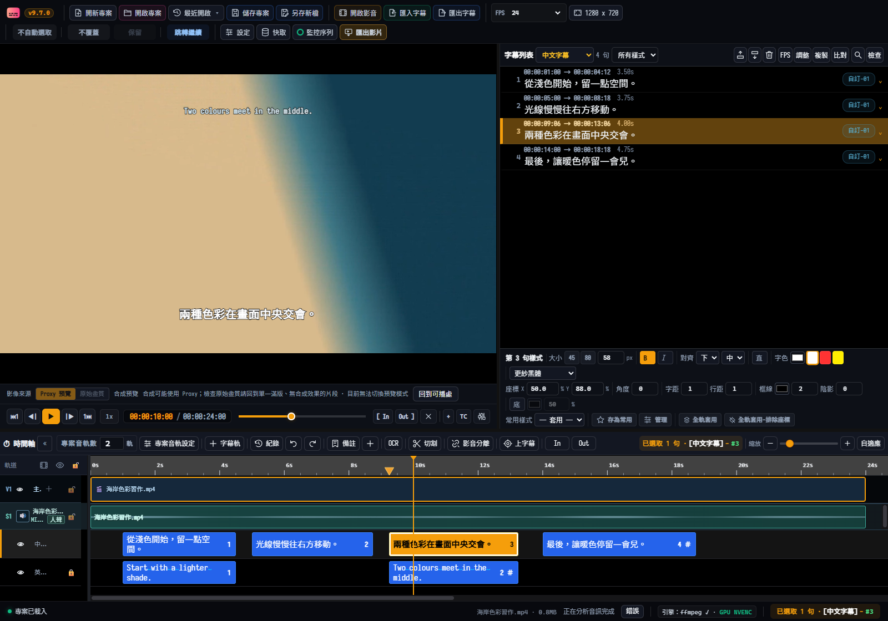
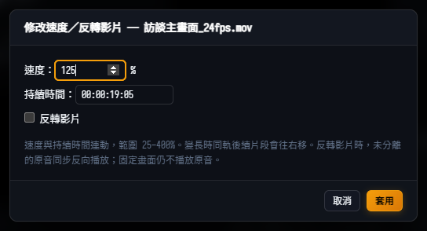
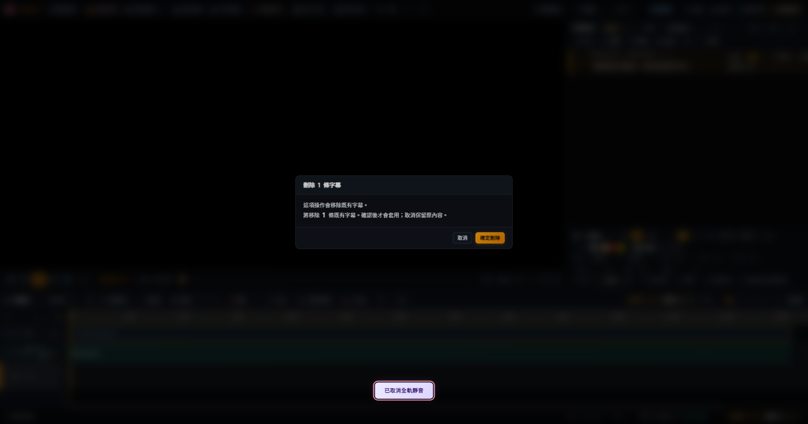
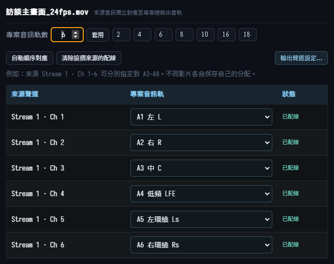
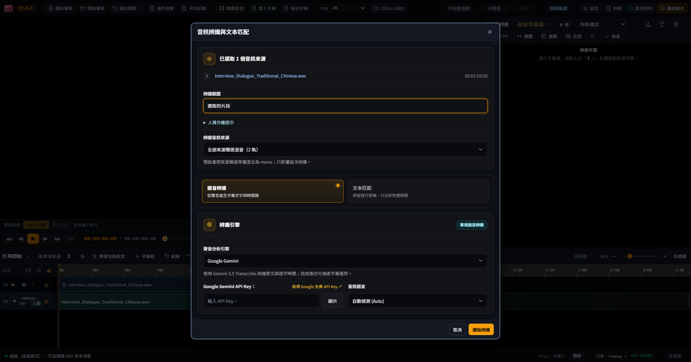
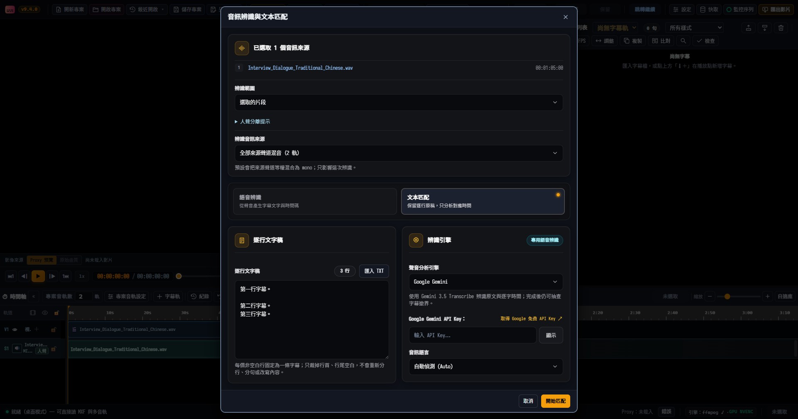
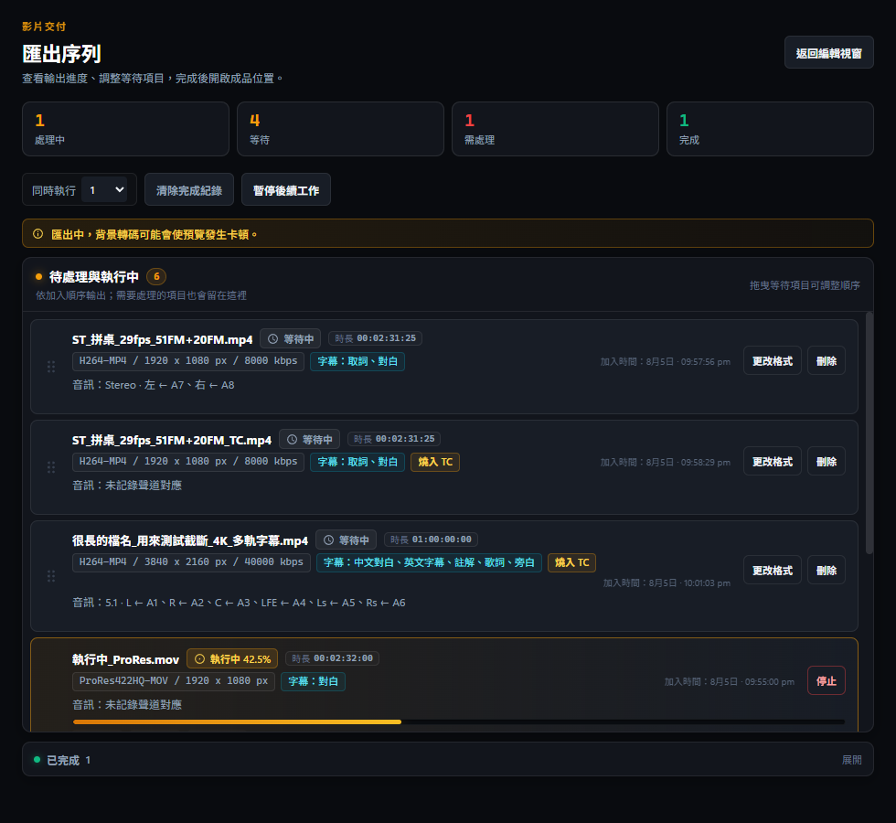
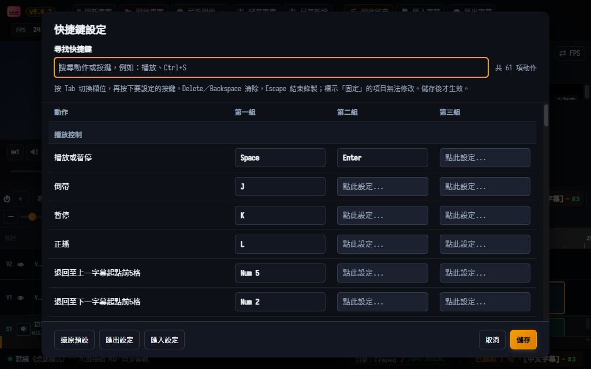
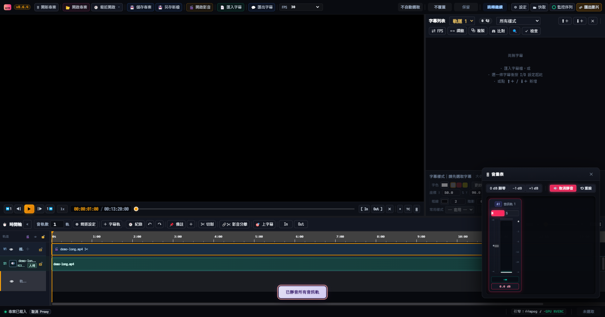

# SUB Tool 使用說明

第一次使用請從[第一條字幕](#3-五分鐘完成第一條字幕)開始。繼續既有專案時，按工作選入口。

| 要做的事 | 前往 |
|---|---|
| 安裝、調整工作區或畫布 | [開啟程式](#1-安裝與開啟) · [介面](#2-介面) |
| 對時、剪片、打點或套樣式 | [播放與定位](#4-播放與定位) · [時間軸與軌道](#5-時間軸與軌道) · [字幕樣式](#6-字幕樣式) |
| 找對白、配聲道或核對兩版字幕 | [音訊](#7-音訊) · [語音辨識與文本匹配](#8-語音辨識與文本匹配) · [校對](#9-檢查比較與搜尋) |
| 保存、交件或復原工作 | [專案](#專案) · [字幕檔](#字幕檔) · [影片與音訊交付](#影片與音訊交付) · [匯出序列](#匯出序列) |
| 查按鍵、清快取或排除問題 | [快捷鍵](#11-常用快捷鍵) · [檔案與快取](#12-檔案與快取) · [常見問題](#常見問題) |

## 1. 安裝與開啟

### Windows 桌面版

下載 GitHub 最新 Release 附件中的 Windows Setup，安裝並開啟 SUB Tool，左上角可核對版號。新工作按「開啟影音」或拖入母素材。接續工作按「開啟專案」、點最近項目，或雙擊 `.subtool`。[下載 Windows 安裝版](https://github.com/evanwayc-star/SUB_Tool/releases/latest)

### 桌面版與網頁版的差別

兩版都能編輯時間軸、製作字幕、匯入及匯出字幕檔。網頁版依瀏覽器實際支援的影音編碼與記憶體播放，字幕和專案以下載保存，重開可能需重選素材。MXF／MOV 長片、多音軌、Proxy、影片／音訊交付、匯出序列、雙軌比對及自訂字型匯入請用桌面版。

### 從原始碼啟動

原始碼根目錄提供 `啟動桌面版.bat`、`啟動網頁版.bat`、`啟動網頁開發版.bat`。[環境與啟動指令](開發與驗證.md)

## 2. 介面

| 位置 | 可做的事 |
|---|---|
| 上方工具列 | 開啟影音、存取專案、匯入／匯出字幕、設定 FPS／畫布／快捷鍵、交付。窄視窗會分列。 |
| 左側播放器 | 播放、逐格、設輸出範圍、看安全框與監看時碼。雙擊影片切全螢幕，`Esc` 離開。 |
| 右側字幕列表／樣式面板 | 選單決定編輯軌，眼睛切換可見性，鎖頭保護內容。列表可編輯文字時碼、篩選、搜尋、檢查。選句後可改樣式。 |
| 下方時間軸／混音器 | 剪輯視訊、圖片、原音及外音，查看字幕、波形、播放點與備註。`Y` 開音量表調整 A 軌。 |
| 底部狀態列 | 左側顯示操作訊息。右側顯示背景階段、進度、時間、停止／繼續／重試。閒置時顯示當前片段 Proxy。「錯誤」可查最近 100 筆回報。 |

拖曳左右分隔線或時間軸上緣可調整版面，設定會保留。`U` 將播放點對齊視野左側約 15%，接近開頭時停在起點。可拖曳浮動視窗標題移動位置，露出底下播放器。長對話框的標題、底部按鈕固定，中段可捲動。

### 專案畫布解析度

點 FPS 旁的尺寸 →「尺寸來源」選自動／自訂 → 選常用尺寸或填寬高 → 核對「畫布尺寸」並套用。自訂寬高各為 2–8192 的整數，總像素上限 8192 × 4320。自動沿用主影片，無影片預設 1920 × 1080。影片等比例置入，未填滿處留黑。

畫布隨專案儲存，支援復原／重做。新建一般影片交付以畫布為預設，各列可另選尺寸。航空與光碟使用固定規格。多層影片、圖片在自訂比例畫布截圖時，請等合成完成。

## 3. 五分鐘完成第一條字幕

1. 按「開啟影音」，播放確認聲畫。按 `Ctrl+S` 先存成 `.subtool`。
2. 在右側選字幕軌。移到開頭，在未選句的狀態按 `I` 或 `Q` 新增字幕。已選句時會改該句起點。
3. 播放到句尾，按 `O` 或 `W` 設終點。終點須晚於起點。
4. 雙擊列表文字輸入台詞，`Enter` 完成，`Shift+Enter` 換行。用 `←`／`→` 逐格對時。
5. 取消選取再做下一句，或從[逐行原稿打點](#上字幕模式與未定時稿)。`Ctrl+S` 保存編輯。「匯出字幕」交字幕檔，桌面版「匯出影片」可將可見軌燒入畫面。

## 4. 播放與定位

### Proxy 預覽與原始畫質

「Proxy 預覽」使用素材旁的 480p、1000 kb/s Proxy，準備完成會自動接手，尚未完成或讀取失敗時先播原片。再按可重試。「原始畫質」供檢查原片細節。切換保留播放位置，偏好存於本機。匯出一律讀母素材。

按鈕亮起代表偏好，旁邊標示實際來源，如「NAS 原片」、「NAS 預覽」、「同資料夾預覽」、「合成預覽」。多層、淡化、縮放、移位可能需 Proxy 合成。需核對原始細節時，移至單一無效果的滿版片段。倒帶及反向片段暫停模式切換，恢復正向後沿用偏好。

### 逐格與 JKL

`Space` 播放／暫停，`←`／`→` 依已顯示畫格逐格，按住可連續移動。`J`／`K`／`L` 倒播／暫停／正播，連按 J 或 L 最高 5×。倒播靜音。右鍵速度數字選 0.25×–2× 的預設，或自訂 0.1×–16× 的監看速度。變更成品速度請用[片段速度](#速度反轉與固定畫面)。[完整定位按鍵](#11-常用快捷鍵)

起播或切換方向失敗會暫停。「mpv 連線中斷」時按播放重連，或點字幕定位重連。

### 用滑鼠移動播放點

點時間尺、空白、已就緒的波形、素材區塊或播放器進度條可定位。前三者可拖曳連續定位，素材區塊的邊緣另用於修剪。「來源時間波形（準備中）」需等正式素材就緒才可操作。

「跳轉繼續／跳轉暫停」決定播放中定位後的行為。原本暫停時維持暫停。跳轉至 NAS 等較慢來源，聲畫就緒後會同步恢復。等待約 250 ms 才出現「定位中／等待影片／等待聲道」，期間可暫停或改定位。

### 鎖定軌的定位規則

點或拖曳鎖定軌、鎖定片段仍能定位，原選取保留。鎖定外音的喇叭與右鍵選單也保留選取。透過字幕列表或搜尋仍能選中鎖定字幕校對。移動或換軌若會推動鎖定鄰片，整筆拒絕。含個別鎖定影片的視訊軌須先解鎖才能刪除。

### 時碼、FPS 與輸出範圍

| 操作 | 說明 |
|---|---|
| 雙擊時碼定位 | 輸入 `HH:MM:SS:FF`，也可只打數字，如 `00000015`。支援貼上完整時碼、右鍵複製／貼上、`Ctrl+A` 全選。`Enter` 或離開欄位確認，`Esc` 取消。播放中可保留輸入草稿。 |
| 設定 29.97 時碼 | DF 選「29.97 (DF)」，例 `01:05:28;16`。NDF 使用冒號計數，長片讀數可能與實際經過時間不同。[FPS／時碼](FPS_時碼一致性.md) |
| 設交付範圍 | `[`／`]` 設 In／Out，同時按兩鍵或按清除回全長。匯出前核對顯示時長。字幕起訖用 `I`／`O`。 |
| 監看與燒錄 | 「TC」及安全框供監看。要把時碼寫入成品，勾交付列「畫面燒入時間碼」。 |

支援位移的欄位可加 `+`／`-`。片段長度等時距欄位也接受小數秒。

## 5. 時間軸與軌道

### 視訊與圖片

載入第一份影音會建立片段。再加入素材時先核對播放點、作用軌與加入位置。拖區塊中間移動時間，拖左右邊緣修剪，上下拖曳影片換軌。`Ctrl+K` 或右鍵「切割」會在播放點切割可編輯媒體。同視訊軌的片段須避開重疊，不同視訊軌可疊層，透明或縮小會露出下層。

圖片預設 10 秒，可修剪、移動、改長度，也可在播放器拖曳、縮放。交付依圖片在時間軸的範圍合成。

### 速度、反轉與固定畫面

| 片段右鍵 | 對播放與交付的影響 |
|---|---|
| 修改速度／反轉影片 | 速度 25%–400%。片段變長時推移同軌後段並保留間距，受鎖定限制時整筆拒絕。反轉讓未分離原音同步反向，畫面預覽需桌面原生播放器。 |
| 固定畫面 | 先定位，再核對或輸入來源影格。整段保持該畫面，長度、位置、大小及淡化保留。片段原音靜音，分離音訊照常播放。「解除固定畫面」或 Undo 可還原。 |
| 解除影音 | 建立可獨立移動、切割的音訊，保留解除當下的速度、方向與裁切。後續分別編輯。 |

### 淡入淡出與交叉淡化

片段右鍵設定淡入／淡出。修剪或切割會延續原淡化進度。「交叉淡化」在前一段和本段間建立重疊，必要時將本段放到上方視訊軌。時長受兩段長度限制，須先解鎖相關軌及片段。片段長度、淡化、溶接均接受時碼、緊湊數字時碼或小數秒，如 `1.5`。

### 字幕選取與編輯

| 要做的事 | 操作 |
|---|---|
| 選句 | 單擊一條，`Ctrl` 加點增減多選，`Shift` 加點選範圍，時間軸範圍限同一字幕軌。金底為選取，藍底為播放中，兩者重合時金底帶藍色標記。 |
| 複製或選範圍 | 時間軸 `Alt` 拖曳複製。列表 `Ctrl+A`、範圍及右鍵「將以上／以下字幕選取」只含篩選後的可見列。 |
| 改文字與時碼 | 雙擊列表文字編輯，`Enter` 確認、`Shift+Enter` 換行、`Esc` 取消。輸入法組字優先。雙擊起點／終點可輸入時碼。 |
| 看原文、切句 | 雙擊時間軸字幕開「修改字幕文字」，可看軌名、本軌句數編號、IN／OUT、複製原文。修改框即時字數排除空白及換行。播放點放句內，將游標放在切字處，`Ctrl+Enter` 切成兩句，沿用原樣式。 |
| 調位置／角度 | 在播放器拖字幕外框或旋轉點，按住 `Shift` 以 15° 吸附。取消拖曳只復原此次位置／角度。 |
| 批次編輯 | 右鍵可複製、貼上、清除時間、交換文字、合併、建立備註、刪除。「⟷ 調整」允許選句／目前軌／全字幕位移或調時長，完成核對首尾與重疊。 |

### 上字幕模式與未定時稿

逐行原稿先匯入 TXT，`Shift+Y` 進入上字幕模式，依原順序用 `I` 打點、`O` 收尾並移往下一句。`Esc` 或再按 `Shift+Y` 離開。模式中暫停自動選取及覆蓋，離開後恢復。

只有 IN 的字幕在儲存、匯出或離開該句時，預設收於起點後兩秒，隨影格與有效片長調整。若起點已到片尾或其後仍保留兩秒。尚可按 `O` 指定實際終點。在暫存階段正式位移、調時長或拖曳後會保留修改。取消拖曳仍是暫存。

一般模式用 `Z` 切換播放時自動選句，`X` 切換可否覆蓋，`C` 切換完整覆蓋其他字幕時保留／刪除。

### 所有既有字幕的移除確認

Delete、刪除含字幕的軌道、合併、完整覆蓋其他句、匯入取代既有軌或開新專案，都會先列出要移除的句數。取消或關閉會恢復原句及時間，Undo 紀錄維持原樣。等待期間若目標已修改、被鎖或專案已切換，請重新操作。清除時間保留文字。附加／新軌匯入保留原稿。[開啟其他專案時的處理](#專案)

### 軌道鎖定

視訊軌／個別片段鎖住移動、修剪、切割、刪除及會改動該軌的移入。音訊素材軌鎖住該素材編輯。字幕軌鎖住新增、文字、時間、樣式、移動和刪除。[鎖定時如何定位](#鎖定軌的定位規則)

## 6. 字幕樣式

### 修改一句或一組字幕

先選字幕，再用樣式面板調字型、字級、粗斜體、顏色、直書、對齊、座標、角度、字距、行距、外框、陰影、底色或不透明度。X／Y 是畫面百分比，字級依畫面高度縮放。換交付解析度仍保持相對比例。

### 常用樣式與整軌套用

「存為常用」保存可跨專案使用的樣式，同名項目依群組區分。「全軌套用」包含座標及角度。要保留各句位置，用「全軌套用－排除座標」。`Ctrl+Shift+C`／`Ctrl+Shift+V` 複製／貼上樣式。

編輯常用樣式會在儲存成功後更新套用者。新增、改名、編輯寫入失敗可保留草稿重試，匯入失敗可重選檔。關閉視窗仍會完成已送出的儲存。開專案遇同群組同名但外觀不同，會另存「名稱 (專案)」、「名稱 (專案 2)」。相同內容會重用。

### 字幕列表的樣式篩選

「所有樣式」顯示整軌。「自訂樣式（非預設）」依最終外觀判定，包括軌道繼承、逐句修改與常用樣式。可依名稱或「自訂-01」等未命名項目篩選。`✱` 表示該句保存了個別樣式設定。搜尋跳到被篩掉的句子會恢復「所有樣式」。

### 自備字型

桌面字型選單 →「匯入自訂字型...」，缺字型也可依開專案時的提示匯入。支援 `.ttf`、`.otf`、`.ttc`、`.woff`、`.woff2`。原始碼環境可放 `font/<顯示名稱>/`，每資料夾宜放一個 Regular 非斜體字型。跨機交接專案與獨立 ASS 需另備有權使用的字型。要固定成品外觀可交燒錄影片。

## 7. 音訊

### 先分清素材、專案音軌與輸出聲道

母素材的 Stream／Ch 是檔案內的聲音。混音器的 A1、A2… 是接收來源與調整音量的專案音軌（bus）。Mono／Stereo／5.1 是成品的聲道編組。例如要交第 7、8 聲道，先將母素材 Ch 7／8 接 A7／A8，再指定成品左 ← A7、右 ← A8。

### 來源配線與輸出配線

| 要改哪一層 | 入口與儲存 |
|---|---|
| 素材 → A 軌 | 右鍵素材 →「音訊配線…」→ 指定來源及 A 軌，可將多個來源送至同軌並即時監聽。完成按「儲存配線」，整次修改可一次 Undo。 |
| 專案預設輸出 | 時間軸「專案音軌設定」→ 設 Mono／Stereo／5.1 →「儲存輸出設定」。若從來源配線進入「主專案音軌設定…」，儲存只回到配線草稿，還須按「儲存配線」。 |
| 個別成品 | 交付列「設定輸出音軌」→ 選編組 → 指定每聲道的 A 軌 →「儲存輸出設定」。例如選「２軌道｜2.0-FM」，左聲道 L 選 A7、右聲道 R 選 A8。回清單核對摘要。 |

配線視窗可設 0–32 條專案音軌，0 表示無軌。時間軸工具列可設 1–32。主專案預設配置需要更多軌時會補齊，切較少聲道的配置仍保留 A 軌。明確減軌會先列出受影響的配線與編組，確認後再增回須重新接線。只想少交幾軌，請改個別交付列。

輸出可選不連續的 A 軌、對調左右或調整 WAV 的聲道順序。「全部專案音軌（Mono）」會全選 A 軌。每組須有足夠聲道，同一 A 軌在組內及跨組均不可重複。軌數不足須先回專案增軌、接線。子視窗按「取消修改並返回…」放棄該次修改。

### 靜音、獨奏與音量

素材喇叭控制該素材，分離外音有自己的開關。Proxy 處理中也可切換。按 `Y` 開混音器看專案 A 軌，**素材靜音、A 軌 M／S 和增益都會影響播放及交付**。

| 控制 | 操作 |
|---|---|
| `M`／`S` | M 靜音，S 獨奏，可同時選多軌 S，M 仍優先。「全靜音／取消靜音」切換全部 A 軌，「重設」也會取消獨奏。 |
| 音量及增益 | 拖推子，雙擊或按「0 dB 歸零」復位。點讀數輸入目標值，如 `-6`、`0`、`2`。相對值用 `+2`、`+=1.5`、`-=2`。滾輪每次 0.5 dB，最高約 +12 dB，`-inf` 無聲。 |
| 音柱與削波 | 各 A 軌顯示混合後電平與短暫保留的峰值。點削波指示可清除。混用原生與外音時若暫無同步電平，顯示「—」，仍可調音。音訊快取完成後恢復。 |

### 音訊平衡

1. 右鍵音訊片段或列頭 →「音訊平衡」。選自訂或 −1／−6／−12 預設。真峰值模式設峰值上限（dBTP）、整體響度（LUFS）。一般峰值設上限（dBFS）、增益基準（dB）。手動改值會轉為自訂。
2. 按「套用」，在面板、狀態列或時間軸查看量測進度。相同設定接續原工作，換設定會重新處理。顯示「已套用」後試播頭、中、尾及峰值處。失敗按「錯誤」查原因。
3. 效果隨專案保存，可 Undo／Redo 或按「還原原音」。無聲保護保持 0 dB 增益。桌面版將預聽、量測報告和波形存於素材旁 `.subtool_Cache`，重開時核對素材與設定後重用。匯出時效果套在原始音訊，原檔削波或失真仍須另行處理。

### 人聲波形

| 要看哪種波形 | 選法與結果 |
|---|---|
| MIX／個別來源聲道 | 預設是「MIX（所有聲道）」。在素材右鍵選 Ch 或 `S6 Ch 1` 等指定串流聲道。桌面版可在 Proxy 停止時獨立產生，選單與軌頭顯示進度。離線恢復後再點同聲道重試。峰值存於素材旁快取，已有原音 WAV 可補建。 |
| 人聲（分離配樂） | 列頭點「人聲」套整列，含切開的外音。片段右鍵只改該來源。同列選擇不同會顯示「混合（依各片段）」。選「原音」回 MIX。顯示選擇僅影響波形，播放、配線與交付沿用專案音訊。 |

人聲分離需主動啟動，首次下載模型，在本機分析。完成前保留原波形，取消、改選原音／聲道或失敗時保留原選擇。結果與偏好存在該電腦應用程式／瀏覽器儲存。有效時重開會還原。換素材、聲軌、模型或清掉本機資料可能重算，人聲快取不隨素材旁的 `.subtool_Cache` 交接。

桌面版分段處理長片。網頁版限 5 分鐘內，需要整檔解碼時限 100 MB，多音軌須取得全部原始音軌。人聲分離可能留下歌聲或配樂，請搭配播放核對句界。

## 8. 語音辨識與文本匹配

右鍵影音／音訊素材 →「語音辨識／文本匹配」。先選全部來源混音或對白清楚的聲道。此選擇與前處理只用於當次分析，專案配線與交付音訊照原設定。

### 語音辨識

選供應商、語言（或自動偵測）及導引文字，再開始辨識。桌面版依選定範圍分段擷取長片音訊。完成後在新增的「語音辨識」軌逐句校對。

| 程式內選項 | 模型或必要設定 |
|---|---|
| 內建本機 AI | Tiny、Base、Small、Large v3 Turbo 量化版、Large v3。首次下載，優先 WebGPU，必要時用 CPU。溫度 0 確定性解碼，0.2／0.5 隨機取樣。 |
| Groq／OpenAI | 分別使用 `whisper-large-v3`、`whisper-1`，可設 Key、語言、提示詞及溫度。 |
| Azure Speech | Key 須符合資源 Region，可設 Phrase List 與不雅詞處理。 |
| Google Gemini | 輸入 Key、查詢帳戶可用模型後選擇，可設提示。 |
| ElevenLabs | `scribe_v2`，可設 Keyterms、說話者數、聲音事件。 |

雲端辨識須有網路、對應 Key、模型權限與額度。切換供應商保留各自草稿，取消或關閉放棄。開始辨識時才在本機記住所選設定。金鑰保存在本機，分享畫面前請遮蔽。

### 文本匹配

1. 選「文本匹配」並核對語言、聲道。貼上或匯入 TXT，每個非空白行成一句，會整理行首尾空白。
2. 開始分析，完成後看新增的「文本匹配」軌。文字與順序照原稿，可靠行才寫入時間。估算或未定時行依診斷行號播放核對，再補 `I`／`O`。
3. 檢查漏詞、重複句、唱詞、噪音及錯序。診斷 JSON 可能含完整原稿與辨識文字，分享前先檢查。

### 背景執行與取消

收起進度可繼續編輯，按頂部「辨識中」重開。要停止請按工作內「取消」，也會停止當次音訊擷取。取消、失敗保留原字幕。換專案會隔離舊結果。重試前先看錯誤，分別核對 Key／Region、額度、模型、網路或來源聲音。

## 9. 檢查、比較與搜尋

### 搜尋與取代

`Ctrl+F` 或放大鏡搜尋目前軌全部字幕。`Enter`／`Shift+Enter` 跳下／上一筆。樣式篩選會讓位給搜尋結果。取代前核對軌名、搜尋字與命中數。鎖定字幕可定位，解鎖後才能取代。取代可 Undo。

### 字幕檢查

按「檢查」或 `Num 9`，核對面板軌名，檢視重疊、空白、過長、連續相同與非繁中字元。點編號或 Tab 選編號再按 Enter 定位。「頭尾為空白」旁「清除」可一次去除目前軌字幕頭尾空白。

連續同文各組以紅／綠／藍序號區分，OUT 與下句 IN 正好相接才合併成範圍，如 `234–235`。有空隙或重疊會分列，點範圍可選整組並跳到首句。淺粉為提示，紅色通常是明確問題，黃色需判讀繁簡共用字，人名或外文請人工確認。

### 比對兩條字幕軌

桌面版按「比對」→ 選左右軌 → 勾時間、文字或樣式，可隱藏相同項。依列表組數／差異數核對。點字幕或 Tab 選字幕後按 Enter 定位。右鍵或 `Shift+F10` 開樣式選單，確認套用方向及目的軌已解鎖。

### 備註與歷史紀錄

| 目的 | 操作 |
|---|---|
| 建立或移除時間點備註 | `V`／`M` 切換，該點已有備註會移除。工具列／面板「新增」一律追加，保留同點備註。 |
| 用字幕文字建備註 | 多選後右鍵「建立備註」，各句文字寫至各自 IN，整批可一次 Undo。有任一句缺有效 IN，先補時間再執行。 |
| 編輯或跳轉 | `Num 8` 開面板，點時間定位，`Ctrl+←/→` 跳前／後筆。Tab 選欄，Enter／F2 編輯，Enter 完成、Esc 取消，再按 Esc 關閉，Shift+F10 開選單。 |
| 查歷史或復原 | `Num 7` 開歷史，`Ctrl+Z` 復原，`Ctrl+Shift+Z` 重做。復原後的新編輯會取代原重做分支。 |

## 10. 儲存與匯出

### 專案

| 目的 | 做法 |
|---|---|
| 儲存／另存 | `Ctrl+S`／`Ctrl+Shift+S`，標題列會更新名稱。`.subtool` 保存字幕、樣式、片段、配線及播放點等設定，母素材與字型須另行保留。若目的檔在儲存期間變更，本次編輯仍未儲存，請另存。 |
| 開啟／重連 | 從工具列、最近清單、拖入或雙擊開啟。只有未儲存的內容變更會詢問先存、不存或取消。等待讀檔時若再編輯會再次詢問。取消保留編輯、歷史及待重連紀錄。遺失的最近項目可在裝置恢復後重試或清除清單。桌面依提示重連。網頁可能須重選素材。 |
| 自動備份與還原 | 桌面專案有路徑後每 3 分鐘檢查一次，內容有尚待備份的修改才寫入專案旁 `.subtool_AutoSave/`。開啟其中的時間戳備份，再另存為正式檔。網頁版備份存在本機瀏覽器，清除網站資料前先下載正式檔。 |

播放點、縮放及軌道收合可隨手動儲存保留，單獨變動不觸發未儲存提示或備份。專案及自動備份以 UTF-16 LE（BOM）寫入，也能開舊 UTF-8、UTF-16 LE／BE 檔。JSON 開頭 `SUB Tool`／`User Name` 記錄保存時的軟體版號／電腦名稱，網頁版標示無法取得電腦名稱。

桌面存專案、備份及匯出字幕時，會先在目的資料夾寫入並驗證 `.tmp` 再替換正式檔。若強制結束或 NAS 中斷，請保留殘檔的完整名稱、大小與時間供排查。切勿依副檔名整批刪除。`.subtool_AutoSave` 內的 `.subtool` 可用來復原。

### 字幕檔

| 格式 | 匯入 | 匯出重點 |
|---|---|---|
| SRT | 接既有字幕 | 播放器與平台通用，可合併多軌。 |
| ASS／SSA | 匯入文字及樣式 | 匯出 ASS，可合併多軌，接收端需要正確字型。 |
| Adobe Encore | 含影格時碼的文字 | 選對 FPS／DF，供影格時碼流程。 |
| TXT | 可逐行匯入未定時稿 | 文字稿。 |
| Excel | — | `.xlsx`，每個選取的字幕軌各一張工作表。 |

**匯入**時先選 FPS，再選目的軌與樣式。新軌、既有軌勾「附加」會保留舊稿。取代既有軌會列出移除句數，全部確認才同時套用字幕與 FPS。列表「⇄ FPS」按來源與目標 FPS 比例換算該軌字幕時間。成品交付 FPS 則保持時長。

Encore TXT 可混用定時和未定時行。定時行的 OUT 與正文間可用空格或 Tab。未定時行以 Tab 開頭，匯入後 IN／OUT 都顯示 `--:--:--:--`。在 24 fps，`00:00:55:24` 進位為 `00:00:56:00`。超過一秒格數、進位後終點不晚於起點，或正文另有成對時碼，會提示原行號。

**匯出**時勾格式、軌道及備註，核對底部摘要。要分交原文、譯文或字卡，可各用一軌，分檔匯出。可選的軌道取自開窗時，文字採送出時的最新編輯。換專案、目標軌刪除／替換或要加選新軌時，須重開視窗。文字字幕、一般／Edius 備註 CSV、樣式／快捷鍵／辨識診斷 JSON 以 UTF-16 LE（BOM）輸出，仍可匯入既有 UTF-8。Excel 保持活頁簿格式。檔名淨化後若撞名會加序號。批次寫入失敗先查成功／略過數，已成功的檔案保留。

本工具合併匯出的 ASS 帶有效 SUB Tool 中繼資料時，匯回所選單軌會保留逐句外觀、原稿與未定時句。同 FPS 保留影格，不同 FPS 依秒數對齊目的格網。未定時句保留佔位。內容、樣式或中繼資料超量會在寫檔前中止整批，可分批匯出或保存專案。

### 影片與音訊交付

1. 在工作區定好 In／Out、音訊配線與可見字幕軌。桌面按「匯出影片」或 `/`，核對來源與輸出時長。純音訊專案可交 WAV／MP3。
2. 每列選格式、尺寸、FPS、碼率、檔名及**該列的資料夾**。手動檔名會保留。用「新增輸出項目」增加其他規格。
3. 在各列「設定輸出音軌」核對 A 軌編組，檢查列出的燒錄字幕軌，按需勾「畫面燒入時間碼」。不同語言版本須回工作區切換可見軌再分次送出。
4. 按「加入匯出序列」。重名需確認覆寫，目的檔後續又變更須重新送出。已接受的列留在佇列，其餘可修正重送。成品讀母素材及入列時的專案快照。

一般影片可自訂寬高，各須 16–8192 的偶數，總像素上限 8192 × 4320。比例不同會等比補黑，例如 16:9 輸出 640 × 480，上下各補 60 px。MP4／MOV 的 FPS 可依專案或選 23.976、24、25、29.97、30、48、50、59.94、60，仍維持原時長。

| 格式 | 影像／容器 | 聲音 |
|---|---|---|
| ProRes422HQ-MOV | ProRes 422 HQ，尺寸／FPS 可選 | 24-bit PCM，依該列編組 |
| H264-MP4 | H.264，尺寸／FPS／kbps 可選 | 依該列編組 |
| WAV | 純音訊 | 24-bit PCM，可選 A 軌子集與順序 |
| MP3 | 純音訊 | 48 kHz／320 kbps，Mono 或 Stereo |
| DVD-ISO (4.5G) | 720×480、16:9、29.97，上場優先 MPEG-2 | AC-3 384 kbps／組，最多 8 組 |
| BD-ISO (24G) | H.264，23.976／24 為 1080p，25／29.97 為 1080i | AC-3 640 kbps／組，最多 32 組 |
| MOD-FHD | TS，1920×1080 上場優先、29.97、7,280 kbps | Stereo，AAC-LC／ADTS 48 kHz／256 kbps |
| 航空-DMPES-H264-1.5M (立體聲) | MPG，720×480、16:9、29.97 逐行、1,500 kbps | Stereo，AAC-LC／ADTS 48 kHz／128 kbps |
| 航空-DMPES-H264-4M (立體聲) | 同 DMPES，視訊 4,000 kbps | 同 DMPES 1.5M |
| 航空-exW-H264-500K (立體聲) | MPG，640×360、16:9、29.97 逐行、500 kbps 目標 | Stereo，AAC-LC／ADTS 48 kHz／64 kbps |

- **MP3** 僅選一組混音。Mono、Stereo、Lt/Rt 保留順序，兩條 Mono 依次為左右，單一 5.1 混為 Stereo。多組時在該列「設定輸出音軌」→「選擇一組輸出音軌」。預設檔名標示 `_Mono`／`_Stereo`。
- **MOD／航空** 需單一 Stereo，兩條 Mono 可依原順序組左右。多組或 5.1 請在該列指定兩條 A 軌。MOD 所選音訊未設專案音訊平衡時，成品 Stereo 套 −12 dBTP 上限、−18 LUFS 目標。已設則沿用，純靜音保持無聲。
- **影片書籤** 僅 MP4／MOV 提供，各列預設關閉。勾「備註」可將輸出範圍內備註轉為章節，依 In／Out 換算時間，同時點合併標題，第一筆晚於開頭則補「影片開始」。若要為字幕建章節，先將字幕右鍵「建立備註」。章節須用支援的播放器檢查。
- **送出失敗** 先看缺少的編碼器／光碟工具，或依清單重連範圍內影片／圖片。範圍外或隱藏且無聲的素材不阻擋交付，隱藏影片的聲音仍依配線處理。

### 航空 MPG 自動合成

三種航空格式直接輸出 MPEG-TS 容器的 `.mpg`，可交最終檔。DMPES 為非正方形像素，使用能讀像素比例的播放器核對 16:9。exW 為正方形像素。舊 S3K／分流工作需從現行清單重送。舊檔 TSA 報告若有音訊 PTS 間距錯誤，從原專案及母素材重出後再檢測。

### DVD／BD 光碟映像

ISO 放入即播、無選單、字幕燒入，可編組 Mono、Stereo、5.1。碼率隨時長、聲音組數和容量計算。DVD 上限 4,500,000,000 bytes，系統暫存磁碟預留約成品兩倍。BD 上限 24,000,000,000 bytes，預留約一倍。映像標籤分別為 DVD、BD。BD 交付 FPS 須為支援值且不低於專案 FPS，專案高於 29.97 時不可選。

### 匯出序列

`.` 切換編輯與序列視窗。依處理中、等待、需處理、完成分組查看。配線摘要顯示入列時設定，如左 ← A7、右 ← A8。舊紀錄無內容會標示未記錄。MP4／MOV 摘要含 FPS。

| 狀況 | 操作及結果 |
|---|---|
| 調整工作順序與資源 | 拖曳或用上下按鈕排序等待項目，可編輯尚未執行的規格。並行數可設 1／2／3。「暫停後續工作」阻止啟動下一份，正在寫出的繼續。 |
| 停止／完成 | 個別停止後等寫檔收尾，勿交半成品。完成後「開啟資料夾」看成品。「清除完成紀錄」保留檔案。 |
| 失敗、來源遺失或已停止 | 先恢復原素材路徑，再重試保存的工作。內容已改須從目前專案建立新工作。狀態讀取失敗按「重新讀取」。 |
| 原輸出位置授權失效 | 按「重新選擇原輸出資料夾並重試」，在系統視窗點回**原資料夾**，保留檔名、快照後重新入列。若仍暫停，按「繼續後續工作」。 |
| 舊工作缺少覆寫證據 | 按「重新確認輸出並重試」，選原檔或新檔。已有檔案要核對完整目的路徑並確認。成功後保留舊工作的交付內容與字幕快照。 |
| 輸出鎖或半成品無法安全清理 | 保留舊工作、鎖及錯誤記錄。確認已停止。需沿用原名時先保存要保留的暫存並重開程式檢查。無法核對舊鎖或還原佇列資料時，從原專案檢查素材，以**新檔名**建立交付（如 `片名_重送.mp4`），勿手動刪鎖強制重試。 |

## 11. 常用快捷鍵

以下為預設值。文字輸入與組字優先。一般按鈕以 Tab 聚焦後用 Enter 啟用，Space 仍控制播放。頂部操作鈕用滑鼠，Tab 略過。FPS 選單、輸入欄及對話框保留原鍵盤操作。右鍵選單可用上下、Home／End、Enter、Esc。

| 功能 | 預設 |
|---|---|
| 播放／暫停 | `Space`。未聚焦按鈕或編輯欄位時也可按 `Enter` |
| 倒播／暫停／正播 | `J`／`K`／`L` |
| 前後 1 格 | `←`／`→` |
| 前後 1 秒／5 秒 | `Shift+←/→`／`Ctrl+Shift+←/→` |
| 開頭／結尾 | `Home`／`End` 或 `Shift+↑/↓` |
| 目前軌道類型的前後邊界 | `↑`／`↓` |
| 目前字幕軌的前後邊界並選取 | `E`／`D` |
| 前後字幕起點（暫停時選取） | `Ctrl+↑`／`Ctrl+↓` |
| 第一／最後字幕 | `Ctrl+Shift+↑`／`Ctrl+Shift+↓` |
| 選取字幕起點／終點 | `A`／`S` |
| 前／後字幕起點前 5 格 | `Num 5`／`Num 2` |
| 字幕 In／Out | `I`／`O` 或 `Q`／`W` |
| 選播放點所在字幕 | `G` |
| 上字幕模式 | `Shift+Y` |
| 自動選取／覆蓋／保留或刪除 | `Z`／`X`／`C` |
| 選取字幕時間移到播放點 | `P` 或 `R`，整組間距保留 |
| 複製／貼上字幕 | `Ctrl+C`／`Ctrl+V` |
| 複製／貼上樣式 | `Ctrl+Shift+C`／`Ctrl+Shift+V` |
| 刪字幕 | `Delete`，先確認移除 |
| 編輯完成／換行／切分 | `Enter`／`Shift+Enter`／`Ctrl+Enter` |
| 搜尋 | `Ctrl+F` |
| Undo／Redo | `Ctrl+Z`／`Ctrl+Shift+Z` |
| 儲存／另存 | `Ctrl+S`／`Ctrl+Shift+S` |
| 加備註／前後備註 | `V` 或 `M`／`Ctrl+←/→` |
| 歷史／備註／檢查 | `Num 7`／`Num 8`／`Num 9` |
| 音量表／安全框 | `Y`／`Ctrl+G` |
| 時間軸視野對齊播放點 | `U`，播放點放在內容區左側約 15% |
| 截圖／含時碼截圖 | `T`／`Ctrl+T` |
| 切割媒體 | `Ctrl+K` |
| 刪除已選影片／外音 | `Delete`。依目前選取的媒體操作 |
| 關閉已選影片前方空白 | `Backspace`。選取外音時則是刪除外音 |
| 輸出起點／終點／清除 | `[`／`]`／同時按兩鍵 |
| 匯出／切換序列 | `/`／`.` |
| 時間軸縮小／放大 | 主鍵盤 `1` 或 `-`／`2` 或 `=`。也可 Num −／＋ |
| 切換時間軸縮放模式 | 反引號、`\` 或 Num ×，交替切換字幕範圍與全片範圍 |
| 取消選取／離開上字幕模式／關閉可取消視窗 | `Esc`，依當前狀態 |

### 自訂快捷鍵

1. 開「設定」→「尋找快捷鍵」，輸入功能、分類或按鍵，如「播放」、`Ctrl+S`。點可編輯欄後按組合鍵，每個動作最多三組，主鍵盤與 Num 分開。錄製時 Delete／Backspace 清空，Esc 結束，衝突提示會指出原綁定。
2. 標「固定」的換行／切分、全選、剪貼、Delete、Esc、儲存、搜尋、Undo／Redo、清除輸出範圍等，沿用既有鍵位。舊預設會遷移至 `Y` 音量表、`Shift+Y` 上字幕、`U` 視野對齊。保留自訂與刻意清空項目，衝突可自行補綁。
3. 「匯出設定」保存 JSON，「匯入設定」載入草稿。修改或重新選檔會使先前待讀草稿失效。按「儲存」成功才套用，失敗保留草稿，取消保留原設定。
4. Tab／Shift+Tab 在視窗內移動，不錄為鍵位。在搜尋框按 Esc 先清搜尋，再按才關閉。清搜尋保留未存修改。

## 12. 檔案與快取

### 哪些檔案需要保留

| 檔案／位置 | 交接或清理時 |
|---|---|
| `.subtool`、原始影片／音訊／圖片、自訂字型 | 一起保留，成品與重新編輯都需要原始素材。 |
| 專案旁 `.subtool_AutoSave/` | 可開啟的備份，確認正式檔已保存再清理。 |
| 母素材旁 `.subtool_Cache/` | 保存 Proxy、逐聲道音訊、原音波形及續算紀錄，可隨母素材交接。舊中央快取不再建立、掃描或自動刪除。 |

工具列「快取」→「轉檔快取」顯示目前素材的保存紀錄、已保存秒數或完成狀態。未開素材時無可操作項目。「無法確認」先查來源、網路、目錄權限，再「重新整理」。

「清除快取」先列出母素材路徑，僅處理該素材可安全確認的快取。先完成或停止背景處理。換素材後須重新確認。清理中可以關閉視窗，重開追蹤同一工作，留意部分保留或失敗提示。清理會失去相應續算進度，母素材、專案與成品保留。

### Proxy、取消與換專案

| 階段或狀況 | 如何判讀與操作 |
|---|---|
| 首次處理含音訊素材 | 先核對來源／快取，再產生原音波形。前 20 秒以每 5 秒保存。時長達 2 分鐘者之後每 30 秒保存。完成獨立寫入 `wave.wav`，再做需要的 Proxy 及播放聲道。波形可先出現。可原生播放的素材能先編輯，部分大型 AVI 等需疊層時才補 Proxy。 |
| 停止、繼續或失敗 | 看底部階段、百分比、時間與原因。「停止背景處理」保留可用波形進度與完成項目。「繼續背景處理」重新核對後續算，未保存的尾段需重算，未完成的 Proxy／聲道會補建。來源可讀、快取可寫後按「重試背景處理」，必要時先重新連結母素材。 |
| 改選素材或工作區 | 開新／換專案會停止前一專案的影音快取。靜音用素材喇叭，建立快取時仍可切換。人聲分離、語音辨識與匯出各有獨立停止按鈕。 |
| NAS／跨電腦 | 兩台都要能讀到同一份母素材與旁邊的快取。可核對同一共享檔案時，即使磁碟代號不同，仍可重用完成項目、接續已保存波形。複製或更換 NAS 可能要完整驗證或重建。 |
| 「驗證母素材內容」 | 顯示百分比與已讀容量時是在核對 SHA-256。舊快取在原電腦確認來源未變仍可用，跨機且缺識別則可能重建。唯讀共享可用已驗證完整元件。無法保存新識別可能反覆驗證，缺件需恢復寫入權限再重試。 |
| GPU／CPU | 桌面自動選擇可用加速，進度顯示實際方式。相容 NVIDIA 可參與解碼／縮放／編碼，ProRes 等由 CPU 解碼。總時間也取決於音訊、格式、網路及磁碟。 |

### 常見問題

| 現象 | 先做什麼 |
|---|---|
| 有畫面無聲、A7／A8 交付無聲 | 確認播放點在有效片段，查素材喇叭 → Ch 配線 → A 軌 M／S、增益 → 該交付列 L／R。[配線](#來源配線與輸出配線) |
| 缺波形、只出現前段，或停 Proxy 後仍見波形 | 核對目前的 MIX／聲道與進度。原音波形獨立保存，重開可續算。AI 人聲要另行選取。[人聲波形](#人聲波形) |
| 字幕找不到或無法編輯 | 看列表編輯軌、可見性、播放時間、鎖頭與樣式篩選。「所有樣式」顯示該軌全部句子。匯入取代原稿需完成 FPS、目的軌及句數確認。 |
| 時碼與秒數有差 | 核對專案 FPS、DF／NDF 與顯示的實際經過時間，再決定是否調稿。 |
| 換電腦缺素材、字型或重算 | 重連原檔、提供字型與素材旁快取。獨立 ASS 的外觀也取決於播放器支援及字型。 |
| 人聲分析緩慢或 ASR 失敗 | 核對來源／聲道及模型下載。雲端另查 Key／Region、權限、額度與網路。長片用桌面版。 |
| 交付無法入列、成品內容過舊或預覽變慢 | 查每列檔名、資料夾、配線、格式與錯誤。開啟該工作資料夾比對快照與送出時間。改稿須重送。磁碟吃緊可降低並行數。[匯出序列](#匯出序列) |

正式交件前播放成品頭、中、尾，核對字幕、畫面位置、輸出範圍及實際聲道。回報問題請附重現步驟、來源格式、錯誤文字與必要畫面。[維護排查](Electron_維護手冊.md)
