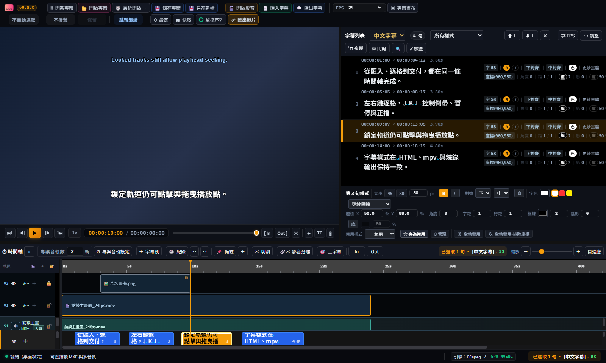
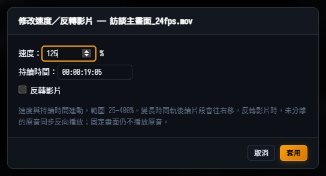
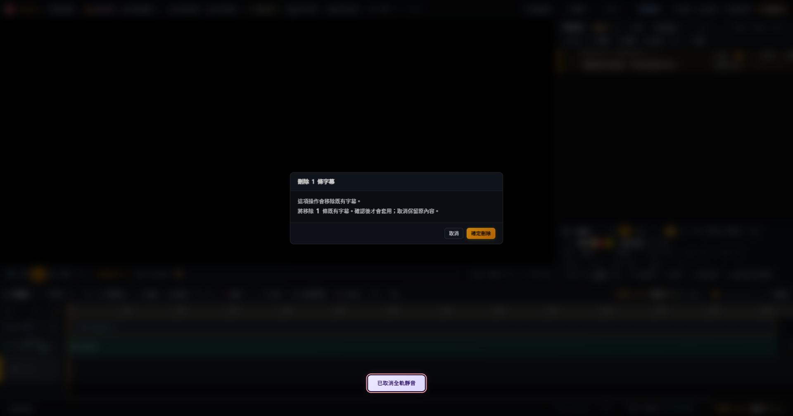
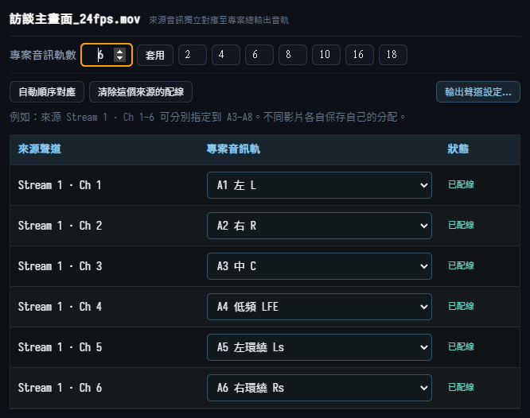
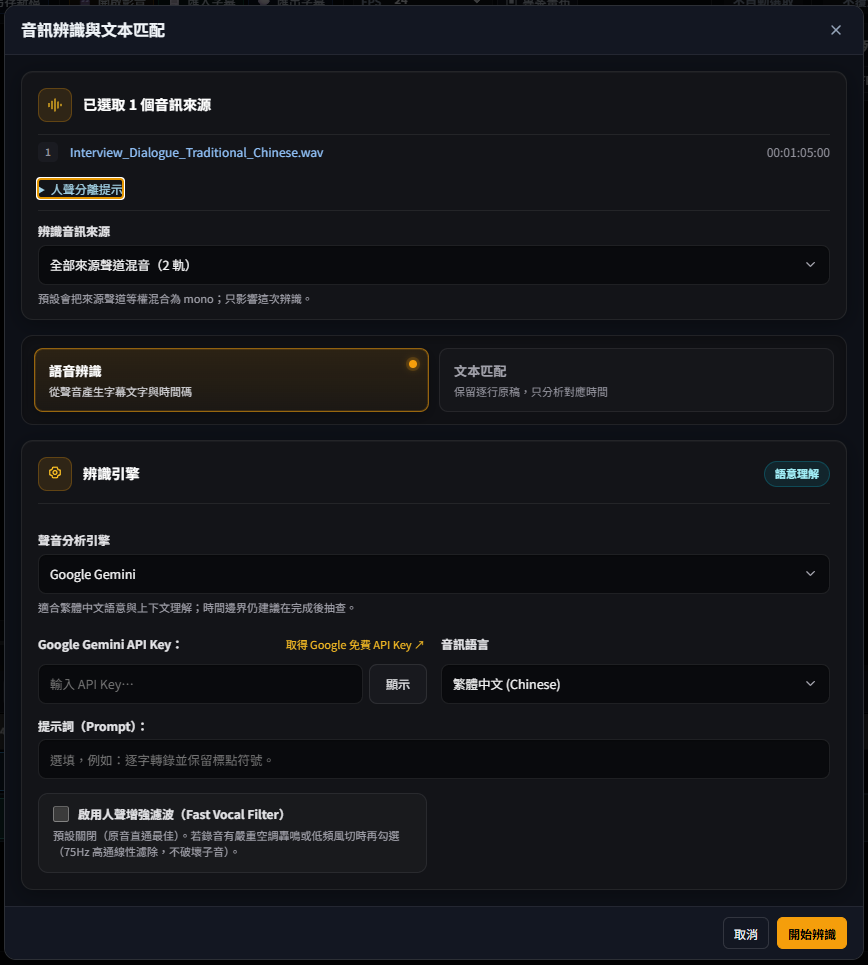
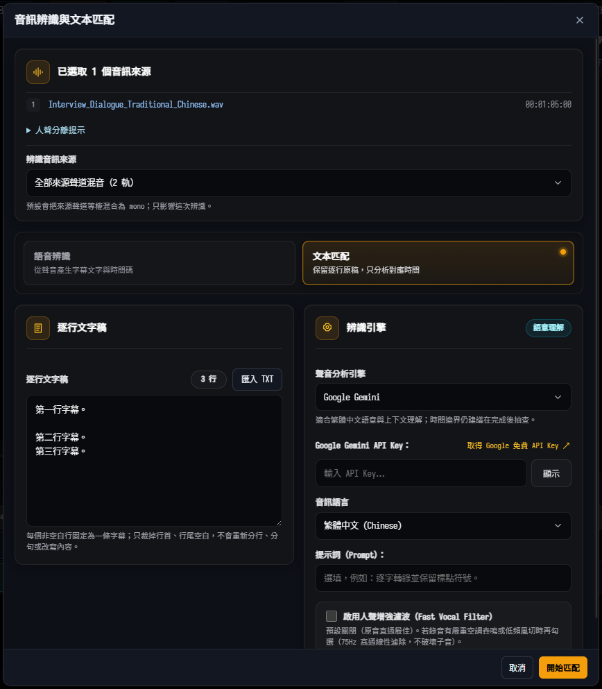
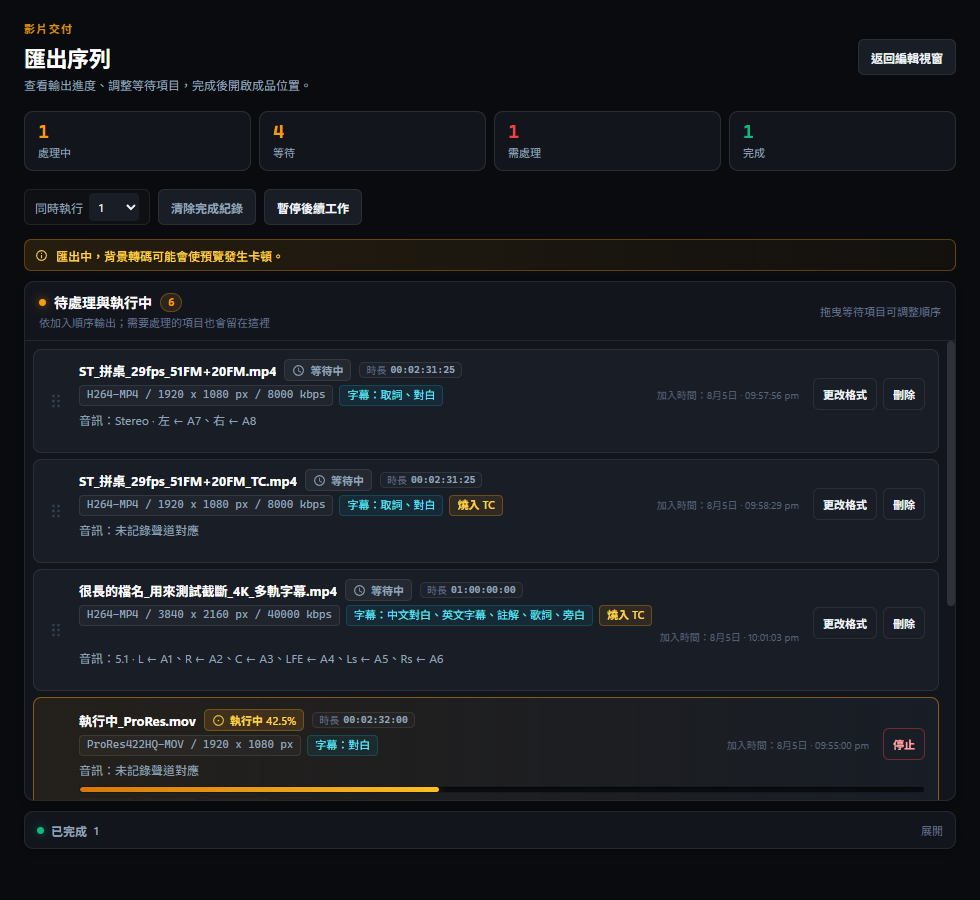
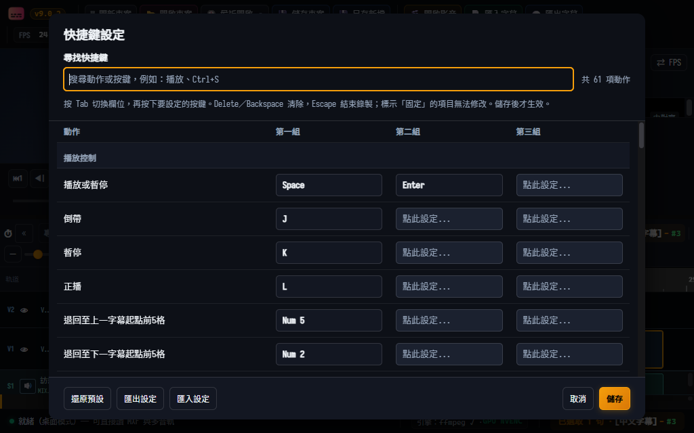
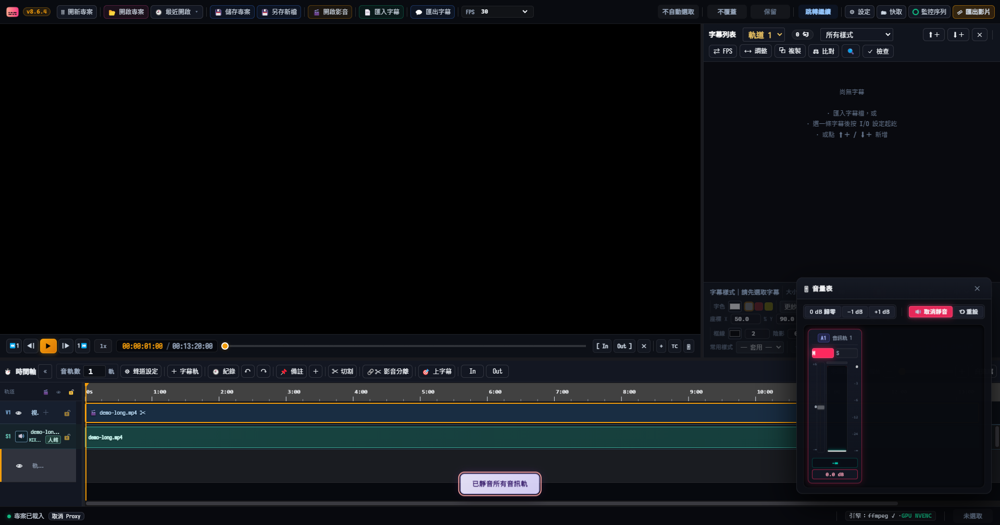

# SUB Tool 使用說明

這份手冊從載入素材、製作字幕一路說明到交付成品。第一次使用可先做完[第一條字幕](#3-五分鐘完成第一條字幕)，再依工作需要查閱各節。安裝來源與文件導覽見 [README](../README.md)；建置、測試、打包及維護細節見[開發與驗證](開發與驗證.md)。

常用查閱：[音軌與輸出配線](#來源配線與輸出配線) · [影片與音訊交付](#影片與音訊交付) · [快捷鍵](#11-常用快捷鍵) · [波形、Proxy 與續算](#proxy取消與換專案)。

## 1. 安裝與開啟

### Windows 桌面版

1. 從 [GitHub Releases](https://github.com/evanwayc-star/SUB_Tool/releases/latest) 下載 Setup 安裝檔。
2. 安裝並開啟 SUB Tool。左上角會顯示目前版本。
3. 按「開啟影音」選擇母素材，或把檔案拖進工作區。
4. 若是繼續舊工作，改用「開啟專案」、最近開啟清單，或雙擊 `.subtool` 專案檔。

桌面版附有影音處理與播放工具，適合 MXF、MOV、多聲道、長片及正式影片交付。先保留原始母素材，再進行字幕與剪輯；專案檔不會把影片包進去。

首次開啟大型素材時，留意底部的波形、快取或 Proxy 進度。能直接原生播放的素材可先預覽；含音訊且需要 Proxy 的素材會先準備波形，再開始轉檔。波形逐步出現不代表全部背景工作已完成，取消與續算方式見[波形、Proxy 與續算](#proxy取消與換專案)。

### 桌面版與網頁版的差別

| 工作 | 桌面版 | 網頁版 |
|---|---|---|
| 編輯字幕、時間軸與專案 | 支援 | 支援 |
| 播放素材 | 可使用原生播放器與轉檔快取 | 受瀏覽器支援的容器、編碼及記憶體限制 |
| 多音軌、大型 MXF／MOV 等素材 | 適合 | 建議改用桌面版 |
| 匯入與匯出字幕檔 | 支援 | 支援，透過瀏覽器下載 |
| 專案儲存 | 寫入選定的 `.subtool` | 下載專案檔；重開時可能要重選媒體 |
| 九種影片／音訊交付與匯出序列 | 支援 | 使用桌面版 |
| 字幕軌道比對視窗、自訂字型檔匯入 | 支援 | 使用桌面版 |

網頁版能否播放一份 MP4／MOV，取決於裡面的實際編碼。副檔名相同不代表一定能解碼。大型素材讀取或多聲道受限時，請使用桌面版。

### 從原始碼啟動

已有原始碼與開發環境時，可使用根目錄的 `啟動桌面版.bat`、`啟動網頁版.bat` 或 `啟動網頁開發版.bat`。環境準備與各腳本用途統一放在[開發與驗證](開發與驗證.md)，操作方式仍依本手冊。

## 2. 介面

| 區域 | 用途 |
|---|---|
| 最上方工具列 | 開新／開啟／儲存專案、開啟影音、字幕匯入匯出、FPS、專案畫布、設定與交付 |
| 左上播放器 | 看畫面、聽聲音、逐格、JKL、輸出範圍、安全框與監看時碼 |
| 右側字幕列表 | 選字幕軌、編輯文字與時間、樣式篩選、搜尋、比對與檢查 |
| 字幕樣式面板 | 修改選取字幕的字型、外觀、位置與常用樣式 |
| 下方時間軸 | 視訊／圖片、素材音訊、字幕軌、波形、播放點與備註 |
| 音量表／混音器 | A1、A2… 專案音訊軌的 M、S、音量與電平 |
| 最下方狀態列 | 處理進度、素材資訊、目前選取；提供停止背景處理，以及停止或失敗後的繼續／重試入口 |

工具列依專案檔案、影音與字幕、專案規格、編輯模式和交付分組。視窗較窄時會分列，按鈕保留文字。尚未載入影音時，可在預覽區直接按「開啟影音」或「開啟專案」。

拖曳播放器與字幕列表中間的分隔線可調整寬度，拖曳時間軸上緣可調整高度。版面會記住上次調整。需要看音量表時，按播放器旁的混音器按鈕或 `Y`。

按 `U` 可將時間軸視野移到目前播放點，讓播放點位於內容區左側約 15%；接近開頭時停在時間軸起點。這只移動視野，不改變播放時間、播放狀態、縮放或選取。

一般對話框內容較長時，只捲動中間內容，標題、右上角關閉與底部操作仍可見。快捷鍵設定則獨立捲動按鍵表格，保留搜尋與儲存操作。可拖曳一般對話框標題或浮動面板上緣移動位置；縮小視窗時，面板會移回可操作範圍。

音量表等浮動視窗可以移到播放器上方，只遮住所占的區域，其餘影片仍會顯示並繼續播放；移開或關閉視窗後會恢復完整畫面。

右側字幕軌選單決定「目前編輯哪一軌」，眼睛圖示決定「這一軌是否顯示」。切換、隱藏與鎖定軌道是不同操作。列表為空時會提示目前軌道尚無字幕、軌道鎖定或樣式篩選沒有結果，並指出下一步。

### 專案畫布解析度

點 FPS 旁的「專案畫布」，在「尺寸來源」選自動或自訂。可從「常用尺寸」選 1920 × 1080、3840 × 2160、1080 × 1920 等尺寸，也可直接填寫「寬度（px）」與「高度（px）」，核對下方「畫布尺寸」後按「套用」。寬高各為 2–8192 的整數，總像素不得超過 8192 × 4320；無效值會在視窗內提示並定位到欄位。套用後，影片等比例放進畫布，未填滿的區域留黑邊。

畫布跟著 `.subtool` 儲存，支援復原與重做。舊專案和選「自動」的專案依主影片決定尺寸，尚未載入影片時使用 1920 × 1080。新建一般影片交付會以專案畫布為預設，仍可逐列調整輸出尺寸。航空、光碟等固定格式使用該格式的畫幅與解析度。

自訂比例且含多層圖片與影片時，請等合成畫面顯示後再截圖。合成尚未就緒會提示重試。

## 3. 五分鐘完成第一條字幕

1. 按「開啟影音」載入一支影片，確認畫面與聲音正常。
2. 按 `Ctrl+S`，先存成 `.subtool`。首次編輯也會出現儲存建議；可立即儲存或選「稍後再說」。
3. 在字幕列表上方選目的字幕軌。空白專案已有字幕軌，需要其他語言或角色時再新增。
4. 定位到第一句開始，按 `I`（或 `Q`）。沒有選取字幕時會新增一條；已有選取時會修改該句起點。
5. 播放到句尾，按 `O`（或 `W`）設定終點。終點必須晚於起點。
6. 雙擊右側該列文字，輸入內容，按 `Enter` 完成；`Shift+Enter` 換行。
7. 用 `←`／`→` 逐格檢查起訖，再調整字級、位置與外觀。
8. 按 `Ctrl+S` 保存。要交字幕檔，按「匯出字幕」；要把字幕燒在影片上，使用桌面版「匯出影片」。

製作下一句時，先取消上一句的選取再按 `I`，或使用[上字幕模式](#上字幕模式與未定時稿)。若出現將移除既有字幕的提示，先核對句數，再決定確認或取消。

## 4. 播放與定位

### Proxy 預覽與原始畫質

播放器下方有「Proxy 預覽」與「原始畫質」兩個按鈕，亮起的按鈕表示目前選擇，並會保存在本機設定。「Proxy 預覽」使用素材同資料夾的 480p、1000 kb/s Proxy，以轉檔速度優先；尚未準備好時先播原片。「原始畫質」讀取原始影片，供檢查細節。切換時保留播放位置，旁邊會顯示實際來源；正式匯出始終讀母素材，預覽切換不修改專案的素材路徑、剪輯時間或交付畫質。

多軌、淡變、縮放或移位需要合成時，來源會標示「合成預覽」，可能仍使用 Proxy。此時亮起的按鈕只代表預覽偏好；檢查原始畫質請回到單一滿版、沒有合成效果的片段。

倒帶期間及反向片段不開放預覽模式切換；回到正向播放後恢復。停止倒帶會沿用先前選擇的預覽模式。

NAS 預覽直接讀取素材旁 `.subtool_Cache` 的 Proxy、播放聲道與波形，不再複製到本機。素材資料夾不能寫入時會提示原因，請調整該資料夾權限後重試。已完成 Proxy 會自動接手，不需要重新開啟專案；來源標示會區分「NAS 原片」、「NAS 預覽」與本機素材的「同資料夾預覽」。

定位或起播等待超過約 250 ms 才顯示「定位中」、「等待影片」或「等待聲道」，避免短暫等待造成提示閃爍。等待期間仍可暫停或改定位，以最後操作為準。

### 逐格與 JKL

| 操作 | 結果 |
|---|---|
| `Space` 或非文字編輯狀態的 `Enter` | 播放／暫停 |
| `←`／`→` | 前後一格；按住可連續逐格 |
| `Shift+←`／`Shift+→` | 前後一秒 |
| `Ctrl+Shift+←`／`Ctrl+Shift+→` | 前後五秒 |
| `J`／`K`／`L` | 倒播／暫停／正播；連按 J 或 L 逐級加速，最高 5× |
| `Home`／`End` | 時間軸開頭／結尾 |
| `↑`／`↓` | 依目前軌道類型移到上一／下一個邊界 |
| `A`／`S` | 選取字幕的起點／終點 |

逐格以已呈現畫格為基準。快速連按與長按會追上最新目標，定位時可能聽到短促聲音。JKL 倒播期間靜音；評估對白、音量或聲道時，回到正常正播再聽。

若影片起播或切換播放方向失敗，工具會暫停並顯示提示；確認來源可用後可再按播放。等待起播期間按暫停、換素材或切換專案，晚到的回覆不會重新啟動聲音。

右鍵點速度數字可選 0.25×、0.5×、0.75×、1×、1.25×、1.5×、2×，或用「自訂速度…」輸入 0.1×–16×。這只改監看速度；要改片段本身的長度與交付速度，使用時間軸片段的「修改速度／反轉影片」。

### 用滑鼠移動播放點

時間尺、時間軸空白、已載入素材的波形、素材區塊與播放器下方進度條，都可用左鍵點擊定位。時間尺、空白與波形也可按住拖曳連續定位；素材區塊本身同時提供剪輯手勢，留意指標與邊緣控制點。「來源時間波形（準備中）」是載入期間的進度預覽，須等正式素材就緒後才能在該波形列操作。

「跳轉繼續／跳轉暫停」控制播放中用滑鼠定位後的行為。原本暫停時只會移動播放點；選「跳轉暫停」可在檢查字幕時避免定位後又繼續播放。

NAS 等來源跳轉後若仍在緩衝，聲音會先停止，等影片與聲道可播放時一起恢復，避免反覆播放同一小段。等待時仍可暫停或跳到其他位置，以最後一次操作為準。

### 鎖定軌的定位規則

鎖定保護內容，仍可定位播放點：

- 點擊時間軸鎖定軌內的區塊，不會改選該區塊，也保留原本選取的影片、音訊或字幕。
- 左鍵點擊仍可改變播放點；按住拖曳仍可連續定位。
- 個別片段鎖定也遵守相同規則。鎖定外音的右鍵選單與喇叭按鈕保留原選取。
- 移動或換軌若需要推動鎖定鄰片，整筆編輯會拒絕；含個別鎖定影片片段的視訊軌不能直接刪除。

字幕列表與搜尋可以選中鎖定字幕並定位，方便閱讀校對；文字、時間、樣式、取代與刪除仍受鎖定保護。「能選到」不代表「可以編輯」。

### 時碼、FPS 與輸出範圍

雙擊目前時碼可輸入 `HH:MM:SS:FF` 定位，右鍵可複製。播放中編輯時，時碼草稿及游標保留；按 `Enter` 或離開欄位確認，`Esc` 取消後恢復目前播放讀數。29.97 DF 使用分號，例如 `01:05:28;16`；NDF 使用冒號。播放器總長度下方會在需要時另顯示實際經過時間。

時碼輸入框支援右鍵複製、貼上；貼上後仍依該欄位原有方式確認，字幕列表內按 `Enter` 或離開欄位會提交時間，`Esc` 取消。等待剪貼簿期間若另行輸入、離開欄位或取消編輯，舊貼上不會覆蓋新草稿。

29.97 NDF 的時碼是影格編號，長片可能與時鐘秒數有差異。看到實際片長比 NDF 時碼長，不代表檔案少了尾段。工作採用 DF 時，請在上方 FPS 選「29.97 (DF)」。進一步說明見 [FPS／時碼一致性](FPS_時碼一致性.md)。

按 `[ In`／`Out ]` 或 `[`／`]` 設定交付起訖；按旁邊的清除按鈕，或同時按 `[` 與 `]`，回到全長。這組是輸出範圍，與字幕 `I`／`O` 不同。匯出前請核對交付視窗顯示的時長。

「TC」只在播放器顯示監看時碼，安全框也只供構圖參考。要把時碼寫進成品，需另勾交付列的「畫面燒入時間碼」。雙擊影片可切換播放器全螢幕，`Esc` 可離開。

## 5. 時間軸與軌道

### 視訊與圖片

第一份影音載入後，時間軸會建立對應片段。已有素材時再開檔，依畫面提供的加入方式選目的位置。先核對播放點與作用中的軌道，再確定加入。

| 手勢／入口 | 用途 |
|---|---|
| 拖曳區塊中間 | 移動時間位置 |
| 拖曳左／右邊緣 | 修剪入點與出點 |
| 上下拖曳影片 | 移到其他視訊軌 |
| `Ctrl+K` 或右鍵「切割」 | 在播放點切割可編輯的媒體片段 |
| 片段右鍵 | 修改長度、速度／反轉、大小位置、淡入淡出、交叉淡化、解除影音或移除 |

同視訊軌片段不可重疊；不同視訊軌可疊層。上層透明、縮小或淡化時會露出下層。操作快捷鍵前，先看目前選取的是影片、音訊還是字幕。

圖片是有持續時間的片段，預設 10 秒。可修剪、移動、改長度，也可在播放器拖曳與縮放；會依時間軸範圍出現在交付影片中。

### 速度、反轉與固定畫面

右鍵影片選「修改速度／反轉影片」。速度可設 25%–400%，片段持續時間跟著改變。變長若碰到同軌後段，後段會往右移並保留原有間距；受鎖定限制時拒絕套用。時間軸速度與反轉圖示可用滑鼠停留查看。

反轉時，未分離原音同步反向播放與匯出。反向畫面預覽需要桌面版原生播放器。這與按 `J` 暫時倒播不同：片段反轉會保存並影響交付。

要停在一格畫面，右鍵選「固定畫面」：

1. 先定位到要保持的畫面。
2. 核對預設的來源影格，或輸入其他影格。
3. 確認後整段保持該畫面，長度、位置、大小及淡化保留。
4. 固定片段原音靜音；已分離音訊依自己的時間軸播放。
5. 「解除固定畫面」或 Undo 可回復。固定設定會隨專案保存並用於匯出。

「解除影音」建立可獨立移動、切割的音訊，保留解除當下的速度、方向與裁切範圍。之後修改影片，不會自動帶著已分離音訊一起改。

### 淡入淡出與交叉淡化

在片段右鍵設定淡入淡出，輸入時間再套用。切割或修剪會延續原淡化進度，不會把每個切段重新當成一次完整淡化。

修改片段長度、淡入淡出及交叉淡化的時間欄位接受時碼、緊湊數字時碼及小數秒數（例如 `1.5` 秒）。格式無效時會保留視窗與輸入，修正後再套用。

交叉淡化使用前一段與目前片段安排重疊，必要時把目前片段放到上方視訊軌。長度受兩段實際片長限制，短片段也不能設定比自身更長的溶接。目的軌或相關片段被鎖定時，先解鎖再操作。

### 字幕選取與編輯

- 單擊選一條，`Ctrl`＋單擊增減多選，`Shift`＋單擊選範圍。
- 選中的字幕以較亮金色底顯示，播放點所在字幕以較亮藍色底顯示；同時符合時保留金底及藍色播放標記。連續同文群組的紅、綠、藍序號保持獨立。
- 列表 `Ctrl+A`、範圍選取及右鍵「將以上／以下字幕選取」只含目前顯示列；樣式篩選隱藏的句子不會連帶選中。
- 時間軸 `Shift` 範圍限同一字幕軌，`Alt`＋拖曳可複製字幕。
- 雙擊列表文字進入編輯；`Enter` 完成、`Shift+Enter` 換行、`Esc` 取消本次修改。輸入法選字的 Enter 先交給輸入法。
- 編輯中 `Ctrl+Enter` 依游標位置切成前後兩句，時間以播放點切分。先把播放點放在該句內並核對文字游標。
- 雙擊起點／終點欄輸入時碼；非法或不完整時間不會當成有效修改。
- 雙擊時間軸字幕可開單句文字與樣式視窗。
- 右鍵可複製、貼上、清除時間、交換文字、合併、[建立備註](#備註與歷史紀錄)或刪除。合併會先確認移除原字幕。

播放器中的字幕可直接拖曳。移到字幕上會出現虛線框與旋轉點，拖動旋轉點可旋轉，按 `Shift` 以 15° 吸附。取消拖曳只復原本次位置／角度，期間另行修改的其他樣式保留。

### 上字幕模式與未定時稿

已有逐行原稿時，先匯入 TXT，再按 `Shift+Y` 進入上字幕模式。依序播放、按 `I` 設起點、按 `O` 設終點，模式會協助前進到下一句。未定時句保留文字，等待你補時間。

模式保留原稿順序，暫時關閉播放自動選取與覆蓋，離開後回復原狀。按 `Shift+Y` 切換或 `Esc` 離開，適合依原稿順序逐句定時。

只按 `I`、尚未按 `O` 時，終點仍是暫存值。若先用批次位移、調整時長或時間軸拖曳正式修改時間，切換選取後會保留這次調整；取消拖曳則維持原本的暫存狀態。

一般模式「自動選取」（`Z`）會跟隨播放點選中字幕。「可覆蓋／不覆蓋」（`X`）決定重疊處理；「保留／刪除」（`C`）決定完整覆蓋其他字幕時是否保留原句。使用刪除模式前先核對狀態。

### 所有既有字幕的移除確認

會移除字幕物件的操作，都先顯示受影響句數，確認前不提交變更：

| 操作 | 確認內容 |
|---|---|
| 單句／多句 Delete、列表或右鍵刪除 | 實際選取的既有字幕數 |
| 刪除有字幕的軌道 | 該軌將移除的字幕數 |
| 合併相鄰字幕 | 合併後會移除的原字幕數 |
| 覆蓋模式下改 In／Out、列表時間或拖曳，完整吞掉其他句 | 將被完整移除的既有字幕數 |
| 匯入既有軌且未勾「附加」 | 目的軌原稿將被取代的字幕數 |
| 開新專案 | 工作區將清空的字幕數 |

按取消、關閉或換掉確認視窗，都保留原資料且不新增 Undo。覆蓋拖曳先撤回暫時預覽再詢問，取消後原時間與原句仍在。開啟其他專案的未儲存確認見[專案](#專案)。

確認只對當時的專案與字幕有效。目標在等待期間被編輯、替換、鎖定，或工作區已更換時，舊確認不會刪新內容，請重新操作。單純新增不相關字幕，不會擴大 Delete 範圍。

一般文字修改、文字編輯內剪下及 Undo／Redo，維持原編輯行為，不另外當成移除字幕物件再詢問。清除時間保留句子與文字；附加或新增軌匯入也不刪原稿。

### 軌道鎖定

| 類型 | 鎖定後的內容保護 |
|---|---|
| 視訊軌／個別片段 | 禁止移動、修剪、切割、刪除與需要改動該軌的移入 |
| 音訊素材軌 | 禁止該素材的編輯 |
| 字幕軌 | 禁止文字、時間、樣式、移動、刪除及新增字幕 |

遇到鎖定提示先核對目的軌。鎖定後仍可閱讀、搜尋與定位，見[鎖定軌的定位規則](#鎖定軌的定位規則)。

## 6. 字幕樣式

### 修改一句或一組字幕

先選字幕，再操作樣式面板。一般情況下只改目前選取字幕，未選取時停用。可調字型、字級、粗斜體、字色、直書、對齊、X／Y、角度、字距、行距、外框、陰影、底色與不透明度。

X／Y 是畫面百分比位置。字級以固定字幕畫布為基準，預覽依實際畫面高度縮放；換交付解析度時保持相對比例。不要把 X／Y 數字當成影片像素。

雙擊時間軸字幕，開「修改樣式（此句）」可改文字及樣式。「確認」保存，「取消」放棄草稿；未修改欄位保留原值，重開可看到已保存設定。數值欄可用滾輪，按 `Shift` 為十倍步進。

在此視窗用 `Ctrl+Enter` 切句時，已修改的樣式會連同文字一起保存到兩句；切分位置或樣式無效時，保留草稿供修正。

### 常用樣式與整軌套用

「存為常用」保存為跨專案樣式。注意樣式群組，不同群組中的同名樣式仍是不同項目。

新增、改名、匯入或編輯完成後，等待儲存成功提示；新增／改名輸入及編輯草稿在寫入失敗時保留供重試，匯入失敗則可重新選檔。編輯完成須保存成功才同步套用中的字幕。關閉視窗不會撤銷已送出的儲存。

開啟專案時，若它帶入的樣式與現有同群組、同名樣式不同，會另存為「名稱 (專案)」、「名稱 (專案 2)」等，不覆寫原有常用樣式；再次開啟相同內容會重用已有項目。

「全軌套用」把位置、角度及外觀一起套用；「全軌套用－排除座標」適合保留各句位置、只統一外觀。編輯常用樣式時會出現專用提示，完成會更新套用者；操作前核對名稱。

`Ctrl+Shift+C`／`Ctrl+Shift+V` 複製／貼上樣式，與 `Ctrl+C`／`Ctrl+V` 複製整句不同。

### 字幕列表的樣式篩選

樣式選單只篩選列表，不刪字幕。「所有樣式」顯示該軌全部；「自訂樣式（非預設）」依最終外觀判定，可能來自軌道繼承、逐句修改或常用樣式。

有名稱可依名稱篩選，未命名外觀顯示如「自訂-01」。`✱` 表示保存了逐句覆蓋，不保證外觀一定不同於預設；沒有 `✱` 也可能因軌道樣式而屬於自訂。

篩選後全選只包含可見列。搜尋跳到隱藏字幕時會切回「所有樣式」，讓結果可見。

### 自備字型

桌面版字型選單可選「匯入自訂字型...」，再選字型檔；專案缺字型時也可依提示匯入。網頁版不提供這個原生匯入流程。

支援 `.ttf`、`.otf`、`.ttc`、`.woff`、`.woff2`。從原始碼管理時可放 `font/<顯示名稱>/`，每資料夾建議一個 Regular、非斜體字型。跨電腦交接要另備有權使用的字型檔，專案不嵌字型。

獨立 ASS 在其他播放器也需正確字型，才能呈現相同外觀。需要固定外觀時，另交燒錄影片供核對。

## 7. 音訊

### 先分清素材、專案音軌與輸出聲道

| 層次 | 介面例子 | 作用 |
|---|---|---|
| 來源聲道 | 母素材 Stream／Ch、素材波形列 | 檔案內實際聲音 |
| 專案音軌（bus） | 混音器 A1、A2… | 接收來源、套 M／S／音量，供交付使用 |
| 輸出 stream | Mono、Stereo、5.1 | 把 A 軌編為成品音訊組 |

例如用母素材 Ch 7／8 做 Stereo，先接到 A7／A8，再把 A7、A8 指定為輸出左右。只選輸出 A7／A8，無法補上缺少的來源配線。

### 來源配線與輸出配線

1. 右鍵影片或音訊素材，選「音訊配線…」。
2. 核對母素材，把需要的來源聲道指定到 A 軌；多個來源可接到同一 bus。
3. 需要增減 A 軌時，在配線視窗調整「專案音訊軌數」並按「套用」。此處允許 0–32 軌；0 表示不建立專案音軌。時間軸工具列的「專案音軌數」可直接輸入 1–32 軌。
4. 進「主專案音軌設定…」，安排專案的預設 Mono／Stereo／5.1 編組；時間軸工具列的「專案音軌設定」也可直接開啟此頁。
5. 從來源配線開啟的子視窗，保存只更新這次配線草稿，最後按「儲存配線」才整次保存；取消或關閉主視窗撤回草稿。從時間軸工具列直接開啟時，按「儲存輸出設定」即保存主專案設定。

來源配線可即時監聽，整次保存後可一次 Undo。主專案套用 2.0／5.1 等預設輸出配置，不會縮減原有 A 軌與來源配線；需要更多音軌的配置會補足 A 軌。明確減少專案音軌數時，先列出將移除的 A 軌、受影響來源配線及預設輸出編組，取消不改設定。確認移除後再增加 A 軌，需重新接回來源。若只是某份交付要較少聲道，保留專案音軌，改該列「設定輸出音軌」。

從子視窗按「取消修改並返回配線」或「取消修改並返回匯出清單」會放棄這次子視窗草稿；要保留修改請按儲存按鈕。

交付清單每列的「設定輸出音軌」只改該份檔案，與主專案音軌設定分開。例如主專案保留 8 軌，要只交第 7、8 軌的立體聲：

1. 在該列開「設定輸出音軌」，選「２軌道｜2.0-FM」，建立一組 Stereo。
2. 將「左聲道 L」選為 A7、「右聲道 R」選為 A8，按「儲存輸出設定」。
3. 回到交付清單核對「左 ← A7、右 ← A8」；其餘輸出列與主專案的 8 軌配線不變。

各聲道都可選任意專案 A 軌，也可交換左右或選不連續的音軌。WAV 同樣可選子集，按畫面群組與聲道順序寫入一份多聲道檔案。選兩軌配置只改輸出編組，所有專案音軌仍保留在選單中。

「全部專案音軌（Mono）」會重新選取全部 A 軌。每組必須指定足夠且不重複的音軌，同一 A 軌也不能同時出現在多組；若只要輸出 A7／A8，移除不需要的其他組後再保存。輸出配置所需軌數多於主專案時，先回主專案增加並接好來源，交付視窗不會代替你新增配線。

### 靜音、獨奏與音量

素材列與片段的喇叭按鈕切換該素材聲音。Proxy 或逐聲道快取仍在建立時，也可關閉或開啟原音，不必等完成。已切成多段但仍共用素材的原音遵守來源開關，已分離外音依自己的開關。

按 `Y` 開音量表：

- `M` 靜音該 A 軌，`S` 獨奏；同時開啟多個 `S` 就一起監聽這幾軌，`M` 仍會使該軌靜音。原生播放與快取完成後都使用相同設定，檢查完記得解除獨奏。
- 推子調音量，雙擊推子回到 0 dB；點擊音量讀數可輸入目標 dB（例如 `-6`、`0`、`2`）。相對增減用 `+2`、`+=1.5`、`-=2`，滾輪每次微調 0.5 dB。最高約 +12 dB，`-inf` 設為無聲。
- 「0 dB 歸零」回原增益；「全靜音／取消靜音」切換所有 A 軌；「重設」也取消獨奏。

素材喇叭與 A 軌 M／S 是兩層控制。無聲時兩層都查；靜音影響專案播放與交付，並非只關你目前的監聽喇叭。

音柱顯示該 A 軌混合後的電平，峰值線暫時保留最高點；削波指示可點擊清除。如果同一 A 軌混用原生與外加音訊、尚無同步電平資料，讀數會顯示「—」，音訊快取完成後恢復，M／S 與音量控制仍有效。

### 音訊平衡

右鍵音訊素材片段或列頭，選「音訊平衡」。提供自訂及提高限制到 −1／−6／−12 的預設。真峰值模式分別顯示峰值上限（dBTP）與目標整體響度（LUFS）；一般峰值模式顯示峰值上限（dBFS）與增益計算基準（dB），不進行響度標準化。手動改數值會切回自訂，尚未套用的變更會在上方標示。

「套用」後背景分析，時間軸顯示進度。無聲保護讓無聲素材維持 0 dB 增益。效果保存到專案、支援 Undo／Redo，重開重建預覽，匯出也套用。「還原原音」移除效果；同來源連續設定以最後一次為準。

完成後正常播放頭、中、尾與峰值處。音量平衡不會修復原檔削波、失真或收音不良。

### 人聲波形

初次載入使用原音的「MIX（所有聲道）」波形。素材右鍵也可選個別 Ch，或多音訊串流的「S1 Ch 1」等來源聲道；這只選顯示哪份波形，不會改變播放配線。原音波形的漸進顯示與續算見[波形、Proxy 與續算](#proxy取消與換專案)。

列頭按「人聲」，或右鍵選「人聲（分離配樂）」，在本機分離人聲、建立對齊波形，方便找字幕起訖。這**只改波形顯示**，播放與匯出仍依原專案音訊。

- 列頭按鈕及列頭／空白列選單，處理同列所有片段，包括切開的外音。
- 個別片段右鍵只選該來源波形。
- 同列選擇不同時顯示「混合（依各片段）」，可按「人聲」統一或「原音」回 MIX。
- 首次需下載模型；分析中保留原波形，全部完成才切換。
- 按取消或改選 MIX／來源聲道可停止；失敗或取消保留原選擇，可重試。

人聲分離需主動選取才會開始，不會因開啟新素材就自動運算。結果與最後選擇保存在這台電腦的應用程式／瀏覽器儲存；同素材先前選過人聲且快取仍有效時，重開會恢復人聲波形。素材、來源音軌、模型版本改變或本機儲存遭清除後，可能重新分析。這份 AI 人聲快取與可共用的原音 `wave.wav` 不同，不隨專案或 `.subtool_Cache` 搬到別台電腦。

長片用桌面版，分析會分段處理。網頁版支援 5 分鐘內素材，需要整檔解碼時上限 100 MB，多音軌需先取得全部原始音軌。分離仍可能留下歌聲或背景聲，邊界要搭配播放確認。

## 8. 語音辨識與文本匹配

在影音或音訊素材右鍵選「語音辨識／文本匹配」。先核對來源與聲道，再選工作類型；這次聲道選擇不修改專案 A 軌配線。

### 語音辨識

1. 選全部來源聲道混音，或指定對白清楚的來源聲道。配樂與不同語言分居不同聲道時，可選對白一路。
2. 選供應商；雲端填對應 API Key，Azure 另填資源 Region。
3. 設語言或自動偵測，依供應商支援填提示詞、專名等。
4. 本機模型首次需下載，完成才推論；雲端需可用帳戶、額度及網路。
5. 開始後可背景執行；完成檢查新增的「語音辨識」軌，再逐句校對。

| 供應商 | 目前提供的設定 |
|---|---|
| 內建本機 AI | Tiny、Base、Small、Large v3 Turbo 量化版、Large v3；先嘗試 WebGPU，必要時 CPU，下載後在本機推論 |
| Groq | `whisper-large-v3`；Key、語言、提示詞、溫度 |
| OpenAI | `whisper-1`；Key、語言、提示詞、溫度 |
| Azure Speech | Key 與資源 Region 必須相符；Phrase List、不雅詞處理 |
| Google Gemini | Key 與提示；查詢帳戶可用模型後選擇支援者，無任意模型名稱輸入欄 |
| ElevenLabs | `scribe_v2`；依介面設定 Keyterms、說話者數、聲音事件 |

表格描述程式選項，不代表供應商當下最新、免費或品質排名。能否呼叫由帳戶決定；外部現況研究見 [research](research/)，注意研究日期。

本機溫度 0 為確定性解碼，0.2／0.5 改用相應隨機取樣；提高不保證更準。辨識前處理只影響這次分析，不等同人聲波形分離，也不改交付音訊。

同一視窗內切換供應商會保留各自尚未送出的 Key 與導引文字；取消或關閉會放棄這次草稿。開始辨識時才在本機記住目前供應商設定。Key 是憑證，勿分享含金鑰畫面；本機保存不等於加密憑證保管庫。

### 文本匹配

已有校對稿時切到文本匹配，貼上或匯入 TXT：

1. 核對聲道與語言。
2. 每句各放一行；每非空白行對應一條字幕，空白行不建字幕，頭尾空白會整理。
3. 開始分析，結果保留原文字與順序，主要工作是找時間。
4. 檢查新增的「文本匹配」軌。可靠行寫入時間；無法安全匹配可能保留未定時，部分估算復原結果會提示人工校對。
5. 依診斷行號搭配播放與波形補 I／O，再做字幕檢查。

全部有時間不代表每句都準。台詞缺漏、重複句、唱詞、噪音與稿件順序不同都需人工確認。診斷 JSON 可能含完整稿件與辨識內容，分享前檢查。

### 背景執行與取消

頂部「辨識中」可重開進度。關閉或收起進度視窗不等於停止，要按工作內「取消」。切換專案時，舊分析不會把晚到結果寫入新工作區。

失敗保留原字幕，依錯誤分別查 Key／Region、模型權限、額度、網路與來源聲音。先修原因再重試，避免重複送同一工作。

## 9. 檢查、比較與搜尋

### 搜尋與取代

按 `Ctrl+F` 或放大鏡搜尋目前軌全部字幕，用上／下一筆或 `Enter`／`Shift+Enter` 跳轉。搜尋全選也會讓被樣式篩選藏起的結果顯示。

取代前確認目前軌、搜尋字與命中數。鎖定字幕可搜尋定位但不能取代。文字取代保留字幕物件，依一般文字編輯與 Undo 處理。

### 字幕檢查

按「檢查」或 `Num 9`，先確認面板上方顯示的軌道，再看重疊、空白、過長、連續相同與非繁中字元。點字幕編號，或用 Tab 移到編號再按 Enter，即可前往該句。

「連續相同」以紅、綠、藍依序標示各組同文字幕。若前句 OUT 與下一句 IN 正好相接，會合成同色範圍，例如 `234–235`；有空隙或重疊則分開列出。點範圍會選取整段字幕並跳到首句。

淺粉為提示，紅色通常是明確問題，黃色可能是需判斷的繁簡共用字。人名、外文、術語與刻意重複不一定錯。「頭尾為空白」旁的「清除」可移除目前軌字幕頭尾空白。

### 比對兩條字幕軌

桌面版按「比對」，選左右軌，勾要比的時間、文字或樣式，可隱藏相同項。視窗會顯示目前列出幾組及差異組數。點字幕，或用 Tab 移到字幕再按 Enter，即可在主視窗定位。

需要用一側樣式修另一側時，可在字幕上按右鍵，或移到字幕後按 Shift+F10 開啟樣式選單。操作前核對方向及目的軌；鎖定軌不能覆寫。比對不會自行決定哪一份正確。

### 備註與歷史紀錄

`V`／`M` 在播放點切換備註：已有同時點備註時會移除該筆。工具列或面板的「新增」則只新增，保留同時點既有備註。`Num 8` 開面板，`Ctrl+←`／`Ctrl+→` 跳前後備註。可把待校對台詞與交付注意記在對應時間，避免寫進正式字幕。

選中一條或多條字幕後，在選中字幕上按右鍵「建立備註」，會以每句字幕文字為內容，分別在各句 IN 點新增備註。同一時間原有的備註會保留；整批可用一次 `Ctrl+Z` 復原。若有字幕尚未設定有效 IN，會提示先補時間，本次不會只建立部分備註。

在備註面板用 Tab 移到時間或文字，按 Enter／F2 編輯，Enter 完成、Esc 取消這次輸入；再按 Esc 關閉面板。時間欄按 Space 可跳到該時間，Shift+F10 可開啟備註選單。開啟浮動面板會把焦點移入，關閉時返回原操作位置。

`Num 7` 開歷史，`Ctrl+Z`／`Ctrl+Shift+Z` 復原／重做。對話框取消只放棄草稿，不需再手動 Undo。Undo 後新編輯會取代原重做分支。

## 10. 儲存與匯出

### 專案

桌面視窗最上方的標題列顯示已開啟或已儲存的專案名稱，另存成功後同步更新；新建顯示「未命名專案」。

`Ctrl+S` 儲存，`Ctrl+Shift+S` 另存。`.subtool` 保存字幕、樣式、軌道、片段、播放點與音訊配線等資料，**不內嵌母素材**。交接也需提供原影片／音訊／圖片及字型。

若桌面版提示專案檔在儲存期間已變更，這次儲存沒有覆寫目的檔；目前的編輯仍未儲存，請使用「另存新檔」選擇其他檔名。

專案 JSON 最前面的 `SUB Tool` 與 `User Name` 分別記錄存檔時使用的軟體版本與電腦名稱，可用記事本查看。桌面儲存、另存與自動備份都更新為目前這台電腦的資訊；網頁版無法取得電腦名稱，會明確標示。這些識別資訊不改變專案資料格式版本。

專案檔及自動備份使用含 BOM 的 UTF-16 LE。既有 UTF-8、UTF-16 LE／BE 專案仍可開啟，重新儲存時統一為 UTF-16 LE。

上字幕模式只按 I、尚未按 O 時，儲存與字幕匯出使用與離開該句相同的預設收尾時間（起點後兩秒，依影格格網及有效片長調整），不把畫面上暫時延伸的終點永久保存。若起點已在片尾或其後，預設仍保留兩秒。原工作區可繼續按 O 確認終點；已明確設定的長字幕維持原時間。

桌面版找不到素材時依提示重連。網頁版不能靠本機絕對路徑直接取檔，可能要重選同份素材；下載多份專案注意檔名與時間，避免重開舊檔。

最近開啟清單中找不到的專案會標示警告並保留；確認檔案或儲存裝置恢復後，可以再點同一項重試。需要移除紀錄時，可使用「清除清單」。

工具列、最近清單、雙擊與拖入專案，在目前內容已儲存時直接開啟，不顯示刪除字幕警告。只有未儲存的內容變更才詢問：先儲存再開、明確不儲存直接開，或取消保留工作區。等待讀檔、檢查字型或尋找素材期間若又有未儲存的修改，會再詢問。取消開啟仍保留目前專案的編輯、Undo／Redo 與尚待重連的素材紀錄。

播放點、時間軸縮放及視訊軌收合只影響檢視，不會讓專案變成「有未儲存的變更」；主動儲存時仍會保存這些檢視設定。字幕文字、時間、樣式、片段、音訊配線與交付設定等內容修改仍需儲存。

首次儲存或開啟已有路徑的桌面專案後，每 3 分鐘自動備份到該專案旁的 `.subtool_AutoSave/`，檔名含時間。這些是可開啟的專案備份，與影音快取不同；要復原時用「開啟專案」選擇所需備份，再另存為正式專案。重要階段仍主動儲存，並把專案及素材備份到其他位置。

網頁版自動備份保存在目前瀏覽器的本機儲存，不會每次下載檔案。清除網站資料可能一併清掉，仍要主動下載正式 `.subtool` 備份。

桌面版儲存專案、備份或匯出字幕時，會先在目的資料夾短暫建立 `.tmp`，寫完並驗證後才替換正式檔，避免斷線或寫入失敗直接損壞原檔；目前沒有停用此保護的選項。正常完成會移除暫存名稱，失敗時也會清除能確認仍屬本次寫入的暫存。強制結束、NAS 失聯或檔案已遭其他程式修改時，仍可能留下無法安全清理的檔案。若持續看到殘留，保留完整檔名、大小與出現時間以便查證；不要只依 `.tmp` 副檔名整批刪除。`.subtool_AutoSave` 內的 `.subtool` 是可復原的備份，不是這類暫存。

### 字幕檔

「匯出字幕」視窗分開列出格式、字幕軌和備註，底部摘要顯示已勾選的內容。

| 方向／格式 | 用途 |
|---|---|
| 匯入 SRT、ASS／SSA、Adobe Encore、TXT | 接已有字幕、ASS 樣式或逐行原稿 |
| 匯出 SRT | 一般播放器與平台 |
| 匯出 ASS | 樣式及位置；接收端需正確字型 |
| 匯出 Adobe Encore | 影格時碼流程，先核對 FPS／DF |
| 匯出 TXT | 文字稿 |
| 匯出 Excel | `.xlsx`，所選各軌分別建立工作表 |

匯入先選 FPS，再選目的軌與樣式。新軌保留原稿；既有軌勾「附加」才保留原內容，未勾會取代該軌並顯示句數確認。取消保留字幕及 FPS，最後確認才一起提交。

文字字幕、一般／Edius 備註 CSV，以及樣式、快捷鍵與辨識診斷 JSON 匯出，統一使用含 BOM 的 UTF-16 LE；匯入仍相容舊 UTF-8 資料。Excel `.xlsx` 維持活頁簿格式，中文字保存在各工作表中。SRT／ASS 可依視窗選多軌合併，先核對不要把校對稿一起交出。

同批字幕或樣式匯出遇到淨化後重名的檔案，會加序號保留各份內容。若批次只寫入部分檔案，會回報實際寫入與略過數，已成功的檔案仍保留；請修正提示中的問題後再匯出。開著字幕或備註匯出視窗時若換了專案，須重新開啟匯出視窗確認。

匯出軌道以開窗時的選項為準，文字內容則取確認時的最新編輯。期間若語音辨識新增字幕軌，請重新開啟視窗才可選新軌；選定的原軌被刪除或替換時，也須重新確認。

本工具合併匯出的 ASS 再匯入時，會把原各軌字幕合到所選目的軌，保留原稿、未定時字幕與各句外觀。已定時字幕在同 FPS 下保留原始影格位置，不同 FPS 則依原始秒數匯入後吸附目的格網；未定時原稿保留原始佔位時間。這項保真需要檔內有效的 SUB Tool 中繼資料。

ASS 匯出若因內容、樣式或中繼資料容量超限而無法完整保存，會顯示失敗原因並保留匯出視窗，不產生缺少原稿的 ASS 或送出同批部分檔案。請分批匯出，或先用專案格式保存完整內容。

列表「⇄ FPS」依來源與目標 FPS 比例換算目前軌字幕時間，不轉影片。交付列輸出 FPS 則保持播放時長，兩者不可互代。「⟷ 調整」可依選取、目前軌或全部字幕範圍位移與調持續時間，調後檢查首尾、重疊與鎖定提示。

### 影片與音訊交付

桌面版按「匯出影片」或 `/`。純音訊專案用 WAV，有畫面可選影片或 ISO：

1. 先確認輸出範圍、音訊及可見字幕軌，隱藏不要燒錄的軌，再開交付視窗。
2. 核對來源與輸出時長。
3. 每列選格式，再設可修改的尺寸、FPS、碼率。
4. 輸入檔名，並為**每一列**選資料夾。手動檔名不會被其他選項的自動命名蓋掉。
5. 按該列「設定輸出音軌」查 A 軌順序與編組，看列出的字幕軌，必要時勾「畫面燒入時間碼」。
6. 「新增輸出項目」可同時備多種規格，逐列檢查。
7. 「加入匯出序列」後看進度，完成開成品檢查。

若同名檔案已存在，送出前會要求確認覆寫；檢查或確認後若目的檔又被新增、取代或修改，該列不會入列，請檢查檔案後重新送出。已接受的列保留在佇列，尚未接受的列留在交付清單。

自訂輸出高度會向下調整為編碼需要的偶數，例如 721p 調整為 720p；畫面規格、預設檔名及實際輸出使用相同高度，手動命名的檔名保留。

列上字幕清單顯示會燒入的可見軌，並非每列有獨立字幕勾選器。要不同字幕版本，回工作區改可見軌後分次送出。監看 TC 與安全框不自動燒入。

工作使用送出當下快照，之後編輯不改已送工作。正式交付讀母素材，Proxy 尺寸與品質不是成品規格。

MP4／MOV 每列可勾選「影片書籤」的「備註」，預設關閉。勾選後，輸出範圍內的備註會依其時間點加入章節；書籤時間依輸出 In／Out 換算，同時點合併標題。自訂樣式字幕不再自動加入書籤；需要檢查的字幕可先用右鍵建立備註。播放器需支援章節清單才能選取跳轉，備註文字不會額外燒在畫面上。WAV、TS／航空及光碟格式不提供此選項。

第一個標記不在影片開頭時會補上「影片開始」章節，確保 MP4／MOV 播放器不把第一個檢查點移到零秒。

輸出範圍內仍有未復原的影片或圖片時，交付會列出素材名稱；請等待復原完成或重新連結，再送出。範圍外或隱藏且無聲的素材不會阻擋，隱藏影片的聲音仍依音軌設定處理。

送出時會先檢查該格式所需的編碼器與光碟工具；缺少能力會顯示原因，保留尚未接受的交付列。補齊環境後可重試，已入列工作重新執行時也會再次檢查。

| 交付格式 | 影像／容器 | 音訊與要點 |
|---|---|---|
| ProRes422HQ-MOV | ProRes 422 HQ、MOV，可選尺寸及 FPS | 24-bit PCM，依該列編組 |
| H264-MP4 | H.264、MP4，可選尺寸、FPS、kbps | 依該列編組，交付前試播 |
| WAV | 無影像 | 24-bit PCM，預設 A 軌順序，可選子集與順序 |
| DVD-ISO (4.5G) | 720×480、16:9、29.97，上場優先 MPEG-2 | AC-3 384 kbps／組，最多 8 組 |
| BD-ISO (24G) | H.264，23.976／24 為 1080p，25／29.97 為 1080i | AC-3 640 kbps／組，最多 32 組 |
| MOD-FHD | `.ts`，1920×1080 上場優先、29.97、7,280 kbps | 單一 Stereo，AAC-LC／ADTS、48 kHz／256 kbps |
| 航空-DMPES-H264-1.5M (立體聲) | `.mpg`，720×480、16:9、29.97 逐行、1,500 kbps | 單一 Stereo，AAC-LC／ADTS、48 kHz／128 kbps |
| 航空-DMPES-H264-4M (立體聲) | 同 DMPES，視訊 4,000 kbps | 同 DMPES 1.5M |
| 航空-exW-H264-500K (立體聲) | `.mpg`，640×360、16:9、29.97 逐行、500 kbps 目標 | 單一 Stereo，AAC-LC／ADTS、48 kHz／64 kbps |

MP4／MOV 輸出 FPS 可依專案，或選 23.976、24、25、29.97、30、48、50、59.94、60。改交付 FPS 保持時長，字幕音訊不變速。固定規格依格式限制，不任意改尺寸、FPS 或碼率。

MOD 與航空只接收一組 Stereo。兩條 Mono 依原順序組左右，多組或 5.1 需在該列「設定輸出音軌」選兩條 A 軌，不能把所有多聲道當成立體聲。

MOD 若所選音訊未設專案音訊平衡，最終 Stereo 會套 −12 dBTP 峰值上限及 −18 LUFS 響度目標；純靜音保持無聲，有平衡設定則沿用。交付前依接收規範核對。

### 航空 MPG 自動合成

三種航空格式會直接編碼合成最終 `.mpg`，實際為 MPEG-TS。完成後不需另用 Manzanita MP2TSME，也不需先交 `.m1v`／`.h264` 分流檔。

DMPES 720×480 用非正方形像素顯示 16:9，請用可讀像素比例的播放器檢查；exW 640×360 為正方形像素。舊 S3K 或舊分流工作，請以現行清單重新送出，避免把舊紀錄當成新成品。

若既有成品在 TSA 報告出現音訊 PTS 間距錯誤，從原專案與母素材重新送出交付，再對新成品執行檢測。

### DVD／BD 光碟映像

ISO 無選單、放入即播放，字幕燒在畫面。碼率依片長、音訊組數與容量算，DVD 上限 4,500,000,000 bytes，BD 24,000,000,000 bytes；容不下會回報原因。

BD 可選不低於專案 FPS、最高 29.97 的支援格率，專案超過 29.97 時不可選。它不是任意格率 MP4，請依交付需求準備合適專案。

可保留多組音訊；「設定輸出音軌」目前提供 Mono、Stereo 與 5.1 編組。輸出 `.iso`，系統暫存磁碟也需空間：DVD 約兩倍成品容量，BD 約一倍；光碟標籤分別 DVD、BD。

### 匯出序列

按 `.` 在編輯與序列視窗切換。視窗顯示處理中、等待、需處理與完成數量，完成清單可收合。每項音訊摘要來自送出當時的配線，例如 Stereo 左 ← A7、右 ← A8；之後改專案不會改已入列摘要。舊完成紀錄若未保存這項資料，會明示未記錄。

| 控制 | 行為 |
|---|---|
| 等待項目拖曳、上移／下移、編輯 | 改尚未執行工作的順序及可修改格式；也可用 Tab 與 Enter 操作排序按鈕 |
| 暫停後續工作 | 暫停啟動後續工作，正在寫出的繼續；「繼續後續工作」恢復 |
| 個別停止 | 停止該工作並等待寫檔收尾；停止中不可把半成品交出 |
| 失敗／來源遺失／已停止的重試 | 用保存內容重送，先修來源或輸出問題 |
| 重新選擇原輸出資料夾並重試 | 重新確認原位置的寫入資格，保留這份工作的內容與檔名 |
| 重新確認輸出並重試 | 舊工作缺少覆寫證據時，確認原檔或選擇新檔後重試，保留原工作的內容 |
| 開啟資料夾 | 到完成成品位置 |
| 清除完成紀錄 | 移除完成紀錄，不刪成品 |
| 同時執行 1／2／3 | 控制並行，多次讀同一大檔不一定快 |

進度更新時，正在操作的停止按鈕會保留焦點，錯誤詳情也會保持展開。MP4／MOV 的規格摘要包含交付 FPS。若序列暫時讀取失敗，畫面會標示上次讀取的狀態，並提供「重新讀取」。

送出後不要搬移或刪母素材。缺來源時先恢復路徑再重試；修改目前專案不會修舊工作，內容有變請重新送出。

若工作顯示輸出位置未經授權或目錄已變更，可直接在匯出序列恢復，不需先載入編輯專案：

1. 按該列「重新選擇原輸出資料夾並重試」。
2. 在系統視窗選回原輸出檔所在的資料夾。這項操作不更換輸出位置或檔名；選到其他資料夾會顯示原因。
3. 成功後，同一份保存內容會重新排入序列；若序列仍暫停，再按「繼續後續工作」。取消選擇或重試失敗時，原工作與字幕快照仍保留，列上會顯示結果。

重新選資料夾不會修復缺少的母素材，也不能解除無法確認身分的舊輸出鎖。若錯誤指出舊鎖缺少目錄身分或無法安全清理，程式會保留相關半成品與鎖。要繼續交付，開啟保存的專案、確認素材與內容，從「匯出影片」以**新檔名**（例如 `片名_重送.mp4`）建立新工作；這份新工作使用重新送出時的專案內容。先保留舊工作及錯誤記錄供排查，不以手動刪除鎖檔來強制重試原路徑。

若提示無法安全確認或清理暫存檔，程式不會自動重試刪除，避免誤刪其他程式後來寫入的內容。先確認工作已停止並檢查暫存檔；若要恢復原輸出名稱，先將需要保留的暫存檔移到安全位置，再重新啟動程式讓它檢查舊鎖。若仍無法確認資料或鎖的身分，請保留現狀並改用新檔名。

舊版佇列工作若缺少原始目的檔的覆寫證據，請按「重新確認輸出並重試」，選擇原檔或新檔。若選到已有的檔案，系統會再次顯示完整路徑並要求確認；成功後保留原工作的交付內容及字幕快照。若原輸出鎖或佇列資料無法核對，請先確認原工作已停止並恢復原佇列資料；無法恢復時，再從原專案以新檔名建立交付。

## 11. 常用快捷鍵

下表為預設。文字框、字幕編輯及輸入法組字時，按鍵優先交給編輯。最上方的操作按鈕用滑鼠點選，Tab 會略過這些按鈕。關閉匯出或設定視窗後，按鈕不保留焦點或選中外框，Space／Enter 交回工作區。FPS 選單、對話框及其他區域的控制項仍可用鍵盤操作。右鍵選單支援上下方向鍵、Home／End、Enter 與 Esc，時碼編輯中的選取範圍會保留。

| 功能 | 預設 |
|---|---|
| 播放／暫停 | `Space` 或非編輯狀態 `Enter` |
| 倒播／暫停／正播 | `J`／`K`／`L` |
| 前後 1 格 | `←`／`→` |
| 前後 1 秒／5 秒 | `Shift+←/→`／`Ctrl+Shift+←/→` |
| 開頭／結尾 | `Home`／`End` 或 `Shift+↑/↓` |
| 目前軌道類型的前後邊界 | `↑`／`↓` |
| 目前字幕軌的前後邊界並選取 | `E`／`D` |
| 前後字幕起點（暫停時選取） | `Ctrl+↑`／`Ctrl+↓` |
| 第一／最後字幕 | `Ctrl+Shift+↑`／`Ctrl+Shift+↓` |
| 選取字幕起點／終點 | `A`／`S` |
| 前／後字幕起點前 5 格 | `Num 5`／`Num 2` |
| 字幕 In／Out | `I`／`O` 或 `Q`／`W` |
| 選播放點所在字幕 | `G` |
| 上字幕模式 | `Shift+Y` |
| 自動選取／覆蓋／保留或刪除 | `Z`／`X`／`C` |
| 選取字幕時間移到播放點 | `P` 或 `R`，整組間距保留 |
| 複製／貼上字幕 | `Ctrl+C`／`Ctrl+V` |
| 複製／貼上樣式 | `Ctrl+Shift+C`／`Ctrl+Shift+V` |
| 刪字幕 | `Delete`，先確認移除 |
| 編輯完成／換行／切分 | `Enter`／`Shift+Enter`／`Ctrl+Enter` |
| 搜尋 | `Ctrl+F` |
| Undo／Redo | `Ctrl+Z`／`Ctrl+Shift+Z` |
| 儲存／另存 | `Ctrl+S`／`Ctrl+Shift+S` |
| 加備註／前後備註 | `V` 或 `M`／`Ctrl+←/→` |
| 歷史／備註／檢查 | `Num 7`／`Num 8`／`Num 9` |
| 音量表／安全框 | `Y`／`Ctrl+G` |
| 時間軸視野對齊播放點 | `U`，播放點放在內容區左側約 15% |
| 截圖／含時碼截圖 | `T`／`Ctrl+T` |
| 切割媒體 | `Ctrl+K` |
| 刪除已選影片／外音 | `Delete`；依目前選取的媒體操作 |
| 關閉已選影片前方空白 | `Backspace`；選取外音時則是刪除外音 |
| 輸出起點／終點／清除 | `[`／`]`／同時按兩鍵 |
| 匯出／切換序列 | `/`／`.` |
| 時間軸縮小／放大 | 主鍵盤 `1` 或 `-`／`2` 或 `=`；也可 Num −／＋ |
| 切換時間軸縮放模式 | 反引號、`\` 或 Num ×，交替切換字幕範圍與全片範圍 |
| 取消選取／離開上字幕模式／關閉可取消視窗 | `Esc`，依當前狀態 |

### 自訂快捷鍵

1. 按「設定」，在「尋找快捷鍵」輸入動作、分類或按鍵，例如「播放」或「Ctrl+S」。按「清除搜尋」回到全部項目；篩選不會丟棄尚未儲存的修改。
2. 點可編輯鍵位欄，按組合鍵，每項最多三組。
3. 錄製時 `Delete`／`Backspace` 清空，`Esc` 結束錄製。
4. 若有衝突，視窗會顯示原因並指出原本綁定的欄位；換用其他按鍵。
5. 按「儲存」並完成寫入後才套用；寫入期間暫停編輯、取消與重開設定。失敗會保留草稿供重試，取消保留原設定。

主鍵盤數字與 Num 分別辨識；無數字鍵盤可把面板功能改其他鍵。

舊預設的音量表 `U` 與上字幕模式 `Y` 會自動更新為 `Y` 與 `Shift+Y`，並加入 `U` 的時間軸視野對齊功能。自訂按鍵及刻意清空的動作保留；若新預設與自訂按鍵衝突，新加入的綁定會留空，可在設定視窗自行指定。

換行／切分、全選、複製貼上、Delete、Esc、儲存、搜尋、Undo／Redo 與輸出範圍清除等操作標示為「固定」，不能編輯。以可編輯欄為準。

「匯出設定」可保存 JSON 鍵位備份供其他電腦使用；「匯入設定」讀入後仍須按「儲存」。等待讀檔時若錄新鍵、還原預設或改選檔案，較早讀取會失效，不蓋目前草稿。

設定開啟後，Tab／Shift+Tab 只在視窗內移動焦點，不會錄成快捷鍵。在搜尋框內按 `Esc` 先清除搜尋，空白時再按一次才關閉。從最上方工具列開啟設定後，關窗會釋放按鈕焦點，Space／Enter 可繼續操作工作區。保存或讀寫備份失敗時，錯誤顯示在視窗內，草稿保留供修正或重試。

## 12. 檔案與快取

### 哪些檔案需要保留

| 檔案／位置 | 用途 |
|---|---|
| `你的專案.subtool` | 編輯資料，配合原始素材交接 |
| 原影片／音訊／圖片 | 交付來源，有 Proxy 也不能刪 |
| 自訂字型 | 另備有權使用的字型檔 |
| 專案旁的 `.subtool_AutoSave/` | 可復原的專案備份，清理前確認已有需要保留的正式檔 |
| 母素材旁的 `.subtool_Cache/` | Proxy、原音波形、聲道及波形續算進度；與母素材一同保留可減少重算 |
| 舊版本機中央快取 | 不再建立、掃描或在快取視窗顯示；舊資料不因升級自動刪除 |

按工具列「快取」開啟「轉檔快取」，查看目前素材同資料夾的保存紀錄。尚未開啟素材時不掃描快取，也不能清除。波形可顯示已保存秒數或完成紀錄，另列 Proxy 與聲道狀態。開視窗只查紀錄與大小，不會重新讀完整波形；真正繼續或重用時仍核對來源與內容。若顯示「無法確認」，先檢查來源、網路連線與目錄權限，再按「重新整理」，不能據此判定快取已遺失。

展開「保存位置與清除範圍」可查看說明：

- 「清除快取」會先確認，只處理目前母素材旁 `.subtool_Cache` 內對應的項目；其他素材、舊本機資料及無法安全確認的項目會保留。
- 素材仍在背景處理時會提示先完成或停止工作，不會一直等待整部影片轉檔。清除中可關閉視窗；重開會繼續顯示同一工作，完成、部分保留或失敗會明確列出，不會重複送出清除。

清除確認會列出目前母素材路徑；期間若換了素材，需重新開啟快取管理確認。快取可重建，但清除會失去可重用的成果或續算進度，長片可能需要重新處理；不會刪除母素材、正式專案或交付成品。

### Proxy、取消與換專案

Proxy 是較輕量的預覽影片，逐聲道快取則供音訊播放與配線使用。正式交付仍讀母素材，不能只留下 Proxy 或波形而刪掉原檔。

桌面主素材及追加影片含有音訊時，依序處理：

1. 核對來源及可用快取。已有相符的完整波形時直接讀取。
2. 尚無完整波形時，連續抽取音訊；每完成約 5 秒的來源音訊保存進度，並顯示已完成範圍。這是素材時間，不保證每 5 秒就能完成一次運算；尚未處理的區域保持空白。
3. 波形完成後獨立保存為 `wave.wav`，再處理同一素材需要的 Proxy 與播放聲道，沿用已保存的波形。
4. 素材載入完成後，準備中的波形交給正式音訊列。能原生播放的素材可能更早就能預覽，背景進度仍會繼續。

可在尚未完成 Proxy 時看到波形；這不代表 Proxy 或全部聲道已可播放。原音波形也不會自動啟動 [AI 人聲分離](#人聲波形)。

桌面版會自動使用可用的 GPU。相容的 NVIDIA 顯示卡可加速影片解碼、縮放與編碼；ProRes 等素材則由 CPU 解碼後交 GPU 縮放及編碼。進度會顯示目前採用的 GPU 工作或「CPU 轉檔」，遇到硬體不支援的來源會在開始供應串流前嘗試相容方式。音訊處理、素材格式及磁碟讀取仍會影響總時間，不需要另外開啟加速開關。

影片與音訊預覽快取只放在母素材旁的 `.subtool_Cache`；該處無法寫入時會提示原因。要跨電腦使用，須讓另一台電腦同時讀到母素材與旁邊的 `.subtool_Cache`；只傳 `.subtool` 不會帶走這些檔案。NAS 預覽不再複製到本機中央快取。

不同電腦開啟同一份 NAS 素材時，若共享檔案證據相符，可重用完成的 Proxy／原音波形，也可接續已保存的波形進度，無須每次完整讀取大型母素材。磁碟代號不同本身不代表要重算；仍須確認是同一個共享檔案。複製到另一個位置或更換 NAS 後，即使檔名相同，也不能保證直接命中。

已有完整內容識別的快取可進一步核對 SHA-256；畫面顯示「驗證母素材內容」、百分比與已讀容量時，是在確認來源內容，不是重算 Proxy。缺少足夠證據時可能需要重建。驗證時間取決於磁碟或網路速度；唯讀快取雖能使用，無法保存新識別時，之後可能再次驗證。搬移資料夾時可把母素材與 `.subtool_Cache` 一起保留，供程式重新核對。

共享快取唯讀且缺少部分音訊時，會提示缺件及無法寫入；請先恢復該資料夾的寫入權限，再重試背景處理。已驗證的完整元件可沿用，不另外複製或補建到本機。

舊版已算好的完整快取，在原電腦確認來源未變後直接使用，不會為了補上跨電腦識別而先讀完整份母素材。未保存內容識別的舊快取移到其他電腦時，無法僅憑檔名確認來源，可能需要重建；新建立的快取會保存內容識別。同機更新軟體不會僅因版號不同就重算；母素材內容改變、缺件或處理規格不相容時才補建。正式交付仍需保留母素材。

狀態列會區分檢查快取、驗證母素材、轉檔及讀取／整理波形；可計算的工作顯示百分比，無法確定總量時顯示處理階段。同一素材的準備步驟不重複算成另一份背景素材工作。播放與暫停不會蓋掉背景進度。失敗時保留原因，先確認來源與快取位置可讀寫，再按「重試背景處理」。

Proxy 已產生但預覽或音訊載入失敗時，也可從同一入口重試。重試先確認仍是原母素材；來源已變更或無法確認時，請重新連結或開啟正確素材。換成另一份素材或新專案後，原來的重試入口不會把舊結果接回。

- 要靜音，按素材列或片段的喇叭。Proxy 中也可切換，聲音設定保留到處理完成。
- 要停止背景工作，按狀態列「停止背景處理」，停止目前專案的 Proxy／音訊快取與原音波形準備，保留母素材、已完成快取與有效的波形續算進度。停止後可按「繼續背景處理」；可讀到保存紀錄時會顯示已保存進度，繼續前仍重新核對。
- 開新或換專案會停止舊背景工作，新專案不會排在舊長轉檔後面等待。
- 人聲分離與語音辨識另有各自的取消控制；取消影音快取不等於取消這些分析或匯出。匯出工作請到[匯出序列](#匯出序列)停止。

中斷後重新開啟素材，波形會先核對已保存的進度再續算；尚未保存的尾段需重算。已完成的 `wave.wav` 不必等待 Proxy 成功才保留，因此取消 Proxy 後仍可重用。未完成的 Proxy／聲道不會當成完整快取使用，重開時會補建需要的部分。母素材仍可直接播放時可先編輯，不要手動刪除正在寫入的快取。

部分大型 AVI 可直接原生預覽，等需要疊層等能力才補 Proxy。背景仍要讀母素材，慢碟、網路磁碟與長片影響時間，不會因此截短時間軸。

### 常見問題

| 現象 | 先檢查 |
|---|---|
| 有畫面無聲 | 素材喇叭、A 軌 M／S、音量、來源配線、播放點是否在有效音訊內 |
| A7／A8 交付無聲 | 母素材 Ch 7／8 是否接到 A7／A8，再查該列左右編組 |
| 沒波形或只有前段 | 看波形進度與目前選擇的 MIX／聲道；未處理區域保持空白，取消後重開可核對並續算 |
| 換電腦又重算 | 確認兩台讀的是同一 NAS 檔案及其 `.subtool_Cache`；本機中央快取不會自動共享，複製檔也需重新核對 |
| 取消 Proxy 後仍看到波形 | 已完成波形獨立保存，取消不會刪除；重開可沿用 |
| 人聲波形失敗或慢 | 模型下載、來源，取消保留原波形；長片用桌面版 |
| 字幕找不到 | 列表軌道、樣式篩選、可見性、播放時間；先回所有樣式 |
| 不能改字幕／拖片段 | 軌道及片段鎖頭、提示；過期確認重新操作 |
| 時碼與秒數不同 | FPS、DF／NDF、實際時間，不要直接改稿補差 |
| 匯入取消後無新稿 | 取消保留原稿；重匯並依序確認 FPS、目的軌及必要的取代確認 |
| 換電腦缺素材／字型 | 帶原始檔與字型再重連，不只傳專案 |
| 別的播放器外觀不同 | ASS 支援及字型，用燒錄影片核對 |
| ASR 失敗 | 具體錯誤、Key、Region、模型權限、額度、網路及音訊 |
| 匯出不能送出 | 每列檔名、資料夾、格式、音軌編組及重複檔名 |
| 完成卻不是新內容 | 開該工作資料夾查送出時間與快照；後來修改需重新送出 |
| 匯出影響預覽 | 降同時執行數或暫停後續；暫停序列不停止正在寫出的工作 |

正式交付後，至少播放成品頭、中、尾，核對字幕、位置、時間範圍與實際聲道。保留專案及母素材，確認成品再清可重建快取。回報問題請附步驟、來源格式、錯誤文字及必要畫面；維護者排查見 [Electron 維護手冊](Electron_維護手冊.md)及[開發與驗證](開發與驗證.md)。
