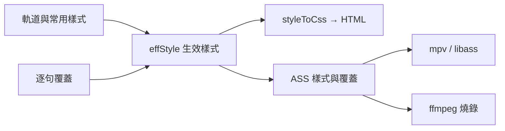
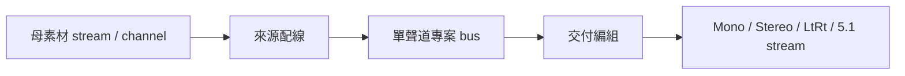
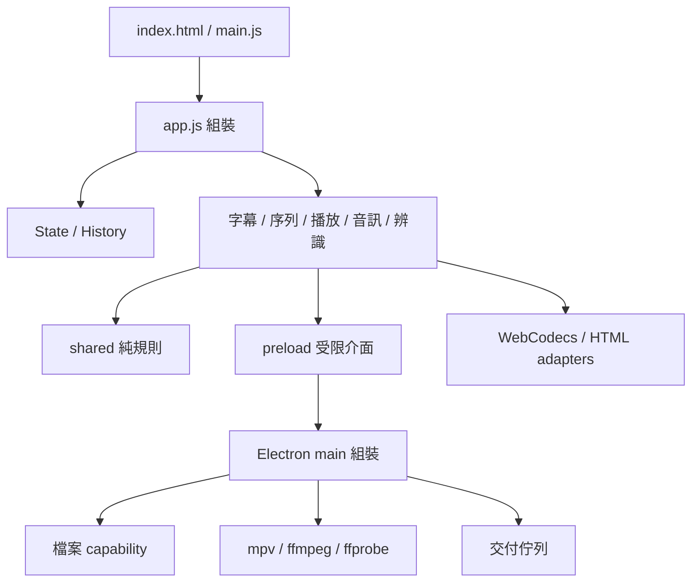
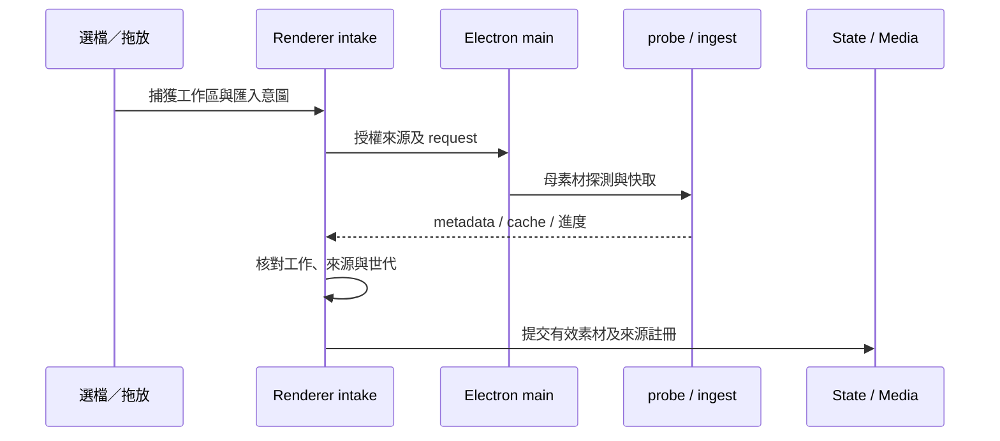

# SUB Tool 技術架構說明

本文件供維護者查閱不變量、模組責任、資料流及非同步所有權。閱讀某個領域前，先確認[領域詞彙](../CONTEXT.md)與相關 [ADR](adr/)；操作步驟見[使用說明](使用說明.md)，原生程序與 IPC 見[Electron 維護手冊](Electron_維護手冊.md)，環境及驗收流程見[開發與驗證](開發與驗證.md)。

| 要查的問題 | 閱讀位置 |
|---|---|
| 哪些錯誤會靜默破壞結果 | [§0 鐵律](#0-鐵律invariants) |
| 某項資料或工作由誰負責 | [§2 模組所有權](#2-模組所有權) |
| 專案、字幕與片段保存什麼 | [§3 核心資料](#3-核心資料) |
| 載入、播放、編輯及交付如何串接 | [§4 關鍵資料流](#4-關鍵資料流) |
| 影片疊層、畫格證據與記憶體 | [§7 WebCodecs 與 demux](#7-webcodecs-與-demux) |
| 時碼與來源原點 | [FPS／時碼一致性](FPS_時碼一致性.md) |

## 0. 鐵律（Invariants）

### 0.1 三路一致：預覽 ＝ mpv ＝ 匯出燒錄

字幕外觀的唯一規格來源是 `substyle.js` 的 `effStyle()`。軌道樣式、常用樣式及逐句覆蓋先合成生效樣式，再由 HTML／CSS 與 ASS adapters 各自表達；mpv 及 ffmpeg 燒錄共用 ASS 規格。



新增樣式欄位須同時驗證三路。CSS 與 ASS 可以有不同表示方式，預設值、繼承及數值規則仍只維護一份，不能各自補公式。

### 0.2 字幕縮放基準是畫面高 ÷ PlayResY

字幕畫布固定為 1920×1080。字級、框線、陰影、字距、行距及座標依實際畫面高度換算：`scale = outputHeight / 1080`。

禁止改用寬度比例。16:9 時錯誤可能被掩蓋，改比例、裁切或交付解析度後才會出現預覽與燒錄差異。

### 0.3 ASS Fontname 是字型檔內部家族名

`font/<資料夾名>/` 的名稱供 UI 顯示；ASS 的 Fontname 及 libass 必須使用解析字型檔取得的內部 family。名稱錯誤通常只會靜默 fallback，程式成功與字型正確是兩個判準。

### 0.4 Windows filtergraph 路徑要跳脫兩層

ffmpeg filtergraph 中的磁碟冒號與反斜線必須處理字串層及 filter 層，例如 `C\\:/...`。診斷時以 `spawn` 的實際 argv 重現；改用 shell 手動重試會再引入 shell 解析，不能直接比較跳脫字串。

### 0.5 時間域：外部是時間軸時間，播放器是來源時間

字幕、片段、播放點、In／Out、備註及交付使用時間軸時間。播放器及來源音訊內部使用來源時間；容器原始時鐘還須先完成來源原點換算。

```text
elapsed      = (timelineTime - clip.offset) * speed
sourceTime   = reverse ? clip.out - elapsed : clip.in + elapsed
timelineTime = clip.offset + (reverse ? clip.out - sourceTime : sourceTime - clip.in) / speed
```

`sequence-time.js` 提供純映射，由 `Seq` 及外部音訊共用；Media 在播放器介面轉換時間域。事件回報須先換回時間軸時間，不能讓 UI 自行解讀播放器秒數。來源原點、慢速畫格區間及精度見 [FPS 不變量 I4](FPS_時碼一致性.md#i4-靜止讀數同源於-mediadisplaytime)。

<a id="06-有產出不等於對驗證要看內容"></a>

### 0.6 有產出不等於正確

驗證要對結果內容作證，不能只看 exit 0、Promise resolve 或檔案存在。

| 看似成功 | 仍須核對 |
|---|---|
| 編出影片 | codec、FPS、聲道、實際片長、字幕及 PCM 位置 |
| seek IPC 成功 | 目前可見 presenter 是否真的交出目標格 |
| 截圖檔存在 | 原生 mpv 像素、凍結時間及疊層是否屬於同一畫格 |
| 兩份公式輸出相同 | 規則本身是否正確，是否應改用同一共用規則 |
| lint／test／build 全綠 | 根目錄 `index.html` 是否仍為來源入口 |

兩類真實事故說明驗證方法本身也會出錯：Electron 頁面截圖無法直接證明 OS 子視窗的 mpv 畫面；asar 解檔則曾在 v6.1.7（`dbc047b`，由 `074572d` 還原）及 v6.1.9（`9544570`，v6.1.10 還原）覆蓋來源 HTML，而建置仍成功。來源入口由 `tests/sourceEntryHtml.test.js` 檢查；完整事故與操作限制以 [AGENTS.md](../AGENTS.md) 為準。

### 0.7 顯示狀態看 computed style

作者 CSS 的 `display` 可以蓋過瀏覽器預設的 `[hidden]`。是否可見必須看 `getComputedStyle()`；已有 display 規則的元素，隱藏規則也要有相應的 `[hidden]` CSS。只看屬性會讓測試與使用者看見的結果不同。

### 0.8 音訊素材、專案 bus、輸出 stream 是三層



來源聲道、專案音軌及容器輸出 stream 不能互相當作數量或身分。`project-audio.js` 解讀來源控制、route、bus 及 placement；交付計畫只帶母素材。Proxy、播放快取及波形不是交付來源，主程序另拒絕快取路徑。

### 0.9 靜態圖片也是時間軸片段

圖片具有自己的時間範圍、軌道、幾何及淡化，在整段作用期間參與合成。它不是播放器暫停的一張 frame。

Windows mpv 是 OS 子視窗，透明 guide 視窗永久穿透滑鼠。圖片與字幕操作只由主視窗的 `#imageLayer`／字幕互動層承接，保持單一互動入口，不另建立 guide pointer IPC。

## 1. 執行架構

SUB Tool 使用 Vite、原生 ES modules 及 `vite-plugin-singlefile`，renderer 打成單一 `dist/index.html`。同一份 renderer 以 `window.subtool`／`IS_DESKTOP` 判斷桌面能力，在瀏覽器與 Electron 執行。



### Renderer

| 入口 | 責任 |
|---|---|
| `main.js` | 載入樣式及 `app.js` |
| `app.js` | 頂層組裝、DOM 綁定、ticker 及跨領域訂閱 |
| `state.js` | 專案狀態、選取介面及來源註冊規則 |
| `history.js` | 已提交快照、預覽投影與 Undo／Redo |
| `events.js` | 同步的進程內通知，沒有 replay |

低階模組不得 import `app.js`。具明確方向的呼叫優先使用模組介面；跨組裝層的命令或重繪由既有事件通知上層。介面不只包含函式名稱，也包含時間域、呼叫順序、取消資格及失敗結果。

### Electron

| 模組 | 責任 |
|---|---|
| `preload.js` | 透過 contextBridge 提供受限的 `window.subtool` |
| `main.js` | 視窗、IPC、能力及 native adapters 的組裝 |
| `file-authority.js` | 檔案讀寫 capability 與路徑權威 |
| `media-probe.js` | 探測結果與 probe 程序生命週期 |
| `media-intake-runtime.js` | Proxy、聲道、波形及串流 lease |
| `mpv-host.js` | Windows 原生視窗、來源時鐘及精準呈現 |
| `export-queue.js`、`delivery-runner.js` | 每份凍結交付的排程及執行 |
| `export-plan.js`、`export-artifact.js`、`export-watchdog.js` | 規格、成品處理及輸出終態 |

預覽 Proxy 使用 720p、無 B 幀及短閉合 GOP；一般 GOP 1，NVENC 為 GOP 2。這減少預覽解碼依賴，不改變實際畫格證據或交付碼率／GOP。原生整合細節集中於 [Electron 維護手冊](Electron_維護手冊.md)。

## 2. 模組所有權

下表提供找程式的入口；資料變更及非同步工作的細節契約見後續各節。

| 領域 | 主要模組 | 對 caller 的責任 |
|---|---|---|
| 選取與格網 | `state.js`、`time.js` | 互斥選取、明確 FPS revision、精確時碼 |
| 專案開啟與存檔 | `project.js`、`project-intake-engine.js` | 開啟意圖、資料准入、依序寫入及 dirty 基準 |
| 復原與重連 | `project-media-restore.js` | pending records、物件化交接及首次快照 |
| 素材載入 | `media-intake-engine.js`、`media-loader.js` | 工作資格、素材準備及載入提交 |
| 原生背景工作 | `media-intake-jobs.js`、`media-intake-view.js` | 專案 session、request、取消及進度歸屬 |
| 播放協調 | `media.js`、`transport-controller.js` | 時間軸意圖、可見畫格與音訊 follower |
| 呈現請求 | `media-presentation-core.js` | 最新 pending、取消、播放意圖及畫格 hold |
| 播放器 adapter | `media-player-adapter.js` | HTML／mpv 操作、來源時鐘及定位證據 |
| 序列與外音 | `sequence.js`、`sequence-time.js`、`external-audio.js` | 來源範圍、速度／反轉、切分及持久化 |
| 幾何與手勢 | `timeline-gesture-transaction.js`、`timeline-edit-transaction.js` | preview／commit／cancel 及欄位所有權 |
| 速度與反轉 | `clip-model.js` 的 `setClipSpeed()` | 准入、ripple、播放器完成與一次 History |
| 時間軸繪製 | `timeline-renderer.js` | gutter、片段、波形、字幕及播放點 |
| 字幕資料 | `subtitle-model.js`、`subtitles.js` | 時間准入、文字、樣式、鎖定與選取 |
| 字幕移除確認 | `subtitle-removal-guard.js` | UI 同意與原文件身分，模型維持同步提交 |
| 樣式 | `substyle.js`、`subtitle-style-engine.js` | 生效樣式及三路表達 |
| 常用樣式 | `preset-library.js`、`style-panel-controller.js` | 樣式庫草稿、原目標及全軌確認資格 |
| 對話框 | `ui.js` | session、關閉／替換與非同步結果歸屬 |
| 字幕比較 | `electron/compare-window.js`、`compare.html` | 最新快照及建立操作時的 revision |
| 圖片與截圖 | `image-compositor-engine.js`、`video-renderer.js` | 共用層序、幾何、淡化與同格擷取 |
| 音訊播放 | `audio-engine.js`、`audio-placement-playback.js`、`audio-reverse-playback.js` | 真正聲音節點、獨立 placement 時鐘及釋放 |
| 音訊規則 | `project-audio.js`、`audio-routing-engine.js` | source → bus → output，完整編輯 session |
| 音訊效果 | `audio-effects.js`、`shared/audio-loudness.cjs` | 每來源效果、取消、有效結果及母素材規格 |
| 人聲波形 | `vocal-waveform-source.js`、`vocal-waveform-worker-client.js`、`vocal-waveform-worker.js` | 分段 PCM、FIFO 推論及可取消的來源峰值 |
| 語音與原稿對齊 | `speech-recognition-engine.js`、`speech-recognition-session.js`、`transcript-alignment.js` | 供應商 adapter、凍結工作與一次提交 |
| 交付提交 | `delivery-submission.js`、`delivery-list.js` | 同步凍結、衝突檢查、逐列 ACK 及重試 |
| 交付編譯 | `delivery-job.js`、`export-job-engine.js`、`electron/export-plan.js` | 範圍、音訊、時長、容量及相容格式 |
| WebCodecs | `decode/player.js`、`decode/demux.js`、`decode/source-frame-index.js` | 畫格、呈現索引、有界讀取及釋放 |

### 專案儲存與對話框

#### 開啟意圖與資料准入

`Project.open()` 在確認、picker 及 IPC 讀取前建立意圖，工具列、最近專案、OS 開檔及拖放共用。較新開啟、取消或工作區替換會撤銷舊讀取；期間新增已提交編輯須再確認，單純移動播放點不算新增修改。冷啟動在等待引擎前也先建立意圖。最近清單另核對讀取序號及原 DOM 節點，路徑授權仍由 main 決定。

載入在清空 State、開始新 generation 或提示缺字型前驗證根物件、record 成員及安全整數索引。字幕依 schema 的零／一基語意判斷。明確軌道 records、宣告軌數及實際引用共同產生建軌計畫，兩類軌道合計最多補建 1,024 筆未宣告空軌；這是舊檔修復額度，完整軌道陣列可大於此數，不能把它當 UI 或總軌數上限。

`cues:[null]`、無限或 Array domain 外索引、過量補建需求直接拒絕，保留目前專案、History、視窗及背景工作。合法舊數字字串轉為索引，負數維持原有修復相容性，其餘走既有遷移。接受 FPS 後先同步正規化字幕，再建立初始 History 及儲存基準。

#### 存檔、dirty 與媒體復原

`save()`／`saveAs()` 在呼叫時凍結資料並依序寫入，以實際寫入快照作為已儲存基準。空軌名稱、樣式、格網與交付範圍仍是專案內容；播放點差異不算 dirty。存檔期間繼續編輯、刪光原內容都不能被舊寫入標成已儲存；新專案撤銷舊寫入更新目前路徑的資格。丟棄前若選擇儲存，必須確認成功且期間無新修改。

`ProjectLoadSession.restoreMedia()` 及 `project-media-restore.js` 在第一個媒體等待前建立文件基準，再依序處理主素材、pending placements／固定幀、外音及播放點。復原 metadata 透過事件補入首次及已有編輯快照，不重設期間的 Undo；來源註冊沿用 State 的同次 ID 分配。真正存檔時則保留該次實際 bytes 基準。完成不等待一般背景 Proxy 或人聲分析。

首次可呈現時透過 Media 的定位介面還原保存播放點；舊檔缺播放點則取時間軸零點，由序列映射到片段 In 或開頭間隙。初始化不強制播放，也不等待背景 Proxy。載入等待期間較新的使用者定位優先，後續 ready／重連不重設初始位置；保存播放點只在原工作真正呈現成功後消耗。

未取得素材留在復原計畫，存檔及重試都保留；同一進行中工作可共用，結束後可再嘗試，延後重連不重建基準。record 身分標記已交接 placement，其餘才用 pending metadata，不能按路徑去重。每筆交接後歸 runtime／History 持有，後續載入失權不能回滾已交接片段；只清理該次等待回傳但尚未交接的實體。Undo 還原後只保存一次，使用者明確刪除也不由 pending 加回。

主素材的檔案選取與拖入共用 `media-loader.js` 匯入入口；延後重連時都沿 `Project.continueLoad()` 交接同一復原計畫，完成後才消耗重連狀態，不能另走未帶計畫的取代載入。

匯入第一支影片時保留既有圖片及外音、URL、效果、波形與有效背景工作；取代影片或換專案才完整 reset。選檔、lazy import、原生授權及批次每個 await 前後均核對工作區。單影片批次先完成加入／取代選擇，再加同行音檔及圖片；明確取消影片仍可保留同行匯入，失權或視窗被取代則停止舊批次。

#### 對話框及延遲命令

`openModal()` 回傳 session，非同步完成後用 `isCurrent()` 判斷或由該 session 的 `close()` 收尾。一般關閉走 `onDismiss`，被取代走 `onReplaced`。父子音訊配線視窗明確交接同一編輯，其他替換撤回草稿。缺字型提示關閉、替換或換專案須結束等待。

延遲刪除、複製軌道、新專案確認、字幕右鍵及空白時間軸新增均持有原工作區、軌道、字幕／片段物件與 revision；Undo 重建相同 ID 也不恢復舊資格。片段提交再核對兩層鎖定與目前同軌鄰片，不能由其他軌片段限制 Trim。字幕移除確認由 `subtitle-removal-guard.js` 保留原文件內容及物件集合，確認後才呼叫原模型提交；不以當下新選取替換舊目標。

字幕匯入的 FPS 留在草稿，目的軌確認後才和新字幕一起提交；取消不改格網，期間明確格網變更使草稿失效。匯入序號與工作區資格同時核對，picker 選取、取消及再次使用恰好結束一次。字幕編輯／辨識視窗的延遲初始化只操作自己的 session；關閉辨識視窗保留工作，換專案才取消。

快捷鍵設定的每次錄製、刪除、預設還原或匯入都更新草稿 revision；關閉、重開移除舊 Escape listener。較新匯入即使取消仍撤銷舊讀取，遲到成功或失敗不能覆寫新草稿。搜尋快捷鍵與工具列共用 `commands.js` 入口、焦點與 `mpv:sync`，原生影片讓位／恢復規則只維護一份。

字幕、軌名、備註、dB、搜尋及批次欄位尊重輸入法 `isComposing`／舊式 `keyCode:229`；組字 Enter、Escape、方向鍵不作為提交或切分。共用 `setupTimecodeInput()` 在 capture 階段保護動態時碼 editor，caller 不搶先確認或增減影格。

#### 字型與樣式庫

缺字型檢查先等共用字型載入，再比較實際字寬；`document.fonts.check()` 不能作為已安裝證據。專案及樣式庫遷移前驗證單筆形狀，毀損樣式不應中斷整份專案。

常用樣式以內建／自訂、明確群組與名稱共同識別，名稱連字號不推測成群組。`substyle.js` 統一型別及合法值，一般專案保留合法歷史數值，ASS metadata 另做嚴格範圍驗證。套用的實際目標軌由字幕模組提供。

載入樣式庫共用進行中工作；儲存立即撤銷舊讀取及名稱遷移的回寫資格，暫時失敗可重試。重新命名／覆寫只合併原目標，保留等待期間新增項目；目標替換或名稱被占用時拒絕。樣式草稿持有原物件，只提交真正改過且仍保有原值的欄位；全軌套用確認保存實際字幕集合，新增、刪除或等量替換後須重新確認。

### 音訊配線編輯

`AudioRoutingModel` 的根 session 擁有完整草稿、基準及巢狀輸出還原點。project adapter 投影即時預覽，delivery adapter 只改該交付列。父子視窗往返不另開根編輯，根儲存才記一筆 History；取消還原完整設定。預設配置保留未選來源 bus，明確縮減 bus 才修剪配線。

bus 與輸出 stream 的持久 ID 為字串，內部遞增序號使用精確整數；超過 Number 安全範圍的合法 ID 不能造成重複或無限迴圈。來源註冊由 State 統一，編輯 session 將同次分配同步合併 root／child 基準及草稿，取消保留背景新增來源與對應 bus。History 不自行重新推測配線。

### 預覽與 History

`History.committedSnapshot()` 同時供 Undo、Project 存檔、備份及 dirty 使用。Project 合併待重連資料後投影已提交值，再計算影片／外音範圍及序列化；畫面仍讀 live State。

配線、字幕、片段及幾何預覽透過 projection 隱藏未提交欄位，背景工作可記錄自己的更新。確認先解除投影再記錄一次；取消只還原仍持有的欄位，保留其他工作較新的提交。`beginPreview()`／`beginAudioPreview()` 登記 owner 取消回呼，reset 先清除 live 草稿、增益、DOM 與 listeners，再建立基準；遲到 blur／pointerup 不能重新提交。覆蓋拖曳須先通過原手勢的 owner、欄位與鎖定驗證，才撤回預覽並建立刪除確認；確認不能讓已被 Undo 或背景提交撤銷的手勢重新取得資格。

影片拖放與選單換軌共用完整重疊位移計畫，先核對所有受影響片段及鎖定，不能移動一半才失敗。幾何交易分別處理片段頂層及字幕 style 子欄位，保留欄位不存在的語意與背景更新。軌高、字幕位置／旋轉核對最後寫入值，不能用舊整份樣式覆蓋新顏色。

`setClipSpeed()` 先核對原片段、軌道及 ripple，投影暫時速率與位移，等 Media 完成準備、方向及實際呈現後才提交一次 History 並回傳 `true`。視窗只交草稿、session 資格及 AbortSignal；取消同步撤回自己的資料，已送原生切換仍由原流程收尾，等待期間的新 seek 保留為最新位置。

`beginCueEdit()` 管理列表、時間軸與單句編輯的草稿及最後寫入證據。未改欄位合併背景提交，同欄競爭或途中鎖定不做部分寫入。背景辨識不切走有效 editor 的列表、選取及游標；辨識與稍後文字確認各自有 History。

字幕模型集中合法格網、上下限與至少一格；移動／複製保留既有時長，修剪才重算端點，跨 FPS 貼上以目的格網合法化。暫定終點在換選取或離開上字幕模式時也處理。`tcparse.js` 對不完整、非數字或超過四段的時間碼回傳 `null`，caller 不得提交。文字交換保存實際物件與原字串，Undo 同 ID 重建不恢復舊交換資格。

備註及批次文字編輯保留 DOM 草稿，核對工作區、物件、History 世代及原欄位；時間另核對 FPS revision。批次全數准入後才一次寫入，取消不回寫舊值。樣式面板立即記錄，`recordCoalesced()` 只合併同 owner 仍在 History 頂端的一筆；換選取、背景提交、Undo 或新專案後另建紀錄，回原值移除空步驟，500 ms timer 只結束合併期間。

Mixer 只讀 project bus；初始化建軌由 `AudioPipeline.registerSource()` 經 State 規則完成。零軌配線與圖片專案保持零軌，重繪不能改寫預覽、取消或 Undo／Redo。bus 音量交易持有原 bus、工作區、History 世代及最後值，未改的 dB 顯示不因四捨五入改寫原 gain；單筆及全部音量提示共用 session。

### 交付計畫與成品階段

`prepareDeliveryPayload()` 是入列與 `buildDeliveryArgv()` 共用的純規則：固定格式、音訊、TC 及有效片長一次決定。佇列保存 SMPTE 分號 TC，只有編譯 filtergraph argv 才轉句點。runner 傳完整工作，不能先猜格式；航空 codec／mux、DMPES transport profile、較長音訊尾端及光碟容量須在同一計畫相容。`airline-encoding.js`／`disc-encoding.js` 是內部規格實作，輸入能力仍由 main 驗證。

`delivery-submission.js` 同步凍結專案、管理目錄衝突世代、重複送出、工作編譯及逐列 ACK；`subio.js` 接 adapters 與視窗。清單保留列物件、revision 及規格收據，ACK 後只回收未改的原列。失敗／取消保留未接受項目，重試不重送已接受工作；改回原值、刪除後重建及新草稿都不屬舊收據，失權停止後續送出。

`subtitle-audit.js` 掃描完整區間，長句包住多個短句也標出每個受影響字幕。H264-MP4 固定經編碼計畫，快照未證明來源 codec 及封包終點，不能猜 stream copy 安全。

影片、圖片及外音的切割保留原淡化時鐘；左修剪移動視窗偏移，交付範圍裁切再疊加。`delivery-job.js` 產生原始時鐘，`export-plan.js` 在 fade／afade 前暫時還原，再回輸出 PTS，截取中段不重新淡入。明確改淡化或交叉溶接才建立新視窗，取消與 History 同步保存偏移。

交叉溶接僅接受有限正時長，重疊不超過兩片段速度換算後的時間軸長度。UI 與模型使用相同上限，一格短片段不能被固定秒數下限推到前段結束前就消失。凍結工作保存圖片／影片的原始尺寸、幾何及軌道可見性；隱藏畫面不交付，聲音仍依獨立配線。

音訊 delay 後先以連續 sample 時鐘建立 PTS，再裁切交付範圍；`adelay` 的前置靜音可能無 PTS，若只以首個有效 PTS 歸零會提早聲音。驗證要比較實際 PCM 位置與淡化曲線。

成品準備與收尾共用生命週期，取消須等準備的原工作安全收尾。watchdog 擁有 lease、程序存活及終態；artifact 只透過它提供的寫入及程序登記處理封裝與驗證。光碟編碼／製作進度統一換算，不能在編碼結束便宣告 100%。每份獨立程序的原因與代價保留於 [ADR-0001](adr/0001-每份交付各自一個-ffmpeg-程序.md)。

### 音訊效果與背景工作

#### 來源、效果與配線

來源保存母路徑及 `audioLimiterSpec`，包括 stream 量測結果；專案、History 及交付共用 `audio-loudness.cjs` 正規化。匯出從完整母 stream 套效果，再分聲道、裁切、gain／fade，不能裁完重新量測。

`audio-effects.js` 按來源身分接受最後一次操作，不同來源可並行。成功準備才安裝播放器及提交效果，失敗保留原效果。Undo、還原或換專案取消舊工作，每次 await 後核對來源物件、母路徑及世代；main 用 sender／request 隔離進度與取消。重開／Redo 及快取遺失按保存規格重建，不新增 History。

所有 HTML、解碼 buffer 及 native WAV 母音沿 Media 安裝入口。已有有效效果時，晚到原音只留作還原來源，不能接回監聽或替換效果波形。瀏覽器追加影片先安裝原音及配線，再選擇性解碼波形；大檔略過或失敗仍可播放。多 stream 先展開原始聲道，不先混成立體聲；Wave 接完整 decoded buffers，短 stream 尾端補零。

#### 播放聲音的唯一 owner

AudioEngine 管理 element、buffer、反向音訊及 scrub。停止、起播及新的 scrub 會撤銷舊短聲音的 metadata、play Promise 與 timer；素材快取仍可供下一次合法操作使用。逐格沿專案 source／bus gain、mute 與配線，不另繞過規則。

同源替代音軌才抑制 native；其他外部配音不能關掉主影片。背景快取未就緒、runtime tracks 為空時，原播放器也按已註冊來源配線判斷 bus mute／solo、停用 route 及零音量。來源 mute 綁定所有存活 placement，刪除 primary、Undo／Redo 及交付均保留，同路徑獨立來源不互相影響。

播放中的 seek 由 presentation session 暫停 follower，畫格完成後只沿最新 play／pause 意圖起播。Media 的 element／buffer 起播入口拒絕 pending 期間的背景重啟，防止同一目標先播放、再由 resume 重播。

同源重疊 placement 各有獨立 voice、速率、來源時鐘及淡化，共用母音資產、source gain 及 bus 配線。`audio-placement-playback.js` 持有 clone、metadata 與釋放；起播意圖只消耗一次，seek 觸發的 `canplay` 不能再強制定位。疊合結束交回原元素前先停掉並釋放 clone，scrub 取消須停止全部 voice。所有類型遵守 trim out。

反轉片段的原音由 AudioEngine 準備並接回原配線，序列映射至裁切後反向音訊。桌面 `clip-audio-cache.js` 以來源證據、升冪範圍及 stream 隔離 WAV；mpv 反向畫面靜音，由獨立音訊發聲。交付只帶母路徑、原聲道及 reverse，裁切後反轉／變速，gain／fade 仍是時間軸秒數。解除影音的 placement 保留速度及方向，切割、重連及邊界起播均交給 AudioEngine；反向波形以升冪桶界線保留橫跨峰值。

解除連結等待期間若同一來源配線改變，整批外音撤銷並保留新配線，避免各 placement 繼承不同版本；其他來源的配線編輯不撤銷此工作。解除影音與外音切割在建立新來源時就透過登錄意圖繼承配線，配線 editor 各自在原基準及 live 草稿重播；取消、History 與存檔保留已提交配線，不將預覽草稿寫成新來源的永久設定。

#### Proxy、聲道與取消

`media-intake-jobs.js` 為原生 ingest／streamIngest 配上工作區 session 及 request ID，結果、進度與 stream completion 必須仍屬於同一工作。串流完成可早於 IPC 回覆或影片 metadata，loader 持有並恰好安裝一次；失敗、reset 或換檔撤銷 listener，其他 job 不可安裝。

換專案的 reset 及取消 Proxy 先在 renderer 撤銷舊資格，再通知 native 停止舊 session；新專案不等待舊編碼自然完成。同專案先加入外音、再加入第一支影片的 `keepExternalAudio` 分支保留既有外音與其背景工作，不視為換專案。已提交 mpv 的時鐘 listener 另持有素材／transport 資格，取消 Proxy 不能切斷正常播放回報。

native 寫入及程序 close 的安全屏障仍由原生 owner 持有。Proxy 進度有自己的 view 與取消入口，不借用交付鎖；操作及原生細節分別見[使用說明](使用說明.md)與[Electron 維護手冊](Electron_維護手冊.md)。

### 人聲波形的顯示邊界

`Wave` registry 保存 MIX／聲道／人聲選項及完整來源 100 Hz min/max，不寫入 State、History 或專案。片段顯示仍按來源映射，整列選擇與單來源選擇分開，混用狀態明示。

即時波形只擷取能隔離單一正向 placement 的來源增益前 analyser；master 已含重疊、bus、效果及淡化，不能寫成母素材峰值。沒有原音訊號時略過，保留完整峰值。

`vocal-waveform-source.js` 讀母素材，每次桌面取得 30 秒中心及前後各 2 秒 context 的 44.1 kHz 立體聲 PCM，不使用 4 kHz 波形快取。Mono 控制項依 stream／channel 還原配置後才混合，避免左右反相被錯當多 stream 相加；成功解碼 EOF 按位置補零。

同母素材切片共享工作及各自訂閱，最後訂閱者離開才取消。`VocalWaveformClient` 以單 Worker FIFO 管理整份來源，包括 PCM 讀取；取消排隊只移除自己，取消進行中工作先完成通知再准入下一份，晚到 PCM 不改新 owner。正常完成保留已載入模型。

Worker 使用固定模型及 SHA-256 驗證的 IndexedDB 快取；讀寫 1.5 秒上限包含 open、upgrade 及 transaction。阻塞／失敗視為未命中，逾時及晚到連線釋放；下載及命中都驗完整雜湊。PFFFT STFT／ISTFT、UVR MDX 分離及 Silero VAD 的依據見[模型研究](research/人聲波形模型研究.md)。重疊窗涵蓋尾段，桶數按整數 sample，避免 30.07 秒尾端溢位；降採樣處理左右極性抵銷。

取消終止 Worker 及失去訂閱者的 native PCM，registry 身分、母路徑與世代攔住晚到結果。分析期間保留原波形選擇及峰值，全部完成才提交人聲選擇；取消、失敗或另選波形撤銷該意圖。

完整峰值及最後選擇另存有容量限制的 IndexedDB。鍵包含可信母素材證據、stream、完整時長及模型／演算法版本；桌面證據核對授權 stat 與前／中／後內容。讀取驗長度、數值及摘要，毀損視為未命中；舊讀取不能按 key 刪掉等待期間的新寫入，淘汰由寫入交易處理。重登錄只恢復有效快取，不自動推論；新操作或 reset 撤銷舊恢復。播放、效果及交付不讀此顯示狀態。

## 3. 核心資料

### State

| 資料 | 持久內容 |
|---|---|
| `tracks`／`cues` | 字幕軌、內容、時間及樣式 |
| `videoTracks`／`clips` | 視訊軌與影片／圖片配置 |
| `audioProject` | bus、來源配線及輸出編組 |
| `externalAudioState` | 外部音訊的序列化配置；runtime 素材由 Media 持有 |
| `notes` | 備註文字及時間 |
| `fps`／`dropFrame` | 專案時間基準 |
| `viewStart`／`pxPerSec` | 時間軸視窗與縮放 |

選取欄位只能經 `setSelection()`、`deselect()`、`pruneSelection()`、`focusTrackKind()` 修改。Media 的內部欄位也只能由明列內部模組存取；其他 caller 使用 `activeClip()`、`inGap()`、`mpvPresenting()` 等公開查詢。兩道 lint 圍籬的例外以 `eslint.config.mjs` 為準。

### Cue

字幕保存 `id`、`start`、`end`、`text`、`track` 與可選逐句 `style`。`timed:false` 明確表示沒有可信時間碼，不能補成假的定時字幕。

### Clip

片段以 `offset`、`in`、`out`、`vtrack` 表達來源範圍及時間軸配置，另保存速度、反轉、淡化、幾何與來源身分。影片可以有來源 FPS、母路徑及 runtime Proxy；圖片及固定畫面仍參與相同視覺計畫。

### Project snapshot

`.subtool` 保存可重建、可遷移的專案內容；未連結素材仍可保存。DOM、Web Audio node、Blob URL、解碼 frame、FFmpeg process、mpv handle 及進度不能成為持久資料。

檔案最前面的 `SUB Tool`／`User Name` 是存檔環境識別資訊，與 `version` 的專案 schema 各自獨立。桌面由 `createProjectWorkspace()` 在已准入的實際寫檔入口注入 `app.getVersion()`／`os.hostname()`，不把開檔時的舊環境資訊寫回，也不加入 renderer 的 dirty／History 比較；網頁下載則記錄建置版本並標示無法取得電腦名稱。

## 4. 關鍵資料流

### 媒體載入



載入完成與背景完成是不同階段，取消資格也分層持有。素材可以已提交並正常播放，而其 Proxy、聲道或波形仍在背景準備。

### Seek 與逐格

意圖先在時間軸格網吸附，序列映射來源，再由目前可見 presenter 提供畫格證據。UI 可即時投影目標；`presentedTime()` 及音訊 resume 必須等待呈現。單次 in-flight、最新 pending、一般／逐格容差及時鐘原點的完整契約見 [FPS 文件](FPS_時碼一致性.md#3-呈現生命週期)。

### 時間軸手勢

`pointerdown → 捕獲目標及選取 → 超過門檻才預覽 → pointerup 一次提交`。Escape、`pointercancel` 或失焦撤回自己持有的預覽，click 只選取或 seek。圖片／字幕拖曳只接受啟動 pointer；失效後晚到事件不再提交。

`beginGeometryEdit()` 共用欄位證據與 History 投影，DOM adapter 保留座標換算及 clamp。軌道重排取消時清掉目標、提示與 listener；正常完成才更新順序、字幕索引及列表軌。重排與軌高手勢只接受主鍵，右／中鍵不能觸發拖曳或雙擊重設。

### 字幕樣式

樣式先合成 `effStyle()`，再送三路。單句視窗顯示生效樣式，確認只提交相對開窗值的實際變動；未改欄位保留繼承，未提供控件的座標／角度也不重建。字幕搬軌先保存原生效外觀，目的軌預設不能改變它；鎖定拒絕搬移，整組一次 History。

ASS 的標準表示與自產 metadata 分別由 `formats.js` 及 `buildSubtitleImportPlan()` 處理。同格率可還原整數 frame，匯入既有軌道則保留原生效樣式；合併多來源軌時仍使用有效 metadata，將各句來源軌的生效樣式保存為逐句覆蓋，合到單一目的軌並保留未定時原稿。失效 metadata 回退。取捨見 [ADR-0002](adr/0002-自產-ass-無損往返.md)。

### 語音辨識與文本匹配

UI 接受工作時凍結素材區間、來源聲道、原稿、供應商設定及 FPS／DF。開窗至開始之間保留原來源，接受時才取得最新 metadata 與 runtime 聲道；已接受工作則保留當時的區間與音訊 URL，不跟隨播放器替換。`speech-recognition-session.js` 管理 identity、取消／替換、狀態、逐素材進度及恰好一次提交；UI 觀察不可變快照，公開進度遮蔽憑證、路徑及原稿。

辨識視窗統一解析來源聲道，右鍵、工具列與視窗內切換素材不由 caller 組裝播放資料。供應商金鑰與導引各有本次視窗草稿，切換不重讀持久設定；開始才保存目前選擇，取消或被替換仍放棄未提交草稿。

`speech-recognition-engine.js` 接供應商／本機推論，`transcript-alignment.js` 只決定原稿行的時間證據及品質。無可靠時間保留原文字為無時間碼字幕，不能改寫行界、標點及順序。結果先映射回時間軸，以工作凍結格網交給既有提交介面；視窗重開不變更工作規格。辨識音訊選擇不改監聽、專案配線或交付。

### 匯出


工作送出後與 live project 脫鉤。renderer 準備字幕及規格；main 持有權限、argv、process、lease、成品驗證及終態。

## 5. events.js（同步事件匯流排）

事件是同步、進程內且沒有 replay 的通知。新增 emit 前確認訂閱者，不為同一件事增加別名；State 變更及 render 通知應在同一交易邊界完成。

| 事件 | 發送者與消費責任 |
|---|---|
| `render:*`、`timeline:invalidate` | 模型通知 view 重新計算字幕、樣式、metadata 或幾何 |
| `action` | UI／快捷鍵交由組裝層派送命令 |
| `media:*` | 播放點、素材、presenter 及來源狀態 |
| `audio:busChanged` | Mixer 通知 Media 重套 gain 及音軌／時間軸重繪 |
| `audio:sourceRegistered` | State 提供同次註冊，配線 session 合併草稿／基準，History 僅在首次復原補入自動配置 |
| `media:projectClipRestored` | Media 交接已物件化 record，History 補原始 metadata 並保留期間編輯 |
| `media:intakeJobs` | 背景工作狀態送專責進度 view，不接管交付生命週期 |

## 6. 桌面版與網頁版

| 能力 | 網頁版 | Electron |
|---|---|---|
| 預覽 | HTML video／WebCodecs | HTML／mpv／WebCodecs |
| 非原生與大檔 | 受瀏覽器解碼、記憶體及格式限制 | 母路徑、ffprobe／ffmpeg、串流及 Proxy |
| 多聲道 | 依瀏覽器／解碼能力 | 來源 metadata 與逐聲道快取 |
| 檔案存取 | File API／下載 | preload 與 main capability |
| 交付 | 瀏覽器可下載的輸出 | 持久背景 ffmpeg 佇列 |

Renderer 拿到路徑字串不代表有讀寫能力，授權須由 main 裁定。差異在 adapters 處理，共用的字幕、時間軸、樣式與音訊規則維持同一份。

## 7. WebCodecs 與 demux

| 模組 | 責任 |
|---|---|
| `demux.js` | MP4 metadata、sample 位址及 edit list 的呈現樣本 |
| `sample-index.js` | 時間／sample 查詢及 keyframe 索引 |
| `source-frame-index.js` | HTML／mpv／WebCodecs 共用來源區間與有界快取 |
| `player.js` | decoder、frame lease、預取及完整可見 stack 繪製 |

`visualStackPlan()` 決定共同層序。圖片全在影片上方時可由 DOM／guide 疊入；位於下方或中間時 Canvas 繪製完整 stack。每個可見影片須以 timestamp 及區間涵蓋來源目標，各來源 FPS 不必相同；圖片須載入並繪製。全部完成才發布新 Canvas 及 `Media.previewComposition()`。

舊 frame 非空不代表適用新時間。已接管且尺寸不變時，途中失敗保留上一張完整畫面；已合成圖片的 bitmap 隱藏，但 wrapper 與控制點保留。原點與 PTS 細節見 [FPS I4](FPS_時碼一致性.md#i4-靜止讀數同源於-mediadisplaytime)。

長片使用串流索引，`SampleReader` 合併同位元組視窗並有 LRU。淘汰／dispose 取消 IO，舊讀取失敗只能清自己的 entry，不能刪新重抓資料。播放可提前準備下一疊層區，所有層就緒才接管；離開預覽工作集後釋放 decoder、frame 及位元組視窗。

### 擷取同一張畫面

`capturePreviewFrame()` 依 `mpvPresenting()` 及真正可見的 Canvas／HTML 選擇來源，`mpvMode` 只代表能力。擷取凍結 Canvas、composition 時間、圖片身分及 FPS／DF；保留舊畫面時不混入新時間圖片，也不重畫已合成的半透明圖。無 composition 時以 `displayTime()` 凍結圖片計畫。

HTML 擷取另凍結 `previewFadeDarkness()`，只淡化影片層；原生／Canvas 已含淡化。圖片共用 `imageLayerPlan()` 軌道裁切及 `fadeAlphaAtTimeline()`，放大圖片仍不得超出 PiP 框。native 畫格 hold、像素及輸出 reservation 的細節見 [Electron 維護手冊](Electron_維護手冊.md)。

## 8. 字幕渲染細節

文字不自動折行，只保留明確換行。`STYLE_DEFAULTS` 及正規化由 `substyle.js` 管理，HTML 轉 CSS、mpv／燒錄轉 ASS。背景先算整段文字框，再向外擴張。

`subtitle-preview-index.js` 按呈現影格查詢作用字幕；編輯、匯入及 Undo 使索引失效，不在每幀掃全部字幕。樣式仍由生效樣式規則決定。左／中／右 × 上／中／下的對齊，以及直書、背景、框線、陰影、旋轉、字距及行距都須三路矩陣驗證。

## 9. shared/

`shared/*.cjs` 只放 renderer 與 main 確實需要的同一條零相依純規則，涵蓋聲道展開、音量效果、淡化、視覺片段、交付格式／格率／解析度、幾何及來源原點。完整清單及加入條件以 [shared/README](../shared/README.md) 為單一來源。

CSS／ASS 是同規格的不同表達；檔名淨化／路徑圍堵是不同層的安全防線。不能只因相似就合併，也不能讓 shared 取得 DOM、Node I/O 或 capability 狀態。

## 10. 驗證策略

| 層級 | 要證明的內容 |
|---|---|
| 純規則 | 數值、格網、狀態機、合法範圍與極端資料 |
| 介面回歸 | 正式 caller 的提交、取消、競爭及 Undo／Redo |
| 共享契約 | renderer／main 同一規則及 CSS／ASS 三路表示 |
| Repository | 來源 HTML、目錄、命名、連結及安裝包內容 |
| Renderer 真機 | 真實 DOM、computed style、鍵盤／滑鼠與對話框 |
| Native／媒體 | 實際畫格、PCM、聲音數、ffprobe 成品及程序釋放 |

新增測試要跨過真實 caller 使用的同一介面。對非同步修復先得到可重現紅訊號，再證明舊結果失效、資源釋放及新工作可繼續。播放既看目標，也看實際 presenter；音訊既看節點數，也看 PCM 位置與內容。

lint、完整測試、build、CDP、大檔與安裝驗收的命令及順序集中於[開發與驗證](開發與驗證.md)。文件中的成功紀錄不代替新變更的驗證，文件版號及歷史則以 manifest 與[版本變更紀錄](版本變更紀錄.md)各自負責。
